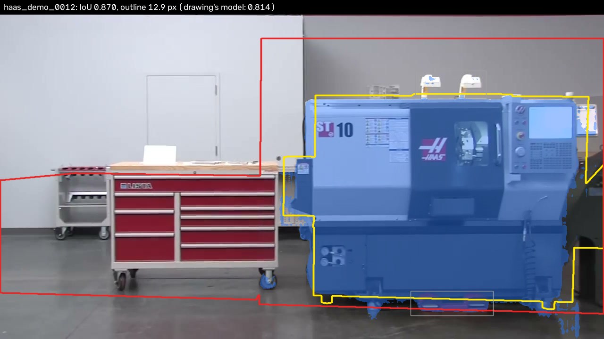
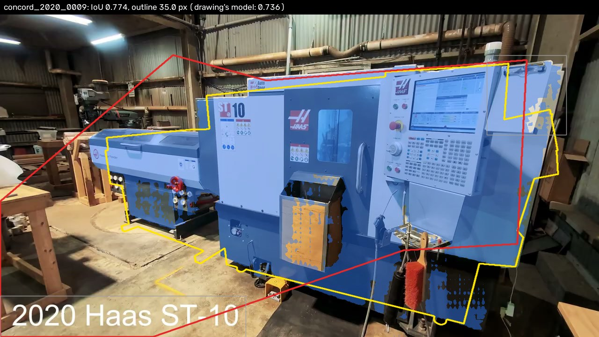

# The Haas ST-10, refined against Haas's drawing and footage (#367, PR #373)

Sterling, on PR #373 (2026-11-22): "Your model of the machines probably need to be refined, especially. Estimating
camera intrinsics of a video that shows the same kind of machine in action, looking at keyframes of tutorial videos on
usage of the machine, all using the raspberry Pi with headed chromium and mouse automation as needed, doing model checks
of volume overlap. Aiming for high perfection on the overlap between our model and the different images considering
those camera intrinsic corrections and maybe doing a background removal before doing that comparison."

## What the model was, and what it is now

**Before:** `lathe_parts()` drew the lathe as one 3437 × 1596 × 2167 mm box: Haas's *installed* envelope, chip
conveyor and all, as a block. The door was a 1140 mm panel. The pendant stood on the headstock side. A 2104 × 1283 ×
1000 mm loader box sat beyond it.

**Haas's machine layout drawing** ([ST-10/15 MLD, 12/20/2024](https://haascnc.com/content/dam/haascnc/pdp_feed/mld/st-10_st-15_mld_12_2024.pdf),
pages 1, 3 and 9) gives the real shape. Its front elevation was read at 3.176 mm a pixel (200 dpi), which matches its
own dimensions to 1 %: 991 mm to the spindle, 680 mm to the sill, a 592 mm opening.

| | Before | Now (`machining_cell.ST10`) | From |
|---|---|---|---|
| Enclosure | 3437 × 1596 × 2167 box | **2160 × 1021 mm, roof at 1795** (a small box on the roof reaches 1842, 72.5 in) | elevation; plan's 40.2 in |
| Base | none | dark grey, 76-676 mm, on 3 in leveling pads | elevation |
| Door | 1140 × 870 panel | opening **592 × 956 mm**, sill **680 mm** (26.8 in); a 642 mm sliding door | dimensioned |
| Pendant | headstock side (wrong) | **right of the door**, 477 × 635 mm, **205 mm proud** (8.1 in) | elevation, plan |
| Spindle axis | 470 mm behind the front, 1050 up | **307 mm behind, 991 up** (12.1 in, 39 in) | dimensioned |
| Chip conveyor | a box inside the envelope's left end | out of the right end, **climbing to 1576 mm (62.1 in), dropping at 1064 (41.9 in)**; overall width 3423 against Haas's 3437 | dimensioned |
| Electrical cabinet | none | on the back, 270 mm deep (to 49.8 in) | plan |
| Spindle cover, left end | none | 130 × 490 mm box (the drawing's outline is larger) | footage |
| Bar Feeder V2 | 2104 × 1283 × 1000 box on the spindle line | 2104 long, 0-1283 mm deep on its stand, body 700-1150 mm, lid to 1250 | bar feeder page; heights est. |

In the cell (`lathe_parts()`), the outside is `st10_parts()` placed by `M_ST10`. The inside is ours, as before:
- the turret, tools, collet, catcher and belt follow the real spindle;
- the slant bed and its casting were narrowed to fit the 1021 mm depth, behind the turret's sweep;
- the belt leaves through a slot in the door's lower panel, since the real sill is at 680 mm, under the belt;
- the pendant is swung back against the enclosure (110 mm proud), clear of the blow-off station's post;
- the bins stand under the conveyor's head.

**The collision audit is 0 of 1727 frames,** arm and movers. The first try had 42 arm frames and 222 mover frames:
the turret's far-side tools in a slant bed set too close, and a fence moved to the pendant's face.

## Footage: fetched through the Pi

The OT-2 lid camera Pi that `frames.py` used left the lab on 2026-11-10. YouTube refuses the runner even a search
(HTTP 403). So `frames.py` now has a tunnel route (`FRAMES_SOCKS`), and the Pi only relays:
- `ssh -D` to the CubXL Pi (`frames.py tunnel`; the exit network is AS6510, Brigham Young University);
- yt-dlp through its own `--proxy`;
- the runner's ffmpeg under proxychains4.

Each frame is one range read of the 720p stream, 2 s apart. The storyboards of 9 videos came to 2.7 MB, and the frames
to a few MB more.

| View | Video | What it shows |
|---|---|---|
| `haas_demo_0012` | [Haas ST-10 Demo, 0:12](https://youtu.be/iF57Px06xck?t=12) (Haas Automation) | the ST-10 from the front, in Haas's showroom; no bar feeder |
| `concord_2020_0009` | [2020 Haas ST10 For Sale, 0:09](https://youtu.be/EwjfuTWPSV8?t=9) (Concord Machine Tools) | a 2020 ST-10 with auto door and the Haas Bar Feeder, from the front right, close, on a wide lens |

Frames from others' videos are not committed (`refs/.gitignore`). Their `"video"` and `"t"` fetch them again.

## The fit (`machining_fit.py`)

1. **Camera intrinsics from picks and verticals.** The picks are window and screen corners and the enclosure's
   corners. The camera is register.py's: a pinhole with square pixels, the principal point at the centre, and one
   radial term (fitted once there are 10 picks or the view asks).
   - Verticals in the frame (`"lines"`: door frames, the enclosure's edges, the wall corner) fix the tilt, and with
     it the focal length.
   - Picks on a flat front can't tell a camera above the floor from its mirror image below it. The first solve put
     Haas's showroom camera 3.3 m under the floor, so a camera below 0.3 m or above 4 m is now penalised, and a view
     can give a rough height (`"cam_z"`).
   - The close, wide shot needed a search from scratch (`global_camera`: 1215 cameras on a grid, the best 6
     refined). Its lens fits at f = 486 px, a 106° horizontal field, with k1 = −0.115 of barrel distortion. Haas's
     showroom camera fits at f = 1092 px (61°) with no measurable distortion.
2. **Background removal: SAM 2.** This is Meta's Segment Anything 2.1, large, via ultralytics, on the CPU at about
   17 s a frame. Its prompt is a box round where the picks' camera sees the model, and points on the body. The outline
   is SAM's own. A view's `"ignore"` polygons leave out what isn't the machine: the beacon lamps on Haas's roof, the
   foot pedals, a clipboard, the video's caption. Holes SAM leaves inside the outline (screens, decals, shiny panels)
   are filled up to 1.5 % of the frame. The bar feeder needed its own prompt points: SAM took the lathe without it at
   first.
3. **Overlap:** the IoU of the model's silhouette against SAM's mask, and the mean distance between their outlines. The
   silhouette is every triangle of the closed outside, projected through the camera, lens term and all. It is filled
   triangle by triangle, since OpenCV's even-odd fill cut each box's back faces out of its front.
4. **Refinement:** the cameras and 30 free dimensions alternate (Powell, three rounds). The loss:
   - 1 % of IoU costs 1;
   - an outline pixel 0.3;
   - picks at 5 px rms cost 1.
   
   Each dimension carries how far the drawing is trusted: 13 mm (Haas's ½ in) where it is dimensioned, 60 mm where it
   was read off the scale, 250 mm where it was guessed. The overall 135.3 in width is held as a sum.

## Results

**In 3-D first** (`machining_fit.py volume st10` → [`refs/st10/volume.json`](../refs/st10/volume.json); voxels on a
25 mm grid, both models placed by the spindle nose):
- **the old box and loader took 14.5 m³, the measured ST-10 and its feeder 5.3 m³;**
- **they share 4.8 m³, a volume IoU of 0.32;**
- 9.7 m³ of the old model was air in the real machine. Of the real machine, 0.46 m³ lay outside the old model:
  - most of it the bar feeder, which stands higher and further back than the old loader box (0.40 m³);
  - the pendant (0.03 m³);
  - the end of the conveyor's head (0.02 m³).

**Against the footage** (`refs/st10/fit.json`). Silhouette IoU went from **0.45 to 0.87** on Haas's showroom frame
and from **0.55 to 0.77** on the close, wide shot. The drawing alone does most of that (0.81 and 0.74); the fit adds
the rest.

| View | Lens (fitted) | Picks rms | Old box | Drawing's model, at the start camera | **Fitted** | Outline, fitted |
|---|---|---|---|---|---|---|
| `concord_2020_0009` | f 486 px (106° across), k1 -0.115 | 9.3 px | IoU 0.554 (76 px) | 0.736 | **0.774** | 35.0 px |
| `haas_demo_0012` | f 1092 px (61° across), k1 +0.000 | 12.5 px | IoU 0.445 (117 px) | 0.814 | **0.870** | 12.9 px |

The old box is scored at the same fitted camera; the outline distance is in pixels of the 1280 × 720 frame. What the fit would change (mm, against the drawing's values; `refs/st10/fit.json`): H -79, W -27, base_x0 -39, base_x1 -9, pend_z1 -12, scr_x0 -10, scr_z0 -7, scr_z1 +19, panel_x0 +37, win_x0 +28, win_z0 +12, win_z1 +15, conv_x1 +46, lcov_w +121, lcov_z0 -62, lcov_z1 -78, conv_head -22, conv_low +200, feed_z0 +38, feed_z1 +95, feed_lid +87.

## Still uncertain

- **Two views are not enough to trust the fitted dimensions.** Haas's showroom view is nearly square-on, so depth and
  focal length trade against each other. The close, wide view sees the bar feeder and the right-hand part but not the
  back. The cell keeps the drawing's values, and `refs/st10/fit.json` lists what the fit would change.
- **What holds the IoU down:**
  - parts of the real machine the model doesn't have: the auto-door housing on the roof, beacon lamps, the parts bin
    and tools hanging on the front;
  - the conveyor dark against a dark shop (SAM misses it);
  - SAM's own edges round the base, where the shadow and floor mat meet the machine.
- **The Bar Feeder V2's heights are estimates.** Haas's bar feeder page gives only its footprint.
- **More views, then the rest of the cell:** the back (electrical cabinet), the right end (conveyor), and a frame of
  the Bar Feeder V2 itself; then the same check on the UR10e, the Elmasonic P bath and the BINDER VDL 23.
