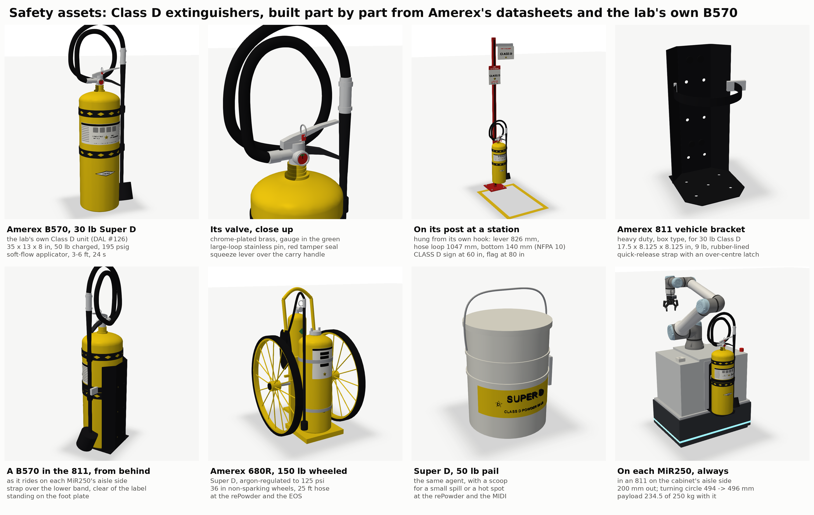
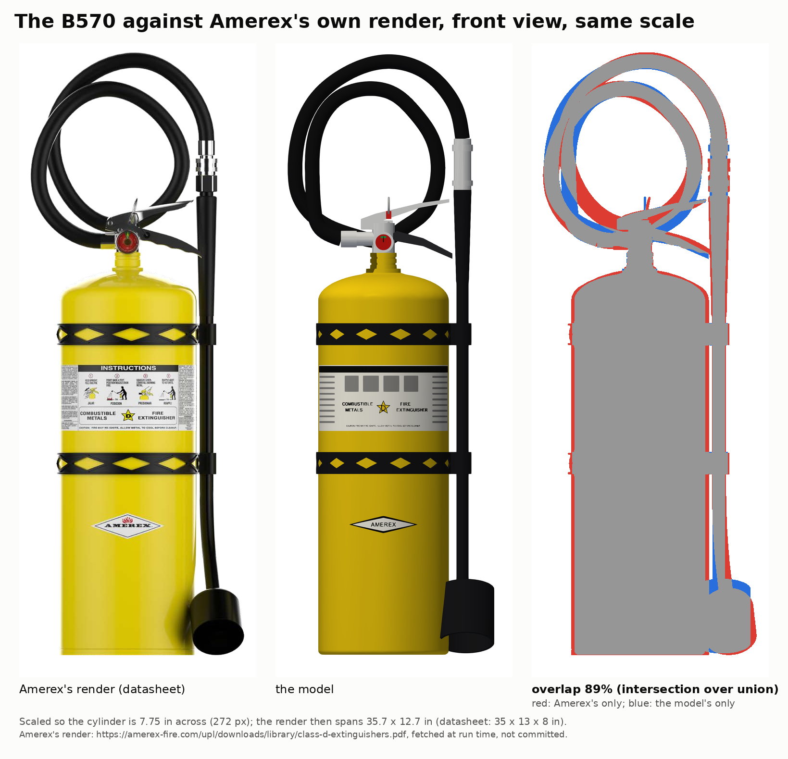
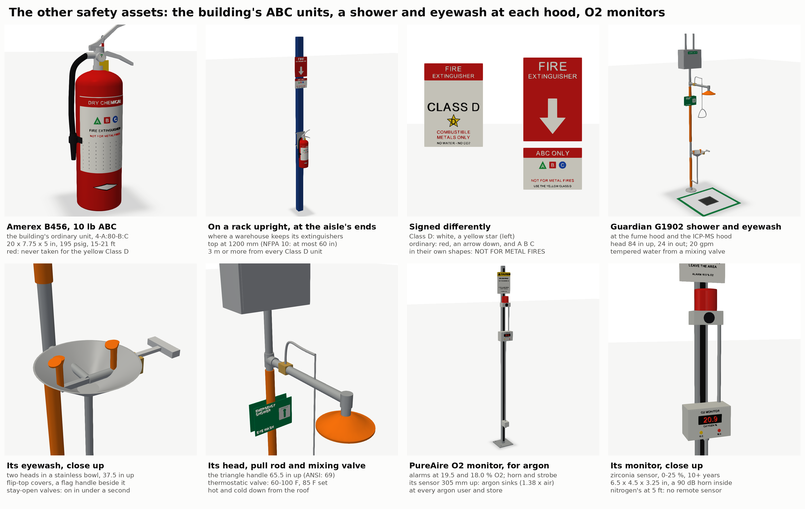
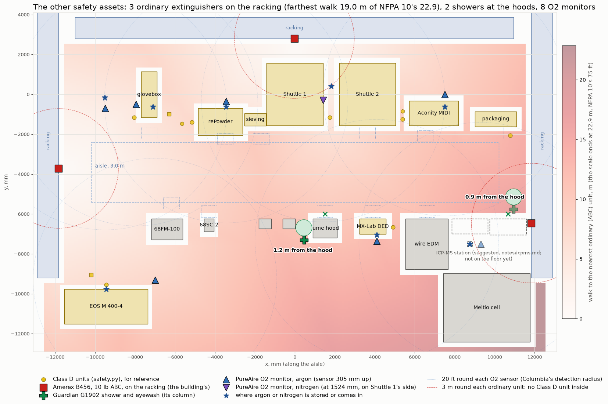

# Safety assets: Class D extinguishers at every powder station and on every MiR250 (#303, PR #318)

Sterling, on PR #318 (2026-11-20): "create a new PR focused on assets for safety. Class D fire extinguishers at each
station, etc. Focused primarily on faithful reconstruction / asset creation. Noting that we might even want to have a
class D fire extinguisher mounted at all times to the MiR250 and available for use, in addition to having these next to
each station that deals with powder."

The code is [`safety.py`](../safety.py) (the models, where they go) and [`safety_render.py`](../safety_render.py) (the
checks, the figures, the clip). The numbers below are in [`out/safety.json`](../out/safety.json).

## What's in the lab now

| Where | What | Why there |
| --- | --- | --- |
| Every MiR250 (both units; a third for floor cleaning, #366, would carry one too) | an Amerex **B570** in an Amerex **811** heavy-duty vehicle bracket, on the cabinet's aisle side | "mounted at all times to the MiR250 and available for use": whoever is near the robot has one, wherever it is working |
| Glovebox (floor) | B570 on a post, west of it | 0.9 m walk |
| rePowder atomizer | a **fire point** west of it: B570 on a post, an Amerex **680R** (150 lb, wheeled), a 50 lb pail of Super D with a scoop | the most metal and the finest powder in the lab; 2.2 m walk |
| Sieving cell | nothing of its own (see below); its docked MiR250's unit, the rePowder's fire point and the unit between the Shuttles | 4.0 m walk to the nearest fixed unit |
| Shuttle 1's opening (and Shuttle 2's) | a B570 on a post in the 800 mm gap between the Shuttles | 2.0 m walk; the floor in front of each opening stays clear for Kardex's extraction table |
| Aconity MIDI, its depowdering box, Shuttle 2's opening | a B570 on a post in the gap between Shuttle 2 and the MIDI, a Super D pail behind it | 1.7 m from the MIDI, 1.9 m from Shuttle 2's opening |
| Packaging station | B570 on a post east of its dock | 1.1 m |
| MX-Lab DED | B570 on a post east of it | 1.3 m |
| EOS M 400-4 | B570 on a post in front of it, a 680R beside it | 0.5 m; 100 kg of powder in its containers |

Not given one: the fume hood (Weck's reagent, no powder), the wire EDM (deionised water), both Instrons, the Meltio cell
(wire, not powder) and the ICP-MS station (acids; it has an eyewash and a shower instead, below). The building's own
ordinary extinguishers, kept apart from the Class D units and signed differently, the showers and the O2 monitors are
in [the other safety assets](#the-other-safety-assets-ordinary-extinguishers-showers-o2-monitors) below.


## The assets, part by part



### Amerex B570 (the lab's own)

- **Sources.** Amerex's Class D datasheet (`class-d-extinguishers.pdf`): P/N 16882, 30 lb Super D (sodium chloride
  based), 35 H x 13 W x 8 D in, 53 lb shipping, 195 psig, 3-6 ft range, 24 s, chrome-plated brass valve, "soft flow"
  extension applicator that "may be quickly detached to provide a straight stream", large-loop stainless pull pin,
  drawn-steel cylinder, wall bracket included. The lab's own unit (DAL #126; Grainger 8C249, $958.01, its box label
  "B570 30 LB SALT, BR VLV W/ WALL BKT, MARINE BRACKET NOT INCLUDED") and its photos, which show the red tamper seal on
  the pin and the red wall hook.
- **Shape.** Measured off Amerex's own render (the datasheet's picture, with its alpha mask), scaled so the cylinder
  is 7.75 in across: the render then spans 35.7 x 12.7 in against the datasheet's 35 x 13, and 7.75 in is inside the
  811 bracket's 7.5-8.5 in. So **the datasheet's 35 in includes the hose's coil**: the shell's head tops out at
  22.65 in, the squeeze lever at 27.0 in.
- **Parts:** the shell with a rounded foot and an elliptical head; the neck ring and the threaded collar; the valve
  body with the gauge (red face, green band, needle) to the front and the outlet to the left; the squeeze lever over
  the black carry handle, both to the right; the ring pin and the red tamper seal; the hose, a turn and a half, traced
  strand by strand from the render (two strands up the left and over the top), its second turn passing behind the
  valve; the quick-detach coupling, the tapered grip, the wand and the soft-flow cup, tilted 22 deg; the two black
  lattice bands with the clips that hold the wand; the instruction label (its header, pictogram panels, the D star,
  "COMBUSTIBLE METALS / FIRE EXTINGUISHER", the CAUTION line) and the Amerex diamond.
- **Checked against the render** ([`out/safety_b570_vs_amerex.png`](../out/safety_b570_vs_amerex.png)): an
  orthographic front view at the render's scale, silhouettes compared pixel by pixel. **89 % overlap** (intersection
  over union), from 77 % before the corrections it showed: the valve and gauge 25 mm lower, the hose's second turn,
  the coupling 700-777 mm, a larger soft-flow cup. What's left is the hose's exact drape and edge pixels. Amerex's
  render is fetched at run time and not committed.



### Its wall hook, the 811 vehicle bracket

- **Wall hook:** the red J hook shipped with the B570, after DAL's model (2 in wide, 0.09 in steel, a back plate
  4.5 in below the seat, three holes), seated under the valve body, the collar in its slot. Ours: the arm widened to
  60 mm round the slot. The manual: use the furnished bracket; UL asks a hanger to hold 5 x the charged weight.
- **Amerex 811** (Buckeye 700229 "also identified as Model 811", Buckeye's datasheet): heavy-duty box-type
  marine/vehicle bracket for 30 lb Class D units, cylinders 7.5-8.5 in, 17.50 x 8.125 x 8.125 in, 9 lb, powder-coated
  carbon steel, rubber bushings, UL 299, DOT, USCG; $79.95 (Fire Supply Depot, which lists it 9.75 in wide with the
  latch). Drawn from Buckeye's photo: a flat web with two 45 deg flanges, a chamfered foot plate, 7/16 in holes,
  bushings, a strap with a hinge and an over-centre latch. The strap sits over the B570's lower band, clear of the label.

### Amerex 680R, Super D pails, signs, posts

- **680R** (Amerex's wheeled catalogue, p. 11): P/N 10897, 150 lb Super D, 444 lb shipping, 52 H x 28 W x 45 D in,
  36 x 2.5 in steel wheels with non-sparking rubber treads, argon cylinder (DOT 3AA2015, 110 ft3) regulated to
  125 psi, 25 ft x 0.75 in hose, 80 s, 4-8 ft with its applicator, extension wand. Drawn from the catalogue's photo:
  spoked wheels, the agent cylinder with its chrome fill cap and stainless collars, the argon cylinder and regulator
  behind it, the handle loop, the hose coiled on its rack on the left, the discharge valve and wand up the left front.
  **Ours:** the cylinders' sizes (305 x 880 mm agent, 178 x 960 mm argon), from the agent's volume and the photo. The
  catalogue's 45 in depth is more than the 36 in wheel; it is probably the unit tipped back to move.
  Price: $11,541 (Tiger Medical's sale price; list $16,589.79), $10,932 (All Security Equipment), up to $22,573.
- **Super D, 50 lb pail** (Brooks/Amerex, "for Amerex models B570, 680"; Brooks 50DPAIL about $519), with a metal
  scoop (sold separately). The pail's size and colour aren't published: drawn as a plain 5 gal open-head pail.
- **Signs:** a 7 x 10 in rigid plastic "FIRE EXTINGUISHER / CLASS D / COMBUSTIBLE METALS ONLY" sign at 60 in, and a
  double-sided flag sign at 80 in on DAL's aluminium flag bracket, so the unit is seen from along the aisle.
- **Posts** (ours): a 1-5/8 in 12 ga strut channel, 2.15 m, on a 10 x 10 x 3/8 in post base with four 1/2 in wedge
  anchors, painted fire red; the B570's hook on its front, the signs above. Where the stations stand there are no walls.
- **Keep-clear area:** 20 in wide and 36 in out, taped yellow in front of each post. DAL suggested 36 x 36 in; on this
  floor a 36 in square in front of a unit between two machines runs into the docked MiR250s and the target posts.

## Mounting heights (NFPA 10 6.1.3.8: gross weight over 40 lb, top at most 42 in, bottom at least 4 in)

| | Bottom | Squeeze lever | Top of the hose's coil |
| --- | --- | --- | --- |
| On its hook (post) | 140 mm (5.5 in) | 826 mm (32.5 in) | 1044 mm (41.1 in) |
| On a MiR250, in the 811 (hose stowed) | 313 mm | 999 mm (39.3 in) | the coupling 1090 mm, the hose's bend 1138 mm (44.8 in) |

On a post both readings of "top" pass. On the MiR the lever passes and the coupling and hose don't: the unit rides on
the 811's foot plate, over the MiR's deck. NFPA 10's heights are written for installed hangers, not vehicles; the lever,
which is what a person lifts it by, is under 42 in.

## The walk (NFPA 10 6.5 and OSHA 1910.157(d)(5): Class D agent within 75 ft of travel; the lab's vacuum SOP: ideally 25 ft)

Shortest walks on a 100 mm grid round the machines (each grown 250 mm for a body), from where a person would fight a
fire at each station to where they would take the nearest fixed unit:

| Station | Walk |
| --- | --- |
| EOS M 400-4 | 0.5 m |
| glovebox | 0.9 m |
| packaging | 1.1 m |
| MX-Lab DED | 1.3 m |
| Aconity MIDI | 1.7 m |
| Shuttle 1, Shuttle 2 | 2.0, 1.9 m |
| rePowder | 2.2 m |
| sieving cell | 4.0 m |

All are under the lab's 25 ft (7.6 m), let alone NFPA 10's 75 ft. The MiR250s' units aren't counted: they move.

## Where each unit stands: a search, not a guess

Each fixed unit is the spot nearest its station (50 mm grid) that clears, on the floor plan `setup_lab.py fit` last
measured (`out/tray_plan.json`): every machine, the racking and chapter 5's depowdering box and lance post (which the
floor plan doesn't hold; the first search put the Aconity's post and pail inside the box, and chapter 5's audit
found it) by 50 mm; every docked MiR250 with its unit, every
approach lane and every pivot circle by 30 mm; every AprilTag target post's foot; the aisle; the floor in front of each
Shuttle's opening (Kardex's extraction table and cart); the rePowder's bonded floor plates, where chapter 2's MiR250s
park; and every other unit by 50 mm. Its keep-clear area must miss the machines, the docked MiRs, the posts, the aisle
and the other units. `places_check` re-checks all eleven: all clear.

**The sieving cell has no spot of its own.** Its bench stands 85 mm from the rePowder and 20 mm from Shuttle 1, and its
front is its MiR250's dock and target post; a unit hung on the bench's front would stand in the arm's way into the
enclosure, with its valve over the bench top. It is covered by its docked MiR's own unit (0.6 m), the rePowder's fire
point and the unit between the Shuttles (4.0 m). To give it one, its target post or the cell would have to move.

## The MiR250's unit


- **On the aisle side, not the back.** The first place tried was the cabinet's back end (the MiR's front has its 3-D
  cameras, the ground shoes and, at every dock, the target post 250 mm ahead). There it stuck out 190 mm behind the
  MiR, grew the circle the MiR sweeps turning on the spot from 494 to 619 mm, and **six docks lost their pivot spot**
  (both Shuttles, the Aconity, packaging, the fume hood, the DED): each MiR turns on its dock line, 80 mm off the
  machines. On the aisle side (the MiR's -y, the side away from the arm, which faces the aisle at every dock), centred,
  it sticks out 208 mm and the circle grows only to **499 mm: every dock as before.** It has to stay centred: shifted
  80 mm towards either end, three docks (both Shuttles, packaging) lose their pivot spot again. The UR control box's
  door moves from that side to the cabinet's front end.
- **The mount:** the 811 bolted through a 6 mm aluminium adapter plate (ours, 250 x 470 mm, four M10) to the cabinet's
  side; the foot plate 310 mm up, over the MiR's deck and its scanners' plane; the label out, the strap's latch to
  the side. A person at a docked MiR takes it from the aisle: throw the latch, lift it off the foot plate.
- **Its hose is stowed low.** Hung in its coil as Amerex draws it, the hose rises to 1,217 mm, 437 mm over the cabinet
  top and 110 mm off its side, and the audits' snapshots show the arm's wrists passing through the coil: in the plate
  swap (3 frames at 4 fps) and in chapter 5 (14), none without the unit. Leaning the coil 90 mm out cleared the plate
  swap but not chapter 5. So on the robot the hose runs down the unit's outer side, across its front just over the
  lower band (the label stays clear) and up beside the applicator into its coupling, under a strap (ours): the unit's
  top is then the coupling at 1,090 mm and the hose's bend into it at 1,138 mm. On a vehicle the hose wants securing
  in any case.
- **Two small changes to chapter 5.** Its last contact was one pose: the arm setting the build plate into its pocket
  on the cabinet's aisle side, its wrist over the unit's coupling, then backing off 110 mm towards the aisle. The
  pocket moves 60 mm towards the arm's side (`alloy_models.POCKETS["plate"]`, y -110 to -50), and the arm lifts
  straight up 90 mm off the plate instead (`alloy_workflow.py`). Tried and dropped: the pocket at y -30 or -10 (the
  plate meets the arm's own upper arm when it is taken out for the EDM) and at +20 (the upper arm again).
- **Payload:** the top module was 205.8 kg (UR10e 33.3, control box 12, cabinet 25, gripper 1.2, carried items 3,
  ballast plate 131.3: `alloy_atomize.MASS`); the unit adds 28.7 kg (the B570 charged 22.7, the 811 4.1, the plate 1.9):
  **234.5 kg, 247.0 with the arm holding its full 12.5 kg, against the MiR250's 250.** 3 kg to spare. If a top module
  ever needs more, the ballast plate is the place to give (the unit itself sits low and on the outside of the
  support, so it does part of the ballast's job, below).
- **Tipping:** the unit's centre of mass is about 370 mm out on the aisle side, 145 mm outside the support rectangle's
  -y edge (`alloy_atomize.WHEELS`, an estimate). About each edge it changes the moment the robot's weight holds it
  down with (parked arm; without the unit: 626 N m about +y, 711 about -y, 965 about either end): **+169 N m about the
  +y edge** (+27 %, the machine side, where the arm pushes and pulls), +87 about +x, +96 about -x, and **-42 N m about
  the -y edge** (-6 %, the aisle side).
- **MiR's rules:** "top-module mounting dimensions are equal to robot footprint ... contact MiR if a bigger top module
  is required" (MiR250 spec sheet). A 200 mm overhang is a question for MiR, and the robot's footprint has to be
  extended in its settings so its planner and protective fields allow for it. Two MiR250s passing in the 3.0 m aisle:
  each is 200 mm wider on its right-hand side, the side a keep-right fleet keeps to the aisle's edge.

### The arms against it (ARM_AUDIT=1, the strict rules, at 4 fps)

| Clip | With the unit on both MiR250s | Without it (same run) |
| --- | --- | --- |
| Chapter 1, the charge | **0** of 1,129 frames | (round 14's: 0) |
| Chapter 2, atomize (two arms) | **0** of 846 | (round 14's: 0) |
| The plate swap (atom_plate) | **0** of 569 (3 with the hose in its coil) | 0 of 569 |
| BN coating (atom_bn) | **0** of 582 | (round 14's: 0) |
| Chapter 5, cut, heat-treat, test | **0** of 1,411 (14 with the hose in its coil and the plate's pocket where it was) | 0 of 1,411 |

The JSONs are `out/collisions/<clip>_classd.json` and `<clip>_noclassd.json`. Chapter 5 also checks the MiR250 bodies
(with their units) against everything as they drive: 0 of 1,411 frames.

## The bill (out/safety.json, "bom")

| Item | Qty | Each | Source |
| --- | --- | --- | --- |
| Amerex B570, 30 lb Class D, with its wall hook | 9 (7 fixed, 2 on MiRs) | $958.01 | Grainger 8C249 (DAL #126) |
| Amerex 811 heavy-duty vehicle bracket | 2 | $79.95 | Fire Supply Depot |
| Adapter plate for the 811 (ours) | 2 | ~$60 | estimate |
| Amerex 680R, 150 lb wheeled | 2 | $11,541 | Tiger Medical sale price |
| Super D, 50 lb pail | 2 | $519 | absupply.net |
| Metal scoop | 2 | not found | safetyemporium.com 09461 |
| Floor post, base, anchors (ours) | 7 | ~$150 | estimate |
| CLASS D sign, 7 x 10 in | 7 | ~$20 | estimate |
| Flag sign and bracket | 7 | ~$35 | estimate |
| Floor tape | 1 roll | ~$30 | estimate |

About **$34,500**, two thirds of it the two 680Rs. Upkeep: monthly checks logged on the tag; annual service by a
contractor (BYU Risk Management doesn't service Class D; the College's industrial hygienist suggested Associated Fire
Protection, Salt Lake City); 6-year maintenance and a 12-year hydrostatic test for dry powder; recharge after any use.

## The other safety assets: ordinary extinguishers, showers, O2 monitors

Sterling, on this PR (2026-11-22), of the list of what wasn't modelled ("the building's ordinary extinguishers (keep them
apart and signed differently); an eyewash and shower at the ICP-MS hood and the fume hood; O2 monitors where argon and
nitrogen are used"): "Do these." The code is [`safety_other.py`](../safety_other.py) (the models, where they go, the
checks) and [`safety_other_render.py`](../safety_other_render.py) (the figures); the numbers are in
[`out/safety_other.json`](../out/safety_other.json).



| Where | What | Why there |
| --- | --- | --- |
| Rack W's upright at the aisle's west end, rack E's upright by the ICP-MS station, rack N's upright behind Shuttle 1 | an Amerex **B456** (10 lb ABC) each, under a red FIRE EXTINGUISHER sign and an ABC placard | NFPA 10's 75 ft for the whole floor, 50 ft for both hoods; 4.3 m or more from every Class D unit |
| West of the fume hood | a Guardian **G1902** shower and eyewash | 1.2 m from the hood; the side away from the DED's powder |
| In front of the ICP-MS hood's closed half (the station at notes/icpms.md's suggested spot) | a G1902 | 0.9 m from the hood; goes in with the station |
| Each argon user and store: the cylinder manifold, the glovebox, the rePowder, the Aconity MIDI, the DED, the EOS M 400-4, the ICP-MS station's dewar | a PureAire **O2 monitor** on a post, its sensor 12 in up | argon sinks; 0.3-0.9 m from where the gas comes in (the EOS's 2.5 m, its inlet not known) |
| Shuttle 1's side, in front of the N2 generator | a PureAire O2 monitor on the Shuttle's panel, at 5 ft | nitrogen mixes at breathing height; 0.8 m from the generator |



### The building's ordinary extinguishers, kept apart and signed differently

- **Amerex B456** (Amerex's catalogue, ABC table p. 16, brackets p. 19): 10 lb ABC (monoammonium phosphate), UL
  4-A:80-B:C, 20 H x 7.75 W x 5 D in on a 5 in cylinder, 18 lb shipping, 195 psig, 15-21 ft, 22 s, aluminium valve,
  hose and nozzle, the 801 wall bracket; $92.99 (Webstaurant). Not the B402 the PR first named: that is Amerex's 5 lb
  unit (3-A:40-B:C, 15.25 in). Drawn part by part: the red shell, the valve and gauge, the lever over the carry handle,
  the pin, the tamper seal and the inspection tag, the hose down the left side to the nozzle in its clip, the label with
  NFPA 10's letter symbols (A in a green triangle, B in a red square, C in a blue circle) and NOT FOR METAL FIRES. The
  valve, lever and hose follow Amerex's family look (the B570's), not a B456's photo.
- **Where a warehouse keeps them: on the racking.** Each hangs on a steel plate clamped to a rack upright's aisle face
  with two U-bolts (ours), its top at 1,200 mm (NFPA 10 6.1.3.8.1: at most 5 ft for 40 lb or less; the handle inside
  the ADA's 48 in reach), facing the floor. They are the building's, not a station's, and they read that way: away
  from the machines, on the building's edge, on the paths people walk to the exits.
- **Apart from the Class D units, by rule** (`abc_check`): every ordinary unit is 3 m or more in a straight line from
  every fixed Class D unit (they are 4.33-4.57 m), and at every powder station the nearest extinguisher by walking is a
  Class D unit, nearer by 3 m or more. The walks, Class D then ordinary: EOS 0.5 / 6.6 m, glovebox 0.9 / 5.1, packaging
  1.1 / 12.8, DED 1.3 / 10.8, Aconity 1.7 / 10.7, Shuttles 2.0 / 7.3 and 1.9 / 7.4, rePowder 2.2 / 8.5, sieving
  4.0 / 9.3. Someone fighting a metal fire reaches a yellow unit first.
- **Signed differently.** Class D: a white sign with a red band and the yellow star, CLASS D, COMBUSTIBLE METALS ONLY,
  NO WATER - NO CO2, on red posts at the stations, with a flag sign at 80 in. Ordinary: a solid red FIRE EXTINGUISHER
  sign with a white arrow down, and under it a placard (ours) with A B C in their own colours and shapes, NOT FOR METAL
  FIRES and USE THE YELLOW CLASS D, on the blue racking. No shared shape, colour or mount.
- **NFPA 10:** Class A, ordinary hazard (Table 6.2.1.1): every reachable 100 mm cell of the floor within 75 ft of
  walking, round the machines grown 250 mm for a body: the farthest is **19.0 m** (62 ft), at the floor's south edge by
  the Meltio cell's west side. Class B at the hoods (Table 6.3.1.1, an 80-B unit, extra hazard: 50 ft): the fume hood 9.8 m,
  the ICP-MS hood 0.9 m. By area a 4-A unit covers 6,000 ft2 and the checked floor is 265 m2 (2,850 ft2).
- **Chosen with a search, not by it.** `abc_search` tries every upright facing the floor (21; 17 of them 3 m from
  every Class D unit) in ones, twos and threes against these rules. Two would do: rack W's with rack N's upright behind
  the Aconity, 16.6 m at worst. But then nothing is near the ICP-MS hood (10.8 m) or the floor's east half, and both
  stand where few walk. The three chosen pass at 19.0 m (the best three, two of them behind the Shuttles, 16.4 m): one
  on the main aisle's axis at its west end, seen down its length; one at the south-east, by the ICP-MS station (rack
  E's upright on the aisle's axis is 2.0 m from the packaging station's Class D unit, too close); and one in the
  corridor behind the Shuttles.
- **Left out of the walk:** the dead ends round the Meltio cell in the south-east corner, against walls the model
  doesn't have: the pocket behind it, 1.1 m between it and the east wall and closed at its north end by rack E, and the
  strip south of it. They are 26.9 m from the nearest unit. If people work there, the cell wants a unit of its own.

### An eyewash and drench shower at each hood

- **Guardian G1902** (its spec sheet, rev. 0615, "tested to and comply with ANSI Z358.1-2014"): the shower arm's centre
  line 89 in up and the actuating arm 5-3/4 in over it; a 10 in orange ABS showerhead, its underside 84 in up and its
  centre 24 in from the pipe; a 1 in stay-open brass ball valve with a stainless actuating arm and a 29 in pull rod with
  a triangle handle, its bottom 65.5 in up; two GS-Plus eyewash heads 6.5 in apart, their tops 37.5 in up, in an
  11-1/8 in stainless bowl 9.25 in from the pipe; a 1/2 in ball valve 6 in beside the bowl and a cast aluminium flag
  handle 5 in beyond it; schedule 40 galvanized pipe in orange polyethylene covers; 1-1/4 in NPT top inlet, the bowl's
  waste out at 9.25 in; a 9 in cast aluminium floor flange; 20 gpm; a green identification sign (EMERGENCY SHOWER / EYE
  WASH, with ISO 7010's E012 and E011 pictograms drawn plainly); $967.75 (Webstaurant).
- **Tempered water:** ANSI wants 60-100 F. A thermostatic mixing valve (Guardian G3800LF: 3-44 gpm, 85 F with a 90 F
  limit, 12 x 10.75 x 7.1 in; discontinued, its successor the G6040 about $994) in a surface cabinet hung on the supply
  over the column (ours), hot and cold down from the roof steel. **Ours, too: a floor drain** under each shower and a
  36 in green square round it, kept clear. ANSI asks for neither. But a shower runs 20 gpm for 15 minutes, 1,100 L,
  and this floor holds metal powder: the water needs somewhere to go.
- **ANSI/ISEA Z358.1** (`shower_check`): reached within 10 s (about 55 ft, 16.8 m) and, for a strong acid or caustic,
  immediately adjacent (read here as 3 m): **1.2 m** from the fume hood (Weck's reagent: KMnO4 and NaOH) and **0.9 m**
  from the ICP-MS hood (HNO3, HCl). The water column 82-96 in up: 84 in. The eyewash 33-53 in: 37.5 in. The actuator at
  most 69 in: 65.5 in. The spray's centre 16 in from any obstruction: its 32 in square is kept off every machine, docked
  MiR250, target post, the aisle and the other units (`places_check`).
- **Away from the powder.** At the fume hood the shower goes west, into the 880 mm gap by the chargers, not east into
  the gap by the DED: its floor square is 2.3 m from the DED's machine. The ICP-MS hood's is 3.1 m from the packaging
  station.
- **The ICP-MS station isn't on the floor yet.** Its shower is placed at notes/icpms.md's suggested spot (the south row's
  east end, facing north): in front of the hood's closed half, its spray 31 mm clear of the MiR250 docked at the hood's
  open half, because the 253 mm between the hood and rack E is too narrow. It, the station's O2 monitor and the station
  go into `setup_lab.build` together (`safety_other.ICPMS_ON_FLOOR`).

### Oxygen monitors where argon and nitrogen are used

- **PureAire 99028** (O2 deficiency monitor with remote sensor; its product page and manual): a zirconium oxide sensor,
  0-25 % O2, over 10 years' life, on a 10-30 ft cable; a 3/4 in backlit LCD; alarms at 19.5 % and 18.0 % (OSHA 29 CFR
  1910.134: oxygen deficient below 19.5 %), two relays and a fault relay, a 90 dB horn inside, 4-20 mA, 24 VDC; a
  6.5 x 4.5 x 3.25 in enclosure (the manual says 5.125 x 3.15 x 3.00 in); $2,375-2,755. Its horn/strobe, P/N 42002,
  $220-315, over it. The sensor head's and the strobe's sizes aren't published: ours. Under the strobe's box, a 7 x
  10 in ANSI Z535 CAUTION sign: ARGON (or NITROGEN) IN USE, OXYGEN MONITOR, IF THE ALARM SOUNDS LEAVE THE AREA.
- **The sensor's height follows the gas.** Argon is 1.38 times as dense as air (from the molar masses), so its sensor
  sits at 12 in, PureAire's lowest ("no closer than 12 inches above floor level ... the characteristics of the gas
  (lighter or heavier than air) ... should all be considered"); the monitor itself at eye level, 1.4-1.5 m. Nitrogen
  (0.97) mixes: its sensor is the monitor, at 5 ft (Emory's 4-6 ft for liquid nitrogen; Columbia's PureAire units at
  about 5 ft). Nobody we found publishes an argon height; 12 in is a reading of PureAire's rule, not a quoted figure.
- **Where:** one at each place argon is stored or comes in: the four-cylinder manifold at the west end, the glovebox,
  the rePowder, the Aconity MIDI and the DED (each where setup_lab's argon line comes down), the EOS M 400-4 (by its
  front: where its gas comes in isn't modelled), and the ICP-MS station's 180 L liquid argon dewar (liquid argon makes
  about 847 times its volume of gas: 180 L is about 150 m3). Each is placed by the same search as the other units,
  within Columbia's 20 ft detection radius of its source (0.3-0.9 m; the EOS 2.5 m). And one for nitrogen, on Shuttle
  1's side in front of the N2 generator between the Shuttles (Parker Balston UHPN2-1100: 1.1 L/min at most, little gas,
  but it is where nitrogen is made, in an 800 mm gap). Beside the generator its display would face the generator from
  92 mm away, so it hangs 0.7 m further forward, where it can be read from the gap.
- **What it doesn't cover:** the AirGradient ONEs on the junction boxes are air-quality monitors, not O2 monitors, and
  stay as they are. The Meltio cell's shielding gas isn't in the model.

### The arms, the docks, the bill

- **Clear of every dock, lane and turning circle:** every unit is checked like the Class D units (`places_check`: all
  thirteen clear), against the machines, the racking, chapter 5's fixtures, every docked MiR250 with its unit, every
  approach lane and pivot circle, the target posts' feet, the aisle, the Shuttles' fronts, the rePowder's plates, every
  Class D unit and keep-clear area, and each other. The ICP-MS station's footprint and its two docked MiR250s are
  added for the purpose. **Not re-run:** the arm audits. The units stand where no dock, lane or pivot circle reaches,
  as the Class D units do, so the arms' clips should not meet them; the next full render's inline audit is the check.
- **In every lab scene from now on:** `setup_lab.build` adds them after the Class D units; `VLAB_SAFETY_OTHER=0` leaves
  them out.

| Item | Qty | Each | Source |
| --- | --- | --- | --- |
| Amerex B456, 10 lb ABC, with its 801 bracket | 3 | $92.99 | Webstaurant |
| Rack-upright clamp plate and U-bolts (ours) | 3 | ~$25 | estimate |
| FIRE EXTINGUISHER sign and ABC placard | 3 | ~$30 | estimate |
| Guardian G1902 shower and eyewash | 2 | $967.75 | Webstaurant |
| Mixing valve (G3800LF, now G6040) in a cabinet | 2 | ~$994 | the G6040's sale price (list $1,603) |
| Plumbing: hot and cold water, a floor drain | 2 | not priced | a contractor's quote |
| PureAire 99028 O2 monitor with remote sensor | 8 | $2,375 | PureAire ($2,375-2,755) |
| PureAire 42002 horn/strobe | 8 | $220 | PureAire ($220-315) |
| O2 monitor post (ours) | 7 | ~$120 | estimate |
| CAUTION ARGON / NITROGEN IN USE sign | 8 | ~$20 | estimate |

About **$26,100** before the plumbing, four fifths of it the eight O2 monitors (one of them, and one shower, the ICP-MS
station's). Upkeep: showers activated weekly and inspected yearly (ANSI Z358.1); O2 monitors calibrated and their alarms
tested as PureAire's manual says; the ABC units checked monthly and serviced yearly, with a 6-year maintenance and a
12-year hydrostatic test (NFPA 10).

### Open, for the other assets

- **For BYU EHS:** the building's own extinguishers, signs and their positions (these stand in for them); whether the
  showers' floor drains are wanted, and where the drains go; whether O2 monitors are wired to a central panel and an
  alarm at the entrances, as some campuses do, rather than standing alone as drawn.
- **For BYU Facilities:** hot and cold water to two points on the floor, and a floor drain under each.
- **For Kardex and EHS:** nitrogen reaches each tray through the docks' couplings inside the Shuttles. A leak inside a
  Shuttle is out of reach of any monitor on the floor; whether a sensor is wanted inside, at the service door.
- **For PureAire:** the sensor head's size, and a mounting height for argon.

## Open

- **For MiR:** the 200 mm overhang on a top module, and the footprint and protective-field settings for it.
- **For Amerex:** whether the B570 may ride vertical in an 811 on a vehicle that accelerates at 0.3 m/s2 and turns on
  the spot (the 811 is sold for 30 lb Class D units on vehicles; Amerex's own bracket chart lists it for its 8 in
  units); the 680R's real cylinder sizes.
- **For BYU EHS / Risk Management:** whether 680Rs are wanted at the atomizer and the EOS (Amerex: "available in
  150-lb wheeled"; NFPA 484 for the powder's own rules), and who services them.
- **For Kardex:** a fire inside a Shuttle holding hundreds of jars of metal powder (trays N, O, P, Q) is not
  something an extinguisher at the opening reaches. Kardex offers fire suppression inside its units; ask what is
  compatible with combustible metal powder (no water, no CO2).
- **The sieving cell** has no unit of its own (above).
- **The other safety assets** have their own open questions ([below](#open-for-the-other-assets)).

## Sources

- Amerex, Class D datasheet: https://amerex-fire.com/upl/downloads/library/class-d-extinguishers.pdf
- Amerex, wheeled extinguisher catalogue (p. 11, 680R): https://amerex-fire.com/upl/downloads/library/wheeled-extinguisher-catalog-english.pdf
- Amerex, owner's manual for hand portables (P/N 09814 rev 4/22), photographed in DAL #126: mounting heights, the
  5 x hanging-device rule, inspection and maintenance.
- Buckeye, datasheet 700229 / Model 811: https://www.qrfs.com/content/attachments/Datasheet_Buckeye_BFE811VB.pdf
- Fire Supply Depot, Amerex 811: https://www.firesupplydepot.com/amerex-811-vehicle-extinguisher-bracket.html
- Tiger Medical, Amerex 680R: https://tigermedical.com/products/150-lbs-wheeled-sodium-chloride-dry-powder-fire-extinguisher-amr680r
- Safety Emporium, Super D 50 lb pail (09530) and scoop (09461): https://safetyemporium.com/09530
- absupply.net, Brooks 50DPAIL: https://absupply.net/brooks-50dpail-univ-dc-class-d-dry-powder-sodium-chloride-50-lbs.aspx
- DAL's mounting study for the lab's B570 (digital-alloy-lab, branch `claude/issue-126-20261119-2136`,
  `lab-safety/class-d-extinguisher/`, commit 9cc2f77): the hook, the heights, the flag bracket, the parts list.
- The lab's vacuum SOP (byu-vcl PR 80, `vacuum-operating-sop.md`, gate 0.2): "Class D extinguisher ... staged at the
  station: <= 75 ft travel distance per OSHA 1910.157, ideally <= 25 ft. Never water, CO2, or ABC on this powder."
- NFPA 10 (2022) 6.1.3.8 and 6.5; OSHA 29 CFR 1910.157(d)(5).
- MiR250 specifications (2023-06-28, Hartfiel's copy): payload 250 kg; top modules equal to the robot's footprint.
- Amerex's portable catalogue, ABC dry chemical (p. 16), CO2 (p. 15) and brackets (p. 19): https://www.webstaurantstore.com/documents/specsheets/amerex_abc_dry_chemical_specs.pdf,
  https://www.webstaurantstore.com/documents/pdf/brochure/amerex_portable-fire-extinguisher_catalog_brochure.pdf;
  B456 at Webstaurant: https://www.webstaurantstore.com/amerex-fe-b456-10-lb-dry-chemical-abc-fire-extinguisher-with-wall-bracket-14967-ul-rating-4a-80b-c/62B14967.html
- Guardian Equipment G1902 spec sheet (rev. 0615): https://www.cooneybrothers.com/userfiles/ad/documents/Guardian_G1902_Specification_Sheet.pdf;
  at Webstaurant: https://www.webstaurantstore.com/guardian-equipment-g1902-safety-station-with-eyewash-and-stainless-steel-bowl/436G1902.html
- Guardian G3800LF mixing valve spec sheet: https://res.cloudinary.com/consolidated-supply/resource/raw/guardian_g3800_specification_sheet.pdf
- ANSI/ISEA Z358.1-2014, via Bradley's quick compliance guide: https://www.webstaurantstore.com/documents/pdf/4055_efx_quick_compliance_guide.pdf;
  Minnesota DLI on strong acids and caustics: https://www.dli.mn.gov/sites/default/files/pdf/emergency_eyewashes_showers.pdf
- PureAire, O2 deficiency monitor with remote sensor: https://www.pureairemonitoring.com/product/oxygen-deficiency-monitor-with-remote-sensor/;
  its manual (99028): https://www.pureairemonitoring.com/wp-content/uploads/2024/04/99028-Air-Check-O2-Remote-25-Manual.pdf;
  where to mount one: https://www.pureairemonitoring.com/how-many-oxygen-monitors-should-be-installed-where-should-i-mount-one/
- Emory EHS-339, oxygen monitoring: https://ehso.emory.edu/sso/documents/ehs-339-oxygen-monitoring-system-guidelines.pdf;
  Columbia's oxygen sensor supplement: https://research.columbia.edu/sites/default/files/content/EHS/ProjectManagers/OxygenSensorSupplement2026.pdf;
  UT Austin EHS on cryogens (expansion ratios): https://ehs.utexas.edu/working-safely/equipment-safety/cryogens
- OSHA 29 CFR 1910.134(b), oxygen deficient atmosphere: https://www.osha.gov/laws-regs/regulations/standardnumber/1910/1910.134
- NFPA 10 (2022) Tables 6.2.1.1 and 6.3.1.1, 6.1.3.8.1.

## Running it

```
python3 safety.py                     # the checks -> out/safety.json
python3 safety.py plan                # out/safety_plan.png
xvfb-run -a python3 safety.py photo   # out/safety_b570_vs_amerex.png (fetches Amerex's datasheet to /tmp)
xvfb-run -a python3 safety.py sheet   # out/safety_assets.png
xvfb-run -a python3 safety.py mir     # out/safety_mir.png
VLAB_ONLY_TRAYS= xvfb-run -a python3 safety.py lab    # out/safety_lab.png
VIZ3D_HD=1 VIZ3D_SIZE=1920x1080 VIZ3D_FPS=15 xvfb-run -a python3 safety.py clip
ARM_AUDIT=1 ARM_AUDIT_TAG=classd VIZ3D_FPS=4 xvfb-run -a python3 <clip>.py              # with the unit
VLAB_MIR_CLASS_D=0 ARM_AUDIT=1 ARM_AUDIT_TAG=noclassd VIZ3D_FPS=4 xvfb-run -a python3 <clip>.py   # without it
```

`VLAB_MIR_CLASS_D=0` leaves the MiR250s' units off (`props.mir250`); `VLAB_CLASS_D=0` leaves the fixed units out of
`setup_lab.build`.

```
python3 safety_other.py                      # the other assets' checks -> out/safety_other.json
python3 safety_other.py plan                 # out/safety_other_plan.png
xvfb-run -a python3 safety_other.py sheet    # out/safety_other_assets.png
VLAB_ONLY_TRAYS= xvfb-run -a python3 safety_other.py lab   # out/safety_other_lab.png
```

`VLAB_SAFETY_OTHER=0` leaves the ordinary extinguishers, the showers and the O2 monitors out of `setup_lab.build`.
