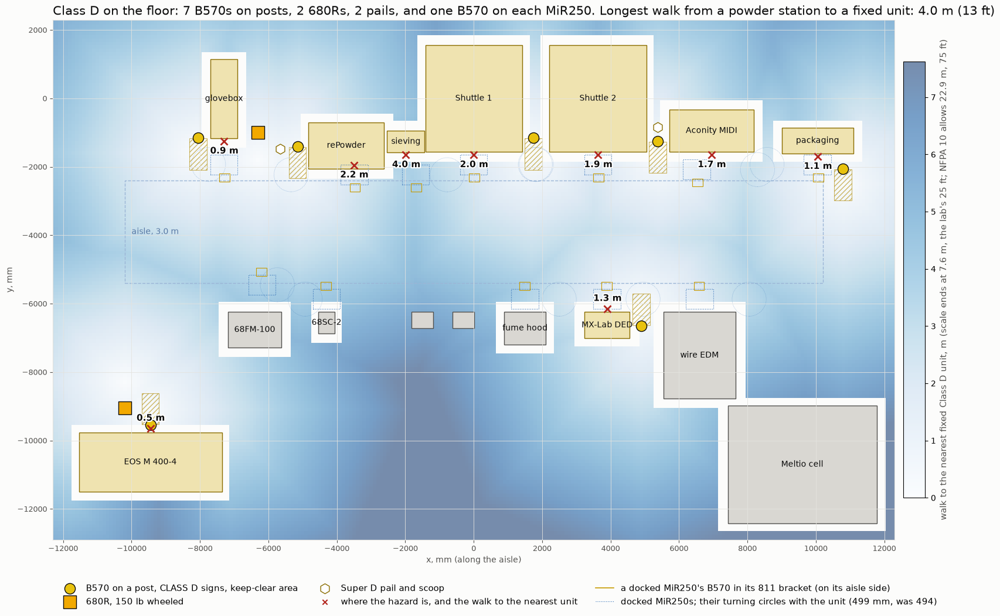
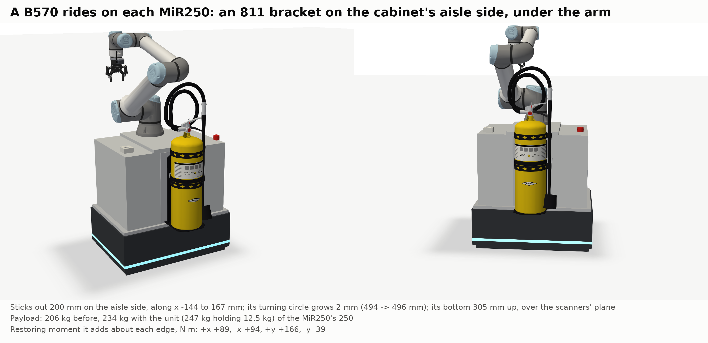

# Safety assets: Class D extinguishers at every powder station and on every MiR250 (#303, PR #318)

Sterling, on PR #318 (2026-11-20): "create a new PR focused on assets for safety. Class D fire extinguishers at each
station, etc. Focused primarily on faithful reconstruction / asset creation. Noting that we might even want to have a
class D fire extinguisher mounted at all times to the MiR250 and available for use, in addition to having these next to
each station that deals with powder."

The code is [`safety.py`](../safety.py) (the models, where they go) and [`safety_render.py`](../safety_render.py) (the
checks, the figures, the clip). The numbers below are in [`out/safety.json`](../out/safety.json).

## What's in the lab now

| Where | What | Why there |
| --- | --- | --- |
| Every MiR250 (both units; a third for floor cleaning, #366, would carry one too) | an Amerex **B570** in an Amerex **811** heavy-duty vehicle bracket, on the cabinet's aisle side | "mounted at all times to the MiR250 and available for use": whoever is near the robot has one, wherever it is working |
| Glovebox (floor) | B570 on a post, west of it | 0.9 m walk |
| rePowder atomizer | a **fire point** west of it: B570 on a post, an Amerex **680R** (150 lb, wheeled), a 50 lb pail of Super D with a scoop | the most metal and the finest powder in the lab; 2.1 m walk |
| Sieving cell | nothing of its own (see below); its docked MiR250's unit, the rePowder's fire point and the unit between the Shuttles | 3.9 m walk to the nearest fixed unit |
| Both Shuttles' openings | one B570 on a post in the 800 mm gap between them | 2.0 and 2.1 m walks; the floor in front of each opening stays clear for Kardex's extraction table |
| Aconity MIDI (and its depowdering) | B570 on a post east of it, a Super D pail behind it | 1.9 m walk |
| Packaging station | B570 on a post east of its dock | 1.1 m |
| MX-Lab DED | B570 on a post east of it | 1.3 m |
| EOS M 400-4 | B570 on a post in front of it, a 680R beside it | 0.5 m; 100 kg of powder in its containers |

Not given one: the fume hood (Weck's reagent, no powder), the wire EDM (deionised water), both Instrons, the Meltio cell
(wire, not powder) and the ICP-MS station (acids; it wants an eyewash and a shower, not Class D). The building's own
ordinary (ABC/CO2) extinguishers aren't modelled; keep them apart from the Class D units and signed differently (DAL's
mounting study: "never use the CO2 or water on a metal fire").



## The assets, part by part


### Amerex B570 (the lab's own)

- **Sources.** Amerex's Class D datasheet (`class-d-extinguishers.pdf`): P/N 16882, 30 lb Super D (sodium chloride
  based), 35 H x 13 W x 8 D in, 53 lb shipping, 195 psig, 3-6 ft range, 24 s, chrome-plated brass valve, "soft flow"
  extension applicator that "may be quickly detached to provide a straight stream", large-loop stainless pull pin,
  drawn-steel cylinder, wall bracket included. The lab's own unit (DAL #126; Grainger 8C249, $958.01, its box label
  "B570 30 LB SALT, BR VLV W/ WALL BKT, MARINE BRACKET NOT INCLUDED") and its photos, which show the red tamper seal on
  the pin and the red wall hook.
- **Shape.** Measured off Amerex's own render (the datasheet's picture, with its alpha mask), scaled so the cylinder
  is 7.75 in across: the render then spans 35.7 x 12.7 in against the datasheet's 35 x 13, and 7.75 in is inside the
  811 bracket's 7.5-8.5 in. So **the datasheet's 35 in includes the hose's coil**: the shell's head tops out at
  22.65 in, the squeeze lever at 27.0 in.
- **Parts:** the shell with a rounded foot and an elliptical head; the neck ring and the threaded collar; the valve
  body with the gauge (red face, green band, needle) to the front and the outlet to the left; the squeeze lever over
  the black carry handle, both to the right; the ring pin and the red tamper seal; the hose, a turn and a half, traced
  strand by strand from the render (two strands up the left and over the top), its second turn passing behind the
  valve; the quick-detach coupling, the tapered grip, the wand and the soft-flow cup, tilted 22 deg; the two black
  lattice bands with the clips that hold the wand; the instruction label (its header, pictogram panels, the D star,
  "COMBUSTIBLE METALS / FIRE EXTINGUISHER", the CAUTION line) and the Amerex diamond.
- **Checked against the render** ([`out/safety_b570_vs_amerex.png`](../out/safety_b570_vs_amerex.png)): an
  orthographic front view at the render's scale, silhouettes compared pixel by pixel. **89 % overlap** (intersection
  over union), from 77 % before the corrections it showed: the valve and gauge 25 mm lower, the hose's second turn,
  the coupling 700-777 mm, a larger soft-flow cup. What's left is the hose's exact drape and edge pixels. Amerex's
  render is fetched at run time and not committed.


### Its wall hook, the 811 vehicle bracket

- **Wall hook:** the red J hook shipped with the B570, after DAL's model (2 in wide, 0.09 in steel, a back plate
  4.5 in below the seat, three holes), seated under the valve body, the collar in its slot. Ours: the arm widened to
  60 mm round the slot. The manual: use the furnished bracket; UL asks a hanger to hold 5 x the charged weight.
- **Amerex 811** (Buckeye 700229 "also identified as Model 811", Buckeye's datasheet): heavy-duty box-type
  marine/vehicle bracket for 30 lb Class D units, cylinders 7.5-8.5 in, 17.50 x 8.125 x 8.125 in, 9 lb, powder-coated
  carbon steel, rubber bushings, UL 299, DOT, USCG; $79.95 (Fire Supply Depot, which lists it 9.75 in wide with the
  latch). Drawn from Buckeye's photo: a flat web with two 45 deg flanges, a chamfered foot plate, 7/16 in holes,
  bushings, a strap with a hinge and an over-centre latch. The strap sits over the B570's lower band, clear of the label.

### Amerex 680R, Super D pails, signs, posts

- **680R** (Amerex's wheeled catalogue, p. 11): P/N 10897, 150 lb Super D, 444 lb shipping, 52 H x 28 W x 45 D in,
  36 x 2.5 in steel wheels with non-sparking rubber treads, argon cylinder (DOT 3AA2015, 110 ft3) regulated to
  125 psi, 25 ft x 0.75 in hose, 80 s, 4-8 ft with its applicator, extension wand. Drawn from the catalogue's photo:
  spoked wheels, the agent cylinder with its chrome fill cap and stainless collars, the argon cylinder and regulator
  behind it, the handle loop, the hose coiled on its rack on the left, the discharge valve and wand up the left front.
  **Ours:** the cylinders' sizes (305 x 880 mm agent, 178 x 960 mm argon), from the agent's volume and the photo. The
  catalogue's 45 in depth is more than the 36 in wheel; it is probably the unit tipped back to move.
  Price: $11,541 (Tiger Medical's sale price; list $16,589.79), $10,932 (All Security Equipment), up to $22,573.
- **Super D, 50 lb pail** (Brooks/Amerex, "for Amerex models B570, 680"; Brooks 50DPAIL about $519), with a metal
  scoop (sold separately). The pail's size and colour aren't published: drawn as a plain 5 gal open-head pail.
- **Signs:** a 7 x 10 in rigid plastic "FIRE EXTINGUISHER / CLASS D / COMBUSTIBLE METALS ONLY" sign at 60 in, and a
  double-sided flag sign at 80 in on DAL's aluminium flag bracket, so the unit is seen from along the aisle.
- **Posts** (ours): a 1-5/8 in 12 ga strut channel, 2.15 m, on a 10 x 10 x 3/8 in post base with four 1/2 in wedge
  anchors, painted fire red; the B570's hook on its front, the signs above. Where the stations stand there are no walls.
- **Keep-clear area:** 24 in wide and 36 in out, taped yellow in front of each post. DAL suggested 36 x 36 in; on this
  floor a 36 in square in front of a unit between two machines runs into the docked MiR250s.

## Mounting heights (NFPA 10 6.1.3.8: gross weight over 40 lb, top at most 42 in, bottom at least 4 in)

| | Bottom | Squeeze lever | Top of the hose's coil |
| --- | --- | --- | --- |
| On its hook (post) | 140 mm (5.5 in) | 826 mm (32.5 in) | 1044 mm (41.1 in) |
| On a MiR250, in the 811 | 313 mm | 999 mm (39.3 in) | 1217 mm (47.9 in) |

On a post both readings of "top" pass. On the MiR the lever passes and the hose's coil doesn't: it rides on the 811's
foot plate, over the MiR's deck. NFPA 10's heights are written for installed hangers, not vehicles; the lever, which is
what a person lifts it by, is under 42 in.

## The walk (NFPA 10 6.5 and OSHA 1910.157(d)(5): Class D agent within 75 ft of travel; the lab's vacuum SOP: ideally 25 ft)

Shortest walks on a 100 mm grid round the machines (each grown 250 mm for a body), from where a person would fight a
fire at each station to where they would take the nearest fixed unit:

| Station | Walk |
| --- | --- |
| EOS M 400-4 | 0.5 m |
| glovebox | 0.9 m |
| packaging | 1.1 m |
| MX-Lab DED | 1.3 m |
| Aconity MIDI | 1.9 m |
| Shuttle 1, Shuttle 2 | 2.0, 2.1 m |
| rePowder | 2.1 m |
| sieving cell | 3.9 m |

All are under the lab's 25 ft (7.6 m), let alone NFPA 10's 75 ft. The MiR250s' units aren't counted: they move.

## Where each unit stands: a search, not a guess

Each fixed unit is the spot nearest its station (50 mm grid) that clears, on the floor plan `setup_lab.py fit` last
measured (`out/tray_plan.json`): every machine and the racking by 50 mm; every docked MiR250 with its unit, every
approach lane and every pivot circle by 30 mm; every AprilTag target post's foot; the aisle; the floor in front of each
Shuttle's opening (Kardex's extraction table and cart); the rePowder's bonded floor plates, where chapter 2's MiR250s
park; and every other unit by 50 mm. Its keep-clear area must miss the machines, the docked MiRs, the posts, the aisle
and the other units. `places_check` re-checks all eleven: all clear.

**The sieving cell has no spot of its own.** Its bench stands 85 mm from the rePowder and 20 mm from Shuttle 1, and its
front is its MiR250's dock and target post; a unit hung on the bench's front would stand in the arm's way into the
enclosure, with its valve over the bench top. It is covered by its docked MiR's own unit (0.6 m), the rePowder's fire
point and the unit between the Shuttles (3.9 m). To give it one, its target post or the cell would have to move.

## The MiR250's unit



- **On the aisle side, not the back.** The first place tried was the cabinet's back end (the MiR's front has its 3-D
  cameras, the ground shoes and, at every dock, the target post 250 mm ahead). There it stuck out 190 mm behind the
  MiR, grew the circle the MiR sweeps turning on the spot from 494 to 619 mm, and **six docks lost their pivot spot**
  (both Shuttles, the Aconity, packaging, the fume hood, the DED): each MiR turns on its dock line, 80 mm off the
  machines. On the aisle side (the MiR's -y, the side away from the arm, which faces the aisle at every dock), centred,
  it sticks out 200 mm but stays inside that circle: **494 to 496 mm, every dock as before.** The UR control box's
  door moves from that side to the cabinet's front end.
- **The mount:** the 811 bolted through a 6 mm aluminium adapter plate (ours, 250 x 470 mm, four M10) to the cabinet's
  side; the foot plate 310 mm up, over the MiR's deck and its scanners' plane; the label out, the strap's latch to
  the front. A person at a docked MiR takes it from the aisle: throw the latch, lift it off the foot plate.
- **Payload:** the top module was 205.8 kg (UR10e 33.3, control box 12, cabinet 25, gripper 1.2, carried items 3,
  ballast plate 131.3: `alloy_atomize.MASS`); the unit adds 28.7 kg (the B570 charged 22.7, the 811 4.1, the plate 1.9):
  **234.5 kg, 247.0 with the arm holding its full 12.5 kg, against the MiR250's 250.** 3 kg to spare. If a top module
  ever needs more, the ballast plate is the place to give (the unit itself sits low and on the outside of the
  support, so it does part of the ballast's job, below).
- **Tipping:** the unit's centre of mass is 365 mm out on the aisle side, 140 mm outside the support rectangle's
  -y edge (`alloy_atomize.WHEELS`, an estimate). About each edge it changes the moment the robot's weight holds it
  down with (parked arm; without the unit: 626 N m about +y, 711 about -y, 965 about either end): **+166 N m about the
  +y edge** (+26 %, the machine side, where the arm pushes and pulls), +88 about +x, +95 about -x, and **-39 N m about
  the -y edge** (-5.5 %, the aisle side).
- **MiR's rules:** "top-module mounting dimensions are equal to robot footprint ... contact MiR if a bigger top module
  is required" (MiR250 spec sheet). A 200 mm overhang is a question for MiR, and the robot's footprint has to be
  extended in its settings so its planner and protective fields allow for it. Two MiR250s passing in the 3.0 m aisle:
  each is 200 mm wider on its right-hand side, the side a keep-right fleet keeps to the aisle's edge.

### The arms against it (ARM_AUDIT=1, the strict rules, at 4 fps)

| Clip | With the unit on both MiR250s | Without it (same run) |
| --- | --- | --- |
| Chapter 1, the charge | **0** of 1,129 frames | (round 14's: 0) |
| Chapter 2, atomize (two arms) | **0** of 846 | (round 14's: 0) |
| Chapter 5, cut, heat-treat, test | see `out/collisions/alloy_workflow_classd.json` | see `alloy_workflow_noclassd.json` |
| The plate swap (atom_plate) | see `atom_plate_classd.json` | see `atom_plate_noclassd.json` |

(The table is filled in from the runs; the README section has the final numbers.)

## The bill (out/safety.json, "bom")

| Item | Qty | Each | Source |
| --- | --- | --- | --- |
| Amerex B570, 30 lb Class D, with its wall hook | 9 (7 fixed, 2 on MiRs) | $958.01 | Grainger 8C249 (DAL #126) |
| Amerex 811 heavy-duty vehicle bracket | 2 | $79.95 | Fire Supply Depot |
| Adapter plate for the 811 (ours) | 2 | ~$60 | estimate |
| Amerex 680R, 150 lb wheeled | 2 | $11,541 | Tiger Medical sale price |
| Super D, 50 lb pail | 2 | $519 | absupply.net |
| Metal scoop | 2 | not found | safetyemporium.com 09461 |
| Floor post, base, anchors (ours) | 7 | ~$150 | estimate |
| CLASS D sign, 7 x 10 in | 7 | ~$20 | estimate |
| Flag sign and bracket | 7 | ~$35 | estimate |
| Floor tape | 1 roll | ~$30 | estimate |

About **$34,500**, two thirds of it the two 680Rs. Upkeep: monthly checks logged on the tag; annual service by a
contractor (BYU Risk Management doesn't service Class D; the College's industrial hygienist suggested Associated Fire
Protection, Salt Lake City); 6-year maintenance and a 12-year hydrostatic test for dry powder; recharge after any use.

## Open

- **For MiR:** the 200 mm overhang on a top module, and the footprint and protective-field settings for it.
- **For Amerex:** whether the B570 may ride vertical in an 811 on a vehicle that accelerates at 0.3 m/s2 and turns on
  the spot (the 811 is sold for 30 lb Class D units on vehicles; Amerex's own bracket chart lists it for its 8 in
  units); the 680R's real cylinder sizes.
- **For BYU EHS / Risk Management:** whether 680Rs are wanted at the atomizer and the EOS (Amerex: "available in
  150-lb wheeled"; NFPA 484 for the powder's own rules), and who services them.
- **For Kardex:** a fire inside a Shuttle holding hundreds of jars of metal powder (trays N, O, P, Q) is not
  something an extinguisher at the opening reaches. Kardex offers fire suppression inside its units; ask what is
  compatible with combustible metal powder (no water, no CO2).
- **The sieving cell** has no unit of its own (above).
- **Not modelled:** the building's ordinary extinguishers; an eyewash and shower at the ICP-MS hood and the fume hood
  (ANSI Z358.1); O2 monitors where argon and nitrogen are used (the AirGradients aren't O2 monitors).

## Sources

- Amerex, Class D datasheet: https://amerex-fire.com/upl/downloads/library/class-d-extinguishers.pdf
- Amerex, wheeled extinguisher catalogue (p. 11, 680R): https://amerex-fire.com/upl/downloads/library/wheeled-extinguisher-catalog-english.pdf
- Amerex, owner's manual for hand portables (P/N 09814 rev 4/22), photographed in DAL #126: mounting heights, the
  5 x hanging-device rule, inspection and maintenance.
- Buckeye, datasheet 700229 / Model 811: https://www.qrfs.com/content/attachments/Datasheet_Buckeye_BFE811VB.pdf
- Fire Supply Depot, Amerex 811: https://www.firesupplydepot.com/amerex-811-vehicle-extinguisher-bracket.html
- Tiger Medical, Amerex 680R: https://tigermedical.com/products/150-lbs-wheeled-sodium-chloride-dry-powder-fire-extinguisher-amr680r
- Safety Emporium, Super D 50 lb pail (09530) and scoop (09461): https://safetyemporium.com/09530
- absupply.net, Brooks 50DPAIL: https://absupply.net/brooks-50dpail-univ-dc-class-d-dry-powder-sodium-chloride-50-lbs.aspx
- DAL's mounting study for the lab's B570 (digital-alloy-lab, branch `claude/issue-126-20261119-2136`,
  `lab-safety/class-d-extinguisher/`, commit 9cc2f77): the hook, the heights, the flag bracket, the parts list.
- The lab's vacuum SOP (byu-vcl PR 80, `vacuum-operating-sop.md`, gate 0.2): "Class D extinguisher ... staged at the
  station: <= 75 ft travel distance per OSHA 1910.157, ideally <= 25 ft. Never water, CO2, or ABC on this powder."
- NFPA 10 (2022) 6.1.3.8 and 6.5; OSHA 29 CFR 1910.157(d)(5).
- MiR250 specifications (2023-06-28, Hartfiel's copy): payload 250 kg; top modules equal to the robot's footprint.

## Running it

```
python3 safety.py                     # the checks -> out/safety.json
python3 safety.py plan                # out/safety_plan.png
xvfb-run -a python3 safety.py photo   # out/safety_b570_vs_amerex.png (fetches Amerex's datasheet to /tmp)
xvfb-run -a python3 safety.py sheet   # out/safety_assets.png
xvfb-run -a python3 safety.py mir     # out/safety_mir.png
VLAB_ONLY_TRAYS= xvfb-run -a python3 safety.py lab    # out/safety_lab.png
VIZ3D_HD=1 VIZ3D_SIZE=1920x1080 VIZ3D_FPS=15 xvfb-run -a python3 safety.py clip
ARM_AUDIT=1 ARM_AUDIT_TAG=classd VIZ3D_FPS=4 xvfb-run -a python3 <clip>.py              # with the unit
VLAB_MIR_CLASS_D=0 ARM_AUDIT=1 ARM_AUDIT_TAG=noclassd VIZ3D_FPS=4 xvfb-run -a python3 <clip>.py   # without it
```

`VLAB_MIR_CLASS_D=0` leaves the MiR250s' units off (`props.mir250`); `VLAB_CLASS_D=0` leaves the fixed units out of
`setup_lab.build`.
