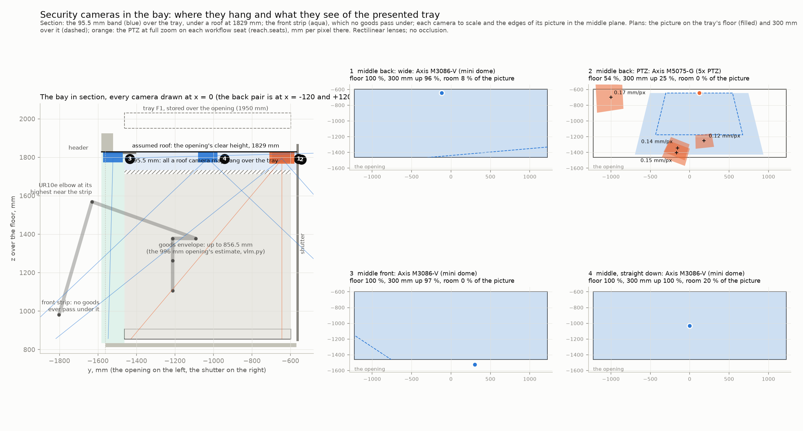

# Security cameras instead of the Pi HQ/Wide units (#303)

Sterling (PR #318, 2026-11-20): "Considering a swap to mostly or all security cameras (with lots of adjustability in
terms of angle, resolution, night vision, onboard temperature/humidity logging, etc.) with a Pi 5 handling the
streaming and control (similar to borysgroup/aurora-cloud-infra PR 35, but doesn't have to be that brand, and I also
need an approximate cost here) ... Note that for a security camera, the power requirements might be higher than what a
typical Pi 5 charger would handle." And for the bay: "two side-by-side, one focused on wide capture and another that
could point closely at whatever workflow is happening. Keeping in mind also that there would be a gripper camera too",
"multiple overhead cameras in the bay to get different angles (e.g., ceiling middle back, ceiling middle front)".

This is research and a recommendation. The Pi camera units in `services.py` and every animation in PR #318 are
unchanged. [`security_cams.py`](../security_cams.py) does the geometry, the power and the cost;
[`out/security_cameras.json`](../out/security_cameras.json) has every number below.

<!-- SUMMARY -->

## What aurora's rig already showed (borysgroup/aurora-cloud-infra PR 35)

Two Amcrest **IP5M-T1179EW-AI-V3** turrets (5 MP, Dahua OEM) in the Aurora glovebox stream to YouTube through a Pi 5
on the same switch, since 2026-11-19:

- **The Pi 5 only copies the streams.** `ffmpeg` pulls each camera's H.264 over RTSP (TCP) and writes it to YouTube's
  ingest with `-c:v copy`: no decode, no encode, **about 3 % of one core per camera**. Each 1080p, 20 fps, 4 Mbit/s
  CBR stream with a 2 s GOP comes in at 4.2 Mbit/s and goes out at 5.7 Mbit/s over RTMPS.
- **The cameras have no way out.** They sit on a segment with no DHCP and a dead gateway; the Pi's `eth0` has a fixed
  address there, no gateway and `ip_forward` 0. The Pi serves them NTP (their clocks were an hour and two minutes
  off). A `relay` viewer account, not admin, holds the RTSP login.
- **ONVIF Profile S answers** (media, imaging, events), so stream URIs can be discovered once logged in.
- **Its limits:** a fixed lens (no zoom, no motorized focus, no PTZ: re-aiming is by hand), and a privacy blur that
  needs the Pi to decode and re-encode: 0.8-1.3 cores per 1080p stream at 20 fps. Cropping or masking in the
  camera, before it encodes, keeps the copy relay.

So the pattern carries over as is: **one Pi 5 per group of cameras, not one per camera.** A tray's two or three
cameras are under a tenth of one core.

## The candidates

Researched on 2026-11-20 from the makers' datasheets where they could be opened; each price is one retailer's on that
day (Black Friday prices were in effect) and marked "snippet" where only a search result showed it. Every figure, with
its datasheet, is in `security_cams.CANDIDATES` and `out/security_cameras.json`.

### Fixed cameras: turret, mini dome, bullet, varifocal, box, sensor on a cable, board

<!-- BEGIN:FIXED_TABLE -->
| Type | Model | Resolution | Lens; across x up | Zoom, focus | IR | PoE, most it draws | Size | ONVIF, RTSP, local | On federal money | Price | Seen 2026-11-20 at |
|---|---|---|---|---|---|---|---|---|---|---|---|
| turret | Amcrest (Dahua-made) **IP5M-T1179EW-AI-V3** | 2960 x 1668, 20 fps | 2.8 mm; 111 x 58° | none | 30 m | af, 5.0 W | Ø110 x 101 mm, 372 g | ONVIF; RTSP; P2P can be off | **no**: Dahua-made; out of stock | $80 | [amcrest.com (out of stock)](https://www.amcrest.com/products/5mp-poe-camera-turret-ip5m-t1179ew-ai-v3) |
| turret | AMLINK (Amcrest's new brand, FOXLINK, Taiwan) **AL5M-T5171EW** | 2960 x 1668, 20 fps | 2.8 mm; 111 x 58° | none | 30 m, can be off | af, 8.2 W (typ. 3.2) | Ø123 x 95 mm | S/G/T; RTSP; H.264 only | maker says yes (not verified) | $95 | [amcrest.com](https://www.amcrest.com/products/amlink-5mp-security-ai-ip-poe-turret-camera-al5m-t5171ew) |
| eyeball turret | Reolink **RLC-520A (2.8 mm)** | 2560 x 1920, 25 fps | 2.8 mm; 100 x 75° | none | 30 m | af; < 12 W (DC figure) | Ø105 x 95 mm, 468 g | ONVIF, RTSP (enable them); P2P can be off; main stream <= 8 Mbit/s | yes (not a named company; Reolink's own statement) | $60 | [reolink.com](https://reolink.com/us/product/rlc-520a/) |
| turret | Ubiquiti **UniFi G5 Turret Ultra** | 2688 x 1512, 30 fps | fixed; 102 x 55° | none | 30 m | PoE, 4 W | Ø90 x 71 mm, 330 g | no ONVIF; RTSP only through a UniFi Protect console | yes (maker) | $129 | [store.ui.com (plus a console)](https://store.ui.com/us/en/products/uvc-g5-turret-ultra) |
| indoor mini dome | Axis **M3086-V** | 2688 x 1512, 30 fps | 2.4 mm; 130 x 93° | none | none | af Class 2, 4.2 W (typ. 3.6) | Ø101 x 56 mm, 150 g | G/M/S/T; local; cloud (O3C) can be off | yes (Axis) | $463 | [CDW (backordered)](https://www.cdw.com/product/axis-m3086-v-network-surveillance-camera-dome/7058880) |
| turret | Hanwha Vision **QNE-8011R** | 2592 x 1944, 30 fps | 2.8 mm; 105 x 77° | none | 20 m, can be off | af Class 3, 7.4 W (typ. 5.5) | Ø125 x 87 mm, 645 g | S/G/T; local; no P2P | yes (Hanwha) | $389 | [a1securitycameras (CDW $377.99, snippet)](https://www.a1securitycameras.com/samsung-hanwha-qne-8011r-5mp-h-265-ir-outdoor-turret-ip-security-camera-with-2-8mm-fixed-lens.html) |
| mini bullet | Reolink **RLC-510A** | 2560 x 1920, 25 fps | 4 mm; 80 x 42° | none | 30 m | af; < 12 W (DC figure) | 186 x Ø67 mm, 415 g | ONVIF (enable it); RTSP; H.264 only | yes (as Reolink above) | $60 | [reolink.com](https://reolink.com/us/product/rlc-510a/) |
| mini bullet | Axis **M2036-LE** | 2688 x 1512, 30 fps | 2.4 mm; 130 x 71° | none; focuses from 0.5 m | 20 m, can be off | af Class 3, 12.95 W (typ. 5) | 170 x Ø101 mm, 491 g | G/M/S/T; local | yes (Axis) | $540 | [CDW](https://www.cdw.com/product/axis-m2036-le-network-surveillance-camera-bullet/6900392) |
| varifocal bullet | Reolink **RLC-811A** | 3840 x 2160, 25 fps | 2.7-13.5 mm; 105-31 x 55-17° | 5x, motorized | 30 m | af; < 12 W (DC figure) | 238 x 80 x 72 mm, 838 g | ONVIF; RTSP; its 4K main stream is H.265 only | yes (as Reolink above) | $98 | [reolink.com](https://reolink.com/us/product/rlc-811a/) |
| varifocal turret | Amcrest (Dahua-made) **IP5M-VT1289EW-AI** | 2592 x 1944, 20 fps | 2.7-13.5 mm; 100-30 x 72-23° | 5x, motorized; focuses from 0.8 m | 40 m | af, 6.4 W | Ø122 x 108 mm, 685 g | ONVIF not listed; RTSP | **no**: Dahua-made | $155 | [amcrest.com (snippet)](https://amcrest.com/new-products/color/white.html) (snippet) |
| varifocal dome | Axis **M4216-LV** | 2304 x 1728, 30 fps | 3-6 mm; 100-45 x 72-34° | 2x, remote zoom and focus | 20 m, can be off | af Class 3, 9.7 W (typ. 5) | Ø121 x 71 mm, 375 g | G/M/S/T; local | yes (Axis) | $650 | [CDW](https://www.cdw.com/product/axis-m4216-lv-4mp-network-dome-camera/6771472) |
| box (CS mount) | Axis **M1137 Mk II** | 2592 x 1944, 30 fps | 2.8-13 mm (i-CS 3.5-10 mm); 112-24 x 82-19° | 4.6x by hand (i-CS: 2.9x, remote); focuses from 0.8 m | none | af Class 3, 7.2 W (typ. 4.5) | 64 x 70 x 179 mm, 205 g | G/M/S/T; local; 1/4-20 thread | yes (Axis) | $657 | [networkdevicesinc (i-CS $803.99 at CDW)](https://networkdevicesinc.com/products/02484-001) |
| box (CS mount) | Axis **P1385** | 1920 x 1080, 60 fps | 2.8-13 mm; 121-26 x 64-15° | 4.6x by hand | none | af Class 3, 9.3 W | 480 g (drawing only) | G/M/S/T; local; 1/4-20 thread | yes (Axis) | $959 | [CDW](https://www.cdw.com/product/axis-p13-series-p1385-network-surveillance-camera-box/8066983) |
| sensor on a cable | Axis **F9111-R Mk II + F2105-RE + 8 m cable** | 1920 x 1080, 60 fps | 3.1 mm; 108 x 58° | none | none | at Class 4, 25.5 W (main unit) | sensor Ø30 x 46 mm, 50 g; main unit 675 g | G/M/S/T; local | yes (Axis) | $1,034 | [CDW (main unit + sensor + cable)](https://www.cdw.com/product/axis-f-series-f9111-r-mk-ii-video-server-1-channels/8334770) |
| mini dome on a cable | Axis **P1275 Mk II** | 1920 x 1080, 30 fps | 2.8-6 mm, by hand; 99-53 x 53-30° | 2x by hand; focuses from 0.1 m | none | af Class 2, 4.1 W | sensor unit 112 g (drawing only), on 8 m | G/M/S/T; local | yes (Axis) | $532 | [networkdevicesinc (backorder)](https://networkdevicesinc.com/products/02859-001) |
| pinhole on a cable | Axis **P1265 Mk II** | 1080p | 3.7 mm; 91 x 45° | none; focuses from 0.2 m | none | af Class 2 | pinhole sensor on a cable | G/M/S/T; local | yes (Axis) | $500 | [CDW](https://www.cdw.com/) (snippet) |
| IP board | Shenzhen CCDCAM **IMA50L12 (IMX335)** | 2592 x 1944, 30 fps | M12, not included; 100 x 75° | none | none (IR-cut only) | 'DC12V/POE', 1.9 W | 38 x 38 mm board | 'ONVIF 2.6'; RTSP; Danale P2P (firewall it) | unknown maker: get a declaration | $17 | [Global Sources (snippet)](https://www.globalsources.com/product/network-camera-module_1200330767f.htm) (snippet) |
| modular, with temperature | Mobotix **S74 + 45° module + MultiSense** | 3840 x 2160, 30 fps | 45° module; 45 x 25° | none | optional module | at Class 4, 25 W | module Ø50 x 43 mm on 1-3 m; body 36 x 232 x 110 mm | G/S/T; local | yes (Mobotix) | $1,628 | [a1 / VoIP Supply (parts, partly snippets)](https://www.a1securitycameras.com/mobotix-mx-f-msa.html) (snippet) |
<!-- END:FIXED_TABLE -->

### PTZ and other moving cameras

<!-- BEGIN:PTZ_CANDS_TABLE -->
| Type | Model | Resolution | Lens; across x up | Zoom, focus | IR | PoE, most it draws | Size | ONVIF, RTSP, local | On federal money | Price | Seen 2026-11-20 at |
|---|---|---|---|---|---|---|---|---|---|---|---|
| mini PTZ | Axis **M5075-G** | 1080p, 60 fps | 2.2-11 mm; 71-14 x 40-8° | 5x, autofocus | none | af Class 3, 9.5 W (typ. 4.4) | Ø130 x 63 mm, 380 g | G/M/S/T; local, cloud optional | allowed (Axis letter, 2024-12-19) | $650 | [Newegg](https://www.newegg.com/p/N82E16881121781) (snippet) |
| mini PTZ | Dahua **SD1A404XB-GNR (Amcrest IP4M-1066EW in the US)** | 2560 x 1440, 30 fps | 2.8-12 mm; 97-32 x 54-18° | 4x; focuses from 0.2-0.5 m | 15 m | af, 8.5 W with IR (3 W without) | Ø128 x 65 mm, 485 g | S/G/T; P2P listed | **not on federal funds** (Dahua) | $290 | [Amcrest (IP4M-1066EW)](https://amcrest.com/4mp-poe-camera-ptz-4x-optical-zoom-ip4m-1066ew.html) (snippet) |
| mini PTZ | Hikvision **DS-2DE2A404IW-DE3** | 2560 x 1440, 25 fps | 2.8-12 mm; 97-32 x 54-18° | 4x; focuses from 1.5 m at full zoom | 20 m | af, 11.2 W with IR | Ø131 x 102 mm, 530 g | S/G/T | **not on federal funds** (Hikvision) | $243 | [IPSecurityDepot](https://ipsecuritydepot.com/Hikvision-DS-2DE2A404IW-DE3) (snippet) |
| PTZ, 16x | Reolink **RLC-823S2** | 3840 x 2160, 25 fps | 5.3-86 mm; 54-4 x 30-2° | 16x; close focus not published | 80 m | at, < 24 W | 373 x 177 x 140 mm with its mount, 2.3 kg | ONVIF (profile not stated); P2P can be turned off | allowed (not a named company; Reolink's own statement) | $340 | [Amazon (list; $230-259 on sale)](https://reolink.com/us/product/rlc-823s2/) (snippet) |
| dual-lens tracker | Reolink **TrackMix PoE** | 3840 x 2160, 25 fps | 2.8 + 8 mm, fixed; 104-38 x 55-21° | none (two fixed lenses, '6x hybrid') | 30 m | af, < 12 W | 228 x 147 x 110 mm, 1.21 kg | ONVIF; P2P can be turned off | allowed (as Reolink above) | $200 | [Reolink store](https://reolink.com/us/product/reolink-trackmix-poe/) (snippet) |
| overview + PTZ | Axis **M5000-G** | PTZ 1080p; overview 3 x 5 MP | 4.7-47 mm; 62-7 x 36-4° | 10x | none | at Class 4, 13.4 W | Ø247 x 138 mm, 1.95 kg | G/M/S/T; local | allowed (Axis letter) | $1,456 | [CDW](https://www.cdw.com/product/axis-m50-series-m5000-g-network-surveillance-panoramic-camera-dome/9030103) (snippet) |
| conference PTZ | PTZOptics **Move SE 20X** | 1080p, 60 fps | 4.42-88.5 mm; 61-3 x 34-2° | 20x; close focus not published | none | af (but 'max 18 W'): plan an at port | 169 x 142 x 164 mm, 1.4 kg | ONVIF (profile not stated); RTSP, SRT, NDI | allowed (PTZOptics' claim) | $1,349 | [Best Buy / Newegg](https://www.bestbuy.com/product/ptzoptics-move-se-20x-grey-gray/J39HLS9JC2) (snippet) |
| conference PTZ | Sony **SRG-A12** | 2160p30 / 1080p60 | 4.4-52.8 mm; 70-7 x 39-4° | 12x; focuses from 0.4 m at full zoom | none | bt Class 8, 71.3 W | 157 x 184 x 200 mm, 2.0 kg | no ONVIF (VISCA over IP, CGI); RTSP | no statement found | $2,285 | [Newegg](https://www.newegg.com/p/34G-005N-00012) (snippet) |
<!-- END:PTZ_CANDS_TABLE -->

<!-- CANDIDATE_NOTES -->

## The bay

### Where a camera can go

- **A roof at the opening's clear height leaves 95.5 mm.** The presented tray's floor is at 857 mm. Kardex's goods
  envelope with its 20 mm clearance tops out at 1733.5 mm; the 996 mm opening's 856.5 mm product height is itself an
  estimate (`vlm.py`). The header's underside, where the bay's side walls and the LED light stop, is at 1829 mm. A
  camera hung from a roof there, anywhere over the tray, has 95.5 mm before the tallest goods would reach it. The
  HQ/Wide bay unit sits higher only because the model draws the bay open up to tray F1 (1950 mm).
- **The front strip is free of goods.** A tray slides in from the shaft and stops with its front edge at
  y = -1462 mm. So the 110 mm strip from there to the front of the LED light (y = -1572 mm) is never swept by
  anything on a tray. A taller camera can hang there, limited only by the arm and the operator: that is where a PTZ
  goes.
- **The sides are no use.** The bay's walls stand 25 mm outside the tray, and the shutter's path takes the back.
- **The UR10e** (`services.bay_arm_clearance`'s 320 poses: the workflow's seats and the presented tray on a 100 mm
  grid, gripper down at 100 and 250 mm; the arm as 75 mm capsules from the shoulder to the TCP). Reaching the tray's
  front half, its elbow rises to 1.56-1.57 m just in front of the opening:

  | A camera there | Lowest point | Nearest the arm |
  |---|---|---|
  | Ø130 x 180 mm (a tall PTZ), front strip, x = 0 | 1649 mm | 17 mm |
  | the same, x = 170 mm | 1649 mm | 31 mm |
  | the same, x = 650 mm | 1649 mm | 137 mm |
  | Ø100 x 90 mm (a turret), front strip, x = 0 | 1739 mm | 105 mm |
  | the same, x = 300 mm | 1739 mm | 146 mm |
  | Ø100 x 90 mm, roof, middle back (y = -645), x = -120 mm | 1739 mm | 286 mm |
  | Ø130 x 63 mm (a mini PTZ), roof, middle back, x = +120 mm | 1766 mm | 313 mm |
  | Ø100 x 90 mm, roof, over the tray's centre | 1739 mm | 242 mm |

  So the middle front camera stands 300 mm right of the middle, and nothing tall goes in the strip's middle.

### The set: four per Shuttle

<!-- BEGIN:BAY_TABLE -->
| Spot | Camera | Mount (x, y) | Heading / tilt, ° | Tray floor seen | 300 mm up | Room in the picture | Lowest point | Nearest the arm | mm/px at the tray's centre |
|---|---|---|---|---|---|---|---|---|---|
| middle back: wide | Axis M3086-V (mini dome) | (-120, -645) | 175 / 85 | 100 % | 96 % | 8 % | 1773 mm, +40 mm to the band | 320 mm | 1.63 |
| middle back: PTZ | Axis M5075-G (5x PTZ) | (120, -645) | 180 / 70 | 54 % | 25 % | 0 % | 1766 mm, +32 mm to the band | 313 mm | 0.75 |
| middle front | Axis M3086-V (mini dome) | (300, -1522) | 0 / 45 | 100 % | 97 % | 0 % | 1773 mm, in the strip | 178 mm | 1.76 |
| middle, straight down | Axis M3086-V (mini dome) | (0, -1030) | 0 / 90 | 100 % | 100 % | 20 % | 1773 mm, +40 mm to the band | 275 mm | 1.50 |
<!-- END:BAY_TABLE -->

<!-- BAY_NOTES -->

### The PTZ at full zoom on the workflow's seats

<!-- BEGIN:PTZ_TABLE -->
| The PTZ at full zoom on | Distance | Picture across | mm/px | In focus (closer than ? mm is not) |
|---|---|---|---|---|
| vial rack (tray B) | 1191 mm | 292 mm | 0.15 | - |
| doser shuttle fork (tray B) | 895 mm | 220 mm | 0.12 | - |
| CubXL holder seat (tray A) | 1098 mm | 270 mm | 0.14 | - |
| tray's back left, 150 mm up | 1367 mm | 336 mm | 0.17 | - |
<!-- END:PTZ_TABLE -->

<!-- PTZ_NOTES -->

## On the trays

<!-- TRAYS_INTRO -->

### Slot height: the trays' real limit

Kardex's 856.5 mm product height is nowhere near a camera on a tray: the HQ/Wide heads top out at 706 mm. What a
camera does decide is **each tray's slot**, since a slot is the tray's tallest top plus 20 mm, rounded up to 25 mm
(`vlm.py`, `setup_lab.py fit`). The camera heads are the tallest thing on seven of the twelve powered trays:

<!-- BEGIN:HEADROOM_TABLE -->
| Tray | Slot | Span | Tallest other thing (top) | Camera heads' top | Highest top for the same slot | Span with no camera above it |
|---|---|---|---|---|---|---|
| D | R1 | 750 | Rigaku MiniFlex (6th generation) (725) | 706 | 730 | 750 |
| A | R2 | 750 | Opentrons OT-2 (665) | 705 | 730 | 700 |
| B | R3 | 900 | multi-doser: chain carousel v5 on an HR-202i, 13 powders (857) | 688 | 880 | 900 |
| E | R4 | 725 | Plastometrex PLX-Benchtop (692) | 703 | 705 | 725 |
| C | F1 | 725 | Bambu Lab H2D (629) | 695 | 705 | 650 |
| F | F2 | 750 | LECO PX500 + disc magazine (680) | 706 | 730 | 700 |
| K | 2R1 | 850 | Custom N2 glovebox (purge-only) (813) | 679 | 830 | 850 |
| L | 2R2 | 725 | Mitutoyo HM-220 Type D (AVPAK) (598) | 696 | 705 | 625 |
| M | 2R3 | 750 | Sentry Air Systems ductless hood, 24 in (717) | 691 | 730 | 750 |
| H | 2R4 | 550 | DDM Novastar SPR-45VA (519) | 411 | 530 | 550 |
| G | 2F1 | 725 | Formlabs Form 4 (557) | 699 | 705 | 600 |
| I | 2F2 | 725 | SnowX SnowPod (663) | 689 | 705 | 700 |
<!-- END:HEADROOM_TABLE -->

So a camera that replaces a head on the same post, aimed at the same point, must keep its top within 2 mm (tray E) to
25 mm (A, D, F) of today's heads, or that tray's slot grows by a 25 mm step. The other way round, **small cameras set
at or below their tray's tallest instrument would free 425 mm of slot height** across A, C, F, G, I and L (the last
column), more than half a tray slot; that is a reason to prefer the small ones and the module-side mounts.

<!-- BEGIN:POSTFIT_TABLE -->
| On a tray post | Over the pivot | Top | Trays it fits as they are | Slots that grow (mm) |
|---|---|---|---|---|
| Amcrest IP5M-T1179EW (aurora's) | 55 | 698 | ABCDEFGHIKLM | none |
| AMLINK AL5M-T5171EW | 62 | 704 | ABCDEFGHIKLM | none |
| Reolink RLC-520A | 52 | 696 | ABCDEFGHIKLM | none |
| UniFi G5 Turret Ultra | 45 | 688 | ABCDEFGHIKLM | none |
| Axis M3086-V (mini dome) | 50 | 694 | ABCDEFGHIKLM | none |
| Hanwha QNE-8011R (turret) | 62 | 706 | ABDFHKM | E +25, C +25, L +25, G +25, I +25 |
| Reolink RLC-510A (bullet) | 99 | 742 | BHK | D +25, A +25, E +50, C +50, F +25, L +50, M +25, G +50, I +50 |
| Axis M2036-LE (bullet) | 111 | 754 | BHK | D +25, A +25, E +50, C +50, F +25, L +50, M +25, G +50, I +50 |
| Reolink RLC-811A (5x bullet) | 124 | 767 | BHK | D +50, A +50, E +75, C +75, F +50, L +75, M +50, G +75, I +75 |
| Amcrest IP5M-VT1289EW (5x turret) | 61 | 704 | ABCDEFGHIKLM | none |
| Axis M4216-LV (2x dome) | 60 | 704 | ABCDEFGHIKLM | none |
| Axis M1137 Mk II (box) | 98 | 741 | BHK | D +25, A +25, E +50, C +50, F +25, L +50, M +25, G +50, I +50 |
| Axis F2105-RE sensor (F-series) | 15 | 658 | ABCDEFGHIKLM | none |
| Mobotix S74 + MultiSense | 25 | 668 | ABCDEFGHIKLM | none |
<!-- END:POSTFIT_TABLE -->

### Mounting: tray, module top, module side, bay ceiling

| Where | How it is held | How it is aimed |
|---|---|---|
| A tray's 2020 post (the 24 places the HQ/Wide units stand now) | a printed plate on two M5 drop-in T-nuts in the post's slot, the camera's base screwed to it, as the unit's sliding block is now | height: slide the plate up the slot; aim: the camera's own pan, tilt and rotate, by hand, then locked |
| The top of a module | the same plate on a printed L-bracket over the top edge, or on the module's own extrusion | the same |
| A module's side | the plate on two M4 rivnuts in the panel, or VHB tape on a painted or glass face | the same |
| The bay's roof | the camera's base on three M4 rivnuts, its lead through a grommet to the side cavity | by hand (fixed cameras), over ONVIF (the PTZ) |
| A tight spot (inside a cabinet or the glovebox) | a pinhole or sensor-on-a-cable camera, its main unit outside | fixed |

A turret's ball sits in its base, so one plate design per camera model serves every row above. No magnet bases on
tray B (its A&D HR-202i balance) or near the multi-doser's balance pan.

### Seeing in the dark

The trays spend most of their time in their slots, unlit, and some keep working there: the printers (C, G), the
CubXL (A), the furnace (F). The HQ/Wide units see nothing there (the Wide has an IR-cut filter and neither has a light).
Every security camera here has infrared LEDs and switches to night mode by itself, so a tray in its slot can still be
watched. Keep IR off in the lit bay and near anything optical (the colour sensor's NIR channel on the OT-2's tray, the
OpenFlexures on D): ONVIF's imaging service, or the camera's own day/night schedule, holds it off.

### Temperature and humidity

<!-- TH -->

## Power

### What a camera draws

IEEE 802.3 sets the classes; a camera's class is what the switch reserves for it unless the switch allocates by
measured draw.

| Class | Standard | At the switch (PSE) | At the camera (PD) |
|---|---|---|---|
| 1 | 802.3af | 4.0 W | 3.84 W |
| 2 | 802.3af | 7.0 W | 6.49 W |
| 3 | 802.3af | 15.4 W | 12.95 W |
| 4 | 802.3at (PoE+) | 30 W | 25.5 W |
| 5-6 | 802.3bt (PoE++) | 45-60 W | 40-51 W |
| 7-8 | 802.3bt | 75-90 W | 62-71.3 W |

<!-- POWER_CAMS -->

### The Pi 5 doesn't power them

A Pi 5 takes 5 V at up to 5 A on its USB-C (the 27 W supply) and gives out nothing a camera can use: it has no PoE
output, and its USB ports share 1.6 A. Every camera here wants PoE (or 12 V DC). So the cameras hang off a **PoE
switch**, and the Pi 5 is just another device on it, on its own 27 W supply or on a PoE+ HAT from the same switch.

### Through the tray's dock

Nothing changes at the CombiTac. The dock brings 208Y/120 V (L1, L2, N, PE on Ø3 mm contacts, 39 A; a 30 A breaker)
and one Ethernet line (the CT-10GBIT-RJ45 module, Cat 6A, 10 Gbit/s). PoE is made **on the tray**, by the tray's own
switch, which `ups.py` already puts on every powered tray's UPS-backed branch (a Ubiquiti USW-Lite-8-PoE-class switch:
8 W typical, 60 W rated, a 52 W PoE budget on four PoE+ ports). So:

- **no PoE crosses the dock**, and nothing new does: the cameras need only the 120 V branch and the one data line;
- **the cameras ride through a transit** (6-8 s off the dock) and a stranded tray (the UPS's 10 minutes and more),
  as the HQ/Wide units do; only the uplink drops, so the YouTube stream stalls for the transit and the relay picks it
  up again. A camera's own microSD card (edge recording, ONVIF Profile G) keeps the footage across the gap;
- **the tray's switch must be managed**, with a camera VLAN that has no gateway (aurora's isolation), since the
  same switch carries the tray's instruments and PCs to the lab network.

<!-- BEGIN:POWER_TABLE -->
| Tray | Cameras | UPS | Backed, rated W | Backed, typical W | Change | Runtime, min | PoE from the switch | Still fits |
|---|---|---|---|---|---|---|---|---|
| A | 2 | GXT5LI-1500LVRT2UXL | 641 -> 614 | 221 -> 230 | +10 | 27 -> 26 | 15 W, 2 ports | yes |
| B | 1 | PSI5-800SRT2ULIN | 493 -> 493 | 48 -> 55 | +7 | 120 -> 104 | 7 W, 1 ports | yes |
| C | 2 | PSI5-800SRT2ULIN | 114 -> 87 | 16 -> 26 | +10 | 360 -> 226 | 15 W, 2 ports | yes |
| D | 3 | GXT5LI-3000LVRT2UXL | 2541 -> 2487 | 540 -> 552 | +12 | 22 -> 22 | 22 W, 3 ports | yes |
| E | 3 | GXT5LI-1500LVRT2UXL | 991 -> 937 | 325 -> 337 | +12 | 19 -> 18 | 22 W, 3 ports | yes |
| F | 2 | PSI5-800SRT2ULIN | 114 -> 87 | 16 -> 26 | +10 | 360 -> 226 | 15 W, 2 ports | yes |
| K | 1 | GXT5LI-1500LVRT2UXL | 820 -> 820 | 214 -> 221 | +7 | 28 -> 27 | 7 W, 1 ports | yes |
| L | 2 | GXT5LI-1500LVRT2UXL | 1004 -> 977 | 176 -> 186 | +10 | 35 -> 33 | 15 W, 2 ports | yes |
| M | 2 | GXT5LI-1500LVRT2UXL | 749 -> 722 | 171 -> 180 | +10 | 36 -> 34 | 15 W, 2 ports | yes |
| H | 2 | PSI5-800SRT2ULIN | 514 -> 487 | 56 -> 66 | +10 | 103 -> 88 | 15 W, 2 ports | yes |
| G | 2 | PSI5-800SRT2ULIN | 114 -> 87 | 16 -> 26 | +10 | 360 -> 226 | 15 W, 2 ports | yes |
| I | 2 | PSI5-800SRT2ULIN | 114 -> 87 | 16 -> 26 | +10 | 360 -> 226 | 15 W, 2 ports | yes |
<!-- END:POWER_TABLE -->

<!-- POWER_TRAYS -->

### The bay

The bay's cameras are on the machine, not a tray. `notes/services.md` already has a PoE+ switch on the VLM's side that
feeds the service risers and the bay camera; the bay's set and its Pi 5 go on that switch.

<!-- POWER_BAY -->

## Streaming and control on the Pi 5

- **One Pi 5 per powered tray and one per bay**, each relaying its cameras with `ffmpeg -c:v copy` as aurora does
  (`amcrest_relay.py`'s pattern: probe the camera, ask the picam Lambda for a broadcast, copy, restart on stall, end the
  broadcast before YouTube's 12 h archive limit).
- **H.264 on the main stream.** The Pi 5 has a hardware HEVC decoder and no H.264 encoder or decoder, so anything that
  isn't a straight copy costs CPU (aurora: 0.54 cores to re-encode 720p20). Set each camera's main stream to H.264,
  CBR, a 2 s GOP, at the resolution YouTube is to get; keep H.265 for local recording if wanted.
- **Masks in the camera.** Every candidate below has privacy masks applied before its encoder, so the cameras that
  see the room (the bay's middle back unit; a few tray units) need no blur on the Pi.
- **The PTZ's control is ONVIF.** A small service on the bay's Pi (python-onvif-zeep, or the camera's own HTTP API)
  moves it to a preset per workflow seat when the arm is about to work there; the workflow already knows the seat
  (`reach.seats`). Presets avoid closed-loop tracking; a wrist camera (the D405) gives the arm's own view anyway.
- **Isolation as in aurora:** cameras on a VLAN with no gateway; P2P, cloud, UPnP and the vendor app off; NTP from the
  Pi; a viewer account for RTSP and the admin login kept off the Pi; firmware loaded by hand.

## Bill of materials and cost

<!-- BEGIN:COST_TABLE -->
| Tier | Per tray point (camera, mount, lead, card, its share of the Pi 5) | Per bay set (with its Pi 5) | Pi 5s | Whole lab |
|---|---|---|---|---|
| A. NDAA: Hanwha turrets on the trays, Axis in the bay | $513 | $2,364 | 14 | **$17,263** |
| B. NDAA, smallest: Axis mini domes everywhere (no IR on the trays) | $587 | $2,364 | 14 | **$19,044** |
| C. Low cost: Reolink turrets on the trays and the strip, Axis on the roof | $184 | $1,961 | 14 | **$8,566** |
| today: HQ + Wide units (for comparison) | $346 | - | 26 | $8,991 |
<!-- END:COST_TABLE -->

<!-- BOM_NOTES -->

## Open questions

**Kardex** (to add to PR #331's questions for the dealer):
1. Is there a roof over the access opening, and at what height? This note assumes 1829 mm, the 996 mm opening's top.
   May cameras be fixed to it and to the header's underside (M6 rivnuts or a strip), and can the LED light under the
   header be split for the front pair? Where may a camera's Cat 6 run to the side cavity?
2. The largest product height through the 996 mm opening. 856.5 mm is our estimate; the band is 95.5 mm only if it
   holds.
3. Is anything in the front strip under the header (a light curtain, a height check, a sensor), which would decide
   between the strip and the roof for the PTZ?

**The camera makers** (for each model on the shortlist):
1. The minimum focus distance at the long end of the zoom. The bay's PTZ works at 0.79-1.14 m from the workflow's
   seats, and most PTZ makers publish none.
2. The PoE class and the maximum draw with IR on and IR off; whether IR can be held off for good.
3. ONVIF PTZ: absolute moves and presets, how repeatable a preset is, and how fast.
4. Does it run with no cloud account or app ever, with P2P and UPnP off, and take firmware from a file?
5. H.264 main stream at its full resolution, CBR, a 2 s GOP: what the copy relay needs.
6. A US NDAA Section 889 / 2 CFR 200.216 statement, for anything bought on federal grant money.
7. A low ceiling or in-ceiling mount that keeps a turret within 95 mm of the roof.

**BYU:**
1. Will the cameras be bought on a federal grant (the ONR YIP, say)? Then 2 CFR 200.216 rules out anything Hikvision
   or Dahua made, including their OEM brands.
2. Does OIT allow IP cameras on a lab VLAN with no gateway and a Pi 5 as the only way out, as aurora does? Is there a
   campus policy on cameras that can see people (the bay's middle back unit sees the floor in front of the opening)?

**Ubiquiti** (or whichever switch): does the USW-Lite-8-PoE reserve a port's class or allocate by measured draw? With
class reservation, three class-3 cameras (46 W) and a PoE+ Pi (30 W) would be over its 52 W budget even though they
draw a third of it.

## Caveats

- **Many figures are search snippets or retailer pages**, marked so in `CANDIDATES` (`kind`); prices are what one
  retailer showed on the date given, before tax and shipping, and move often.
- **The lenses are drawn rectilinear.** A 2.8 mm security lens has strong barrel distortion (aurora measured it), so
  its published angle is the distorted picture's; coverage at the corners is a little different from what's computed.
- **Nothing occludes.** Coverage counts every point of the tray's floor in the picture, whatever stands in front of it;
  the instruments, the arm and the goods hide some of it.
- **The arm check is reach.py's poses only**, as `services.bay_arm_clearance`: the chapters' own paths between poses,
  and the mobile manipulator's own cameras (another PR), aren't checked.
- **Typical draws are ours** where a maker gives only a maximum (70 % of it, IR off), and so is the 88 % PoE
  efficiency.
- **The roof is assumed.** If Kardex's roof is higher than 1829 mm, the band grows (up to 216.5 mm under tray F1's
  1950 mm in today's tray plan, less the roof's own depth) and a PTZ could hang over the tray too.
