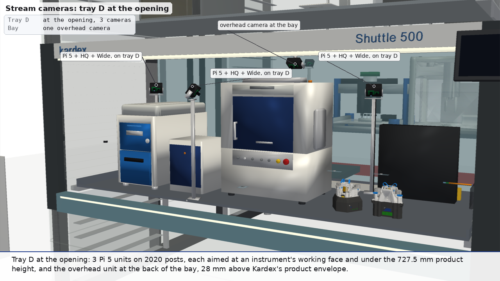
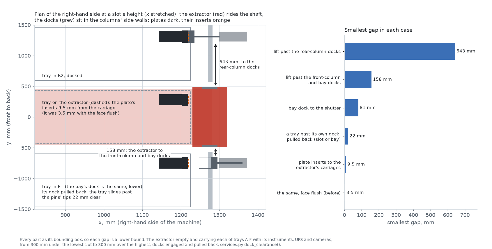
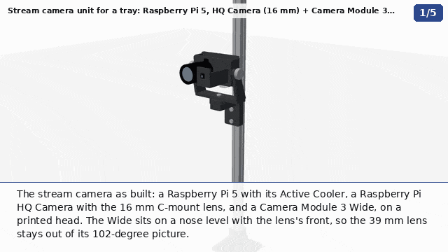
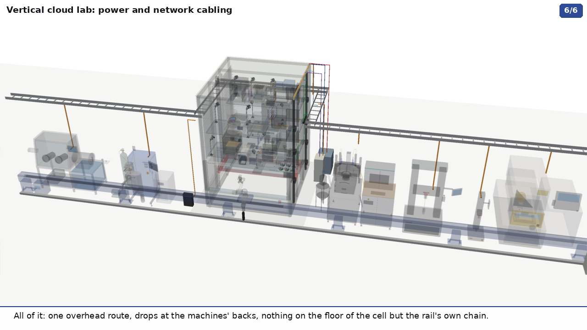

## Tray services: docking couplings, stream cameras, cabling and heat (round 4)

Kardex powers a tray in its slot and again at the opening, but not while the extractor carries it (#53). The dealer
offered a quick-connect cord to the device on the tray. A search of Kardex's Shuttle options found no powered tray and
no air or data to a tray. [`services.py`](../services.py) takes every service a tray needs through one automatic
coupling instead: mains, Ethernet, compressed air, N2 and chilled water. A UPS on the tray covers the transit.

| | GIF | MP4 |
|---|---|---|
| **Docking**: tray A leaves its slot, rides the extractor on its UPS and docks again at the opening; then the cameras | [`out/vlm_services.gif`](../out/vlm_services.gif) | [`out/mp4/vlm_services.mp4`](../out/mp4/vlm_services.mp4) |
| **Hookups and the UPS**: one tray from its slot to the bay, close up: the six media flowing, the valves shutting and venting, the UPS taking over, the bay's dock taking back | [`out/vlm_hookups.gif`](../out/vlm_hookups.gif) | [`out/mp4/vlm_hookups.mp4`](../out/mp4/vlm_hookups.mp4) |
| **The bay camera**: from an operator's eyes in front of the opening, then through its own two lenses while the arm works | [`out/bay_camera.gif`](../out/bay_camera.gif) | [`out/mp4/bay_camera.mp4`](../out/mp4/bay_camera.mp4) |
| **Cabling**: the line with only its cabling drawn solid | [`out/vlm_cabling.gif`](../out/vlm_cabling.gif) | [`out/mp4/vlm_cabling.mp4`](../out/mp4/vlm_cabling.mp4) |
| **All four, joined** (`services.py join`) | | [`out/mp4/vlm_services_all.mp4`](../out/mp4/vlm_services_all.mp4) |
| **The coupling on its own** (`tour.py tray_dock`) | [`out/instruments/tray_dock.gif`](../out/instruments/tray_dock.gif) | [`out/mp4/instruments/tray_dock.mp4`](../out/mp4/instruments/tray_dock.mp4) |
| **The camera unit on its own** (`tour.py stream_cam`) | [`out/instruments/stream_cam.gif`](../out/instruments/stream_cam.gif) | [`out/mp4/instruments/stream_cam.mp4`](../out/mp4/instruments/stream_cam.mp4) |



[`out/services.json`](../out/services.json) has the coupling, the docks against the lift, the camera clearances and
views, and the heat budget. [`out/cabling.json`](../out/cabling.json) has the circuits.
[`out/dock_lift_clearance.json`](../out/dock_lift_clearance.json) has every case of the dock check.

**The retractable line was dropped** (PR #318: "Let's remove the retractable line option for now. It overcomplicates
things for now."). Round 4 had a clip of tray A on an igus e-spool from the rear wall. It was a poor fit anyway:
- while its tray was out, the line spanned the shaft, so the extractor could fetch no other tray;
- it had to run in the 30 mm between the tray's side and the extractor's guide rails;
- the shutter needed a notch for it.

It suited one tray, kept at the opening's own height. The clip, its outputs and `tether_payout()` are gone; they are in
the git history.

### The coupling

**One plate per tray, on the back right corner, facing out through the tray's right-hand side.** Each slot a tray uses,
and the bay, has a matching dock in its right-hand side wall. The dock pushes in 60 mm, across the tray's travel. The
plate's face is 6 mm inside the tray's side, so nothing on a tray stands proud of it.

Why not on the back edge itself:
- A tray keeps its orientation. In a rear-column slot it is pushed home towards the rear wall, back edge first, so a
  dock on the rear wall would meet it head on.
- In a front-column slot and at the opening it is pushed home the other way, back edge last. The back edge then faces
  the shaft.
- A dock there would sit in the 106-146 mm between the tray and the extractor's platform. That is in the path of every
  tray the extractor pulls out of that column. At the opening the shutter is only 35 mm behind the tray.
- So a back-edge plate needs a different dock in each column, and the one at the opening has nowhere to go.

A side plate meets the same dock everywhere: rear slots, front slots and the bay. The dock's housing sits in the
cavity between the column's side wall and the cladding, about 108 mm in the model. It is clear of the extractor's
guide rails and of the shutter, and pulled back its pins' tips are 22 mm clear of the tray. One plate serves both
places.

### Do the docks get in the lift's way? No

PR #318 asked: "Are any of the docks going to interfere with the lift itself?" `dock_clearance()` checks it, with every
part as its bounding box, so each gap is a lower bound:
- the extractor (platform, carriages, tray-pull unit) runs the whole shaft, from 300 mm under the lowest slot to
  300 mm over the highest, in 10 mm steps;
- it runs empty, and carrying each of trays A-F with its instruments, UPS, plate and cameras;
- it passes every dock (the six slots in use and the bay's), both engaged and pulled back;
- each tray slides out of its slot onto the extractor, and from the extractor into the bay, past that place's dock.



| Case | Smallest gap |
|---|---|
| The extractor past the front-column docks and the bay's, at any height, empty or loaded, docked or pulled back | 158 mm |
| The extractor past the rear-column docks | 643 mm |
| A tray past its own dock, pulled back (out of its slot, or into the bay) | 22 mm |
| The bay's dock to the shutter | 81 mm |
| The plate's inserts to the extractor's carriages, with the tray on the extractor | 9.5 mm |

- **The docks are in the columns and the lift is in the shaft.** The dock's stroke is along x, across the tray, so
  whether it is engaged or pulled back makes no difference to the lift. The nearest dock is 158 mm from the
  extractor's carriages, in y.
- **The one tight place was the plate, not a dock.** The extractor guides a tray 5 mm from its carriages. With the
  plate's face flush with the tray's side, its inserts stood 1.5 mm proud and passed the carriages at 3.5 mm. The face
  is now 6 mm inside the tray's side, which gives 9.5 mm.
- **The stroke went from 45 to 60 mm.** The guide pins are 32 mm long with their conical tips. At 45 mm, pulled back,
  their tips were 13 mm from a passing tray; at 60 mm they are 22 mm. The housing moved out to start behind the
  pulled-back head (1298 mm from the centre).
- **Each dock needs a window in its side wall:** a column's perforated wall, or the bay's slatted one. The window takes
  out the tray supports 25-100 mm over the slot on that side. Only a tray stored in that slot would use them.

### The dock's valves, and what happens at each hand-over

Behind each dock, on each hose from the riser, is what switches it:
- a solenoid valve with a vent on air, N2, chilled water in and chilled water out;
- a contactor on the mains;
- a link light on the Ethernet.

In the model each has an indicator, green when open and red when shut. The tray's own lines run from the plate over
its bracket. The mains goes into the back of the UPS, which feeds the tray's power strip. The rest run along the back
rim, over the power strip, to a manifold left of the UPS.

`services.py hookups` ([`out/vlm_hookups.gif`](../out/vlm_hookups.gif)) follows tray A from R2 to the bay:
1. **Stored, docked.** All six media are live (dots running from the riser to the tray's end of each line). The UPS
   charges; its status strip is green.
2. **Letting go.** The four valves shut one by one and their lines vent. Then the contactor opens and the UPS takes the
   load: its strip and the tray's lamp go amber. Then the dock pulls back 60 mm.
3. **In transit.** About 6 s on the UPS, with a label riding along.
4. **At the bay.** The bay's dock pushes in, pins first. The contactor closes (the UPS recharges), then the valves open
   and the lines fill again.

The close-ups draw tray A's instruments faint, as its OT-2 stands in front of the UPS.

**The parts are Stäubli CombiTac's, from its catalogue:**

| Medium | Insert | Rating |
|---|---|---|
| Mains (L1, L2, N, PE) | 4 x Ø3 mm power units | 39 A, 600 V each |
| Ethernet | 10 Gbit module, RJ45 | Cat 6A, 10 Gbit/s, 14 N sliding force |
| Compressed air | RCT06 | 6 mm, shut-off on one side, 15 bar |
| Nitrogen | SCT03 | G1/8, shut-off on both sides, 15 bar |
| Chilled water in and out | 2 x LCT06 | G1/4, shut-off on both sides, 15 bar, 8.48 L/min at 5 m/s |
| Docking | CombiTac align 4 | pins on one side, conical sockets on the other; 4 mm radial and ±2° misalignment; 100,000 cycles |

- **The couplings must not part under pressure.** Stäubli prohibits connecting or disconnecting the pneumatic inserts
  under pressure. So the dock shuts and vents air, N2 and water before it pulls back, and opens them only after the
  plate is home.
- **The dock has to press the plate home.** The largest gap Stäubli allows between mated carriers is 1-2 mm. The
  standard frames don't float ("the customer must provide a stable guide system"); the align 4 parts add the pins and
  the conical sockets that take up the misalignment.
- Alternatives with similar figures:
  - ODU-MAC's P4+ docking frame: ±4 mm radial, 1 mm axial, 100,000 cycles.
  - Harting's Han docking frame: ±2 mm float, ±4 mm lock-in, at least 10,000 cycles.
  - CPC's Everis BLQ6, a blind-mate water coupling that disconnects under pressure without drips (search snippet).
- **The sequence**:
  1. The air, N2 and water supplies shut and vent.
  2. The UPS takes the load.
  3. The dock pulls back.
  4. The extractor moves the tray.
  5. The bay dock pushes in, pins first.
  6. The contacts mate, the supplies open, and the tray is back on mains.
- **The transit is short.** From R2 to the opening the tray moves 2 x 1030 mm in and out at Kardex's 0.7 m/s, about
  3 s, and 246 mm down at 2 m/s, 0.1 s. With the shutter and the accelerations, which Kardex doesn't publish, that is
  about 6 s. R4, the farthest slot, adds about 0.8 s of vertical travel.

### The UPS on each tray

Eaton's 5PX1500RTNG2 (120 V, 1500 VA), a 2U rack/tower unit 86 x 437 x 447 mm, stands on its side at the back right
of every tray, in front of the power strip. A 230 V 5PX 1500 runs 44 min at 300 W (a retailer's figure), against a
transit of seconds.

PR #318: "I'm seeing it now shows electrical hookups, but I didn't see anywhere that showed UPS-s." It was there, but
on tray A the OT-2 stands right in front of it. Now every UPS has "UPS" in white on its top and on the side facing the
front of the tray, and a status strip: green while it charges from the dock's mains, amber on battery. The tray's
mains line goes into its back. The hookups clip labels every tray's UPS, then draws tray A's instruments faint in
its close-ups. Its size and place (`UPS`, `UPS_AT` in `services.py`) are unchanged.

**It carries five of the six trays.** Each tray's load, from the makers' ratings where they publish them:

| Tray | Slot | Load, W | What dominates | Share that is our estimate |
|---|---|---|---|---|
| A | R2 | 297 | OT-2, 100-180 W active (Opentrons) | 37 % (the CubXL's 100 W) |
| B | R3 | 45 | the doser, 40 W (ours) | 91 % |
| C | F1 | 1244 | H2D, 1050 W average, 1320 W max at 110 V (Bambu, snippet) | 3 % |
| D | R1 | 1207 | SEM 500 VA (TM4000PlusIII; the II's figure wasn't found), XRD's 600 W tube | 8 % (the OpenFlexure array's 60 W) |
| E | R4 | 630 | three instruments with no published rating, 200 W each (ours) | 66 % |
| F | F2 | 3654 | Nabertherm NAT 15/65, 2.8 kW (Nabertherm) | 23 % (the polisher's 740 W) |

Tray F is over the UPS. Its furnace's heaters have to pause in transit, and its thermal mass carries the few seconds.
At 120 V the furnace alone would draw 23 A, so each dock carries L1, L2, N and PE on a 30 A breaker. That gives 208 V
and 120 V, 5 kVA continuous at 80 %, inside the contacts' 39 A.

### Utilities, and the heat

- **N2 generator: it doesn't fit a tray.** Parker Balston's UHPN2-1100 is 889 mm tall against the 727.5 mm limit. It
  is 305 x 406 mm, 50 kg and 120 V. It gives 500-1100 cc/min at 99.9999 %, and needs compressed air at 60-125 psig;
  it has no compressor of its own. It stands beside the VLM and feeds N2 through the docks.
- **Chiller: beside the VLM as well.** Thermo's ThermoFlex 900 removes 900 W at 20 °C. Its size and electrical input
  were not found, so the cabling scene draws it as a box, not to size. Beside the machine its heat goes into the room.
  On a tray it would go into the enclosure, and it would add its own input on top of the 900 W it moves.
- **Heat into the VLM.** Every watt a stored, powered tray uses ends up inside the cladding. The enclosure is
  2.83 x 3.12 x 3.95 m, with 56 m² of walls and roof.

  | Case | Heat, W | Rise with no ventilation (estimate) | Air for a 5 K rise | Air for a 10 K rise |
  |---|---|---|---|---|
  | Everything on at its rating | 7077 | 23 K | 4225 m³/h | 2113 m³/h |
  | Tray C printing in storage, the furnace holding at a third of 2.8 kW | 2277 | 7 K | 1360 m³/h | 680 m³/h |
  | Idle: controllers, cameras and UPSs, about 60 W a tray (ours) | 360 | 1 K | 215 m³/h | 107 m³/h |

  The rise uses 5.5 W/m²K for painted sheet steel in still air, the usual figure for sizing electrical enclosures.
  It is an estimate for a machine this size. The airflow is W / (ρ c_p ΔT) for air.
- **So a VLM holding a printer at work and a furnace needs forced ventilation,** about 700-1400 m³/h. A furnace at
  650 °C inside a sheet-metal store also needs Kardex's say-so.
- **What to ask Kardex:**
  - the heat a tray may give off in a slot, and in total;
  - the interior temperature the drives and controls are rated for;
  - whether a column can take a filtered fan and a roof outlet;
  - the extractor's repeatability at a slot, against the coupling's 4 mm;
  - whether a side wall can take a window and a dock;
  - whether power to a slot stays on while a tray is stored, and what they would fit.

### The stream cameras

**The unit as it would be built** (round 5). Asked for on PR #318: "more realistic by using actual Pi 5, camera,
etc. See robot-arms ... able to be adjusted in terms of angle and height."



- **The boards and the lens are robot-arms' CAD**, from Raspberry Pi's drawings (robot-arms PR #10,
  `piper-camera-mount/cad/piper_mount.py` and `lenses.py`):
  - a Raspberry Pi 5, 85 × 56 mm, with its ports and camera connectors, and its Active Cooler;
  - an HQ Camera with the CS mount's back-focus ring and tripod foot, and Raspberry Pi's 16 mm C-mount lens: Ø39 ×
    50 mm, 22.2 × 16.7°;
  - a Camera Module 3 Wide, 102 × 67°.

  The Active Cooler's fins and blower are ours, drawn from photos over robot-arms' 52 × 38 mm block.
- **The Wide sits on a nose 56 mm forward, level with the front of the lens.** Side by side on one plate, as DAL PR
  #189 mounts its M12 lens and the Wide, the 39 mm lens would sit in the left of the Wide's 102° picture. DAL #189's
  M12 lens, about Ø16 × 18 mm, is short enough not to.
- **The mount is ours**, after robot-arms PR #40's printed 2020 fixtures (a foot with a post socket, blocks on M5
  T-nuts, a Pi 5 plate on standoffs). Each adjustment is a joint:
  - **height:** a block slides up the post's T-slot and locks on two M5 drop-in T-nuts;
  - **pan:** a yoke turns on an M6 bolt through the block's arm, up to 75° each way;
  - **tilt:** the head turns between the yoke's arms on two thumb knobs, from 15° up to 65° down. At 65° the lens's
    front is 16 mm above the yoke's base.

  The Pi rides on the head behind the cameras, so neither ribbon flexes. One PoE lead leaves its Ethernet jack. The
  printed parts are drawn dark grey; DAL #189's are black PETG.
- **In a scene**, `rig_pose()` stands each post square to its tray, with its yaw a multiple of 90°. The pan and tilt
  then aim the head at the instrument.
- **Placement: in front of or beside the instrument, looking back** (PR #318: "The stream camera on tray A should be
  positioned closer to the front or middle to avoid capturing irrelevant things outside the bay (e.g., people/faces)").
  Every unit used to stand at the back of its tray and look forward, over its instrument and out through the
  opening: 20-60 % of each Wide picture was the room. `unit_view()` now measures that. With the tray presented, it
  casts the Wide's 102 × 67° picture and the HQ's 22.2 × 16.8° through the opening. A ray counts as seeing the room if
  it leaves through the opening before it meets the tray's floor. Nothing else counts as cover, since the instruments
  have windows.
- **The units were then placed by a search** over post positions (35 mm grid), the four post yaws and up to ten aim
  points on each instrument. It took the least room in either picture, then the closest view. Each post had to be:
  - 15 mm or more from every instrument's box, the UPS and the service plate (the UPS and the plate were not in the
    check before);
  - inside the rim;
  - off the middle half of each instrument's front, where the arm works, and on tray B off the front between the rack
    and the doser's cup.
- **11 of 13 units now see none of the room.** Two still see some, both in the Wide's picture; no HQ does:

  | Unit | Watches | Room in the Wide's picture, now | Before |
  |---|---|---|---|
  | A0 | the CubXL and its potentiostat, from their left | 0 % | 36 % |
  | A1 | the OT-2, from behind the CubXL (no room in front of the OT-2) | 26 % | 35 % |
  | B0 | the doser, from its right | 0 % | 60 % |
  | C0, C1, D0, D1, E0-E2, F0, F1 | | 0 % | 20-45 % |
  | D2 | the OpenFlexure array, which is at the front edge | 15 % | 25 % |

  Those two streams want a privacy crop: the Pi's camera stack can crop the sensor (libcamera's ScalerCrop), or the
  stream can mask the top of the picture.
- **Tray B is down to one unit.** Its rack camera ended up in the middle of the tray, in the arm's way and in the middle
  of the bay camera's picture. The bay camera sees the rack.
- **Clear of the instruments.** D0, E0 and F1 touched their instruments' boxes; A0 and B0 stood inside the tray plan's new
  CubXL + EZstat frame and multi-doser. All are clear now: `setup_lab.py fit` reads ok for trays A-F; every unit is
  inside the rim and its top is 688 mm or less over the tray floor.
  `tray_instrument_boxes()` also has tray B's vial rack now, which it missed.

  Each unit's yaw, pan, tilt, gap and view are in `services.json` (`cameras.clearances`, `cameras.views`); the old
  positions are `TRAY_CAMS_ROUND5`.

**On the trays, not the machine.** The cameras go on 2020 posts clamped to each tray, 2 or 3 to a tray:
- They watch the instrument wherever the tray is. The printers and the CubXL keep working in storage, where nothing
  fixed to the machine can see them.
- The tray's dock already brings power and Ethernet, so a Pi needs no wiring of its own.
- A camera fixed to a slot would have to be re-aimed whenever a tray changes slot or load.

Every tray unit's top is at most 688 mm over the tray floor, 40 mm under the 727.5 mm limit. The tilt axis stands
640 mm up and, tilted down, the head rises at most 48 mm above it. The tall instruments (the MiniFlex at 722 mm, the
OT-2 at 662 mm) can't be looked into from above within the limit, so their cameras stand beside them and look in
through the side or the door.

[`out/vlm_cameras_still.png`](../out/vlm_cameras_still.png) (`services.py cameras`) shows tray E at the opening with
its three units and the bay's. It was tray D. D's two OpenFlexures need their OpenSCAD meshes in `.cache/`, which this
render didn't have.

**One overhead unit at the bay, on the machine.** The same head and yoke, tilted 64° down, on a 2020 bar across the
back of the bay.
- **It had to lose its post for the 996 mm opening.** The taller opening (vlm.py) raises the top of Kardex's product
  envelope to 854 + 3 + 856.5 + 20 = 1733.5 mm. Tray F1, stored over the opening, is still at 1900 mm. That leaves
  166.5 mm, and the unit on its 90 mm post and sliding block was 221 mm tall. So its yoke is now bolted straight onto
  a printed saddle clamp on the bar (`bay_at()`): 144 mm from the clamp's underside to the head's top.
- **Height.** The clamp is the lowest point, at 1744.5 mm: 11 mm over the envelope. The head's top is at 1888 mm,
  12 mm under tray F1. If F1 moves up a slot or two, the post can come back.
- **Depth.** The bar is 72 mm in front of the shutter's plane; the head's back is 24 mm clear of the shutter.
- **What it sees.** The Wide sees 95 % of the presented tray's floor. Its axis meets the floor 65 mm in front of the
  tray's centre, 1028 mm away. It misses two triangles at the back corners nearest it. The HQ sees 7 %: the detail.
- **Against the arm: 295 mm clear** (`bay_arm_clearance()`, `cameras.bay_camera.arm` in `services.json`) over 320 of `reach.py`'s
  poses, the workflow's seats and every reachable point of the presented tray on a 100 mm grid, gripper down, 100 and
  250 mm over its floor. It draws the UR10e as 75 mm capsules round its links from the shoulder to the TCP. The
  nearest approach is 250 mm over the tray, near the middle of its back, with the highest joint at 1378 mm.
- Round 4's unit hung from the bar at 1735 mm, tilted 58°; round 5's stood on a 90 mm post on a bar at 1650 mm.

**Its own clip** (`services.py baycam`, [`out/bay_camera.gif`](../out/bay_camera.gif); PR #318: "It probably deserves
its own sequence and showing an upward looking angle from the front of the bay as if an operator and then also a
rendered view of what the camera would see"):
1. An operator's view: eyes at 1.6 m, 0.9 m in front of the opening, looking up at the unit under the header.
2. Its two pictures drawn as see-through pyramids down to the tray: the Wide's (blue) and the HQ's (orange).
3. The Wide's own picture, rendered from its lens's position and aim, 102° across, while the arm takes a vial from
   tray B's rack to the doser's cup.
4. The HQ's, 22.2 × 16.8°, pillarboxed to its 4:3 sensor, with the head turned on its joints onto the doser's cup
   (pan 20°, tilt 44° down): a close-up of the gripper.

**The fields of view, with sources:**

| Camera | Across | Up and down | Diagonal | From |
|---|---|---|---|---|
| Camera Module 3 Wide | 102° | 67° | 120° | Raspberry Pi's figures |
| HQ Camera, 16 mm lens | 22.2° | 16.8° | 27.6° | IMX477: 4056 × 3040 pixels of 1.55 µm = 6.29 × 4.71 mm (Raspberry Pi's product brief); 2 atan(6.29 / 32) = 22.2° |

Raspberry Pi gives 102° for the Wide across, not diagonally; its diagonal is 120°. The render is a pinhole camera: a
16:9 picture 102° across is 69.6° up and down, so the clip blacks out 17 px at the top and bottom to show 67°. The HQ's
figures agree with Raspberry Pi's lens table for the 16 mm lens on the HQ Camera (22.2 × 16.7°).

Power: Raspberry Pi's PoE+ HAT lists only the Pi 4 and 3B+. For a Pi 5 that means Waveshare's PoE HAT (H) or (J), or
the 27 W USB-C supply from the tray's power strip. A Pi 5 takes about 4 W typical (800 mA at 5 V).

The docking and cabling chapters were re-rendered with the new placements and the bay unit's new mount; `setup_lab`
picks them up the next time it is rendered, through `add_cameras`.

### Cabling



**One overhead ladder tray at 2.8 m.** It runs 300 mm wide behind the line's machines and round the back of the VLM.
The ladder is at y = -560 mm, behind the machines' backs (y = -700 to -927 mm); it passes over the Aconity and the
wire EDM, which are deeper.
There is a drop to each machine's back or top.

**Into the VLM:**
- its own 208 V three-phase supply goes into the back;
- the dock circuits go over the roof into two service risers, one per column, in the right-hand side cavity;
- a PoE+ switch on the VLM's side feeds the risers and the bay camera;
- N2 and chilled water come from the units beside it, and house air from the ladder.

**The rail:** its energy chain lies in a trough on the beam's side towards the machines. The chain's fixed end is
halfway along the carriage's travel, and its bend follows the carriage at half its speed (the rail's tour clip).
`vlm_line` drives its 17 m beam in mm and keeps the old fixed chain. MachineMotion 2 and the UR control box stand at
the rail's end. The MiR's charger is in the gap left of the VLM; it matters only for the MiR layout.

**Published ratings** (with each source in `cabling.json`):

| Machine | Supply | Load |
|---|---|---|
| Kardex Shuttle XP 500 | 208 V 3-phase (#53) | not published; a used 2450 x 864 unit lists 400 V 17 A (snippet) |
| rePowder atomizer and its chiller | 400 V 3-phase and 230 V, 32 A plugs | the optimizer up to about 60 A (the install call) |
| FANUC ROBOCUT α-C400iC | 200 V 3-phase | 13 kVA (snippet), 36 A per phase at 208 V |
| Instron 68FM-100 | 208-240 V 1-phase, or 208/240/400 V 3-phase (preferred) | not found |
| Instron 68SC-2 | 100-240 V 1-phase | 1400 VA (table models) |
| Vention MachineMotion 2 | 85-264 V | 1200 W typical |
| UR10e control box | 100-240 V | 350 W typical, 615 W maximum |
| MiR Charge 48V | 100-240 V, a 15 A outlet | 48 V, 40 A out |
| Aconity MIDI, Inert glovebox | not found | not found |

The wire EDM is the biggest single load. With the VLM, the rePowder and the trays, the line needs a three-phase panel
of its own. Its size waits on the two figures not found.

### Caveats

- **Kardex hasn't seen any of this.** The side-wall window, the cavity width, the risers and the docks' places are
  layout choices.
- **Many ratings are search snippets.** Many figures come from search-result snippets of pages that weren't opened.
  Each is marked so in the JSON. Those for Bambu, Hitachi, Buehler, Instron, FANUC, Eaton, Parker and Thermo should
  be checked against the makers' sheets.
- **Some loads are ours.** Five tray loads are estimates: the CubXL, the doser, the PIP, the nanoindenter and the
  OpenFlexures.
- **The bay camera is checked against `reach.py`'s poses only.** The chapters' own arm paths, between those poses,
  aren't checked; nor are the `baycam` clip's straight joint moves.
- **The bay unit fits with 11-12 mm to spare** above the 996 mm opening's estimated envelope and under tray F1. That
  envelope (856.5 mm of product) is itself an estimate (vlm.py).
- **The tray cameras' room check ignores the instruments** as cover, and the arm's own paths past the posts at the
  front of the trays aren't checked.
- **Some boxes are not to size:** the MiR charger is a marker, and the chiller is a placeholder.

### Calling these from other scenes

```python
import services as S
S.add_tray_cameras(sc, "D")                  # units on tray D (rides tray_D); layout=[(x, y, aim_x, aim_y, aim_z)]
S.add_bay_camera(sc)                         # the overhead unit at the bay; returns its head's group
S.rig_pose(x, y, (ax, ay, az))               # a unit at (x, y) aimed at a point: (post yaw, pan, tilt), degrees
S.head_point(x, y, ax, ay, az)               # where that unit's head is, tray frame; S.bay_cam_point() for the bay's
S.add_docks(sc, ["R2", "open"])              # docks (and the two risers) at slots / the bay; returns {pos: head group}
S.set_dock(sc, "open", u)                    # 0 engaged, 1 pulled back 60 mm
S.set_switches(sc, "open", on)               # the dock's valves, contactor and link light: True / False or {medium: bool}
names = S.add_tray_services(sc, "A")         # plate, lines, UPS with its label and strip on tray A; the line actors
S.set_live(sc, names, f)                     # lines grey (0, shut) to coloured (1, live)
S.set_ups(sc, "A", battery)                  # the UPS's status strip: green on mains, amber on battery
flow = S.Flow(sc, ["R2", "open"])            # dots along each live medium; flow.set(pos, f[, keys]) fills 0 to 1
S.unit_view(x, y, ax, ay, az, post)          # how much of the room a tray unit sees with its tray presented
S.dock_clearance()                           # the docks against the lift (out/dock_lift_clearance.json)
S.make_lab(sc, data)                         # animate.Lab whose gauges come from lab.svc_lines, lamps amber on a UPS
S.build_vlm(name, data, idata, title)        # the VLM with trays A-F, their instruments, docks and cameras
```

Run: `xvfb-run -a python3 services.py services hookups baycam cabling cameras clearance json join`, and
`xvfb-run -a python3 tour.py tray_dock stream_cam`.
