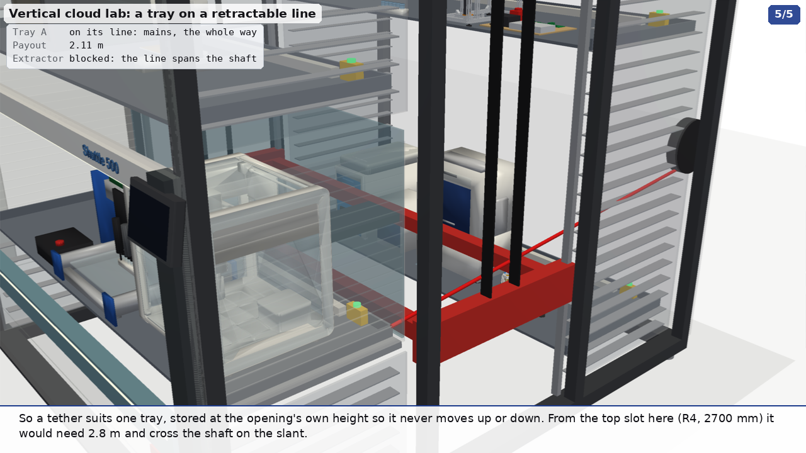

## Tray services: docking couplings, stream cameras, cabling and heat (round 4)

Kardex powers a tray in its slot and again at the opening, but not while the extractor carries it (#53). The dealer
offered a quick-connect cord to the device on the tray. Kardex's own option list for the Shuttle shows no powered tray
and no air or data to a tray. [`services.py`](../services.py) takes every service a tray needs through one automatic
coupling instead: mains, Ethernet, compressed air, N2 and chilled water. A UPS on the tray covers the transit.

| | GIF | MP4 |
|---|---|---|
| **Docking**: tray A leaves its slot, rides the extractor on its UPS and docks again at the opening; then the cameras (34 s) | [`out/vlm_services.gif`](../out/vlm_services.gif) | [`out/mp4/vlm_services.mp4`](../out/mp4/vlm_services.mp4) |
| **Cabling**: the line with only its cabling drawn solid | [`out/vlm_cabling.gif`](../out/vlm_cabling.gif) | [`out/mp4/vlm_cabling.mp4`](../out/mp4/vlm_cabling.mp4) |
| **Tether**: tray A on a retractable line instead of a coupling | [`out/vlm_tether.gif`](../out/vlm_tether.gif) | [`out/mp4/vlm_tether.mp4`](../out/mp4/vlm_tether.mp4) |
| **The coupling on its own** (`tour.py tray_dock`) | [`out/instruments/tray_dock.gif`](../out/instruments/tray_dock.gif) | [`out/mp4/instruments/tray_dock.mp4`](../out/mp4/instruments/tray_dock.mp4) |
| **The camera unit on its own** (`tour.py stream_cam`) | [`out/instruments/stream_cam.gif`](../out/instruments/stream_cam.gif) | [`out/mp4/instruments/stream_cam.mp4`](../out/mp4/instruments/stream_cam.mp4) |


[`out/services.json`](../out/services.json) has the coupling, the camera clearances, the heat budget and the tether's
payout. [`out/cabling.json`](../out/cabling.json) has the circuits.

### The coupling

**One plate per tray, on the back right corner, facing out through the tray's right-hand side.** Each slot a tray uses,
and the bay, has a matching dock in its right-hand side wall. The dock pushes in 45 mm, across the tray's travel.

Why not on the back edge itself:
- A tray keeps its orientation. In a rear-column slot it is pushed home towards the rear wall, back edge first, so a
  dock on the rear wall would meet it head on.
- In a front-column slot and at the opening it is pushed home the other way, back edge last. The back edge then faces
  the shaft.
- A dock there would sit in the 106-146 mm between the tray and the extractor's platform. That is in the path of every
  tray the extractor pulls out of that column. At the opening the shutter is only 35 mm behind the tray.
- So a back-edge plate needs a different dock in each column, and the one at the opening has nowhere to go.

A side plate meets the same dock everywhere: rear slots, front slots and the bay. The dock's housing sits in the
cavity between the column's side wall and the cladding, about 108 mm in the model. It is clear of the extractor's
guide rails and of the shutter, and pulled back it is 20 mm clear of the tray. One plate serves both places.

**The parts are Stäubli CombiTac's, from its catalogue:**

| Medium | Insert | Rating |
|---|---|---|
| Mains (L1, L2, N, PE) | 4 x Ø3 mm power units | 39 A, 600 V each |
| Ethernet | 10 Gbit module, RJ45 | Cat 6A, 10 Gbit/s, 14 N sliding force |
| Compressed air | RCT06 | 6 mm, shut-off on one side, 15 bar |
| Nitrogen | SCT03 | G1/8, shut-off on both sides, 15 bar |
| Chilled water in and out | 2 x LCT06 | G1/4, shut-off on both sides, 15 bar, 8.48 L/min at 5 m/s |
| Docking | CombiTac align 4 | pins on one side, conical sockets on the other; 4 mm radial and ±2° misalignment; 100,000 cycles |

- **The couplings must not part under pressure.** Stäubli prohibits connecting or disconnecting the pneumatic inserts
  under pressure. So the dock shuts and vents air, N2 and water before it pulls back, and opens them only after the
  plate is home.
- **The dock has to press the plate home.** The largest gap Stäubli allows between mated carriers is 1-2 mm. The
  frames don't float on their own: "the customer must provide a stable guide system".
- Alternatives with similar figures:
  - ODU-MAC's P4+ docking frame: ±4 mm radial, 1 mm axial, 100,000 cycles.
  - Harting's Han docking frame: ±2 mm float, ±4 mm lock-in, at least 10,000 cycles.
  - CPC's Everis BLQ6, a blind-mate water coupling that disconnects under pressure without drips (search snippet).
- **The sequence**:
  1. The air, N2 and water supplies shut and vent.
  2. The UPS takes the load.
  3. The dock pulls back.
  4. The extractor moves the tray.
  5. The bay dock pushes in, pins first.
  6. The contacts mate, the supplies open, and the tray is back on mains.
- **The transit is short.** From R2 to the opening the tray moves 2 x 1030 mm in and out at Kardex's 0.7 m/s, about
  3 s, and 246 mm down at 2 m/s, 0.1 s. With the shutter and the accelerations, which Kardex doesn't publish, that is
  about 6 s. R4, the farthest slot, adds about 0.8 s of vertical travel.

### The UPS on each tray

Eaton's 5PX1500RTNG2 (120 V, 1500 VA), a 2U rack/tower unit 86 x 437 x 447 mm, stands on its side at the back right
of every tray, in front of the power strip. A 230 V 5PX 1500 runs 44 min at 300 W (a retailer's figure), against a
transit of seconds.

**It carries five of the six trays.** Each tray's load, from the makers' ratings where they publish them:

| Tray | Slot | Load, W | What dominates | Share that is our estimate |
|---|---|---|---|---|
| A | R2 | 297 | OT-2, 100-180 W active (Opentrons) | 37 % (the CubXL's 100 W) |
| B | R3 | 49 | the doser, 40 W (ours) | 84 % |
| C | F1 | 1244 | H2D, 1050 W average, 1320 W max at 110 V (Bambu, snippet) | 3 % |
| D | R1 | 1166 | SEM 500 VA (TM4000PlusIII; the II's figure wasn't found), XRD's 600 W tube | 5 % |
| E | R4 | 630 | three instruments with no published rating, 200 W each (ours) | 66 % |
| F | F2 | 3654 | Nabertherm NAT 15/65, 2.8 kW (Nabertherm) | 3 % |

Tray F is over the UPS. Its furnace's heaters have to pause in transit, and its thermal mass carries the few seconds.
The furnace and the polisher also want 208 V, so each dock carries L1, L2, N and PE on a 30 A breaker. That gives 208 V
and 120 V, 5 kVA continuous at 80 %, inside the contacts' 39 A.

### Utilities, and the heat

- **N2 generator: it doesn't fit a tray.** Parker Balston's UHPN2-1100 is 889 mm tall against the 727.5 mm limit. It
  is 305 x 406 mm, 50 kg and 120 V. It gives 500-1100 cc/min at 99.9999 %, and needs compressed air at 60-125 psig;
  it has no compressor of its own. It stands beside the VLM and feeds N2 through the docks.
- **Chiller: beside the VLM as well.** Thermo's ThermoFlex 900 removes 900 W at 20 °C. Its size and electrical input
  were not found, so the cabling scene draws it as a box, not to size. Beside the machine its heat goes into the room.
  On a tray it would go into the enclosure, and it would add its own input on top of the 900 W it moves.
- **Heat into the VLM.** Every watt a stored, powered tray uses ends up inside the cladding. The enclosure is
  2.83 x 3.12 x 3.95 m, with 56 m² of walls and roof.

  | Case | Heat, W | Rise with no ventilation (estimate) | Air for a 5 K rise | Air for a 10 K rise |
  |---|---|---|---|---|
  | Everything on at its rating | 7040 | 23 K | 4200 m³/h | 2100 m³/h |
  | Tray C printing in storage, the furnace holding at a third of 2.8 kW | 2277 | 7 K | 1360 m³/h | 680 m³/h |
  | Idle: controllers, cameras and UPSs, about 60 W a tray (ours) | 360 | 1 K | 215 m³/h | 107 m³/h |

  The rise uses 5.5 W/m²K for painted sheet steel in still air, the usual figure for sizing electrical enclosures.
  It is an estimate for a machine this size. The airflow is W / (ρ c_p ΔT) for air.
- **So a VLM holding a printer at work and a furnace needs forced ventilation,** about 700-1400 m³/h. A furnace at
  650 °C inside a sheet-metal store also needs Kardex's say-so.
- **What to ask Kardex:**
  - the heat a tray may give off in a slot, and in total;
  - the interior temperature the drives and controls are rated for;
  - whether a column can take a filtered fan and a roof outlet;
  - the extractor's repeatability at a slot, against the coupling's 4 mm;
  - whether a side wall can take a window and a dock;
  - whether power to a slot stays on while a tray is stored, and what they would fit.

### The stream cameras

**The unit is the lab's own design.** It is DAL PR #189's front unit without its display, since no one stands at a
tray:
- An HQ Camera (M12) with a 16 mm M12 lens, beside a Camera Module 3 Wide. The boards are 2 mm apart, the HQ's lens
  15 mm left of the axis and the Wide's 18.5 mm right.
- The Pi 5 and its Active Cooler behind them, in a black PETG box of 95 x 66 x 46 mm. The box size is ours.
- A 2020 extrusion post, as on PR #189's top unit, with a 1/4-20 tilt joint, as DAL #147 recommends over a printed
  ball joint.
- The board sizes are Raspberry Pi's drawings: HQ 38 x 38 mm, Camera Module 3 25 x 24 mm, Pi 5 85 x 56 mm.
- The Wide sees 102 x 67°. The HQ behind a 16 mm lens sees about 22 x 17°; that is our figure, from the IMX477's
  6.29 x 4.71 mm active area.

**On the trays, not the machine.** The cameras go on 2020 posts clamped to each tray, 2 or 3 to a tray:
- They watch the instrument wherever the tray is. The printers and the CubXL keep working in storage, where nothing
  fixed to the machine can see them.
- The tray's dock already brings power and Ethernet, so a Pi needs no wiring of its own.
- A camera fixed to a slot would have to be re-aimed whenever a tray changes slot or load.

Every tray unit's top is at most 687 mm over the tray floor, 40 mm under the 727.5 mm limit. Each unit is aimed at
its instrument's working face. The tall instruments (the MiniFlex at 722 mm, the OT-2 at 662 mm) can't be looked into
from above within the limit, so their cameras stand beside them and look in at the door.

[`out/vlm_cameras_still.png`](../out/vlm_cameras_still.png) (`services.py cameras`) shows tray D at the opening with its three units and the bay's.

**One overhead unit at the bay, on the machine.** It hangs from a 2020 bar across the back of the bay, 650 mm behind
the front, tilted 58° down:
- Its lowest point is 1633 mm, 28 mm above the top of Kardex's product envelope at the opening (854 + 3 + 727.5 + 20
  = 1604.5 mm). It stays clear of the shutter's plane.
- Its axis meets the tray 129 mm in front of the tray's centre, 961 mm away. There the Wide spans about 2.37 m of the
  2.45 m tray, and the HQ about 0.38 m.

Power: Raspberry Pi's PoE+ HAT lists only the Pi 4 and 3B+. For a Pi 5 that means Waveshare's PoE HAT (H) or (J), or
the 27 W USB-C supply from the tray's power strip. A Pi 5 takes about 4 W typical (800 mA at 5 V).

### Cabling


**One overhead ladder tray at 2.8 m.** It runs 300 mm wide behind the line's machines and round the back of the VLM.
The machines' backs are at y = -758 to -927 mm; the ladder passes over the Aconity and the wire EDM, which are deeper.
There is a drop to each machine's back or top.

**Into the VLM:**
- its own 208 V three-phase supply goes into the back;
- the dock circuits go over the roof into two service risers, one per column, in the right-hand side cavity;
- a PoE+ switch on the VLM's side feeds the risers and the bay camera;
- N2 and chilled water come from the units beside it, and house air from the ladder.

**The rail:** its cable chain lies in a trough in front of the beam. MachineMotion 2 and the UR control box stand at
the rail's end. The MiR's charger is in the gap left of the VLM; it matters only for the MiR layout.

**Published ratings** (with each source in `cabling.json`):

| Machine | Supply | Load |
|---|---|---|
| Kardex Shuttle XP 500 | 208 V 3-phase (#53) | not published; a used 2450 x 864 unit lists 400 V 17 A (snippet) |
| rePowder atomizer and its chiller | 400 V 3-phase and 230 V, 32 A plugs | the optimizer up to about 60 A (the install call) |
| FANUC ROBOCUT α-C400iC | 200 V 3-phase | 13 kVA (snippet), 36 A per phase at 208 V |
| Instron 68FM-100 | 208-240 V 1-phase, or 208/240/400 V 3-phase (preferred) | not found |
| Instron 68SC-2 | 100-240 V 1-phase | 1400 VA (table models) |
| Vention MachineMotion 2 | 85-264 V | 1200 W typical |
| UR10e control box | 100-240 V | 350 W typical, 615 W maximum |
| MiR Charge 48V | 100-240 V, a 15 A outlet | 48 V, 40 A out |
| Aconity MIDI, Inert glovebox | not found | not found |

The wire EDM is the biggest single load. With the VLM, the rePowder and the trays, the line needs a three-phase panel
of its own. Its size waits on the two figures not found.

### The tether, instead of a coupling



An igus e-spool carries power, data and air on one spool with no slip ring, up to 15 m (e-spool flex 2.0; the
motor-driven e-spool power does 25 m). Spring reels from Conductix-Wampfler and Hannay are alternatives. The clip puts
one on the rear wall behind tray A's slot. Its line runs in the 30 mm between the tray's side and the extractor's
guide rails.

**The payout is short.** It is 2.1 m from R2, and 2.2-2.8 m from the other slots, the most from R4 at 2700 mm. Any of
these spools covers it.

**The geometry is what limits it:**
- The line has to stay in that 30 mm gap. Anywhere else it crosses a guide rail or the extractor's carriages.
- The shutter needs a notch at its right-hand end for the line.
- **While the tray is out, its line spans the shaft at the extractor's height.** The extractor can't fetch any other
  tray until this one goes home.
- So a tether suits one tray, stored at the opening's own height, whose moves are only in and out. The taller the
  machine and the higher the slot, the longer the line, and the more of the shaft it crosses on the slant.

### Caveats

- **Kardex hasn't seen any of this.** The side-wall window, the cavity width, the risers and the docks' places are
  layout choices.
- **Many ratings are search snippets.** Many figures come from search-result snippets of pages that weren't opened.
  Each is marked so in the JSON. Those for Bambu, Hitachi, Buehler, Instron, FANUC, Eaton, Parker and Thermo should
  be checked against the makers' sheets.
- **Some loads are ours.** Five tray loads are estimates: the CubXL, the doser, the PIP, the nanoindenter and the
  OpenFlexures.
- **The bay camera hasn't been checked against the arm.** It is 880 mm behind the front, where `reach.py`'s closest
  approach to the header (118 mm) doesn't apply. Run the workflow's poses against it.
- **Some boxes are not to size:** the e-spool and the MiR charger are markers, and the chiller is a placeholder.

### Calling these from other scenes

```python
import services as S
S.add_tray_cameras(sc, "D")                  # units on tray D (rides tray_D); layout=[(x, y, aim_x, aim_y, aim_z)]
S.add_bay_camera(sc)                         # the overhead unit at the bay; returns its group
S.add_docks(sc, ["R2", "open"])              # docks (and the two risers) at slots / the bay; returns {pos: head group}
S.set_dock(sc, "open", u)                    # 0 engaged, 1 pulled back 45 mm
names = S.add_tray_services(sc, "A")         # plate, lines and UPS on tray A; returns the line actors
S.set_live(sc, names, f)                     # lines grey (0, shut) to coloured (1, live)
S.make_lab(sc, data)                         # animate.Lab whose gauges come from lab.svc_lines, lamps amber on a UPS
S.build_vlm(name, data, idata, title)        # the VLM with trays A-F, their instruments, docks and cameras
```

Run: `xvfb-run -a python3 services.py services cabling tether cameras json`, and `xvfb-run -a python3 tour.py tray_dock
stream_cam`.
