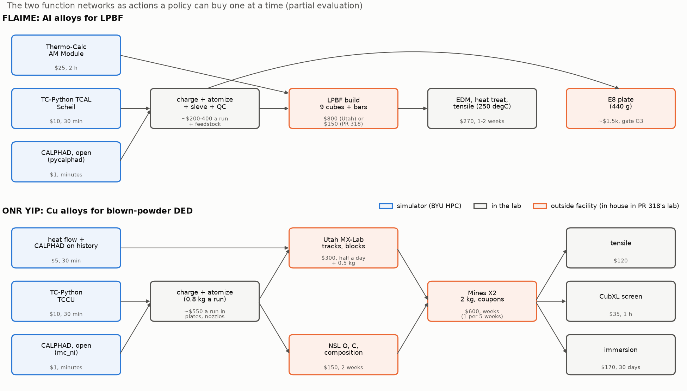
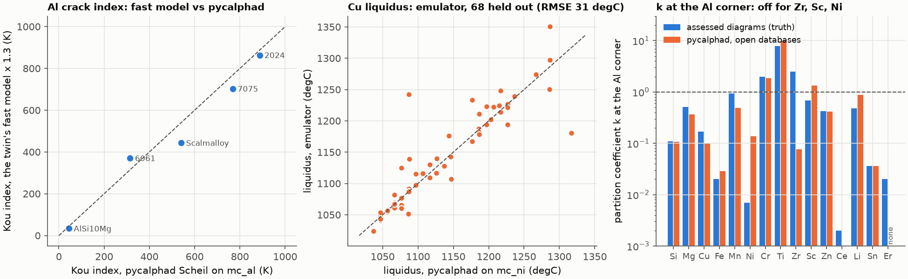
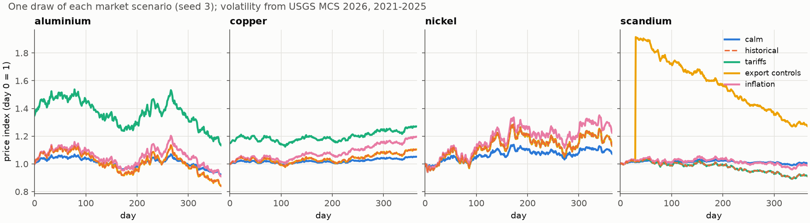
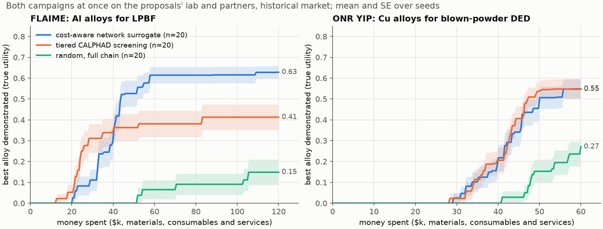
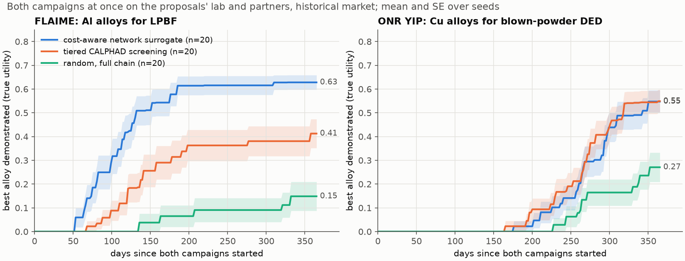
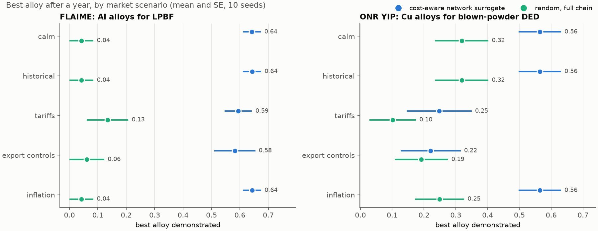
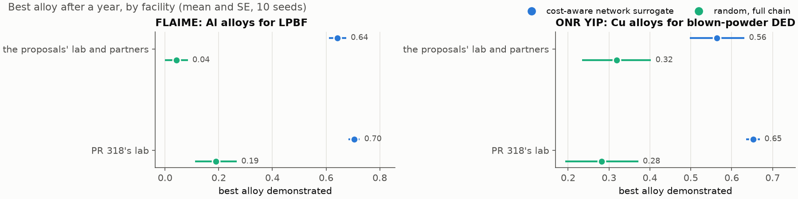
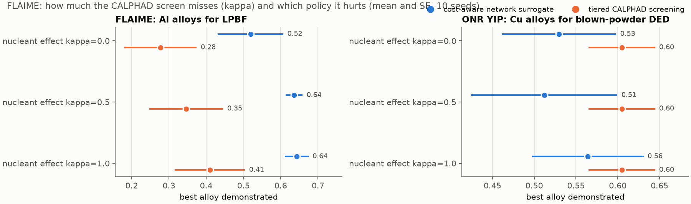
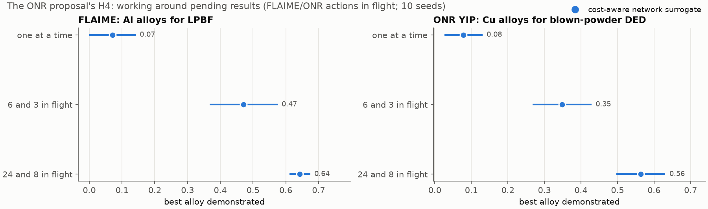

# A digital twin of the manufacturing network, for synthetic benchmarks

Sterling, on PR 318 (2026-11-24): "open a new PR focused on building a best-effort digital twin optimization function
for the full manufacturing network (for running synthetic benchmarks, including running whatever open source
physics-based simulations and database lookups that we can, including also proprietary ones that we have access to)
based on the proposed campaigns in the two proposals ... it needs to be two simultaneous, independent campaigns ...
This also needs to consider things like lead times and market supply uncertainty (or cost increase driven by supply
chain risks that can be sporadic and temporal or stable and consistent)." Tracking issue: DAL #276.

The code is [`../twin/`](../twin/README.md). This file is the design, the sources, the checks and the first results.

## What it is

DAL's preliminary benchmark (`benchmarks/bofn-prelim`, used in both proposals) is a hand-written function network:
composition → CALPHAD ($10) → atomize ($1,500) → print ($2,500) → tensile ($200), one objective, no noise. The ONR
proposal lists what it leaves out: "no measurement noise, one objective, no corrosion branch, no process physics,
and one experiment at a time", and its Task 1 promises "simulated benchmarks that replace the functions of Fig. synth
with copper and DED ones, with noise, multiple objectives, a corrosion branch, and delays drawn from measured
turnaround times". The twin is that, for both proposals at once, on the lab and partners they name (or on PR 318's
vertical lab), with the market they will buy from:

* **two campaigns, simultaneous and independent**: FLAIME (Al, LPBF) and the ONR YIP (Cu, blown-powder DED), each
  with its own search space, network, ground truth, objectives, budget, stores and policy;
* **one facility and one market** that they share, as they would: the atomizer (with an Al↔Cu changeover), the SEM,
  the partners, one clock, the same prices;
* **physics and data where they exist**: pycalphad on open CALPHAD databases, USGS commodity data, process models
  from the literature, DAL's own procurement record; Thermo-Calc behind the same interface;
* **gaps where the lab has them**: what the simulators cannot see (nucleants, the open databases' own errors,
  retained β′, film formation) is in the truth and not in the simulators.

## The two campaigns

| | FLAIME (Genesis Mission, DAL `consolidation-2`) | ONR YIP (DAL PR 117, copper-DED version) |
|---|---|---|
| Alloys | Al + Mn, Cr, Zr, Mg, Si, Cu, Ti, Fe, Ni, Ce, Sc, Li, Er, Zn, Sn; Al ≥ 85 wt% | Cu + Ni 0-30, Al 0-9.5, Fe 0-4.5, Mn 0-4, Cr 0-0.7, Si 0-0.5, Nb 0-0.8, Ti 0-0.5; Cu ≥ 65 |
| Bounds and rules | `alloy_element_bounds.csv` recommended uppers; Mg+Zn+Li ≤ 10, Cu+Mg ≤ 5, Sc+Zr ≤ 1.5; 2-8 elements on | Table "tab:space"; Cr, Nb (and Si) only where Al ≤ 3; Si > 0.1 only with Nb; Al > 7 → Ni ≥ Fe; Al < 1.5 → Fe ≤ 2.3; liquidus ≤ 1,250 °C (black box) |
| Process | atomizer (superheat, pour pressure, amplitude); LPBF power, speed, hatch, layer, plate temperature | atomizer; DED power, travel speed, powder feed |
| Network | CALPHAD (open, TC-Python, AM Module) → powder → LPBF build → tensile → E8 plate | CALPHAD (open, TC-Python), heat flow → powder → NSL → pre-placed / small DED (Utah) → 2 kg DED (Mines) → tensile, corrosion screen, 30-day immersion |
| Objectives | yield strength, elongation, mineral burden (CMDRI_log); gates: ≥ 99.5 % dense and crack-free (G2), MBS_lin ≤ 10 % of Scalmalloy's (G3a); discovery: YS ≥ 250 and EL ≥ 5, or YS ≥ 200 and EL ≥ 8 (G3) | yield strength, elongation, long-term seawater rate, nickel; feasible if ≥ 99 % dense and crack-free; H5 pass: rate ≤ 70-30's and selective attack ≤ 3 µm |
| Money (non-personnel, per year; assumed) | $120,000 | $60,000 |

The money is ours: FLAIME's $750k over nine months and the ONR's $748k over three years are mostly people and F&A;
these are the materials, consumables and services lines, rounded. `twin/bench.py` `BUDGET`.

## Physics and data

### CALPHAD (`twin/calphad.py`, `twin/thermo.py`)

* **Databases**: MatCalc's open `mc_al` v2.037 and `mc_ni` v2.036 (ODbL; downloaded and sha256-checked against the
  hashes DAL recorded), and COST 507 as bundled with pycalphad 0.12. DAL's `clean_tdb_text` (MIT) converts MatCalc's
  syntax without changing a number.
* **Al**: each solute's liquidus slope m and partition coefficient k at the Al corner from LIQUID + FCC equilibrium;
  Scheil on seven reference alloys (`data/al_scheil_ref.json`); primary-intermetallic liquidus for Zr, Sc, Ti, Cr, Mn,
  Fe (COST 507 for Al-Zr: 759/833/893 °C at 0.3/0.6/1.0 wt%).
* **Cu**: equilibrium over 483 compositions of the ONR space (480 Sobol points and the three reference alloys,
  1,527 → 627 °C in 10 K steps), with DAL's phase list; liquidus, solidus, and α, β, κ amounts at 1,000-700 °C
  (`data/cu_calphad.json`). The three references reproduce DAL's numbers (70-30: 1,237/1,167 °C; NAB β gone below
  737 °C).

**What the open databases get wrong, found here**, and kept as the open-CALPHAD node's blind spots:

| | assessed diagram (the truth) | open database (the open node) |
|---|---|---|
| Zr at the Al corner | peritectic, k ≈ 2.5, m ≈ +4.5 K/wt% (Easton & StJohn 1999); primary Al₃Zr above 0.11 wt% | mc_al: k = 0.08, m = −1.9; no primary Al₃Zr below 1 wt% (Al-0.6Zr liquidus 659 °C against COST 507's 833 °C) |
| Sc | eutectic at 0.55 wt%, k ≈ 0.69 | mc_al: k = 1.34 (wrong side of 1) |
| Ni | k ≈ 0.007 | mc_al: k = 0.14 |
| Er | eutectic about 6 wt% | in none of the three databases |
| Cu: NAB liquidus | handbook 1,060 °C | mc_ni: 51 °C high (DAL found this; the twin's truth corrects it) |

So a lab that sets its atomizer from the open database melts an Al-0.6Zr charge 170 °C below its liquidus and gets a
leaner powder than it designed (`truth_al.AlTruth.atomize`), and a screen built on it cannot see why Zr makes 7075
printable.

**The fast model against pycalphad** (Scheil, the twin's dilute model with literature m and k, Kou's index
×1.3 to match):

| alloy | pycalphad first solid / range / Kou | fast model (truth) | fast model (open params) |
|---|---|---|---|
| AlSi10Mg | 594 °C / 34 K / 44 K | 592 / 30 / 34 | 598 / 34 / 43 |
| 6061 | 650 / 115 / 315 | 650 / 139 / 370 | 652 / 150 / 378 |
| 7075 | 638 / 158 / 769 | 631 / 269 / 703 | 636 / 274 / 763 |
| 2024 | 638 / 107 / 887 | 635 / 152 / 863 | 640 / 157 / 897 |
| Scalmalloy | 780 / 329 / 541 | 759 / 166 / 444 | 639 / 166 / 607 |
| Al-Mn-Cr-Zr | 778 / 126 / – | 878 / 1 / 0 | 658 / 0 / 0 |

It orders crack susceptibility as pycalphad does and costs 0.15 ms a composition. Its freezing ranges for Zn- and
Cu-rich alloys run long (no multicomponent eutectic), and for the Zr-bearing alloys the first solid is the primary
intermetallic, which pycalphad on mc_al does not form. The Cu emulator's error on 68 held-out pycalphad points: 31 °C
on the liquidus, 22 °C on the solidus, 0.08 on the β fraction.

### Process physics (`twin/physics.py`)

* **Atomizer**: Lang's capillary-wave median (47 µm for a Cu melt at 40 kHz, as DAL computed), coarsened toward the
  measured 2× (NAB 98 µm, Uhlmann 2024) with pour pressure and amplitude; lognormal sizes; usable 91 % on a good run
  (DAL #219); a melt below its true liquidus drips (the Oct 8 Al 6063 run) or leaves additions undissolved; Mg, Zn,
  Li and Mn boil off with superheat; oxygen with fines.
* **LPBF**: Rosenthal width and cooling rate; King et al.'s normalized enthalpy, keyhole at π T_b/T_m (volatile
  solutes lower T_b); Tang et al.'s lack-of-fusion index; evaporation of Mg, Zn, Li with energy density; porosity
  from all three plus oxygen and satellites. The standard AlSi10Mg settings (370 W, 1,300 mm/s, 130 µm, 30 µm) sit
  inside the window (lack-of-fusion index 0.38, keyhole 0.73).
* **DED**: Rosenthal on a thick plate with heat build-up; catchment from the melt pool against the powder stream;
  lack of fusion when the line energy cannot melt what is caught; dilution; Mn and Al loss.

### Ground truth (`twin/truth_al.py`, `twin/truth_cu.py`)

Strength as σ₀ + solid solution + Hall-Petch + cell/eutectic network + precipitates (L1₂ for Sc, Zr, Er; θ′, η′,
β″, δ′ after ageing; κ in the bronzes) + martensite (β′); ductility falling with strength, brittle second phases,
porosity and cracks; hot cracking from Kou's index, cut by up to 85 % by nucleants (`kappa`); seawater as a
film-controlled rate (Ni, about 1.5 % Fe in solution, Al, Mn) plus selective attack of β′. Each truth adds a smooth
random field over composition (a few percent), fixed by the seed, so no policy can win by fitting the closed forms.

| reference alloy | truth | target |
|---|---|---|
| AlSi10Mg, as built | YS 285 MPa, EL 6.9 %, 99.6 % dense | 240-280 MPa, 4-8 % |
| Scalmalloy, aged | 446 MPa, 6.7 % | 450-520 MPa, 8-14 % |
| Al-Mn-Cr-Zr, aged | 325 MPa, 11 % (meets FLAIME's family threshold) | 350-450 MPa |
| Al-1Zr | 169 MPa, 16 % | FLAIME's Al-Zr threshold is 200 MPa / 8 % |
| 7075 / 2024, LPBF | crack density 1.9 / 2.0 mm/mm² | crack |
| 7075 + 1 Zr | 332 MPa, 10 %, crack-free | Martin et al. 2017 |
| 70-30 Cu-Ni (DED) | 153 MPa | 140-170 |
| 90-10 Cu-Ni (DED) | 120 MPa, 37 % | 100-130, 35-45 % |
| NAB (DED, as deposited) | 428 MPa, 9 %, 31 % retained β′, 16 µm selective attack in 30 days | 300-420 MPa; β′ attacked selectively |

Over random designs about 8 % of the copper space scores above zero; the best are low-nickel Cu-Ni-Al alloys (e.g.
Ni 5, Al 6: 293 MPa, 28 %, 14 µm/yr), the region "between the two families ... where low-nickel candidates may lie"
that the ONR proposal points to.

## Supply (`twin/supply.py`)

**Commodity prices** follow daily log processes with each commodity's own volatility from the USGS 2021-2025 series
(Al 22 %, Cu 9 %, Ni 26 %, Mg 55 %, Si 50 %, Li 124 %, Sc 8 %, Er 26 %, graphite 10 %; floor 8 %), plus:

| scenario | steady drift | sporadic shocks | lead times and stockouts |
|---|---|---|---|
| calm | none, half the volatility | none | as quoted |
| historical | Sc −10 %/yr (USGS 2021-2025) | 2022-type: Ni, Mg, Si, Mn, Cr, Zn, Al, Li; about +40 %, half-life 240 days, ~0.15 a year each | 1.5× during a shock, 5 % backorders |
| tariffs | as historical | as historical, plus permanent steps: Al +35 %, Cu +15 % (2025's Section 232 moves), +25 % on the import share of every lab item | imports 1.3× |
| export controls | as historical | Sc, Er, Ce, graphite +70 % decaying over a year (China: graphite Dec 2023, seven rare earths incl. Sc Apr 2025; Er's suspension lapsed 2026-11-10) | 3×, 30 % backorders |
| inflation | +8 %/yr on commodities, +6 %/yr on services | as historical | as historical |

**Lab items** are what DAL actually buys, from its 2026 procurement threads (121 threads read in full; aggregated
here, no vendor quote reproduced): small lots cost 4-17× a 1-2 lb price and about 10× LME; the charges take
additions as elemental powders because no master alloy was ever bought or quoted, so scandium costs about $235 a gram
in a lab charge against about $1.5 inside bulk Al-2Sc; cheap channels fail (a reseller that supplied none of 16
powders after a month, "no source" at a distributor) and the fallback costs more; the ordering office adds its own
delay (one quote lapsed unplaced; one order was held about four weeks); reactive powders ship ground-only with a
hazmat fee. DAL saw no steady within-2026 price rise on anything priced twice; its budgets rose because cheap
suppliers fell through, which is what `p_fail` and `fallback_mult` model. Each item's price passes through a fraction
of its commodity's index (a 5N rod moves with about a fifth of the metal's price, an elemental powder with half).

**Atomizer consumables** dominate the copper campaign: a W-coated plate lasts about one Cu run and an hBN nozzle and
rod are replaced every run (DAL #219), so a copper run costs about $550 in consumables at the assumed prices (AMAZEMET
has never priced them). An Al run uses a fifth of a Mo plate (4-6 runs each) and 0.07 of an argon cylinder.

**Private figures** (partners' rates and quotes the lab keeps out of public text) go in the git-ignored
`twin/data/private/prices.json` and `rates.json`; the twin reads them if they are there.

## The facility (`twin/facility.py`)

Stations have units, a calendar (`24/7`, `day`, or `day6` for FLAIME's six-day weeks), slots (the atomizer: three
starts a weekday and one on Saturday, FLAIME's ≤ 16 a week), breakdowns (rate assumed), per-job fees and hourly
rates, and for outside facilities a booking lead, a turnaround and a cap (Utah's MIDI three builds a week; its
MX-Lab about one session in three weeks, "about twelve half-day sessions a year"; Mines one session in five weeks,
"3-7 sessions a year"). Bookings are made when an action is bought, in order, and later bookings can use earlier
gaps. `vertical_lab` swaps in PR 318's in-house stations, round the clock, with the finale's step times.

## Scoring

The benchmark scores what the policies cannot see: the true utility of each alloy a campaign has *demonstrated*
(tested), a geometric mean of desirabilities (Derringer & Suich 1980) times feasibility:

* FLAIME: YS 150 → 400 MPa, EL 2 → 15 %, CMDRI_log 1.5× AlSi10Mg's → 0; feasible if ≥ 99.5 % dense, crack-free and
  MBS_lin ≤ 10 % of Scalmalloy's.
* ONR: YS 100 → 400 MPa, EL 5 → 35 %, long-term rate 3× 70-30's → 0.5×, Ni 30 → 0 wt%; feasible if ≥ 99 % dense and
  crack-free.

Curves are best-so-far against days and against money, per campaign; targets are 0.6 (FLAIME) and 0.45 (ONR).

## First results

370 twin-years, each with both campaigns running from day 0 on one clock (`python3 -m twin.bench run`; every run is
in `out/twin/runs/*.jsonl`, the summary in `out/twin/bench_summary.json`). "Best" is the true utility of the best
alloy demonstrated in the year (0-1), mean ± SE over seeds; "hit" is the share of seeds that reached 0.6 (FLAIME) or
0.45 (ONR), with the median money and days it took them. These are runs of a synthetic truth: they say how the
policies, the market and the facility interact in this model, not what the real lab will find.

**main**

| setting | n | FLAIME best (± SE) | hit 0.6 | $ to 0.6 | days to 0.6 | discoveries | ONR best (± SE) | hit 0.45 | $ to 0.45 | days to 0.45 |
|---|---|---|---|---|---|---|---|---|---|---|
| random, full chain | 20 | 0.15 ± 0.06 | 10% | $78k | 233 | 0.2 | 0.27 ± 0.06 | 30% | $51k | 300 |
| tiered (open CALPHAD) | 20 | 0.41 ± 0.06 | 40% | $24k | 135 | 1.4 | 0.55 ± 0.05 | 85% | $43k | 271 |
| cost-aware (open CALPHAD) | 20 | 0.63 ± 0.03 | 60% | $40k | 105 | 2.5 | 0.55 ± 0.05 | 80% | $42k | 266 |

**supply**

| setting | n | FLAIME best (± SE) | hit 0.6 | $ to 0.6 | days to 0.6 | discoveries | ONR best (± SE) | hit 0.45 | $ to 0.45 | days to 0.45 |
|---|---|---|---|---|---|---|---|---|---|---|
| calm, random, full chain | 10 | 0.04 ± 0.04 | 0% | - | - | 0.1 | 0.32 ± 0.08 | 30% | $56k | 329 |
| calm, cost-aware (open CALPHAD) | 10 | 0.64 ± 0.03 | 50% | $43k | 114 | 2.4 | 0.56 ± 0.07 | 90% | $41k | 273 |
| historical, random, full chain | 10 | 0.04 ± 0.04 | 0% | - | - | 0.1 | 0.32 ± 0.08 | 30% | $57k | 329 |
| historical, cost-aware (open CALPHAD) | 10 | 0.64 ± 0.03 | 50% | $43k | 114 | 2.3 | 0.56 ± 0.07 | 90% | $42k | 266 |
| tariffs, random, full chain | 10 | 0.13 ± 0.07 | 10% | $105k | 353 | 0.2 | 0.10 ± 0.07 | 10% | $53k | 305 |
| tariffs, cost-aware (open CALPHAD) | 10 | 0.59 ± 0.05 | 60% | $50k | 163 | 2.0 | 0.25 ± 0.10 | 40% | $52k | 341 |
| export_controls, random, full chain | 10 | 0.06 ± 0.06 | 10% | $64k | 284 | 0.1 | 0.19 ± 0.08 | 20% | $46k | 305 |
| export_controls, cost-aware (open CALPHAD) | 10 | 0.58 ± 0.07 | 50% | $40k | 99 | 1.7 | 0.22 ± 0.09 | 30% | $43k | 306 |
| inflation, random, full chain | 10 | 0.04 ± 0.04 | 0% | - | - | 0.1 | 0.25 ± 0.08 | 20% | $52k | 286 |
| inflation, cost-aware (open CALPHAD) | 10 | 0.64 ± 0.03 | 50% | $43k | 114 | 2.3 | 0.56 ± 0.07 | 90% | $42k | 266 |

**facility**

| setting | n | FLAIME best (± SE) | hit 0.6 | $ to 0.6 | days to 0.6 | discoveries | ONR best (± SE) | hit 0.45 | $ to 0.45 | days to 0.45 |
|---|---|---|---|---|---|---|---|---|---|---|
| proposed, random, full chain | 10 | 0.04 ± 0.04 | 0% | - | - | 0.1 | 0.32 ± 0.08 | 30% | $57k | 329 |
| proposed, cost-aware (open CALPHAD) | 10 | 0.64 ± 0.03 | 50% | $43k | 114 | 2.3 | 0.56 ± 0.07 | 90% | $42k | 266 |
| vertical_lab, random, full chain | 10 | 0.19 ± 0.08 | 0% | - | - | 0.5 | 0.28 ± 0.09 | 30% | $50k | 270 |
| vertical_lab, cost-aware (open CALPHAD) | 10 | 0.70 ± 0.02 | 90% | $31k | 94 | 4.7 | 0.65 ± 0.02 | 100% | $48k | 266 |

**sharing**

| setting | n | FLAIME best (± SE) | hit 0.6 | $ to 0.6 | days to 0.6 | discoveries | ONR best (± SE) | hit 0.45 | $ to 0.45 | days to 0.45 |
|---|---|---|---|---|---|---|---|---|---|---|
| one shared lab, cost-aware (open CALPHAD) | 10 | 0.64 ± 0.03 | 50% | $43k | 114 | 2.3 | 0.56 ± 0.07 | 90% | $42k | 266 |
| a lab each, cost-aware (open CALPHAD) | 10 | 0.68 ± 0.02 | 70% | $41k | 107 | 3.5 | 0.62 ± 0.03 | 100% | $41k | 282 |

**kappa**

| setting | n | FLAIME best (± SE) | hit 0.6 | $ to 0.6 | days to 0.6 | discoveries | ONR best (± SE) | hit 0.45 | $ to 0.45 | days to 0.45 |
|---|---|---|---|---|---|---|---|---|---|---|
| kappa 0.0, tiered (open CALPHAD) | 10 | 0.28 ± 0.10 | 20% | $20k | 125 | 1.1 | 0.60 ± 0.04 | 90% | $43k | 271 |
| kappa 0.0, cost-aware (open CALPHAD) | 10 | 0.52 ± 0.09 | 50% | $43k | 114 | 2.0 | 0.53 ± 0.07 | 80% | $44k | 287 |
| kappa 0.5, tiered (open CALPHAD) | 10 | 0.35 ± 0.10 | 30% | $21k | 141 | 1.3 | 0.60 ± 0.04 | 90% | $43k | 271 |
| kappa 0.5, cost-aware (open CALPHAD) | 10 | 0.64 ± 0.02 | 60% | $50k | 152 | 2.1 | 0.51 ± 0.09 | 80% | $43k | 263 |
| kappa 1.0, tiered (open CALPHAD) | 10 | 0.41 ± 0.09 | 40% | $23k | 138 | 1.6 | 0.60 ± 0.04 | 90% | $43k | 271 |
| kappa 1.0, cost-aware (open CALPHAD) | 10 | 0.64 ± 0.03 | 50% | $43k | 114 | 2.3 | 0.56 ± 0.07 | 90% | $42k | 266 |

**calphad**

| setting | n | FLAIME best (± SE) | hit 0.6 | $ to 0.6 | days to 0.6 | discoveries | ONR best (± SE) | hit 0.45 | $ to 0.45 | days to 0.45 |
|---|---|---|---|---|---|---|---|---|---|---|
| tiered (Thermo-Calc) | 20 | 0.42 ± 0.06 | 45% | $31k | 114 | 2.1 | 0.52 ± 0.05 | 70% | $49k | 278 |
| cost-aware (Thermo-Calc) | 20 | 0.70 ± 0.01 | 90% | $41k | 109 | 4.2 | 0.53 ± 0.05 | 75% | $44k | 274 |

**scaleup**

| setting | n | FLAIME best (± SE) | hit 0.6 | $ to 0.6 | days to 0.6 | discoveries | ONR best (± SE) | hit 0.45 | $ to 0.45 | days to 0.45 |
|---|---|---|---|---|---|---|---|---|---|---|
| cost-aware + gas atomization and E8 plate | 20 | 0.64 ± 0.03 | 70% | $42k | 113 | 3.0 | 0.54 ± 0.05 | 75% | $42k | 265 |

**wip**

| setting | n | FLAIME best (± SE) | hit 0.6 | $ to 0.6 | days to 0.6 | discoveries | ONR best (± SE) | hit 0.45 | $ to 0.45 | days to 0.45 |
|---|---|---|---|---|---|---|---|---|---|---|
| in flight at once: 1/1 (FLAIME/ONR), cost-aware (open CALPHAD) | 10 | 0.07 ± 0.07 | 10% | $3k | 166 | 0.1 | 0.08 ± 0.05 | 0% | - | - |
| in flight at once: 6/3 (FLAIME/ONR), cost-aware (open CALPHAD) | 10 | 0.47 ± 0.10 | 60% | $15k | 144 | 0.9 | 0.35 ± 0.08 | 50% | $18k | 275 |
| in flight at once: 24/8 (FLAIME/ONR), cost-aware (open CALPHAD) | 10 | 0.64 ± 0.03 | 50% | $43k | 114 | 2.3 | 0.56 ± 0.07 | 90% | $42k | 266 |

What the runs say, in this model:

1. **FLAIME: choosing the step beats the funnel, and the funnel loses on what the screen cannot see.** The
   cost-aware policy ends at 0.63 ± 0.03 (60 % of seeds reach 0.6, median $40k and 105 days; 2.5 discoveries a
   year), the tiered CALPHAD funnel at 0.41 ± 0.06 (40 %), random designs through the full chain at 0.15. The funnel
   starts faster (its first alloys cost less) and then stalls: its open-database screen rejects the high-solute,
   Zr-inoculated alloys the truth rewards, the same mechanism as DAL's prelim, now from the databases' real errors.
   Without the nucleant effect (kappa 0) both policies fall (0.28 and 0.52) and the gap stays.
2. **Copper: a year buys about three demonstrated alloys, so no model has anything to learn from.** Mines' cap (one
   session in five weeks) and the 30-day immersion mean 3-4 alloys get the whole chain in a year. The tiered and
   cost-aware policies tie (0.55 each, 80-85 % reach 0.45), both on the same physics prior, and both double random
   (0.27). The proposal's split of DED into a cheap Utah step and a costly Mines step, and its three-year plan, are
   what the twin says the copper campaign needs before a surrogate can earn its keep.
3. **The market's noise moves the bill, not the results; policy steps move both, and copper is the exposed one.**
   Calm, historical and inflation markets give the same alloys in the same time (the budgets are not yet binding
   when the targets fall). Tariffs cut FLAIME to 0.59 and push its target from 114 to 163 days; they cut copper from
   0.56 to 0.25. Export controls cut FLAIME to 0.58 and copper to 0.22. Copper is exposed because every Cu run
   consumes an imported, graphite-based plate and nozzle (DAL: a W-coated plate lasts about one copper run), so a
   tariff on imports or a graphite licence stall hits every run; aluminium's exposure is its rare additions (Sc, Er,
   Ce), which the cost-aware policy prices in and mostly avoids.
4. **Where the money goes**: orders are 54 % of FLAIME's spend and 81 % of copper's (feedstock and atomizer
   consumables); outside printing is most of the rest of FLAIME's (36 %). Orders wait about 40 days on average,
   office delays and failed channels included. The first tested aluminium alloy comes after a median 48-89 days and
   $15-24k depending on the policy; the first copper alloy with its whole chain after about 220-235 days and $35-43k.
5. **PR 318's lab is worth about what it promises.** In house, round the clock: FLAIME 0.70 ± 0.02 (90 % reach 0.6,
   in 94 days for $31k) against 0.64 on the proposals' partners, 4.7 discoveries a year against 2.3; copper 0.65
   against 0.56, every seed reaching 0.45.
6. **Sharing costs both campaigns a little.** With a lab each, FLAIME reaches 0.68 and copper 0.62, against 0.64 and
   0.56 sharing one (the atomizer's changeovers and slots, the SEM, Utah's MIDI).
7. **What Thermo-Calc buys.** With TC-Python in place of the open databases (a node that reads the liquidus right,
   so Zr and Ti dissolve in the melt, at $10 a call against $1), the cost-aware policy's FLAIME result rises from
   0.63 to 0.70 ± 0.01, 90 % of seeds reach 0.6 against 60 %, and discoveries from 2.5 to 4.2 a year; the funnel
   gains nothing (0.42; its screen still cannot see nucleants), and copper gains nothing measurable in a year. The
   TC node here is the truth plus a small error: on BYU's HPC the same experiment can be run with the real one.
8. **Working around pending results is what makes a year enough (the ONR proposal's H4).** With one action in
   flight at a time, neither campaign gets anything through in a year (FLAIME 0.07, copper 0.08); with 6 and 3 in
   flight, 0.47 and 0.35; with 24 and 8, 0.64 and 0.56. More in flight spends faster ($43k against $15k to FLAIME's
   target) and gets there sooner (114 against 144 days): a money-for-time trade, not the equal-spend comparison H4
   specifies, which needs a policy that holds spend fixed.
9. **The multi-objective view agrees.** The hypervolume of each campaign's demonstrated alloys (in desirability
   space, `bench.hypervolume`) ranks the policies the same way: FLAIME 0.32 cost-aware, 0.15 tiered, 0.06 random;
   copper 0.16, 0.17, 0.05.
10. **The scale-up path fits in the year.** A cost-aware variant that buys a gas-atomized lot of its first alloy
    at 0.6 (Valimet, 50 kg, about $8.5k with melting stock; Ames for copper, about $5.9k) and, for FLAIME, a full
    plate of ASTM E8 bars from it did so in 13 of 20 FLAIME runs and 11 of 20 copper runs, and ended the year where
    the plain policy did (0.64 and 0.54).

## What is assumed, and what to check

* **The strength, ductility and corrosion forms** are textbook, their coefficients ours, calibrated on the seven
  reference alloys above. The hidden random field is a few percent. Absolute values matter less than the ordering
  they give.
* **Prices and lead times** are DAL's 2026 experience, aggregated; AMAZEMET's consumables (plates, nozzles,
  crucibles) are assumed ($350, $120, $450). Mines' and Utah MX-Lab's per-session fees are assumed ($600 and $300; DAL's own benchmark allows $500 for Utah,
  and Mines' posted rates stay in DAL's private budget);
  private rates override them locally.
* **Budgets** per year are ours ($120k, $60k), as are the policies' work-in-progress caps (24, 8).
* **Breakdown rates** are assumed; AMAZEMET spares come from Poland (DAL: parts "in stock" with nobody to ship them).
* **The open-node errors are real** (found on this runner); the TC-Python and AM-Module nodes are the truth plus a
  small error until they run on BYU's HPC (`calphad.ThermoCalcBackend` has the calls).
* **Not modelled yet**: XCT, hardness and microscopy as separate nodes, the partner validation network, repair-coupon galvanic tests as their own score,
  people as a resource (shifts only), and the elevated-temperature objective in the utility.

## Plugging in another optimizer

See [`../twin/README.md`](../twin/README.md): a policy is `propose(view, n_free)`. DAL's BOFN and pKGFN map their
stages onto the actions (CALPHAD → `sim_*`, atomize → `powder`, print → `print` / `small_ded` / `large_ded`, test →
`test` / `tensile` / `immersion`).
