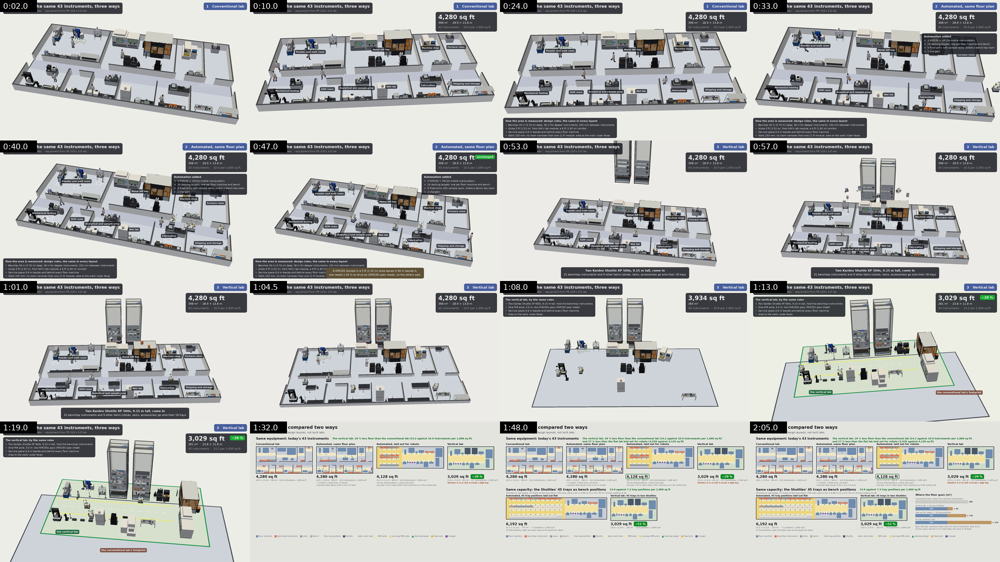

# Floor space: four labs, the same equipment, and the same capacity (video segment)

Sterling, on PR 400 (2026-11-27): a video segment that compares three labs on floor space: a conventional lab, an
automated "flat" lab on the same floor plan, and the vertical lab, as one continuous animation from a whole-lab view,
with each layout's area computed from its footprints, clearances and aisles, Emerald Cloud Lab as a reference point,
and instruments per square foot as well as total area. A standalone preview, written as reusable modules in
`twin/video/` so round 5's re-cut can drop it in next to the lab comparison.

Sterling, on PR 406 (2026-11-27): the 29 % compares today's 43 instruments with the conventional lab's benches packed
as people pack them, and leaves out what the Shuttles add, which is tray capacity. So: count the Shuttles' tray
capacity; lay it out flat as benches a mobile manipulator can serve; check whether the same-plan layout leaves robots
enough room and, if not, add a fourth layout that does; report both comparisons (same equipment, same capacity) with
the floor machines apart; show both in the segment with a line in the narration; upload the new preview unlisted.
Issue 407 (is the vertical lab worth it?) can take its figures from here and from `out/floorspace/layouts.json`
(`capacity`).

**Everything here is a design layout, not a built lab.** The equipment is the 3-D lab's (PR 318's scene). The floor
plans, their rules and their areas are ours.

**Preview:** [RCcNL1mthBE](https://www.youtube.com/watch?v=RCcNL1mthBE), **unlisted** (2:18, uploaded 2026-11-27
from commit f18dd48; `out/youtube.json`, key `floorspace/floorspace_preview.mp4`). The record is
[`out/floorspace/floorspace_preview.json`](../out/floorspace/floorspace_preview.json) and the contact sheet
[`out/floorspace/sheet.png`](../out/floorspace/sheet.png). The first preview,
[RUXoZQPodyU](https://www.youtube.com/watch?v=RUXoZQPodyU) (1:58, from 0902898), had the three layouts only. It
went up private, and YouTube reads it as unlisted now; the upload token can't change or remove it.



## The result

**Same equipment: today's 43 instruments.**

| Layout | Length × width | Area | Instruments per 1,000 sq ft | The vertical lab needs |
|---|---|---|---|---|
| Conventional lab | 28.9 × 13.8 m | 398 m² (4,280 sq ft) | 10.0 | 29 % less |
| Automated, same floor plan | 28.9 × 13.8 m | 398 m² (4,280 sq ft) | 10.0 | 29 % less (robots can't pass in it) |
| Automated, laid out for robots | 34.3 × 11.2 m | 384 m² (4,128 sq ft) | 10.4 | 27 % less |
| Vertical lab | 23.8 × 11.8 m | 281 m² (3,029 sq ft) | 14.2 | |

**Same capacity: the Shuttles' 45 trays as bench positions** (each tray 2,450 × 864 mm, 2.1 m²).

| Layout | Length × width | Area | Of it, the floor machines' block | Benchtop part | Tray positions per 1,000 sq ft (whole; benchtop part) |
|---|---|---|---|---|---|
| Automated, 45 tray positions flat | 51.5 × 11.2 m | 575 m² (6,192 sq ft) | 241.5 m² | 333.7 m² | 7.3; 12.5 |
| Vertical lab, 45 trays | 23.8 × 11.8 m | 281 m² (3,029 sq ft) | 241.5 m² | 39.9 m² | 14.9; 104.7 |

- **The vertical lab needs 51 % less floor than the same capacity laid out flat** (2.04 times less), against 29 % less
  than the conventional lab for today's equipment. On the benchtop part alone, the flat benches take 8.4 times the
  floor the Shuttles add.
- **The floor machines are the same in every layout,** so they are shown apart. The **floor machines' block** is the 12
  machines in the vertical lab's two rows along its 3.0 m MiR aisle, with their 0.6 m service space, three chargers and
  their docks, without the Shuttles: 21.6 × 11.2 m, 241.5 m² (2,600 sq ft). The vertical lab and both layouts for robots
  are that block plus their benchtop part. The conventional lab's rooms mix machines and benches, so it has no such
  split; its machines and their service space take 113 m² of its 398 (`breakdown_m2`).
- **For today's equipment, a flat lab laid out for robots needs about what the conventional lab does** (4,128 against
  4,280 sq ft): the dock lanes and passing lanes take about what the rooms, the corridor, their walls and NIH's module
  minimum gave back. The vertical lab needs 27 % less than it.
- **Robots that pass each other in two-way 3.0 m aisles** instead (the sensitivity): 496 m² (5,338 sq ft) for today's
  trays and 723 m² (7,785 sq ft) for the 45; the vertical lab then needs 43 % and 61 % less.
- **Without the two scale-up printers** (the EOS M 400-4 and the Meltio cell, in every layout): the same equipment, 2,439
  sq ft against 3,692 conventional (34 % less) and 3,571 laid out for robots (32 %); the same capacity, 2,439 against
  5,635 (57 %; `layouts.json`, `without_scaleup`).
- **It needs a high bay.** The Shuttles are 9.15 m tall. The flat layouts' tallest machine is the Meltio cell, 3.16 m.

Where the floor goes (m², rasterized at 25 mm; `floorspace.breakdown`):

| | Floor machines | Benches, shelves, Shuttles | Service clearance | Aisles and corridor | Walls | Other floor |
|---|---|---|---|---|---|---|
| Conventional | 47 | 28 | 66 | 121 | 25 | 111 |
| Automated, same plan | 48 | 28 | 66 | 120 | 25 | 111 |
| Automated, laid out for robots | 48 | 39 | 60 | 154 | 15 | 69 |
| Vertical | 48 | 18 | 62 | 71 | 12 | 72 |

"Other floor" is room the rules leave over: in the conventional lab, mostly where a room is deeper than its rows need
because rooms along one side of the corridor share one depth (the metal AM bay's sets it, at 7.4 m); in the vertical
lab and the layout for robots, mostly the rows' floor behind the shallower machines, beyond their 0.6 m service space,
since each row is as deep as its deepest machine (and, for robots, a 1.0 m strip under the bench block).

## The Shuttles' tray capacity

`floorspace.tray_capacity()`, from `out/tray_plan.json` and `vlm.py`'s columns at 9.15 m (copied into
`floorspace.SHUTTLE`; the tests read them back from `vlm.py`'s source). A column runs from the lowest tray position
(300 mm) to the drive bay's underside (8,890 mm); the front column is cut by the opening, with 300-793 mm under the
access table (short trays only) and 1,950-8,890 mm over the header.

- **Today: 18 trays,** 8 in Shuttle 1 and 10 in Shuttle 2. The 12 with a UPS hold the 31 instruments (and the vial
  rack, the disc magazine and the quench tank) in slots of 625-900 mm, 750 mm on average. The 6 passive stores (the two
  sample stores and the four racks of powder jars) take 150-325 mm. 38.1 m² (410 sq ft) of tray.
- **Free column:** 5,140 mm in Shuttle 1's rear column and 5,465 in its front, 5,265 and 5,490 in Shuttle 2's
  (`notes/tray_plan.md` has the same).
- **Filled at the plan's 750 mm: 27 more trays** (6, 7, 7, 7), so **45 in the two (21 and 24)**, 95.3 m² (1,025 sq ft)
  of tray. 1,396 mm of column is left in pieces under 750 mm, for short stores only, and not counted.
- **An empty 9.15 m unit takes 20 trays at 750 mm** (11 in the rear column, 9 in the front over the opening), plus short
  stores under the access table. **PR 344 counted 24 at 9.2 m** (`facility/footprint.py`, `trays_per_unit`; its rule
  gives 24 at 9.15 m too). Its slots came from round 13's loads, 550-725 mm and 623 mm on average, and its front column
  started at 1,820 mm. Today's trays are taller: the UPS (437 mm), the camera heads (up to 706 mm) and the 996 mm
  opening, whose header moved the front column's start to 1,950 mm.
- **Capacity here is tray surface, not throughput.** Every tray goes through the same opening (#332), and Kardex's 70 t
  unit load allows 490 kg strong trays on all 24 of Shuttle 2's.

## Laid out for robots: the fourth layout

**The check.** Robots need more room than the conventional benches give, but in the aisles, not along the benches.

- **Along a bench, the trays give an instrument about what the conventional benches do:** 865 mm of tray per item on the
  12 instrument trays, against 852 mm of bench per item (0.75 against 0.68 m²). The trays also carry each tray's UPS,
  cameras, air monitor, dock plate and lines, and leave the arm its working room; the conventional benches have 150 mm
  between instruments and building power.
- **In the aisles, robots need twice the room.** A docked MiR250 (580 mm wide) leaves 0.94 m of a 5 ft aisle, under the
  1.45 m one needs to drive by. Facing rows that a robot can dock at and pass along need 838 + 1,450 + 838 = 3,126 mm
  between them, against 1,524 mm.

**The rules for a bench position** (`floorspace.TRAY_BENCH`; Sterling's, from PR 406):

- **One position a tray:** the tray's own 2,450 mm along the bench, with its instruments, UPS, cameras and the arm's
  working room where the tray has them (the plans draw each instrument where its tray has it). Positions abut.
- **Benches 864 mm deep,** the tray's depth, 914 mm high.
- **A docking target at each position's centre,** as at the Shuttle's opening, so the arm reaches what it reaches on a
  tray, in an **838 mm dock lane** in front of the row (the 3-D lab's dock zone, from a row's fronts to the aisle).
- **One-way 1.45 m MiR aisles** between the dock lanes of two facing rows, so a robot drives past one that is docked (one
  MiR250 driving needs 1.45 m: MiR250 specification sheet, 2023-06-28, as `warehouse.py` cites it), and one-way
  cross-aisles at both ends join them into loops. **3.0 m** (two pass) is the sensitivity.
- **Rows back to back 150 mm apart** (our choice: cables and the UPS's vents). Walls 150 mm.

**The layout** (`floorspace.tray_benches`): the floor machines' block, and the positions. The first two go where the
Shuttles stood, along the north row's free length (4.9 m), facing the MiR aisle as the Shuttles' openings do. The rest
go in a block at the west end: two one-way aisles with a row each side, top-aligned to the north wall, its east
cross-aisle open to the machines' MiR aisle. The number of aisles is the one that gives the smallest outer rectangle.
For today's 18 trays that is 4 rows of 4 and a 12.7 m block; for 45, 4 rows of 11 (one short) and 29.9 m. The robots'
and chargers' number is the vertical lab's (two units, three chargers): more units for the longer routes would add
chargers, not floor that changes these figures.

## The equipment

`twin/video/floorspace.py` takes one list for all three layouts. 43 instruments:

- **31 benchtop instruments** (on the Shuttles' trays in the 3-D lab, measured there by `setup_lab.py fit`,
  `out/tray_plan.json`): SEM (Hitachi TM4000Plus II), XRD (Rigaku MiniFlex), the powder prep station, Opentrons OT-2,
  the corrosion cell (CubXL + EZstat), the multi-doser, the vacuum press (Specac), PIP (Plastometrex), the nanoindenter
  (KLA iMicro), particle size (Mastersizer), Bambu Lab H2D and A1 mini, the polisher (LECO PX500), the furnace
  (Nabertherm), the mounting press (LECO MX400), the N₂ glovebox, the digital microscope (Keyence VHX), tensile
  (zwickiLine), hardness (Mitutoyo HM-220), XRF (Bruker S2 PUMA), the ductless hood, the CNC (Makera Carvera), the
  stencil printer, the pick-and-place (LumenPnP), the reflow oven, two Formlabs Form 4s, Form Wash, Form Cure and two
  SnowPods.
- **12 floor machines** (measured from the built scene, `out/twin2/video/birdseye/high.json`): the atomizer (AMAZEMET
  rePowder), the sieving cell, the argon glovebox, LPBF (Aconity MIDI), DED (MX-Lab), the EOS M 400-4, the Meltio cell,
  the wire EDM, the two Instrons (68FM-100 and 68SC-2), the fume hood and the packaging station.
- Not counted as instruments, but laid out and moved like them: the vial rack, the disc magazine, the quench tank, the
  two sample stores and the four racks of powder jars (on storage shelving in the conventional lab).

## The layouts

**Conventional lab** (`floorspace.conventional`): ten zones along a 6 ft corridor, grouped by workflow. Each zone has a
back row against its far wall and, where it needs one, a front row against the corridor wall, with a 5 ft aisle between
them, and an entry at its west end (a door, or a gap in the front row).

| Zone | Enclosed | W × D (m) | What stands in it |
|---|---|---|---|
| Powder and melt room | yes | 10.0 × 7.4 | atomizer, sieving cell, argon glovebox; doser, press, SnowPods and the N₂ glovebox on benches; the powder jars on shelving |
| Metal AM bay | yes | 10.6 × 7.4 | EOS M 400-4, Meltio cell, Aconity MIDI, DED |
| Machine shop | yes | 3.9 × 7.4 | wire EDM; CNC and ductless hood on a bench |
| Furnace room | yes | 3.6 × 7.4 | the furnace and the quench tank on a bench |
| Mechanical testing | no | 6.3 × 3.9 | both Instrons; zwickiLine, hardness tester, PIP and nanoindenter on benches |
| SEM room | yes | 3.4 × 3.9 | SEM and digital microscope on a bench |
| Analytical and sample prep | no | 3.7 × 3.9 | XRD, XRF, particle size, powder prep; polisher, mounting press, disc magazine |
| Wet lab | no | 4.9 × 3.9 | fume hood; OT-2 and the corrosion cell |
| Fabrication | no | 4.3 × 3.9 | the polymer printers and the PCB line |
| Shipping and storage | no | 5.4 × 3.9 | packaging station; the sample stores on shelving |

**Automated, same floor plan** (`floorspace.flat`): nothing moves and the walls stay. Added: 4 MiR250 + UR12e mobile
manipulators (our choice: twice the vertical lab's two, for the longer routes), 24 docking targets (one per floor machine
and one per bench), 5 fixed UR arms on pedestals with sample racks (beside each bench whose row has 600 mm free at its
end), and 2 chargers in the last room on the south side.

**Vertical lab** (`floorspace.vertical`): the two Shuttles where the 3-D lab has them; the glovebox, the atomizer, the
sieving cell and the Aconity MIDI in the north row with them; the two Instrons, three chargers, the fume hood, the DED,
the wire EDM and the packaging station in the south row; the 3.0 m MiR aisle between; the EOS M 400-4 and the Meltio
cell (no MiR dock) at the aisle's east end. Each row is packed from the Shuttles outward by the same clearance rule.

**Automated, laid out for robots** (`floorspace.robots`): the vertical lab's floor machines without the Shuttles (the
floor machines' block, `floorspace.machine_block`: the north row closes up, the sieving cell and the LPBF 0.6 m apart),
and today's 18 trays as bench positions by the rules above: two where the Shuttles stood, 16 at the west end. Its
benchtop instruments stand where their trays have them. **Automated, 45 tray positions** (`floorspace.capacity_flat`)
is the same with the 27 free positions added.

## The rules

The same in every layout. An area is the outer rectangle of the layout's walls, so it counts the walls, the corridor,
every aisle and every clearance.

- **Benches** 30 in (762 mm) deep, 36 in (914 mm) where an instrument is deeper than 712 mm. **Aisles** 5 ft (1524 mm)
  between rows. NIH Office of Research Facilities, "Lab Module Design Considerations", Technical Bulletin issue 23,
  December 2013: "a 5'-6" center aisle with 30" deep lab benches on both sides, and a 5' aisle with equipment up to 36"
  deep on one side"; "5' is the minimum ADA turning radius"
  (https://orf.od.nih.gov/TechnicalResources/Documents/Technical%20Bulletins/13TB/Lab%20Module%20Design%20Considerations%20December%202013%20Bulletin_508.pdf).
- **No room narrower than one 11 ft (3.35 m) module**, the same bulletin's "ideal module width". It sets the SEM room and
  the furnace room, which would otherwise be 2.1 and 1.5 m wide.
- **The MiR aisle** is the 3-D lab's: 3.0 m, two MiR250s pass; one alone needs 1.45 m (MiR250 specification sheet,
  2023-06-28, as `warehouse.py` cites it).
- **Our choices:** 150 mm between instruments on a bench and at its ends; bench runs in whole feet; 600 mm of service
  clearance beside and behind every floor machine; a 6 ft corridor (the building code's minimum is 44 in); 150 mm walls;
  4 ft doors.
- **Not in any layout:** offices, write-up desks, restrooms, gas cylinder storage, a loading dock, mechanical rooms.
  They would add the same to each, or more to the conventional lab, which has people working in it.

## Emerald Cloud Lab, as published

- **South San Francisco:** "the 1,400 square metre (15,000 square feet) lab", where "more than 100 items of high-end
  bioscience equipment whirr away on workbenches" (The Guardian, Tom Ireland, 11 September 2022, "Cloud labs and remote
  research aren't the future of science - they're here"; reprinted by Carnegie Mellon:
  https://www.cmu.edu/ambassadors/december-2022/pdf/guardian_cloud-labs.pdf). That is more than 6.7 instruments per 1,000
  sq ft, against 10.0 for the conventional layout here and 14.2 for the vertical one. A built facility's whole lab area
  counts things these layouts leave out, and its instruments are life-science ones on benches, loaded by staff: a scale
  reference, not like for like.
- **Carnegie Mellon's cloud lab,** built and run with Emerald: "the new 1,500 square metre (16,000 square feet) site"
  (the same article).
- **Austin:** "The 105,000-square-foot facility will house over 230 unique types of instruments" (Emerald Cloud Lab
  press release, PR Newswire, 28 February 2023,
  https://www.prnewswire.com/news-releases/emerald-cloud-lab-to-relocate-state-of-the-art-facility-from-south-san-francisco-to-austin-301758704.html).
  That counts types, not instruments, so it gives no instruments-per-area figure. A Texas Department of Licensing and
  Regulation record for the project (TABS2023016373) lists 40,000 sq ft for the renovation, which may cover part of the
  building only; the sources don't say.

## The segment

2:18 at 1920 × 1080, 30 fps; the 3-D drawn at 15 fps, as the campaign video's replay. One continuous shot from a
whole-lab view, then the plans. The 3-D part (to 1:25.6) is the first preview's, rendered again from the same code:
the longer plans phase changes no frame of it (`floorspace_story` gives the same camera and the same people and robots
at every time before the cross-fade with either end).

| Time | What happens |
|---|---|
| 0:00-0:31 | The conventional lab: six people walk between the rooms carrying sample totes, the rooms are labelled, the rules and the area come up |
| 0:31-0:51 | The same plan automated: four MiR250 + UR12e units drive in from the corridor's east door, the docking targets, fixed arms and chargers come up, four people leave, the robots take the routes people walked |
| 0:51-1:23 | The two Shuttles come down north of the building; every benchtop instrument and store flies to its tray; the walls and benches go down; the floor machines move to the vertical layout as its floor spreads from the Shuttles; the camera closes in; two units dock at the openings while the Shuttles present trays D and L, and a person works the glovebox and the atomizer |
| 1:23-1:35 | Cross-fade from straight down on the vertical lab to its plan, then the first row: the four layouts of today's equipment at one scale, and the first comparison (-29 %) |
| 1:35-1:53 | The layout for robots is picked out (-27 %); the second row comes in: the Shuttles' 45 trays laid out flat beside the vertical lab, -51 %, 14.9 against 7.3 tray positions per 1,000 sq ft |
| 1:53-2:07 | Where the floor goes: the floor machines' block, the same in the vertical lab and both layouts for robots, and each benchtop part |
| 2:07-2:18 | Emerald Cloud Lab |

The flights into the trays, the machines sliding and the floor spreading are animation devices, not a move plan. The
people's and robots' routes are drawn from each layout's aisles and doors (`floorspace_story`), not from a simulated
schedule.

**Narration:** eleven lines, Kokoro v1.0 (open weights), voice `af_heart` at 0.96 speed, as the campaign video
(`twin/video/narration_floorspace.json`; spoken by `floorspace_voice.py` through `narration.phonemes`). Numbers with a
thousands separator are respelled for the voice ("4,280" as "four thousand two hundred eighty"): the phonemizer reads
the comma as a pause and says "four, two hundred eighty". So are decimals ("14.9" as "fourteen point nine"). Each line
says only what is on screen when it is said, and every number in it is `layouts.json`'s (`twin/tests/test_floorspace.py`
checks, and that every decimal and thousands number has its respelling).

- **New (f11):** "Laid out so robots can dock and pass, a flat lab needs 4,128 square feet. And by capacity, the Shuttles
  hold 45 trays: 14.9 tray positions per thousand square feet, against 7.3 laid out flat."
- **Reworded (f9),** to follow it: "In the vertical lab, most of the floor goes to the floor machines, their clearances
  and the robot aisle, the same as in the flat layouts for robots. And the Shuttles stand 9.15 meters tall, so it needs a
  high bay." It was "Most of what is left is floor machines, ...", which read after the capacity line as if it meant the
  flat lab.
- The other nine lines are the first preview's recordings, unchanged.

**Heard back:** every line by faster-whisper small.en, 1.02 % word error over the script
(`out/floorspace/narration/check.json`). The new line and the reworded one are word-perfect. The rest is the first
preview's: "29%" for "29 percent", "Kardex" written "cardiac" (a word small.en doesn't know), "South, San Francisco",
"100" for "a hundred". When the first preview was made, two lines were reworded after the first pass: "Now automate it
on the same floor plan" came back as "now automated on the same floor plan", and "Emerald Cloud Lab's lab" read
awkwardly. The encoded file's own audio, transcribed whole: 1.7 % word error
(`out/floorspace/narration/encoded_check.json`), all of it spelling ("29%", "1,000" for "thousand", "100" for "a
hundred") and "cardiac" again. In the new line "And by capacity" starts 6.7 s in, so the second row is in by 7.6 s.

**The track:** each line levelled to -19 dBFS RMS at its time, 48 kHz, then ffmpeg's `loudnorm` in two passes to -16
LUFS and -1.5 dBTP. A single linear gain would have put the peaks over -1.5 dBTP, so `loudnorm` used its dynamic mode.
Subtitles: `out/floorspace/floorspace_preview.srt`.

**What it cost on the runner** (2026-11-27, 4 cores): the scene builds in 3 min with the tessellation cached (each of
three workers builds its own; 2.8-3.2 GB each), 1,284 renders at 1.4-1.8 s each with three workers side by side (10-13
min), and the cut with its overlays and plans in 2-3 min. The packages are the README's; `pycollada` (trimesh's COLLADA
loader) and `python-fcl` (the arm's collision checks) are easy to miss, and without `python-fcl` `robot.py` falls back
to straight joint moves, which changes the arms' paths.

## Rebuilding it

```bash
cd vertical-lab
python -m twin.video.floorspace              # out/floorspace/layouts.json: the layouts, areas, breakdown, capacity
python -m twin.video.floorspace_voice tts    # the lines whose text changed (Kokoro), into out/floorspace/narration/
python -m twin.video.floorspace_voice check  # heard back by faster-whisper
# the 3-D needs the set-up movie's stack (VTK, cadquery), as twin/video/lab3d.py
TWIN_VIDEO_WORKERS=3 python -m twin.video.floorspace3d all     # /tmp/fs3d/lab3d.mp4: 1,284 renders
python -m twin.video.floorspace_cut final    # out/floorspace/floorspace_preview.mp4, .srt, .json
python -m twin.video.floorspace_cut sheet    # out/floorspace/sheet.png
python -m pytest -q twin/tests/test_floorspace.py
```

For round 5's re-cut: `floorspace_cut.Cut().frame(t, base)` draws any moment of the segment (base: the 3-D render at t
from `floorspace3d.FloorLab().render(t)`, or None in the plans), `Cut.T` is its length and `Cut.lines` its narration
with their times.

## A slip while building it

The first two checkpoint commits went to PR 400's branch as well as this one's: the action's push wrapper sends HEAD to
the branch the run started on. They were reverted there in one commit (a2dec04), which leaves PR 400's tree identical to
86517c6, and the work moved to a fresh branch (PR 406). GitHub marked the first stacked PR (404) as merged, because its
one commit had reached PR 400's branch.
