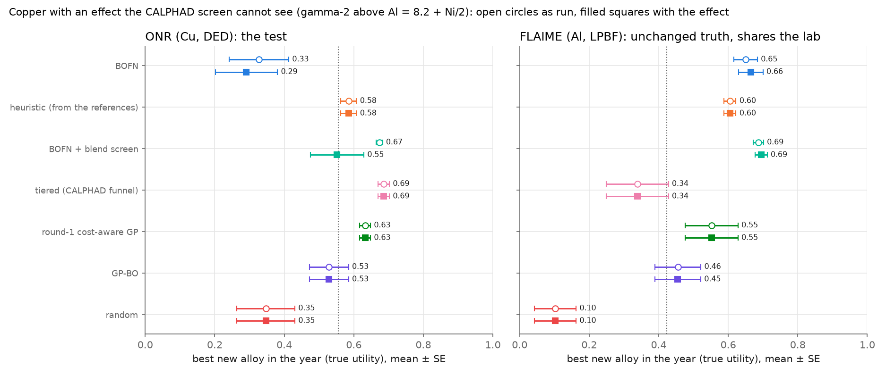

# Digital twin, round 2: every instrument simulated, real optimizers, what it costs, and a video

Sterling, on PR 318 (2026-11-25): "open a new PR in relation to [the digital twin] ... that also contains the
results from that session. This time, consider that there is lots of equipment available. You should be making
synthetic functions and/or using simulations, etc. for everything from desktop SEM + EDS + EBSD (simulated
micrographs, spectra, and patterns), to particle size analysis (PSD), yield, powder XRD, PIP, and other various
characterization, synthesis, and processing modules. ... The synthetic functions should not be dumbed down. Also,
the Cu benchmark may need some further investigation given that tiered BO was on par with BOFN. ... SAASBO ... consider
both the optimization efficiency in terms of budget (esp. compared to random and some DoE method like Sobol or
something simple and heuristic), as well as the throughput increase and the overall reduction in cost per experiment
... Make sure you're also considering powder reuse and allowing for the option of a 400 cm^3 crucible ... percent
utilization across core instruments, from a cloud user facility perspective."

Round 1 is [`twin.md`](twin.md) (the network, the market, the facility, the first 370 twin-years). This file is
round 2: what changed, how it is checked, the results, the copper investigation, and what is assumed. The
instruments have their own notes ([microscopy and diffraction](twin_instruments_micro.md),
[powder, mechanics and corrosion](twin_instruments_mech.md)), as do the [economics](twin_econ.md) and the
[video](twin_video.md).

## 1. The instruments: raw data, then the lab's own analysis

Round 1 measured every quantity as the truth plus a Gaussian. Round 2 makes each instrument's raw data from the
artifact's hidden state, then runs the analysis the lab would run on it. The errors, biases, detection limits and the
correlations between instruments come out of that chain, because every instrument looks at the same hidden part.

| Instrument | Raw data it makes | What the analysis returns | What emerges (not imposed) |
|---|---|---|---|
| SEM, powder (TM4000) | secondary-electron image of particles: lognormal sizes from the lot's runs, satellites, ligaments from cold melts, edge brightness, shot noise | sphericity, satellite share, image d50 | projection bias of image sizing; satellites hide in clusters |
| SEM, section | backscattered image of a polished section: phases by mean Z, lack-of-fusion, keyhole and gas pores, hot cracks along columnar boundaries, scratches | porosity, largest pore, lack-of-fusion share, crack length per area | a single section misses sparse large pores; resolution floor for small ones |
| EDS (desktop SDD) | 0-20 keV spectrum: bremsstrahlung, K/L/M lines, Fano-limited resolution, escape and sum peaks, dead time, counting noise | composition with 3σ detection limits | real overlaps (Er M/Al K, Mn Kβ/Fe Kα, Ni Kβ/Cu Kα, Cu Kβ/Zn Kα, Ti Kβ/Ce Lα); Li invisible; light elements worse on powder |
| EBSD | orientation map (columnar <100> fibre or equiaxed grains), indexing that fails at strain, pores and martensite; Kikuchi patterns in full mode | grain size, equiaxed share, texture strength, indexed share, KAM, β′ share | β′ under-counted against XRD because martensite indexes poorly |
| XRD (MiniFlex) | Bragg-Brentano pattern: structure factors, Lorentz-polarization, Kα1/Kα2, Scherrer and strain broadening, preferred orientation, displacement, counting noise | phases by whole-pattern fit, FCC lattice parameter, solute estimate, crystallite size, β′ | detection limits of 1-3 wt% (Mg₂Si at 0.2 wt% is not seen) |
| XRF (S2 PUMA) and ICP-MS | element-dependent precision; the ICP-MS digest is HF-free | composition | ICP-MS loses Si above ~1 wt% (no HF in this lab), so silicon comes from XRF |
| Laser diffraction (Mastersizer) | the lot's volume distribution through the instrument's optical model and dispersion | d10/d50/d90, span, in-cut and fines shares | agglomerates and satellites shift the coarse tail |
| Yield (balances, sieves) | the run-by-run mass balance | charge, collected, in-cut grams | sieving loses about 15 % of the ideal cut for coarse Al lots |
| Archimedes density | weighings in air and liquid | relative density against the designed composition | open, surface-connected porosity reads as solid; Mg boil-off reads high |
| Tensile (3 sub-size bars) | full curves: compliance, Voce plasticity, necking, fracture at each bar's worst defect (weakest link) | 0.2 % yield, UTS, elongation | scatter grows with defects; cracked bars break before yield |
| PIP (Plastometrex) | indent profile from the Voce law, profilometer noise | yield, UTS, uniform elongation by inverse fit | samples ~1 mm³ of sound metal, so it over-reads porous or cracked parts (+18 % on average) |
| Vickers, nanoindentation | indent diagonals; Oliver-Pharr load-displacement | HV; H and E | size effect; pores under indents |
| CubXL corrosion screen | OCP drift, LPR, EIS, cyclic polarization | Rp, icorr, early rate, Rct, Eb, Erp | the Tafel fit reads 1.5-1.75x the true early rate |
| 30-day immersion | mass loss; SEM of selective attack; ICP-MS of the solution | 30-day rate, attack depth, Cu and Ni release | |

Every simulator has three fidelities: `full` (publication-size raw data and the analysis), `lite` (small raw data and
the same analysis, under ~30 ms) and `fast` (under 1 ms, errors sampled from distributions fitted to many lite runs,
state-dependent, checked against lite by the tests). The benchmark runs in `fast`. The galleries in
`out/twin2/instruments/` show each instrument's raw data and what its analysis extracted.

**Found by the simulators, then fixed in how the lab checks a part.** With Archimedes alone, a part's density read
0.3 % high on average with a 0.9 % spread, because lack-of-fusion pores open to the surface fill with water; 17 % of
cubes read as dense (≥ 99.5 %) when they were not. The print and DED routes already book an hour of SEM, so every
made part is now checked by Archimedes and by its polished section imaged in the SEM, and the lower density is the one
reported (`Campaign._soundness`). That removes the bias (−0.02 %); what is left (0.6 % spread, about 12 % of cubes on
the wrong side of the 99.5 % gate each way) is the real difficulty of telling 99.4 % from 99.6 %.

## 2. The campaign engine

* **Partial evaluations the vertical lab can buy** besides round 1's: `section` (cut, mount, polish; SEM, EBSD and a
  Vickers row; XRD for copper), `pip` (aluminium coupons are heat-treated first, like the bars) and, for copper,
  `blend_ded` (below).
* **The crucible**: the rePowder's standard 225 cm³ crucible or the 400 cm³ upgrade (DAL #219). The charge per run,
  the run time, the consumables and the added drip risk come from `atomize_yield.charge_plan`; a policy picks it per
  run.
* **Powder reuse**: the unfused powder of every LPBF build (about 18 of the 30 g a 55 mm kit spreads, 370 of the 440 g
  of an E8 plate) and the overspray of every DED deposit is sieved and returned to its lot, with more oxygen and
  satellites (`reuse.after_build` / `after_ded`), blended by mass. Every later part made from the lot carries it.
* **In-house DED blocks for bars** (vertical lab): 1 kg on the MX-Lab, no NSL certificate and no Mines queue.
* **A stocked inventory** (vertical lab): consumables and every feedstock but Sc and Er bought at day 0 at the day's
  prices and charged to the campaign, reordered four times over. Ordering each charge's metal as it is needed (round
  1, and DAL today) left the atomizer 89 % idle while work in flight waited on orders.
* **Booking tags and an event log**: every booking records the design and the network node it served
  (`Twin.event_log`), which is what the video and the utilization study read.
* **External load**: `Twin(..., external=callable)` lets outside users' jobs take slots before the campaigns run.
* **DAL's own lab on DAL #256's schedule** (facility `dal256`, `twin/facility.py` `DAL256`): the conventional lab's
  stations on #256's calendar and step times: one atomizer run a day Mon-Thu with copper on Fridays, a run plus about
  3 h to cool, clean and rebuild, a Thursday SEM session and a Wednesday polishing batch, tensile and corrosion on
  Thursdays, two-day Utah LPBF sessions on alternate weeks with parts back a week later. The times #256 doesn't give
  keep the twin's own; `out/twin2/trace/README.md` lists both.
* **The campaign trace** (`twin/trace.py`, schema in `out/twin2/trace/README.md`): every booking with its sample, its
  node in DAL #211's network and its outcome in DAL #274's ledger (`COMPLETED`, `FAILED`, `ABANDONED`,
  `EARLY_STOPPED`, `STALE`, `NOT_AS_PLANNED`, `DOWN`), every sample, every measurement, the optimizer's state at every
  iteration (what it proposed, the acquisition value, its incumbent and the hidden best so far), and the literature
  steps a campaign would run, each pointing at an Edison answer already in DAL (no new queries). A traced run gives
  the same results as an untraced one.
* **A common seed set** (`twin/seeding.py`, DAL #275): the seeded runs start every policy from the same seven
  aluminium seeds (D1 and D2 baselines, the B30 and B15 dosing checks, the S1 and S2 literature picks, the S3 IMSE
  pick) and five copper seeds built the same way (#275 plans aluminium only), so that no policy's lead is a warm
  start.

## 3. The policies

All are `propose(view, n_free)` on the twin (`twin/opt/policies2.py`, BoTorch 0.18):

* **Random** (round 1: every design through the whole chain) and **Sobol** (a scrambled Sobol design, made in order).
* **Heuristic**: start from the reference alloys (AlSi10Mg, Al-Mn-Cr-Zr, Al-Zr; 90-10, 70-30, NAB), keep the best
  measured alloy, try one or two elements up or down from it with the process settings that worked.
* **Tiered** (round 1): screen 256 designs with the open CALPHAD node, make the 24 the proxy likes best, in order.
* **Round-1 cost-aware GP**: a GP on the final utility with CALPHAD features, the proxy before four results.
* **GP-BO**: a GP (BoTorch's `SingleTaskGP`) from the whole design (d = 23 for FLAIME, 14 for copper) to the measured
  utility, expected improvement per dollar over a pool of Sobol points and local moves, the reference alloys as its
  first designs. **SAASBO**: the same with the sparse axis-aligned subspace prior, fully Bayesian (NUTS, 128 warm-up,
  128 samples thinned to 16) and at its MAP point. A NUTS fit took 25-170 s at 30-140 points on the runner, so a fresh
  chain at every new result would have cost about 33 CPU-hours for 12 seeds: SAASBO runs a fresh chain each time its
  data have grown by 4 points and by half (at 3, 7, 11, 17, 26, 39, 59, 89, 134, ... points), and in between rebuilds
  the model on the new data with the last chain's hyperparameter samples, as the MAP GPs reuse theirs.
* **BOFN**: a GP per node of the function network, each node's inputs its parents' measured outputs plus the design
  variables acting on it; the utility computed through MC samples of the network; expected improvement per dollar for
  new designs and for every next step of a part already made. FLAIME: atomize → print → EBSD section → PIP → tensile.
  Copper: atomize → DED → PIP and CubXL screen → tensile and 30-day immersion of a 1 kg deposit. Partial evaluation
  (in the spirit of pKGFN): a sound part gets the cheap nodes (PIP, section, screen) at once, and the dear step
  (bars, a 1 kg deposit) only when its posterior expected improvement per dollar beats starting something new. The
  atomize node picks the atomizer settings; the print and DED nodes pick the process settings. Same reference start as
  GP-BO.
* **BOFN + blend screen** (copper): every new composition is first deposited from blended elemental powders on the
  MX-Lab (no atomizer run, about $250 with PIP and the screen), and atomized only when the network, which carries a
  blend/atomized flag on its DED, PIP, screen, tensile and immersion nodes, says it is worth it.

## 4. Targets: the state of the art, from the truth itself

`twin/oracle.py` scores the reference alloys and 3,000 random designs on the truth at tuned process settings, then
hill-climbs on the truth for an upper reference:

| | best reference (the state of the art) | random designs above it | best the oracle found | proxy vs utility (Spearman, feasible designs) |
|---|---|---|---|---|
| FLAIME | AlSi10Mg, 0.42 (Scalmalloy fails the mineral gate) | 7.2 % | 0.86 (Al-0.6Mn-0.5Zr-0.2Mg-0.4Fe-2Li) | 0.51 |
| ONR | NAB, 0.56 (70-30 has 30 % Ni) | 0.5 % | 0.76 (Cu-8.4Ni-6.1Al-1.5Fe-1.9Mn-0.3Ti) | 0.007 |

**T1**: a new alloy (not a re-test of a reference) at or above the state of the art. **T2**: halfway from the state of
the art to the oracle's best (0.64 for FLAIME, 0.66 for copper). Curves and targets count new alloys only.

## 5. Results

*Checked against `out/twin2/fig/tables.md`, `bench2_summary.json` and the per-run logs (`out/twin2/runs/`). Standard
errors are the sample standard deviation (n − 1) over seeds divided by √n. Everything here is simulated, not
measured.*

**What this shows.** Before any equipment is bought, the digital twin simulates the whole alloy-discovery workflow,
with real prices, lead times and machine schedules. Search strategies and lab designs compete for a simulated year
against the same hidden, synthetic "true" alloy landscape, so each is scored on what it actually found and what it
cost.

**The setup.** Two campaigns share one lab: aluminum alloys for laser powder-bed printing (named FLAIME after its
proposal; $120k a year for materials and services) and copper alloys for directed energy deposition, a blown-powder
printing process (DED; from an Office of Naval Research proposal; $60k a year). Each has a hidden property map
(textbook formulas calibrated on 7 known alloys) that the strategies never see, plus open CALPHAD thermodynamics,
USGS metal prices with supply shocks, and lead times from the lab's own purchasing [1]. **The score** (0 to 1)
combines strength, ductility and either mineral-supply burden (aluminum) or seawater corrosion and nickel (copper). It
is zero unless the part is dense and crack-free, and it is computed on the hidden truth for the best alloy actually
made and tested [1]. On this truth the best existing alloy scores 0.42 for aluminum (AlSi10Mg) and 0.56 for copper
(nickel-aluminum bronze); a direct search of the truth found 0.86 and 0.76 [2].

### 5.1 Round 1 (Nov 24): simple strategies, plain measurement noise

370 simulated years, with simple strategies: random recipes, a "tiered" screen that ranks recipes by a cheap
thermodynamic calculation, and a cost-aware model that weighs each test's expected gain against its price. The full
optimizer was not yet plugged in [1, 7].

- **Strategy matters.** Aluminum, 20 simulated years each: cost-aware model 0.63 ± 0.03, random recipes 0.15 ± 0.06.
- **Parallel work makes a year enough.** With one experiment in flight at a time, almost nothing good got through in a
  year (aluminum 0.07, copper 0.08); with 24 and 8 in flight, 0.64 and 0.56.
- **Vertical lab against the partner facilities named in the proposals** (own instruments around the clock, against
  booking lead times, turnaround and session caps; cost-aware model, 10 simulated years each): aluminum 0.70 ± 0.02
  against 0.64 ± 0.03; a score of 0.6 reached in 90% against 50% of runs, at a median $31k and 94 days against $43k
  and 114 days; 4.7 against 2.3 "discoveries" a year (alloys passing the proposal's strength and ductility bar).
  Copper: 0.65 ± 0.02 against 0.56 ± 0.07 [1].

(Round 1's standard errors are as `notes/twin.md` reports them.)

### 5.2 Round 2 (Nov 25): every instrument simulated, real optimizers

Each instrument (SEM, EDS, EBSD, XRD, XRF, ICP-MS, particle sizing, Archimedes density, tensile, small-sample
indentation testing called PIP, hardness, corrosion) now makes raw data from the part's hidden state, and the lab's own
analysis runs on it, so errors and biases emerge instead of being assumed [3]. Setup: the vertical lab design, one
year, both campaigns, the same budgets, 8 strategies × 12 random seeds (96 simulated years) [3, 5]. The strategies
[3, 8]:

- **Random**, and **Sobol** (recipes spread evenly over the design space). Neither learns.
- **Heuristic**: a metallurgist without a model. Start from known alloys, nudge one or two elements.
- **Tiered screening**: rank 256 recipes by a cheap CALPHAD calculation, make the top 24.
- **GP-BO** (standard Bayesian optimization): one model from recipe to final score; it picks the next test by expected
  gain per dollar.
- **BOFN** (Bayesian optimization of function networks): one model per workflow step (powder, print, polished section,
  PIP, tensile), so cheap intermediate results teach it, and a part goes on to the costly step only when that is the
  best use of the money. **+ blend screen** (copper only): each new recipe is first deposited from mixed elemental
  powders (about $250) and atomized only if promising.

"Best new alloy": true score of the best new alloy made in the year (re-tests of known alloys don't count), mean ±
standard error over 12 runs. "Halfway": halfway from the best existing alloy to the best found on the truth (0.64
aluminum, 0.66 copper) [2, 4, 5].

| Strategy | Al: best new alloy | Al: runs reaching halfway | Al: runs beating today's best; median days | Cu: best new alloy | Cu: runs reaching halfway |
|---|---|---|---|---|---|
| BOFN, set A (Cu also plain BOFN) | 0.65 ± 0.03 | 67% | 92%; 123 | 0.33 ± 0.09 | 8% |
| BOFN, set B (Cu with blend screen) | 0.69 ± 0.01 | 83% | 100%; 116 | 0.67 ± 0.01 | 58% |
| Heuristic | 0.60 ± 0.02 | 25% | 100%; 37 | 0.58 ± 0.02 | 17% |
| Round-1 cost-aware model | 0.55 ± 0.08 | 50% | 83%; 48 | 0.63 ± 0.02 | 42% |
| GP-BO | 0.46 ± 0.07 | 17% | 83%; 185 | 0.53 ± 0.06 | 17% |
| Tiered screening | 0.34 ± 0.09 | 17% | 58%; 60 | 0.69 ± 0.02 | 75% |
| Sobol | 0.10 ± 0.05 | 0% | 8% (1 run) | 0.45 ± 0.05 | 8% |
| Random | 0.10 ± 0.06 | 8% | 8% (1 run) | 0.35 ± 0.08 | 17% |

*Round 2, simulated: best new alloy so far against days, mean ± standard error over 12 runs per strategy; aluminum
left, copper right. Dotted line: the best existing alloy on this synthetic truth [9].*

- **Aluminum: BOFN finishes highest and most reliably** (0.65 to 0.69; halfway in 67% to 83% of runs, against 25% for
  the heuristic). The heuristic beats today's best fastest (median 37 days against about 120), then stalls: BOFN's
  edge is a better final alloy, not a faster first one. Standard GP-BO trails the heuristic on both campaigns [4, 5].
- **The two BOFN sets run the same aluminum strategy**; only the copper strategy sharing the lab (and its atomizer)
  differs, so 0.65 against 0.69 is run-to-run spread [8].
- **Copper: no clear winner, and plain BOFN fails.** Tiered screening (0.69 ± 0.02) edges BOFN with the blend screen
  (0.67 ± 0.01) and beats today's best sooner (median 88 against 225 days). Plain BOFN scores 0.33, no better than
  random (0.35); 5 of its 12 runs ended the year with no new alloy scoring above zero. Copper results are slow and
  costly, so a model has little to learn from; the cheap blend screen supplies more data [1, 4, 5]. The copper test is
  also too kind to tiered screening: its screen uses the truth's own strengthening coefficients. Section 5.3 reruns it
  with an effect the screen cannot see.
- **Fidelity check.** With slower, fuller instrument simulators, BOFN scored 0.665 against 0.690 on aluminum and 0.36
  against 0.36 on copper (the same 3 seeds) [4].

### 5.3 The copper tie, tested twice: neither test favors BOFN

In the main benchmark, tiered screening edged BOFN with the blend screen on copper (0.69 against 0.67) and plain BOFN
failed (0.33). Round 2's first reading was that the copper truth was too kind to the funnel: nothing in it was hidden
from the CALPHAD screen, and the funnel's proxy reads the truth's own strengthening coefficients (14 MPa per wt% Al,
2.6 Ni, 6 Mn; `truth_cu.CuTruth.strength`). Two tests, 12 seeds each, same seeds as the main benchmark:

**A hidden effect: γ₂ (`cu_hidden`, 7 policies × 12 seeds).** Above Al = 8.2 + Ni/2 wt%, nickel-aluminium bronze keeps
γ₂ (Cu₉Al₄), which corrodes selectively in seawater and embrittles it (the Weill-Couly/Meigh rule). The CALPHAD nodes
don't report it. In the truth (`truth_cu.CuTruth`, `gamma2`), with g₂ the wt% of Al above the line, elongation falls by
a factor e^(−1.2 g₂), the 30-day corrosion rate rises by a factor 1 + 2.5 g₂ and the selective-attack depth by 25 µm per
g₂, and the 1-hour screen's early rate by only 1 + 1.5 g₂. The targets don't move: NAB (Al 9.2, Ni 4.5) and the
oracle's best (Al 6.1, Ni 8.4) are both below the line.

| Copper, best new alloy | as run | with γ₂ | paired difference |
|---|---|---|---|
| Tiered screening | 0.69 ± 0.02 | 0.69 ± 0.02 | 0.00 (identical, seed for seed) |
| BOFN + blend screen | 0.67 ± 0.01 | 0.55 ± 0.08 | −0.12 ± 0.08 |
| Round-1 cost-aware model | 0.63 ± 0.02 | 0.63 ± 0.02 | 0.00 (identical) |
| Heuristic | 0.58 ± 0.02 | 0.58 ± 0.03 (n = 11) | 0.00 (identical) |
| GP-BO | 0.53 ± 0.06 | 0.53 ± 0.06 | 0.00 (identical) |
| Random | 0.35 ± 0.08 | 0.35 ± 0.08 | 0.00 (identical) |
| Plain BOFN | 0.33 ± 0.09 | 0.29 ± 0.09 | −0.04 ± 0.04 |

- **Only the two BOFN variants changed.** Every other policy's results were identical with and without the effect,
  seed for seed: none of their best alloys sat in the γ₂ corner, and no learning policy's choices changed, so none of
  them measured an alloy there.
- **The screen keeps the funnel out of the corner anyway.** The corner is 2.2 % of the copper space, and the funnel's
  screen (liquidus, freezing range under 110 K, β at 900 °C under 0.3) passes 13 % of it, against 62 % of the space as
  a whole (4,096 Sobol designs). β at 900 °C rises in the same high-Al, low-Ni bronzes where γ₂ forms, so the effect is
  not hidden from the screen in practice.
- **BOFN with the blend screen explored the corner** (strong, cheap, low-nickel bronzes, which score well on the plain
  truth) and lost 0.12 there, with 2 of its 12 runs ending at zero. Its 1-hour corrosion screen sees only part of the
  effect (the early rate), while the selective attack shows only in the 30-day immersion, the copper analogue of DAL
  #205's η knob.

**A mis-specified proxy (`tiered_mis`, 12 seeds, plain truth and with γ₂).** The same funnel, the same 256 screened
designs per seed, with each strengthening coefficient of its proxy off by its own lognormal factor (σ = 0.4, a factor
of 1.5 at one sigma), as a rule of thumb from the literature would be. Copper: 0.71 ± 0.01, a paired +0.02 ± 0.02 over
the plain funnel (9 seeds better, 3 worse), and +0.03 ± 0.02 over BOFN with the blend screen. With γ₂ on, the results
are identical again. Aluminium: 0.30 ± 0.09 (−0.04 ± 0.04 paired).

**What this says.** The funnel's copper lead doesn't rest on its proxy, and the γ₂ effect doesn't reach it. It rests on
its screen: on this truth the freezing range (hot cracking) and β at 900 °C (retained β′) are the main ways a copper
alloy fails, and the open CALPHAD node sees both. Once the screen has removed those, almost any reasonable ranking of
what is left does well. BOFN has to learn the same failure modes from slow and costly copper results (about 10-14
alloys tested a year), so it doesn't catch up within a year. A copper truth with a failure mode the screen cannot see
*and* that sits where the funnel looks would test the funnel properly. That is not done here.

### 5.4-5.8 (in progress)

The conventional lab, SAAS priors, the crucible, reuse and stocking, the seeded runs and the economics are being run (`twin/bench2.py` experiments `conventional`, `saas`, `crucible`, `reuse`, `stock`, `seeded`, `seeded_dal256`).

## 6. Where round 2's truths differ from DAL's synthetic benchmarks

The campaign trace and every result above use round 2's synthetic truths (`twin/truth_al.py`, `twin/truth_cu.py`).
DAL has three synthetic benchmarks of its own; none is on DAL's `main`.

| | DAL #121 (aluminium LPBF, "bofn-prelim") | DAL #205 (copper DED, "bofn-cu-ded") | DAL #265 (EIFN test function) | Round 2 here |
|---|---|---|---|---|
| Design space | 7-D, all scaled to [0, 1]: Zn+Mg, Cu, Zr, Sc, an atomizer setting, laser power, scan speed; no units | 7-D, scaled: Ni 0-30, Al 0-9.5, Fe 0-4.5, Mn 0-4 wt%, atomizer setting, power (Utah capped), speed | 20 inputs, x1-x10 in [0, 1], the rest in [-5, 5] | the proposals' own spaces in physical units: FLAIME Al + 15 elements and 8 process variables (d = 23), the ONR's Cu + 8 elements and 6 process variables (d = 14), with their rules (`twin/spaces.py`) |
| Node functions | hand-written closed forms (solute strengthening, a Scheil-type crack criterion, nucleant crack suppression, a P - v process ridge) | closed forms over 8 priced stages and 11 nodes; also a physics variant (pycalphad `mc_ni` grid, a seawater film model fitted to 30 published rates) | analytic test functions chained: Styblinski-Tang, DTLZ2, Rastrigin, ZDT4 | CALPHAD (pycalphad on MatCalc `mc_al` and COST 507 as the open node, assessed binaries in the truth), process physics (Lang, Rosenthal, King et al., Tang et al.), textbook strength, ductility and corrosion calibrated on 7 reference alloys, USGS mineral data |
| What the lab measures | the node's true value | the node's true value | the node's true value | raw data from simulated instruments, then the lab's analysis: errors, biases and detection limits emerge (section 1) |
| Noise | none | none | none | from the instruments, plus run-to-run process scatter |
| The screen's blind spot | a knob, κ: how much a nucleant suppresses hot cracking, which the CALPHAD screen can't see | κ, and η: the 1-hour screen is blind to β′ selective attack | none | emerges from the open databases' own errors (`mc_al` puts Zr and Sc on the wrong side of k = 1, no primary Al₃Zr); copper's γ₂ effect is an option (`cu_hidden`, section 5.3) |
| Objective | J = strength − 0.3 × mineral burden; optimum known (J* = 0.694 at κ = 1) | J = strength × immersion pass − 0.3 × burden; J* = 0.492 at (κ, η) = (1, 1) | two objectives, known Pareto front | a 0-1 utility: strength, ductility and mineral burden (FLAIME) or corrosion and nickel (ONR), zero unless dense and crack-free; no known optimum (a local search on the truth found 0.86 and 0.76) |
| Money and time | $100k of new spend, stage prices; no clock | $100k, stage prices; no clock | unit node costs | the campaigns' yearly budgets ($120k, $60k), USGS prices with supply shocks, lead times, and a shared lab with calendars, so days matter as well as dollars |
| Start | sunk seed data for every policy: CALPHAD on 32 compositions + 5 random full chains | the same | none | each policy's own start in the main benchmark; DAL #275's common seed set in the seeded runs (5.6) |
| Score | true J of the best design printed and tested, as % of J* | the same, carried through tensile and immersion | not run | true utility of the best new alloy made and tested (references excluded) |

**What the difference changes.** On #205's copper network the spec tiered screen fails outright (0 of its 80
immersions pass; −8 % of J*), because the 1-hour screen can't see β′ attack (η = 1) and the shortlist is Al bronzes
with 2-6 wt% Ni. On round 2's copper truth, tiered screening did best (0.69) because nothing in the truth was hidden
from its screen and its proxy used the truth's own strengthening coefficients. Section 5.3 adds a hidden effect to
test that. #121's aluminium result (BOFN with powder reuse ahead of tiered screening by about 3.8× in spend, but only
when κ = 1) has the same shape as round 2's aluminium result, where the open databases' blind spot plays κ's part.
DAL's sources: [#121](https://github.com/vertical-cloud-lab/digital-alloy-lab/issues/121) (`benchmarks/bofn-prelim/`
at d1ca727, PR 117), [#205](https://github.com/vertical-cloud-lab/digital-alloy-lab/issues/205) (`benchmarks/bofn-cu-ded/`
at b1ba843, PR 206), [#265](https://github.com/vertical-cloud-lab/digital-alloy-lab/issues/265)
(`benchmarks/eifn_synthetic/` at 6c7b0ef).

## Sources for section 5

1. Round 1 write-up, [`notes/twin.md`](twin.md) (L31-43, L173-313 at [a7b0090](https://github.com/vertical-cloud-lab/byu-vcl/blob/a7b0090/vertical-lab/notes/twin.md?plain=1#L173-L313)).
2. Targets: [`out/twin2/oracle.json`](../out/twin2/oracle.json) (`twin/oracle.py`).
3. This write-up, sections 1-4.
4. Round 2 result tables: [`out/twin2/fig/tables.md`](../out/twin2/fig/tables.md) and [`out/twin2/bench2_summary.json`](../out/twin2/bench2_summary.json), with n − 1 standard errors.
5. The runner, [`twin/bench2.py`](../twin/bench2.py) (`EXPERIMENTS`), and the per-run logs, [`out/twin2/runs/`](../out/twin2/runs/).
6. Round 2 progress report on PR 318 (the copper tie; unfinished runs), Nov 25: https://github.com/vertical-cloud-lab/byu-vcl/pull/318#issuecomment-7153171668
7. Round 1 report on PR 318, Nov 24: https://github.com/vertical-cloud-lab/byu-vcl/pull/318#issuecomment-7122957665
8. Strategy code: [`twin/opt/policies2.py`](../twin/opt/policies2.py) and [`twin/policies.py`](../twin/policies.py).
9. Figures: [`out/twin2/fig/`](../out/twin2/fig/).

The results draft this section grew from was staged by Sterling on Nov 25 (written from this branch at e3667f8). Every
number in it was checked against the tables and run logs above. One was wrong: plain BOFN on copper ended the year
with no new alloy above zero in 5 of its 12 runs, not 6. The standard errors are now the sample standard deviation
(n − 1), which raises five of them by 0.01.
