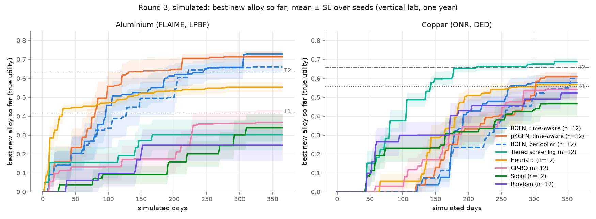
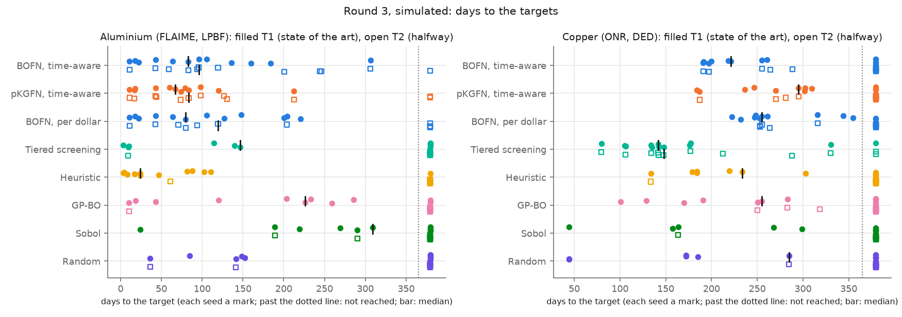

# Digital twin, round 3: physical capacity, asynchronous acquisition, interim readings, pKGFN, time to discovery

Sterling, on PR 393 (2026-11-26): "Round 3 of the twin: remove the scheduling constraints that aren't physical, then
rerun. ... Round 2 explains copper's result as 'copper data is slow and scarce' (§ 5.3). But the twin caps work in
flight at 8 actions for copper and 24 for aluminium, and a 30-day immersion holds one of those slots for its whole
month. The policies also choose one action at a time. A real lab isn't limited to sequential evaluation, or to
synchronous batches either. ... Replace the in-flight cap with physical capacity ... Asynchronous acquisition ...
Interim observations and early stopping ... pKGFN proper ... Optimize for wall time to discovery, not just cost ...
Fairness ... Report mean ± SE with paired differences, and say plainly where BOFN or pKGFN still doesn't win."

Round 1 is [`twin.md`](twin.md), round 2 [`twin_round2.md`](twin_round2.md). Everything here is simulated: synthetic
truths, simulated instruments, assumed prices, capacities and schedules. It shows how policies, capacity and
schedules interact in the model, not what the real lab will find.

## What changed from round 2, and why

| Round 2 | Round 3 | Why |
|---|---|---|
| A cap on each campaign's actions in flight (24 aluminium, 8 copper), whatever they held: a 30-day immersion took one of copper's eight for its month | No cap. Stations keep their units, calendars, start slots, session caps and breakdowns; every step also books its robot or person; passive steps hold a fixture slot (24 immersion positions, furnace positions) and the sample, nothing else | The cap was not a physical limit, and it made copper look slow because the cap was |
| A policy was asked for `wip − inflight` actions when one of its results came back | Every simulated hour, a campaign whose results came back or whose lab had a booking end is asked for a ranked list of actions across every node of every part; each starts if its gating station can take it within 2 h (later steps may queue) | A lab chooses a station's next job when the station frees up, from everything it could do then |
| Money limited only by the budget (the cap throttled spending) | One spending plan for every policy: a stocked lab's day-0 inventory, then 15 % of the rest, rising to all of it at 75 % of the horizon; money goes in the policy's own ranking (once the top-ranked action has to wait for the plan, nothing ranked below it that costs more than $50 starts that hour) | Without the cap, something has to pace money; a plan is what a grant has |
| Pending work was handled by the cap and a distance rule within one batch | Kriging believer: GP-BO adds each design in flight to its GP at the posterior mean; BOFN and pKGFN count parts whose final result is in flight at their posterior mean in the incumbent, and keep new designs 0.03 away (composition features) from anything started | Asynchronous BO needs a model of what is already running |
| The 30-day immersion was one result at day 30 | Interim readings at days 1, 3, 7 and 14 (mass change of the uncleaned coupon, from the coupon's own film-growth trajectory; selective attack only at day 30), a network node from interim reading to 30-day rate, and a stop action | A long test says something along the way; a coupon that can't pay should give its position back |
| BOFN "in the spirit of pKGFN": EI per dollar for new designs and the dear steps, the cheap nodes always | BOFN (EI per cost of the remaining path to a demonstrated alloy) and pKGFN (the knowledge gradient of the next node or bundle, per its cost) on every node of every part, each with a per-dollar or a time-aware denominator | The request: pKGFN proper, and acquisitions that target days |
| The funnel screened its 256 designs a few at a time under the cap, made its 24 best, then rebuilt the same shortlist and made those designs again | The funnel screens its 256 at once, makes its best 24, then the next 24 down its own ranking, and screens 256 more when those run out | The same freedom to fill capacity for every policy |
| A copper alloy was scored when its tensile came back if its immersion had started (`Campaign._cu_check` tested only that both keys existed) | Both results must be back | A bug, found here; see below |

**A round-2 bug, and what it did.** `Campaign._cu_check` scored a copper alloy once the deposit had a `tensile` and an
`immersion` entry, and an immersion that had only started was the string `"pending"`. So an alloy whose immersion
started before its tensile came back was scored when the tensile came back, up to 30 days before its immersion
finished. In round 2's seed-0 event logs, **126 of 271 copper alloys were scored early**: random 13-20 a run, the
funnel 13-22, the cost-aware model 12, plain BOFN 3-4, GP-BO 1-2, BOFN with blend screening 0 (its immersions waited
for a slot under the cap). The scored utility was the truth's, so best-of-year values barely move, but round 2's copper
day counts (5.2-5.4) favour the funnel and the baselines by up to 30 days. Round 3 fixes it; round 2's code keeps the
old check behind a flag (`Campaign.legacy_cu_check`, set by `twin/bench2.py`), so its committed results still
reproduce, and `TWIN_FIX_CU_CHECK=1` reruns round 2 with the fix.

Round 3 is not seed-for-seed comparable with round 2: the engine differs and the interim readings draw from the same
random streams. Comparisons below are within round 3, or policy by policy across rounds.

## 1. Physical capacity

Each step of an action books its station (`Facility.run_step_joint`) together with whoever has to be there when it
starts: the earliest time all of them are free. An action is admitted only if its gating station would take it within
2 h of when the part gets there (`Campaign.gate_ok`; the atomizer for powder, the MIDI for a print, the MX-Lab or the
Mines session for DED, the EDM for bars, metallography for sections and PIP, the CubXL for a screen, an immersion
position for a coupon); the steps after the gate may queue (first come, first served).

**The shared atomizer needs a rule.** The first round-3 runs left its sharing to first come, first served (each hour
the campaign further below its share of the money in the atomizer's recent hours decided first). Aluminium's stream of
new designs then booked the next day's starts in the small hours, before copper had a charge ready: in one year copper
got no atomizer run from about day 56 to day 210, while aluminium took 39-70 runs a month (the atomizer allows about
69), and copper's first tensile test came on day 91. Round 3 therefore splits the atomizer's week as DAL #256 plans it
(copper on Fridays), with Saturday's start to copper too: aluminium Monday to Thursday (12 starts a week), copper Friday
and Saturday (4). It also cuts the 3 h changeovers between the two melts to two a week. The same split holds for every
policy and both labs.

| Resource | Vertical lab | Conventional lab | Source |
|---|---|---|---|
| Atomizer (AMAZEMET rePOWDER) | 1; starts at 08:00, 10:30, 13:00 Mon-Fri and 09:00 Sat; aluminium Mon-Thu, copper Fri-Sat; 2.5 h a run (225 cm³), 3 h to change between Al and Cu | the same | FLAIME App. 2 ("up to 3 compositions/day M-F and 1 on Saturday"); DAL #256 (copper on Fridays); `timelapse.py`; AMAZEMET's 2-4 h changeover (`bottleneck.py`) |
| Robots | 2 MiR250 + UR12e, round the clock, 0.1 h a step | none | PR 318; the transfer time from `setup_lab.TwoLab` and `warehouse.Amr` timings (assumed 6 min) |
| People | 1 technician, Mon-Sat 08-17: each atomizer run's attended hour, packing outside work | 3 operators, Mon-Sat 08-17: each station's hands-on hours (`econ.HANDS_ON`: a fixed part per booking plus a share of the hours, capped at a day) | `econ.STAFF` (one person on the day shift); DAL #256 (`al-campaign-schedule/README.md` L21-L25 @ 6ff7717: "One run takes about 10–15 person-hours from charge to SEM" and the plan needs "a third trained operator") |
| LPBF | Aconity MIDI in house, round the clock, 5 h a build | Utah core facility: at most 3 builds a week, booking lead about 7 days, results 2 days after | PR 318; ONR budget and FLAIME App. 2 (round 1) |
| DED | InssTek MX-Lab in house, round the clock: blend screen 3 h, small deposit 4 h, 1 kg plate 8 h | Utah MX-Lab half-day sessions, one per 21 days; Mines FormAlloy X2 for 2 kg, one session per 35 days, 21-day lead, 10-day turnaround | PR 318 `bottleneck.py`; DAL PR 117 |
| Heat treatment | 2 furnaces × 4 coupon positions, a 3 h cycle starting every 3 h, robots load | 2 × 4 positions, cycles at 08:00, 11:00 and 14:00 on weekdays, a person loads | assumed (positions per furnace) |
| Immersion | 24 vial positions on the gantry deck | 24 | round 1's assumption |
| CubXL screen | 1, round the clock | 1, attended 0.25 h | DAL PR 117 Task 2 |
| SEM, XRD, XRF, metallography, Vickers, PIP, EDM, tensile | in house (PR 318 chapters 4-7), round the clock | core facilities and services on day shifts with their rates and turnaround (PIP and EDM outside) | round 2 (`facility.py`) |

None of the new helpers binds in the vertical lab: the robots are about 1.5 % busy and the technician 5-7 % in the main
benchmark. The atomizer runs 13-17 % of the clock's hours, 55-71 % of what its start slots allow.

## 2. The policies

All on the same engine, capacity and money (`twin/opt/policies3.py`, `twin/opt/net3.py`):

* **Random, Sobol, the heuristic**: round 1 and 2's decisions unchanged, behind an adapter that offers every downstream
  step at once and up to four new designs a decision, and offers again whatever a busy station or the plan turned away.
* **Tiered screening** (and its mis-specified and ablated variants): section "What changed".
* **GP-BO**: round 2's (one GP from the design to the measured utility, EI per dollar), with the kriging believer.
* **BOFN** (`bofn3`, time-aware; `bofn3_usd`, per dollar): round 2's network (the same nodes and data), with every
  candidate (a new design; a print from powder already made, or another print at new settings when a lot's parts came
  out unsound; PIP and section; bars; for copper a blend screen, PIP and screen, atomizing a screened blend or going
  large from a small deposit, a 1 kg deposit, tensile, immersion, and stopping a coupon) scored by the expected
  improvement of the part's utility over the incumbent, per cost of the remaining path to a demonstrated alloy.
* **pKGFN** (`pkgfn3`, time-aware): the knowledge gradient of the next node or bundle (powder and its first print,
  PIP and section, PIP and screen, the whole chain of a 1 kg deposit, tensile, the 30-day result), per its own cost
  (Buathong et al. 2024; DAL's port, `benchmarks/partial_kgfn`, and its `bofn-cu-ded` policy, whose bundles,
  incumbent-anchored inner max and EI-per-cost fallback this follows). Six Monte Carlo fantasies of the node's outputs,
  each carried through the rest of the network with 24 common draws; the value is E[max(μ(y), c)] − max(μ, c) with c
  the best alternative's posterior mean or the incumbent. KG for the four candidates of each stage with the most EI per
  cost to completion (DAL scores 16). Two simplifications: the fantasy's effect on *other* parts' posteriors (through the
  node GP's covariance) is left out, an independent-alternatives inner max; and when every KG is flat, EI per cost to
  completion decides (DAL's fallback).
* **Denominators.** Per dollar: the action's money. Time-aware: bottleneck-hours, the station-hours of the step or path
  weighted by each station's load (the share of its next 72 h booked, at least 0.05; the next 720 h for immersion
  positions), plus 0.001 h per dollar so money still breaks ties. Money is the plan's constraint in both.

**What BOFN and pKGFN needed before they worked on this engine** (each found in a test year, fixed for both, and part
of the policies as run):

1. *Powder that won't atomize.* The network's utility starts at the print or DED node, so a design that atomizes to
   nothing looked as good as one that doesn't (87 of 98 aluminium lots in one test year had no usable powder). New
   designs are now weighted by the atomize node's chance of an in-cut yield above 3 %, and need an expected improvement
   of at least 1e-4 to start.
2. *Powder already made is printed* (round 2's rule): only a reprint at new settings is valued.
3. *Copper's blend screens against screened blends.* An unscreened design valued at the atomized fidelity beat every
   screened blend valued from its own (inhomogeneous, so worse) readings, and the year's copper money went to screens.
   Both are now valued at the blend fidelity, and before copper's tensile and immersion nodes have data, the proxies
   for them carry their spread (PIP to yield, 12 %; uniform to total elongation, a factor of 1.4; the 1-hour screen to
   the 30-day rate, a factor of 1.6; a blend's inhomogeneity, a fifth lower ± 35 %).
4. *Screens can't take the whole budget.* Blend screens (with their PIP and screen) are capped at 25 % of copper's money
   so far plus $2,500. Round 2's BOFN with blend screening spent 18 % on them (12 seeds, 17-20 %).
5. *KG of finishing is 0 before the first demonstration.* With an incumbent of 0 and a utility that is never negative,
   the KG of a coupon's 30-day result is exactly 0 (its posterior mean is a martingale), and pKGFN stopped every coupon
   on day 1 (four discarded runs). Stop decisions use EI of finishing, for both, once an alloy has been demonstrated.

These are design choices, stated so the comparison can be judged; the baselines needed none.

## 3. Results

*All simulated. Checked against [`out/twin3/fig/tables.md`](../out/twin3/fig/tables.md),
[`out/twin3/fig/numbers.json`](../out/twin3/fig/numbers.json) and the per-run logs in
[`out/twin3/runs/`](../out/twin3/runs/). Mean ± SE over seeds (sample SD, n − 1, over √n). Days to a target are
Kaplan-Meier medians over seeds (a seed that never gets there counts as censored at the horizon; ">365" means fewer
than half got there). T1 is a new alloy at or above the state of the art (aluminium 0.42, AlSi10Mg; copper 0.56, NAB);
T2 is halfway from it to the best the oracle found (0.64 and 0.66). New alloys only, as in round 2.*

### 3.1 The main benchmark (vertical lab, one year, both campaigns, 12 seeds)

**Aluminium:**

| Policy | best new alloy | vs the funnel, paired (ahead/behind) | T1 reached; median day | T2 reached; median day | spent | new alloys tested a year |
|---|---|---|---|---|---|---|
| BOFN, time-aware | **0.73 ± 0.02** | +0.43 ± 0.08 (11/1) | 12/12; 83 | **11/12; 96** | $105k | 20.5 |
| pKGFN, time-aware | 0.71 ± 0.03 | +0.41 ± 0.09 (11/1) | 12/12; 67 | **10/12; 83** | $108k | 30.4 |
| BOFN, per dollar | 0.66 ± 0.03 | +0.36 ± 0.09 (11/1) | 12/12; 80 | 7/12; 119 | $106k | 19.6 |
| Heuristic | 0.55 ± 0.03 | +0.25 ± 0.08 (10/2) | 11/12; **24** | 1/12; >365 | $120k | 77.5 |
| GP-BO | 0.37 ± 0.07 | +0.07 ± 0.06 (5/4) | 9/12; 226 | 1/12; >365 | $117k | 34.5 |
| Sobol | 0.34 ± 0.07 | +0.04 ± 0.08 (6/4) | 6/12; 309 | 2/12; >365 | $119k | 13.1 |
| Tiered screening | 0.30 ± 0.08 | | 6/12; 146 | 1/12; >365 | $119k | 17.9 |
| Random | 0.25 ± 0.08 | −0.05 ± 0.13 (5/5) | 5/12; >365 | 2/12; >365 | $119k | 59.6 |

**Copper:**

| Policy | best new alloy | vs the funnel, paired (ahead/behind) | T1 reached; median day | T2 reached; median day | spent | new alloys tested a year |
|---|---|---|---|---|---|---|
| Tiered screening | **0.69 ± 0.02** | | **11/12; 142** | **10/12; 148** | $61k | 11.3 |
| pKGFN, time-aware | 0.61 ± 0.03 | −0.08 ± 0.03 (3/9) | 9/12; 295 | 4/12; >365 | $61k | 6.4 |
| BOFN, per dollar | 0.60 ± 0.03 | −0.09 ± 0.03 (2/10) | 10/12; 255 | 5/12; >365 | $60k | 7.4 |
| BOFN, time-aware | 0.58 ± 0.04 | −0.11 ± 0.04 (2/10) | 8/12; 221 | 5/12; >365 | $61k | 7.6 |
| Heuristic | 0.57 ± 0.03 | −0.12 ± 0.04 (1/11) | 7/12; 234 | 1/12; >365 | $61k | 9.5 |
| GP-BO | 0.54 ± 0.06 | −0.15 ± 0.06 (2/10) | 7/12; 255 | 3/12; >365 | $61k | 8.3 |
| Random | 0.52 ± 0.03 | −0.17 ± 0.03 (1/11) | 6/12; 285 | 1/12; >365 | $61k | 13.4 |
| Sobol | 0.47 ± 0.06 | −0.22 ± 0.06 (2/10) | 5/12; >365 | 1/12; >365 | $61k | 9.9 |

* **Aluminium: BOFN and pKGFN reach the halfway target T2 in about three months** (median day 96 and day 83, in 11
  and 10 of 12 seeds), and nothing else does (at most 2 of 12). They also finish highest: +0.16 to +0.17 over the
  heuristic and +0.41 to +0.43 over the funnel, paired. The heuristic still reaches the state of the art first
  (median day 24 against 67-83) and then stalls, as in round 2.
* **Copper: the funnel still wins.** It finishes 0.08-0.11 ahead of BOFN and pKGFN (paired, 2-3 seeds of 12 behind
  it), reaches the state of the art in 11 of 12 seeds at a median of day 142 against day 221-295, and reaches T2 in 10
  of 12 against 4-5. Removing the cap did not change that.
* **Time-aware against per dollar (BOFN, paired, 12 seeds).** Aluminium: +0.07 ± 0.03 on the final alloy (8 seeds
  ahead, 2 behind) and T2 in 11 seeds instead of 7 (median day 96 against 119); T1 is a draw (day 83 against 80).
  Copper: no difference in the final alloy (−0.02 ± 0.03), though the time-aware rule got to T1 first in 8 seeds
  and behind in 2 (median day 221 against 255). It helps on aluminium and changes little on copper, where money binds.
* **pKGFN against round 2's rule (EI per dollar: BOFN per dollar here, paired).** Aluminium: +0.05 ± 0.04 (9 ahead,
  2 behind), first to T1 in 8 seeds of 12 (median day 67 against 80) and to T2 in 7 (day 83 against 119). Copper:
  +0.01 ± 0.03, a draw. Against time-aware BOFN, pKGFN is within error on both campaigns (−0.02 ± 0.04 and
  +0.03 ± 0.03): its knowledge gradient pays in time to the first targets on aluminium, not in the final alloy.

### 3.2 What changed from round 2, policy by policy

| Policy | Aluminium, round 2 → round 3: best; T1 day; T2 reached, day | Copper, round 2 → round 3: best; T1 day; T2 reached |
|---|---|---|
| BOFN (round 2: with blend screening for copper) | 0.69 → 0.73; 110 → 83; 10/12, 153 → 11/12, 96 | 0.67 → 0.58; 225 → 221; 7/12 → 5/12 |
| pKGFN (round 2: BOFN) | 0.69 → 0.71; 110 → 67; 10/12, 153 → 10/12, 83 | 0.67 → 0.61; 225 → 295; 7/12 → 4/12 |
| Tiered screening | 0.34 → 0.30; 106 → 146 | 0.69 → 0.69; 88 → 142; 9/12 → 10/12 |
| Heuristic | 0.60 → 0.55; 23 → 24 | 0.58 → 0.57; 146 → 234; 2/12 → 1/12 |
| GP-BO | 0.46 → 0.37; 190 → 226 | 0.53 → 0.54; 218 → 255; 2/12 → 3/12 |
| Random | 0.10 → 0.25; T1 in 1 → 5 of 12 | 0.35 → 0.52; T1 in 4 → 6 of 12 |
| Sobol | 0.10 → 0.34; T1 in 1 → 6 of 12 | 0.45 → 0.47; T1 in 3 → 5 of 12 |

(Round 2's day counts here are recomputed the same way as round 3's, Kaplan-Meier over 12 seeds, from round 2's
committed runs, so they differ slightly from round 2's text. Round 2's copper days carry its scoring bug, up to 30 days
early for the funnel and the baselines.)

**Alloys and evaluations a year (seed means), round 2 → round 3** ([`tables.md`](../out/twin3/fig/tables.md)):

| Policy | Al lots | Al prints | Al bar tests (alloys demonstrated) | Cu lots | Cu blend screens | Cu 1 kg deposits | Cu 30-day immersions finished; stopped early | Cu alloys demonstrated |
|---|---|---|---|---|---|---|---|---|
| Random | 153 → 235 | 43 → 61 | 42 → 60 | 20 → 19 | 0 | 14 | 13; 0 | 14 → 13 |
| Sobol | 152 → 232 | 40 → 63 | 10 → 13 | 21 → 21 | 0 | 12 | 10; 0 | 10 → 10 |
| Heuristic | 146 → 206 | 106 → 140 | 103 → 131 | 21 → 20 | 0 | 16 | 14; 0 | 14 → 14 |
| Tiered screening | 158 → 236 | 38 → 62 | 15 → 18 | 22 → 20 | 0 | 13 | 11; 0 | 11 → 11 |
| GP-BO | 149 → 233 | 70 → 79 | 45 → 36 | 22 → 21 | 0 | 12 | 11; 0 | 12 → 11 |
| BOFN, time-aware (round 2: with blend screening) | 147 → 207 | 67 → 95 | 36 → 22 | 14 → 17 | 44 | 14 | 8; 3 | 10 → 8 |
| pKGFN, time-aware (round 2: BOFN) | 144 → 202 | 64 → 103 | 34 → 32 | 20 → 17 | 46 | 14 | 8; 3 | 13 → 7 |

* **Aluminium uses the freedom:** 40-56 % more lots and 13-63 % more prints a year for every policy. BOFN and pKGFN
  send fewer of them to bars than round 2's BOFN did (22-32 against 34-36): with every node competing, bars go to the
  parts whose PIP and section make them contenders.
* **Copper does not.** Every policy finished about as many copper alloys as in round 2 (or fewer). Copper's limit was
  never the cap: it is money. Both campaigns spend about 80 % of their money on orders (metal and consumables: the
  stocked lab's day-0 inventory and its four-times-over reorders, build plates, argon, crucibles; round 2 had the same
  split), and copper's $60k, after its $13.4k day-0 inventory, buys 17-22 copper lots a year, 12-16 of them taken to a
  1 kg deposit, and 8-14 demonstrated alloys. In round 3 copper is held by the spending plan for most of the year (BOFN and pKGFN were
  turned away by it 15,000-21,000 times a year) and copper's days on the atomizer (Friday and Saturday) come second.
* **Early stopping works but saves little.** BOFN and pKGFN stopped about 3 coupons a year after an interim reading,
  of 11 they put in immersion. A coupon costs little to keep in (the 30-day section and ICP-MS, about $150), and copper
  is not short of immersion positions (3-5 % busy).

RESULTS_PLACEHOLDER
