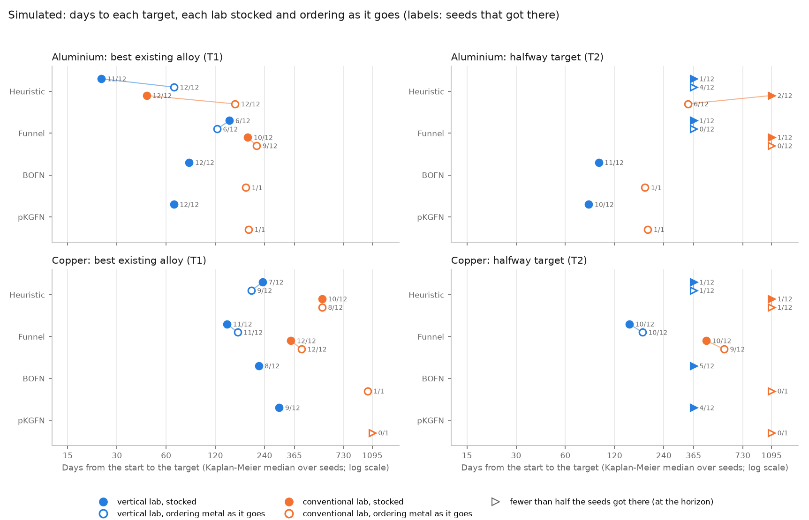

# Digital twin, round 3b: round 3 reproduces, and the lab comparison like with like

Sterling, on PR 394 (2026-11-26): "Twin round 3b: compare like with like, and make round 3 reproduce. ... 1.
Reproducibility first. The video run found that reruns of round 3's BOFN and pKGFN seeds (0 and 5) don't reproduce the
committed rows: the event logs match for about 25 simulated days, then diverge. Find the cause ... Pin it so a rerun
of a committed seed gives the committed row exactly, and add a check that reruns one short seed and compares. ... 2.
Like with like. Every round-3 lab-against-lab factor compares a stocked automated lab with a conventional lab ordering
metal as it goes, so the stock's share isn't measured ... Report the speed-up to both targets ... four ways ... 3.
Event logs for every seed, so a future replay can use the true median seed."

Round 3 is [`twin_round3.md`](twin_round3.md). Everything here is simulated: synthetic truths, simulated
instruments, assumed prices, capacities and schedules. Round 3's engine and policies are unchanged; round 3b adds the
numerical pin (`twin/repro.py`), the runs (`twin/bench3b.py`), the comparison (`twin/like3b.py`) and a figure
(`twin/figures3b.py`). The tables in full are [`out/twin3b/tables.md`](../out/twin3b/tables.md).

**In short:**

(Simulated. 12 seeds unless noted. Medians are Kaplan-Meier medians over seeds, with 95 % paired-bootstrap
intervals.)

- **Round 3 reproduces bit for bit on an AVX-512 machine, under a pin.**
  - Its BOFN and pKGFN reruns departed because numpy and torch pick their BLAS kernels by CPU. Forcing AVX2 kernels on
    this AVX-512 runner reproduces the video run's departure exactly: 1,010 identical bookings, then a different one
    at day 24.9.
  - Python's per-process string hashing moved the last bit of a true utility now and then.
  - `twin/repro.py` pins both, with the threads and the global generators. `python -m twin.repro check` reruns BOFN
    seed 0 for 30 days against the committed log.
  - Of round 3's committed rows, 348 were rerun under the pin: 338 are identical, 10 differ only in the last bit of aluminium utilities, and 0 differ otherwise.
- **Like with like, the vertical lab's best policy against the rule of thumb is 1.8× on aluminium's halfway target,
  not 4.0×.**
  - BOFN and pKGFN against the conventional lab's heuristic, both labs ordering metal as they go: day 183 against 337,
    with the vertical lab first in 9-10 of 12 seeds.
  - Round 3's 4.0× is this 1.8× times the stock's 2.2×. Ordering as it goes, the vertical lab waits weeks for each
    charge's metal: its first new aluminium alloy comes at a median of day 84-88, against day 11 stocked.
- **The same policy in both labs, like with like:**
  - The heuristic reaches aluminium's best existing alloy 2.4× sooner with both labs ordering as they go, and 1.9×
    with both stocked. Round 3 said 6.6-6.8×: the stock's 2.8× times the lab's 2.4×.
  - The funnel reaches copper's best existing alloy 2.5× sooner and its halfway target 3.0-3.2× sooner. Round 3 said
    2.9× and 3.8×, so copper's lead is mostly the lab's.
  - **BOFN and pKGFN in the conventional lab** (4 seeds of three-year runs, new here): with both labs ordering
    as they go, the conventional lab gets to aluminium's halfway target about as soon (0.9-1.0×). With both stocked,
    the vertical lab is 1.3-1.4× sooner, with wide intervals.
- **Cost, on one basis (campaign spend to the target):**
  - The vertical lab spends 2-3× less with the heuristic, the funnel, and BOFN and pKGFN against the rule of thumb.
  - Against BOFN and pKGFN in the conventional lab it spends about the same, or more on copper's first target.
  - This basis leaves out the vertical lab's fixed costs, where round 3 found it dearer per alloy.
- **A design point of round 3 that favours the conventional lab early.** Its three years' money comes with a day-0
  tranche three times the vertical lab's ($54k against $18k for aluminium).
- **Every seed now has an event log** (xz, `out/twin3b/events/`), and section 3 names each arm's median seed for a
  replay.

## 1. Why round 3's BOFN and pKGFN reruns did not reproduce

### 1.1 The cause: the BLAS kernels the CPU selects

numpy's OpenBLAS is built with DYNAMIC_ARCH: it looks at the CPU and runs its `SkylakeX` kernels where there is
AVX-512 and its `Haswell` or `Zen` kernels where there isn't. torch dispatches its own kernels and MKL's the same way.
The kernels add up the same numbers in different orders, so their results differ in the last bits. Every GP fit and
every posterior in BOFN and pKGFN goes through them, and when two of a policy's options score within a rounding error
of each other, the last bits decide which goes first. From then on the two runs are different runs.

Round 3 ran on a runner with AVX-512. This one has it too (Intel Xeon 6975P-C, 4 cores): numpy picks `SkylakeX` and
torch `AVX512`. What a rerun of BOFN seed 0 (round 3's main benchmark) does here:

| Rerun | Against the committed event log |
|---|---|
| This runner's own kernels, 1 BLAS thread | identical through day 128 (2,452 bookings, 747 results); twice, and pKGFN seed 0 too (2,506 bookings) |
| 4 BLAS threads | identical through day 43 (the length of that test) |
| After other runs in the same process (the heuristic for a year; pKGFN for 40 days; BOFN itself) | identical through day 58 (the length of that test) |
| numpy forced to its AVX2 kernels (`OPENBLAS_CORETYPE=Haswell`) | **identical for 1,010 bookings, to day 24.9, then different** |
| torch forced to AVX2 (`ATEN_CPU_CAPABILITY=avx2`, `MKL_ENABLE_INSTRUCTIONS=AVX2`) | the same: 1,010 bookings, day 24.9 |
| Both, or numpy's `Zen` kernels with torch's AVX2 | the same: 1,010 bookings, day 24.9 |

The video run reported exactly this: "the event logs are identical for the first 25 simulated days (1,010 events) and
then diverge". At hour 598 the copper campaign's ranking puts a different action first: in the committed run a DED
blend of design 24 starts at hour 599.1, and with AVX2 kernels a powder charge of design 3 starts at hour 598.0.
Changing either library's kernels is enough. The video run's runner most likely had no AVX-512. Its log doesn't
record the CPU, so that is an inference, but it is the only difference that reproduces its result here.

Full-year reruns on this runner, on its own kernels, gave the committed rows exactly: BOFN seeds 0 and 5 (the two
the video run tried), pKGFN seed 0, and seed 0 of the heuristic, the funnel, GP-BO, random and Sobol, in the vertical
lab and the conventional lab. Every field of the row is compared: the curves, the money, the counts, the stops, the
utilization. Only the run time and the GP bookkeeping are left out. Those reruns ran before the hash key was pinned.
Under the full pin, BOFN seed 0 differs from its committed row in the last bit of some aluminium utilities, and
nowhere else (1.2, 1.4).

**Ruled out:**
- *Threads*: 4 BLAS threads gave the same bookings as 1 here.
- *Worker history*: round 3's pool ran several configurations in each worker, and BOFN seed 0's committed row was made
  after other runs in its worker. Reruns after other runs in the same process match the committed log.
- *BoTorch's fit retries*: `fit_gpytorch_mll` resamples the hyperparameters from their priors with torch's global
  generator when a fit fails, and torch 2.15 seeds that generator at random in every process. That would be a real
  source of irreproducibility, but no run here drew from it. Every round-3b row records whether the generator moved
  during the run (`torch_rng_used`), and it never did.

### 1.2 A second, smaller cause: Python's string hashing

Of the first 60 reruns, one (the heuristic, seed 11) differed from its committed row. The difference was one unit in
the last place of one alloy's true utility (0.4257213698149713 against 0.4257213698149712). Every count, day and
dollar in the row was the same. The cause is Python's string hashing, which uses a random key in every process.
`Campaign` builds the true composition of an atomized lot, and of a lot topped up with another, by iterating a set of
element symbols (`twin/campaign.py`, the two set expressions where a lot's truth is made and blended). The set's order
follows the hash key, so the composition's keys come out in a different order in each process, and so does a later
floating-point sum over them. Rerunning that seed under four hash keys gives the committed value under three and the
other one under the fourth (`test_string_hashing_moves_a_last_bit`).

### 1.3 The pin

`twin/repro.py`, applied when the `twin` package is imported, before numpy or torch load:

- **Threads:** one for OpenMP, OpenBLAS and MKL.
- **Kernels:** the AVX-512 ones round 3 used, `OPENBLAS_CORETYPE=SkylakeX`, `ATEN_CPU_CAPABILITY=avx512` and
  `MKL_ENABLE_INSTRUCTIONS=AVX512`, so that a newer CPU doesn't get newer kernels.
- **`PYTHONHASHSEED=0`:** the hash key is fixed when an interpreter starts. `apply()` puts it in the environment of
  every process started from this one (the benchmark's workers). The command-line tools (`twin.bench3`,
  `twin.bench3b`, `twin.repro`) re-execute themselves under it.
- **Global generators:** Python's, numpy's and torch's, seeded at the start of every run.
- **The record:** every row records its set-up in `env` (versions, the kernels and threads actually in use, the CPU,
  the pin).

`TWIN_PIN=avx2` pins the AVX2 kernels instead. They run on any x86-64 CPU from 2013 on, but give rows of their own,
not round 3's. `TWIN_PIN=off` sets nothing: kernels, threads and hashing are left to the libraries and the
interpreter.

**A machine without AVX-512 can't give round 3's rows.** On one, `apply()` leaves the kernels alone, and the check
and the tests say why and skip. The AMD EPYC 7763 (Zen 3), for example, has no AVX-512. To make the rows portable,
everything would have to be rerun under `TWIN_PIN=avx2`, every BOFN and pKGFN row included, and the results would
move. That wasn't done here.

**The check:**
- `python -m twin.repro check` reruns BOFN seed 0 for 30 simulated days (about half a minute) and compares every
  booking and result before day 28 with the committed event log. Day 24.9 is where an AVX2 rerun departs.
- `python -m twin.repro row main bofn3 5` reruns a whole committed row and compares every field.
- `twin/tests/test_round3b.py` runs both checks, with the heuristic and GP-BO as the full rows. It also runs the
  hash-seed test, and checks that every rerun committed here matched.

### 1.4 Round 3's committed rows, rerun

Every row is compared field by field, leaving out only the run time and the GP bookkeeping.

| Round 3's experiment | Committed rows | Rerun | Identical | To the last bit | Different |
|---|---|---|---|---|---|
| `main` | 96 | 96 | 93 | 3 | 0 |
| `main_more` | 60 | 60 | 57 | 3 | 0 |
| `conventional` | 60 | 60 | 58 | 2 | 0 |
| the copper tests (`cu_hidden`, `cu_proxy`, `cu_ablation`, `cu_money`) | 140 | 132 | 130 | 2 | 0 |
| all | 356 | 348 | 338 | 10 | 0 |

Runs rerun by policy: bofn3 12, bofn3_usd 12, gpbo 60, heuristic 60, pkgfn3 12, random 48, sobol 36, tiered 60, tiered_mis 24, tiered_proxy 12, tiered_screen 12.

To the last bit: `r3_proposed_gpbo_s6_stock-lean`, `r3_proposed_sobol_s3_stock-lean`, `r3_vertical_lab_bofn3_s0`, `r3_vertical_lab_gpbo_s15`, `r3_vertical_lab_gpbo_s5_cu_budget-180000.0`, `r3_vertical_lab_heuristic_s0_cu_budget-180000.0`, `r3_vertical_lab_heuristic_s23`, `r3_vertical_lab_heuristic_s3`, `r3_vertical_lab_heuristic_s7`, `r3_vertical_lab_tiered_s17`. In each, aluminium's true utilities differ by one to three units in the last place. A best-so-far curve carries a value forward, so that is 4 to 128 entries of the row. Everything else in the row (every count, day and dollar) is identical (`bench3b.match_kind`). The cause is the hash key of the process that made the committed row. It was random and wasn't recorded, so no single key recovers every row's last bits.

No run of round 3b's 436 drew from torch's global generator.

The seed-0 event logs that round 3 committed (`out/twin3/events/`) are identical, booking for booking, to the reruns'
logs (`test_rerun_logs_equal_round_3s_committed_logs`). Not rerun: BOFN and pKGFN in the copper tests (`cu_money`,
`cu_hidden_net`), 16 runs of 10-18 minutes each.

## 2. The lab comparison, like with like

### 2.1 The arms

| Arm | Vertical lab, 1 year at 1 year's money | Conventional lab, 3 years at 3 years' money |
|---|---|---|
| Stocked | round 3's `main` (12 seeds of each policy) | **new:** `c_stocked`: the heuristic and the funnel (12 seeds), BOFN and pKGFN (4) |
| Ordering metal as it goes | **new:** `v_lean`: all four policies, 12 seeds | round 3's `conventional` (the heuristic and the funnel, 12 seeds); **new:** `c_lean_net`: BOFN and pKGFN (4), round 3's `conventional_net`, which never ran |

"Stocked" is round 2's standing inventory, about a month's use at the vertical lab's pace (copper's costs $13.4k). It
is bought on day 0 and charged to the campaign, and shortfalls are reordered four times over (1.5 times when
ordering as it goes). The conventional lab's BOFN and pKGFN run on seeds 0-3: each run simulates three
years and took 19-40 minutes here, against 4-22 for a vertical-lab year. Seeds are paired: seed *s* has the same synthetic truth,
market and breakdowns in every arm.

| Lab | Stock | Policy | Seeds | Al best | Al T1 | Al T2 | Cu best | Cu T1 | Cu T2 |
|---|---|---|---|---|---|---|---|---|---|
| vertical | stocked | heuristic | 0-11 | 0.55 ± 0.03 | 11/12; 24 | 1/12; >365 | 0.57 ± 0.03 | 7/12; 234 | 1/12; >365 |
| vertical | lean | heuristic | 0-11 | 0.60 ± 0.02 | 12/12; 67 | 4/12; >365 | 0.59 ± 0.02 | 9/12; 199 | 1/12; >365 |
| conventional | stocked | heuristic | 0-11 | 0.57 ± 0.02 | 12/12; 46 | 2/12; >1095 | 0.59 ± 0.02 | 10/12; 540 | 1/12; >1095 |
| conventional | lean | heuristic | 0-11 | 0.64 ± 0.03 | 12/12; 159 | 6/12; 337 | 0.57 ± 0.02 | 8/12; 540 | 1/12; >1095 |
| vertical | stocked | funnel | 0-11 | 0.30 ± 0.08 | 6/12; 146 | 1/12; >365 | 0.69 ± 0.02 | 11/12; 142 | 10/12; 148 |
| vertical | lean | funnel | 0-11 | 0.30 ± 0.08 | 6/12; 123 | 0/12; >365 | 0.68 ± 0.02 | 11/12; 164 | 10/12; 178 |
| conventional | stocked | funnel | 0-11 | 0.48 ± 0.05 | 10/12; 190 | 1/12; >1095 | 0.70 ± 0.01 | 12/12; 348 | 10/12; 437 |
| conventional | lean | funnel | 0-11 | 0.44 ± 0.06 | 9/12; 215 | 0/12; >1095 | 0.69 ± 0.01 | 12/12; 405 | 9/12; 561 |
| vertical | stocked | BOFN | 0-11 | 0.73 ± 0.02 | 12/12; 83 | 11/12; 96 | 0.58 ± 0.04 | 8/12; 221 | 5/12; >365 |
| vertical | lean | BOFN | 0-11 | 0.73 ± 0.01 | 12/12; 127 | 11/12; 183 | 0.58 ± 0.03 | 7/12; 288 | 4/12; >365 |
| conventional | stocked | BOFN | 0-3 | 0.69 ± 0.02 | 4/4; 129 | 3/4; 130 | 0.69 ± 0.02 | 4/4; 274 | 3/4; 497 |
| conventional | lean | BOFN | 0-3 | 0.75 ± 0.01 | 4/4; 175 | 4/4; 184 | 0.67 ± 0.02 | 4/4; 384 | 3/4; 384 |
| vertical | stocked | pKGFN | 0-11 | 0.71 ± 0.03 | 12/12; 67 | 10/12; 83 | 0.61 ± 0.03 | 9/12; 295 | 4/12; >365 |
| vertical | lean | pKGFN | 0-11 | 0.72 ± 0.01 | 12/12; 162 | 11/12; 183 | 0.56 ± 0.04 | 8/12; 277 | 4/12; >365 |
| conventional | stocked | pKGFN | 0-3 | 0.72 ± 0.02 | 4/4; 130 | 4/4; 130 | 0.68 ± 0.04 | 4/4; 407 | 3/4; 417 |
| conventional | lean | pKGFN | 0-3 | 0.74 ± 0.00 | 4/4; 165 | 4/4; 192 | 0.64 ± 0.05 | 3/4; 352 | 3/4; 352 |

### 2.2 How the comparison is made

- **Days to a target:** per seed, from the run's best-so-far curve of new demonstrated alloys. A seed that never gets
  there is censored at its horizon.
- **The two targets:** T1 is the best existing alloy on this synthetic benchmark (aluminium 0.423, copper 0.556). T2
  is halfway from there to the best alloy the oracle found (0.639, 0.656).
- **Medians:** Kaplan-Meier medians over seeds for every arm. That is one rule throughout. Round 3's
  `econ_summary.json` used the plain median where every seed got there, which the audit noted.
- **The factor:** the conventional arm's median over the vertical arm's.
  - If fewer than half the conventional seeds get there in three years, the factor is a lower bound, written `>=`
    (1,095 days over the vertical median).
  - If fewer than half the vertical seeds get there in a year, it is an upper bound, written `<=`.
- **Intervals:** 95 % percentile intervals from a paired bootstrap over seeds, with seeds resampled together in both
  arms.
- **Paired differences:** the days the vertical lab saved, per seed where both got there, and the number of seeds in
  which each lab got there first.
- **Cost:** one basis throughout, campaign spend to the target. That is the money the campaign had spent (metal,
  consumables, the stock where there is one, outside services) on the day it first got there. It counts no staff,
  equipment or building.

### 2.3 The stock's share

Each lab against itself, stocked and ordering as it goes, same policy, same seeds. The factor is the lean arm's median
day over the stocked arm's (above 1: the stock makes that lab faster). Then come the seeds that got there (stocked vs
lean) and the paired difference in the final best alloy.

| Lab | Policy | Al T1 | Al T2 | Cu T1 | Cu T2 | Final best, stocked − lean (Al; Cu) |
|---|---|---|---|---|---|---|
| vertical | heuristic | 2.8x (0.8-8.2); 11/12 vs 12/12 | neither; 1/12 vs 4/12 | 0.9x (0-1.3); 7/12 vs 9/12 | neither; 1/12 vs 1/12 | -0.05 ± 0.03; -0.02 ± 0.04 (n=12) |
| vertical | funnel | 0.8x (0.6-8.4); 6/12 vs 6/12 | neither; 1/12 vs 0/12 | 1.2x (0.9-2.0); 11/12 vs 11/12 | 1.2x (0.8-2.1); 10/12 vs 10/12 | +0.00 ± 0.00; +0.01 ± 0.01 (n=12) |
| vertical | BOFN | 1.5x (0.9-5.4); 12/12 vs 12/12 | 1.9x (0.7-3.3); 11/12 vs 11/12 | 1.3x (0.8-∞); 8/12 vs 7/12 | neither; 5/12 vs 4/12 | -0.00 ± 0.02; -0.00 ± 0.03 (n=12) |
| vertical | pKGFN | 2.4x (1.5-7.5); 12/12 vs 12/12 | 2.2x (1.0-5.1); 10/12 vs 11/12 | 0.9x (0.7-∞); 9/12 vs 8/12 | neither; 4/12 vs 4/12 | -0.01 ± 0.03; +0.05 ± 0.04 (n=12) |
| conventional | heuristic | 3.5x (0.8-4.6); 12/12 vs 12/12 | <= 0.3x; 2/12 vs 6/12 | 1.0x (0.7-∞); 10/12 vs 8/12 | neither; 1/12 vs 1/12 | -0.08 ± 0.03; +0.03 ± 0.02 (n=12) |
| conventional | funnel | 1.1x (0.8-10.9); 10/12 vs 9/12 | neither; 1/12 vs 0/12 | 1.2x (0.8-1.6); 12/12 vs 12/12 | 1.3x (0.9-2.1); 10/12 vs 9/12 | +0.05 ± 0.04; +0.00 ± 0.01 (n=12) |
| conventional | BOFN | 1.4x (0.6-3.8); 4/4 vs 4/4 | 1.4x (0-4.8); 3/4 vs 4/4 | 1.4x (0.6-1.9); 4/4 vs 4/4 | 0.8x (0.6-1.4); 3/4 vs 3/4 | -0.07 ± 0.02; +0.02 ± 0.01 (n=4) |
| conventional | pKGFN | 1.3x (1.2-3.8); 4/4 vs 4/4 | 1.5x (0.5-4.8); 4/4 vs 4/4 | 0.9x (0.7-∞); 4/4 vs 3/4 | 0.8x (0.7-0.9); 3/4 vs 3/4 | -0.01 ± 0.01; +0.05 ± 0.02 (n=4) |

- **The stock is most of round 3's aluminium factor.**
  - With the heuristic, the stock brings aluminium's first result forward 2.8× in the vertical lab (day 24 against
    67) and 3.5× in the conventional lab (day 46 against 159).
  - Round 3 set the stocked vertical lab (day 24) against the lean conventional lab (day 159). Medians multiply, so
    its 6.6× is exactly the stock's 2.8× times the lab's 2.4×.
- **It does little for copper's funnel:** 1.2-1.3× in both labs, to either target, and nothing to the final alloy.
- **The stock doesn't always help later.**
  - Stocked, the conventional lab's heuristic reaches aluminium's halfway target in 2 of 12 seeds (6 of 12 lean), and
    finishes 0.08 ± 0.03 lower.
  - The vertical lab's heuristic reaches it in 1 of 12 stocked (4 of 12 lean), and finishes 0.05 ± 0.03 lower.
  - In the conventional lab, spending by kind, lots and builds are the same either way to within 2 %. So the
    difference is in which designs the heuristic went on to make, not in how much it could make.
- **The stock speeds BOFN and pKGFN in the vertical lab to aluminium's halfway target:** day 96 against 183 for BOFN
  (1.9×) and 83 against 183 for pKGFN (2.2×). 10-11 of 12 seeds get there either way, and the final alloy is the same
  (paired difference 0.00 ± 0.02 and −0.01 ± 0.03).
  - Ordering as it goes, the lab waits weeks for each charge's metal. Its first new aluminium alloy comes at a median
    of day 84 (BOFN; 88 for pKGFN), against day 11 stocked.
  - It also places a median of 480 orders a year against 300-310.
  - In the conventional lab the stock speeds them less: 1.4-1.5× to the same target, on 4 seeds with intervals
    that reach below 1 (the table).

### 2.4 The speed-up four ways

Round 3's comparisons (and BOFN's), four ways. Each cell gives the factor (the conventional lab's median day over the
vertical lab's) and its 95 % interval. Then come the seeds that got there (vertical vs conventional) and the seeds in
which the vertical lab got there first. The first column of factors is round 3's pairing, recomputed by the one
median rule. Each factor is computed on the seeds both arms have: seeds 0-3 wherever the conventional
lab runs BOFN or pKGFN. It can therefore differ from the ratio of two medians in 2.1, which are over each arm's own
seeds. The rows for every policy against both the same policy and the rule of thumb, and the paired differences in
days, are in [`tables.md`](../out/twin3b/tables.md).

| Target | Vertical lab | Conventional lab | Round 3 said | vertical stocked, conventional lean (round 3) | both lean | both stocked | vertical lean, conventional stocked |
|---|---|---|---|---|---|---|---|
| Al T1 | heuristic | heuristic | 6.8x (plain medians; Kaplan-Meier 6.6x) | 6.6x (1.4-9.3); 11/12 vs 12/12; first in 10/12 | 2.4x (0.9-3.1); 12/12 vs 12/12; first in 11/12 | 1.9x (0.5-8.5); 11/12 vs 12/12; first in 8/12 | 0.7x (0.5-3.2); 12/12 vs 12/12; first in 7/12 |
| Al T1 | pKGFN | heuristic | 2.3x | 2.4x (0.8-8.9); 12/12 vs 12/12; first in 9/12 | 1.0x (0.4-1.4); 12/12 vs 12/12; first in 5/12 | 0.7x (0.4-4.7); 12/12 vs 12/12; first in 6/12 | 0.3x (0.2-1.4); 12/12 vs 12/12; first in 3/12 |
| Al T2 | pKGFN | heuristic | 4.0x, the aluminium headline | 4.0x (2.1-∞); 10/12 vs 6/12; first in 9/12 | 1.8x (1.2-∞); 11/12 vs 6/12; first in 9/12 | >= 13.1x; 10/12 vs 2/12; first in 9/12 | >= 6.0x; 11/12 vs 2/12; first in 10/12 |
| Al T2 | BOFN | heuristic | - | 3.5x (1.3-∞); 11/12 vs 6/12; first in 10/12 | 1.8x (1.3-∞); 11/12 vs 6/12; first in 10/12 | >= 11.4x; 11/12 vs 2/12; first in 10/12 | >= 6.0x; 11/12 vs 2/12; first in 10/12 |
| Al T2 | pKGFN | pKGFN | not run | 2.0x (0-3.8); 3/4 vs 4/4; first in 3/4 | 1.0x (0-1.7); 3/4 vs 4/4; first in 2/4 | 1.3x (0-7.6); 3/4 vs 4/4; first in 2/4 | 0.7x (0-2.3); 3/4 vs 4/4; first in 2/4 |
| Al T2 | BOFN | BOFN | not run | 1.9x (0.9-4.1); 4/4 vs 4/4; first in 3/4 | 0.9x (0-2.5); 3/4 vs 4/4; first in 1/4 | 1.4x (0.4-∞); 4/4 vs 3/4; first in 2/4 | 0.7x (0-∞); 3/4 vs 3/4; first in 3/4 |
| Cu T1 | funnel | funnel | 2.9x | 2.9x (2.3-3.9); 11/12 vs 12/12; first in 11/12 | 2.5x (1.5-3.3); 11/12 vs 12/12; first in 10/12 | 2.5x (1.8-4.0); 11/12 vs 12/12; first in 9/12 | 2.1x (1.9-2.6); 11/12 vs 12/12; first in 11/12 |
| Cu T2 | funnel | funnel | 3.8x, the copper headline | 3.8x (1.9-5.8); 10/12 vs 9/12; first in 10/12 | 3.2x (1.9-4.8); 10/12 vs 9/12; first in 10/12 | 3.0x (1.8-5.1); 10/12 vs 10/12; first in 9/12 | 2.5x (1.5-4.1); 10/12 vs 10/12; first in 10/12 |
| Cu T1 | pKGFN | heuristic | 1.8x | 1.8x (1.4-∞); 9/12 vs 8/12; first in 8/12 | 2.0x (0-∞); 8/12 vs 8/12; first in 8/12 | 1.8x (1.3-3.0); 9/12 vs 10/12; first in 9/12 | 2.0x (0-2.9); 8/12 vs 10/12; first in 8/12 |
| Cu T1 | pKGFN | pKGFN | not run | 1.2x (1.0-1.6); 3/4 vs 3/4; first in 3/4 | 1.3x (0-1.8); 2/4 vs 3/4; first in 2/4 | 1.4x (0-1.7); 3/4 vs 4/4; first in 2/4 | 1.5x (0-2.5); 2/4 vs 4/4; first in 1/4 |
| Cu T1 | BOFN | BOFN | not run | 1.5x (0-1.8); 2/4 vs 4/4; first in 2/4 | 1.3x (0-1.9); 2/4 vs 4/4; first in 2/4 | 1.0x (0-2.0); 2/4 vs 4/4; first in 1/4 | 0.9x (0-2.9); 2/4 vs 4/4; first in 1/4 |

- **Aluminium, the same policy in both labs (the heuristic, T1).** Round 3's 6.6× becomes 2.4× (0.9-3.1) with both
  labs ordering as they go, and 1.9× (0.5-8.5) with both stocked.
  - Both intervals reach below 1. Seed by seed, though, the vertical lab gets there first in 11 of 12 (both lean,
    +71 ± 14 days) and in 8 of 12 (both stocked, +51 ± 24 days).
  - In the other mixed pair the stocked conventional lab is the faster one: 0.7× (day 46 against 67), and the
    vertical lab is first in 7 of 12.
- **Copper, the funnel in both labs.** To the best existing alloy, 2.5× (1.5-3.3) both lean and 2.5× (1.8-4.0) both
  stocked, against round 3's 2.9×. To the halfway target, 3.2× (1.9-4.8) and 3.0× (1.8-5.1), against 3.8×. Like with
  like, round 3's copper factors shrink by 14-21 %; the rest holds.
- **BOFN and pKGFN against the rule of thumb (aluminium's halfway target):** round 3's 4.0× for pKGFN becomes **1.8×
  (1.2 to unbounded) with both labs ordering as they go**: day 183 against 337. pKGFN gets there in 11 of 12 seeds (the
  heuristic in 6 of 12), and first in 9 of 12; BOFN is the same, 1.8×, first in 10 of 12.
  - Round 3's 4.0× is the stock's 2.2× (pKGFN in the vertical lab, stocked against lean) times this 1.8×.
  - With both labs stocked, the factor is at least 13×, but only because the stocked conventional heuristic gets
    there in 2 of 12 seeds (section 2.3).
- **BOFN and pKGFN in both labs** (4 seeds; the conventional lab's three-year runs). This is the comparison
  round 3 couldn't make.
  - **With both labs ordering as they go, the conventional lab gets to aluminium's halfway target about as soon**:
    BOFN 0.9× and pKGFN 1.0×, the vertical lab first in 1 and 2 of 4 seeds.
  - It also gets to copper's best existing alloy in more of the same seeds (BOFN 4 of 4, against 2 of
    4 in the vertical lab's year).
  - With both stocked, the vertical lab is ahead on aluminium by 1.4× (BOFN) and 1.3× (pKGFN), with intervals that
    reach below 1.
  - These rest on 4 pairs of seeds and say less than the 12-seed rows.
- **What is like with like, then:**
  - the same policy in both labs, both ordering as they go: the heuristic 2.4× on aluminium's first target; the
    funnel 2.5× and 3.2× on copper's; BOFN and pKGFN no faster on aluminium's halfway target;
  - the vertical lab's best policy against the rule of thumb, both ordering as they go: 1.8× on aluminium's halfway
    target;
  - the stocked vertical lab's lead in round 3 came largely from the stock, on aluminium.



### 2.5 Cost on one basis: campaign spend to the target

The same comparisons on one basis: **campaign spend to the target**. That is the money the campaign had spent
(metal, consumables, the day-0 stock where there is one, outside services) on the day it first got there. The factor
is the conventional lab's median spend over the vertical lab's (above 1: the vertical lab spent less to get there).
This basis leaves out staff, equipment and the building. Those are where the vertical lab costs more: round 3's
economics put its fixed costs at $1.18M a year against the conventional lab's $0.12M, and its cost per demonstrated
alloy above the conventional lab's on every basis that carries them (`notes/twin_round3.md`, 3.5). Round 3b
doesn't redo that model.

| Target | Vertical lab | Conventional lab | Round 3 said | vertical stocked, conventional lean (round 3) | both lean | both stocked | vertical lean, conventional stocked |
|---|---|---|---|---|---|---|---|
| Al T1 | heuristic | heuristic | - | 10.1x (1.9-10.9); 11/12 vs 12/12 | 3.1x (2.3-3.3); 12/12 vs 12/12 | 6.1x (1.0-11.4); 11/12 vs 12/12 | 1.9x (0.6-3.5); 12/12 vs 12/12 |
| Al T1 | pKGFN | heuristic | - | 2.6x (1.6-5.1); 12/12 vs 12/12 | 1.5x (1.0-2.6); 12/12 vs 12/12 | 1.6x (0.4-4.8); 12/12 vs 12/12 | 0.9x (0.3-2.3); 12/12 vs 12/12 |
| Al T2 | pKGFN | heuristic | - | 3.8x (2.4-∞); 10/12 vs 6/12 | 2.3x (1.5-∞); 11/12 vs 6/12 | >= 7.6x; 10/12 vs 2/12 | >= 4.7x; 11/12 vs 2/12 |
| Al T2 | BOFN | heuristic | - | 3.1x (1.7-∞); 11/12 vs 6/12 | 2.2x (1.7-∞); 11/12 vs 6/12 | >= 6.3x; 11/12 vs 2/12 | >= 4.4x; 11/12 vs 2/12 |
| Al T2 | pKGFN | pKGFN | - | 1.9x (0-2.7); 3/4 vs 4/4 | 1.5x (0-2.6); 3/4 vs 4/4 | 1.7x (0-4.6); 3/4 vs 4/4 | 1.3x (0-3.7); 3/4 vs 4/4 |
| Al T2 | BOFN | BOFN | - | 1.9x (1.6-2.8); 4/4 vs 4/4 | 1.3x (0-3.4); 3/4 vs 4/4 | 1.7x (1.0-∞); 4/4 vs 3/4 | 1.2x (0-∞); 3/4 vs 3/4 |
| Cu T1 | funnel | funnel | - | 2.6x (2.0-3.2); 11/12 vs 12/12 | 2.5x (1.8-3.5); 11/12 vs 12/12 | 2.5x (2.1-3.3); 11/12 vs 12/12 | 2.5x (2.1-3.3); 11/12 vs 12/12 |
| Cu T2 | funnel | funnel | - | 3.2x (2.3-4.1); 10/12 vs 9/12 | 3.2x (2.2-4.5); 10/12 vs 9/12 | 2.9x (2.1-4.1); 10/12 vs 10/12 | 2.9x (1.9-4.0); 10/12 vs 10/12 |
| Cu T1 | pKGFN | heuristic | - | 2.1x (1.8-∞); 9/12 vs 8/12 | 2.1x (0-∞); 8/12 vs 8/12 | 2.2x (1.7-3.1); 9/12 vs 10/12 | 2.2x (0-3.0); 8/12 vs 10/12 |
| Cu T1 | pKGFN | pKGFN | - | 0.7x (0.6-1.0); 3/4 vs 3/4 | 0.7x (0-1.0); 2/4 vs 3/4 | 0.8x (0-0.8); 3/4 vs 4/4 | 0.8x (0-1.3); 2/4 vs 4/4 |
| Cu T1 | BOFN | BOFN | - | 1.0x (0-1.3); 2/4 vs 4/4 | 0.9x (0-1.2); 2/4 vs 4/4 | 0.6x (0-1.1); 2/4 vs 4/4 | 0.6x (0-1.6); 2/4 vs 4/4 |

- **On campaign spend, the vertical lab reaches most targets more cheaply.** Most of that is time, since a campaign
  spends as it goes and the conventional lab runs three years. There are two exceptions:
  - BOFN and pKGFN against the same policy, on copper's first target (0.6-1.0×);
  - pKGFN against the conventional heuristic on aluminium's first target, in the mixed pair (0.9×).
- **Copper's funnel:** 2.5× less campaign money to the best existing alloy and 2.9-3.2× less to halfway, the same in
  all four pairings.
- **Aluminium's heuristic:** round 3's pairing gives 10.1×. Like with like it is 3.1× (both lean) and 6.1× (both
  stocked). Stocking costs the vertical lab money on day 0, but it gets there in days.
- **BOFN and pKGFN against the rule of thumb, aluminium's halfway target:** round 3's pairing gives 3.8× less campaign
  money for pKGFN. With both labs ordering as they go it is 2.3× (BOFN 2.2×).
- **BOFN and pKGFN in both labs, both ordering as they go:**
  - The vertical lab spends 1.3× (BOFN) and 1.5× (pKGFN) less campaign money to aluminium's halfway target.
  - To copper's best existing alloy it spends about the same or more (0.9× and 0.7×).
  - The intervals are wide (4 seeds).

### 2.6 Where the vertical lab doesn't win, like with like

Everything here is simulated.

- **BOFN and pKGFN against the same policy in the conventional lab, both ordering metal as they go.** With three
  years' money, the conventional lab gets to aluminium's halfway target about as soon (0.9-1.0×), and to copper's
  best existing alloy in more seeds (4 seeds).
- **Aluminium's first target, against the stocked conventional lab.**
  - The stocked conventional lab's heuristic gets to the best existing alloy on day 46. That is sooner than the lean
    vertical lab with any policy (day 67 for the heuristic, 127-162 for BOFN and pKGFN).
  - It is also sooner than the stocked vertical lab's pKGFN (day 67).
- **The heuristic's aluminium factor like with like has an interval reaching below 1** (2.4×, 0.9-3.1), though the
  vertical lab gets there first in 11 of 12 seeds.
- **Copper's halfway target with BOFN and pKGFN:** the vertical lab gets there in 4-5 of 12 seeds in its year
  (stocked or lean). The conventional lab gets there in 3 of its 4 seeds in three years, either way.
- **A design point that favours the conventional lab early.** Round 3's spending plan releases 15 % of the budget on
  day 0, then the rest at the same rate in both labs. Three years' money is a larger budget, so the conventional
  lab's day-0 tranche is three times the vertical lab's: $54k against $18k for aluminium, $27k against $9k for
  copper. It can have spent $36k (aluminium) or $18k (copper) more on any day until the vertical lab's plan runs out
  at day 274. With metal ordered as it goes, money for metal is what an early result waits on. Round 3b keeps round
  3's set-up; a conventional lab on one year's money a year would be the test.

## 3. Event logs for every seed

`out/twin3b/events/` holds 436 event logs, 26.9 MB in all (62 KB each on average), xz-compressed JSON in round 3's schema (`Twin.event_log`: every booking, design, result and best-so-far curve). `twin.bench3b.read_events(path)` reads one, and so does `xz -dc`. There is one for every run round 3b made: the new arms, and round 3's reruns. The reruns match their committed rows, so their logs are the committed runs' logs (a log rounds utilities to 4 decimals, so the last-bit cases don't show). Round 3's own seed-0 logs (`out/twin3/events/*.json`) are unchanged.

Every row of round 3's main benchmark and lab comparison has a log.

**The median seed of each arm**, for a replay: the seed whose day to the target is the arm's Kaplan-Meier median (ties go to the seed whose final best is nearest the arm's median). Where fewer than half the seeds got there, it is a seed that didn't. All from `like3b.json` (`median_seeds`):

| Arm | Al T1 | Al T2 | Cu T1 | Cu T2 |
|---|---|---|---|---|
| conventional, lean, BOFN | seed 2 (day 175; 4/4) | seed 0 (day 184; 4/4) | seed 1 (day 384; 4/4) | seed 1 (day 384; 3/4) |
| conventional, lean, heuristic | seed 8 (day 159; 12/12) | seed 3 (day 337; 6/12) | seed 10 (day 540; 8/12) | seed 3 (not reached by most; 1/12) |
| conventional, lean, pKGFN | seed 2 (day 165; 4/4) | seed 0 (day 192; 4/4) | seed 1 (day 352; 3/4) | seed 1 (day 352; 3/4) |
| conventional, lean, funnel | seed 10 (day 215; 9/12) | seed 1 (not reached by most; 0/12) | seed 5 (day 405; 12/12) | seed 11 (day 561; 9/12) |
| conventional, stocked, BOFN | seed 0 (day 129; 4/4) | seed 3 (day 130; 3/4) | seed 1 (day 274; 4/4) | seed 2 (day 497; 3/4) |
| conventional, stocked, heuristic | seed 0 (day 46; 12/12) | seed 8 (not reached by most; 2/12) | seed 0 (day 540; 10/12) | seed 3 (not reached by most; 1/12) |
| conventional, stocked, pKGFN | seed 3 (day 130; 4/4) | seed 3 (day 130; 4/4) | seed 1 (day 407; 4/4) | seed 3 (day 417; 3/4) |
| conventional, stocked, funnel | seed 10 (day 190; 10/12) | seed 1 (not reached by most; 1/12) | seed 6 (day 348; 12/12) | seed 6 (day 437; 10/12) |
| vertical, lean, BOFN | seed 1 (day 127; 12/12) | seed 11 (day 183; 11/12) | seed 7 (day 288; 7/12) | seed 2 (not reached by most; 4/12) |
| vertical, lean, heuristic | seed 1 (day 67; 12/12) | seed 6 (not reached by most; 4/12) | seed 5 (day 199; 9/12) | seed 0 (not reached by most; 1/12) |
| vertical, lean, pKGFN | seed 1 (day 162; 12/12) | seed 3 (day 183; 11/12) | seed 2 (day 277; 8/12) | seed 5 (not reached by most; 4/12) |
| vertical, lean, funnel | seed 10 (day 123; 6/12) | seed 3 (not reached by most; 0/12) | seed 4 (day 164; 11/12) | seed 7 (day 178; 10/12) |
| vertical, stocked, BOFN | seed 7 (day 83; 12/12) | seed 0 (day 96; 11/12) | seed 5 (day 221; 8/12) | seed 4 (not reached by most; 5/12) |
| vertical, stocked, heuristic | seed 7 (day 24; 11/12) | seed 2 (not reached by most; 1/12) | seed 3 (day 234; 7/12) | seed 5 (not reached by most; 1/12) |
| vertical, stocked, pKGFN | seed 5 (day 67; 12/12) | seed 7 (day 83; 10/12) | seed 3 (day 295; 9/12) | seed 4 (not reached by most; 4/12) |
| vertical, stocked, funnel | seed 10 (day 146; 6/12) | seed 10 (not reached by most; 1/12) | seed 3 (day 142; 11/12) | seed 10 (day 148; 10/12) |

## 4. What changes in round 3's notes

**Round 3's numbers don't change.** Every committed row that was rerun matches: exactly, or to the last bit of a true
utility, with everything else in the row the same (1.4). What changes is what the lab factors mean.
`notes/twin_round3.md` now says so where they appear:
- the summary at the top;
- section 3.4, which gains the four-way table;
- its limits, where BOFN and pKGFN in the conventional lab have now run (4 seeds each, both ways), and where
  the rows reproduce under the pin.

`notes/twin_video.md` gets one line where the video run reported the departure.

PR 394's description gave BOFN's gain from three times the copper money as +0.17 ± 0.04, from its first 3 seeds. It now
gives the 4 committed seeds' +0.14 ± 0.04 (with "4 seeds each" and the difference from the funnel, +0.03 ± 0.04), as
the notes have since 3071af0.

## Limits

All simulated: synthetic truths, simulated instruments, assumed capacities, prices and schedules.

- **One machine type.** Round 3's rows reproduce on an x86-64 CPU with AVX-512 under the pin. On one without it they
  can't: the kernels differ, and BOFN seed 0 departs at day 24.9. `TWIN_PIN=avx2` would make rows that reproduce on
  any x86-64 machine, but they would be new rows, and everything would have to be rerun.
- **Library versions.** The rows were checked with the versions listed below. A new numpy, torch or BoTorch can change
  a kernel or a default and move a row the same way; every row now records its versions (`env`).
- **The last bit.** The few committed rows that differ in the last bit of a true utility can't be recovered exactly,
  because the hash key of the process that made them wasn't recorded.
- **The conventional lab's BOFN and pKGFN have 4 seeds** (three simulated years each). Their factors rest on
  4 pairs; the counts are given with every one. `TWIN3B_CONV_NET=8 python -m twin.bench3b run c_stocked
  c_lean_net` adds seeds 4-7.
- **Campaign spend is the one cost basis here.** It leaves out the vertical lab's fixed costs, where round 3 found it
  costs more per alloy.
- **Round 3's choices stand:** the spending plan, the 2 h admission window, the atomizer split, the stock's size and
  its four-times reorders, the operators, and BOFN and pKGFN's parameters (`notes/twin_round3.md`, Limits).

## Rerunning it

```bash
cd vertical-lab
pip install numpy scipy scikit-learn scikit-image matplotlib pillow pycalphad scheil pytest threadpoolctl "botorch[fully_bayesian]"
python -m twin.repro env            # the set-up; "problems" must be empty to get round 3's rows
python -m twin.repro check          # BOFN seed 0, 30 simulated days, against the committed log
python -m pytest -q twin/tests/test_round3b.py
TWIN_WORKERS=4 python -m twin.bench3b run v_lean c_stocked c_lean_net re_main re_main_more re_conventional re_cu
python -m twin.like3b && python -m twin.figures3b
```

Versions here: Python 3.14.4, numpy 2.5.5 (OpenBLAS 0.3.34), scipy 1.18.1, torch 2.15.0, botorch 0.18.1,
gpytorch 1.15.2: the same as the video run's.
