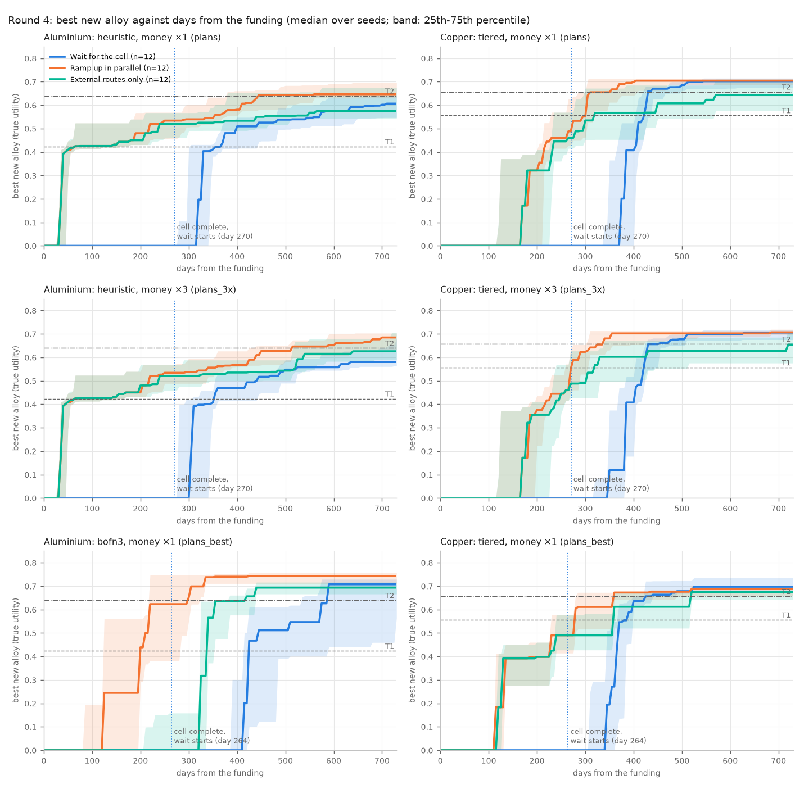
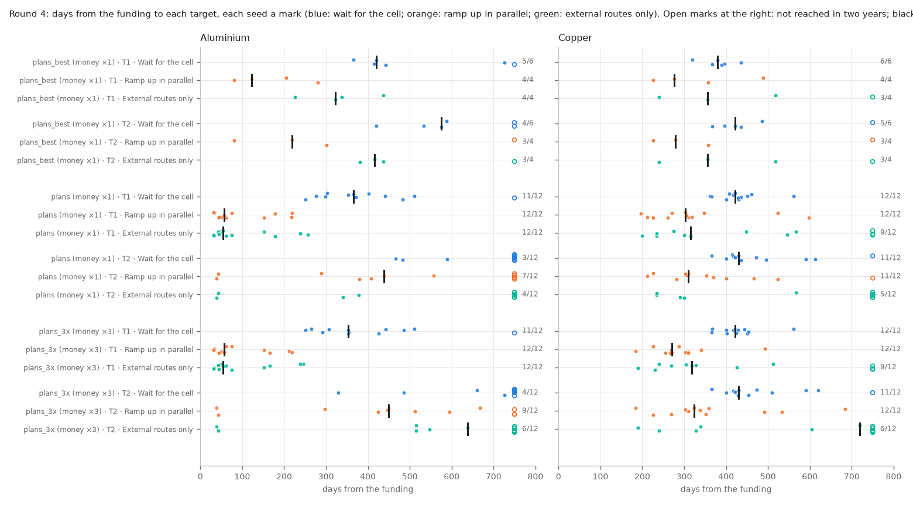
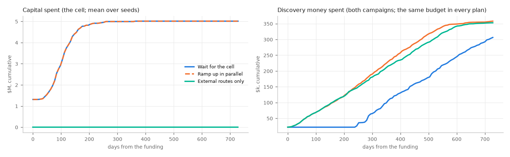
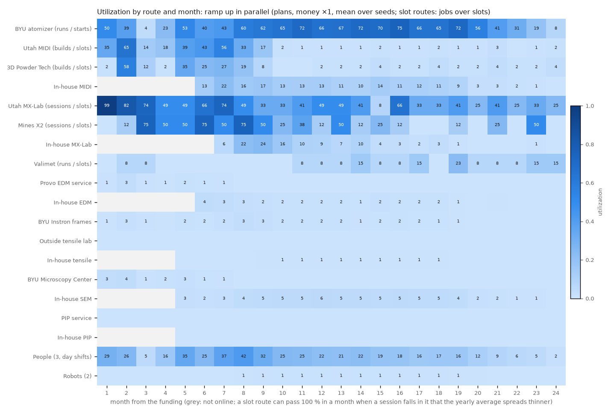
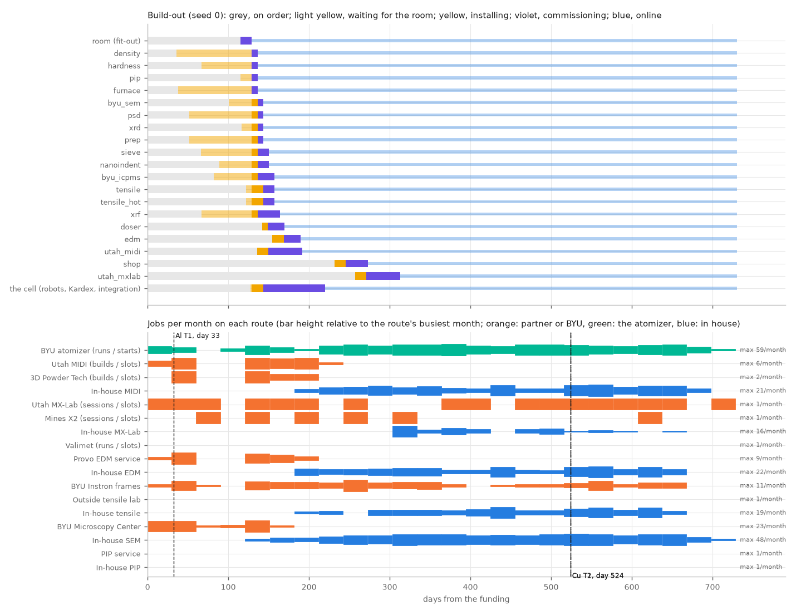

# Digital twin, round 4: building the lab while running real experiments, every route at once

Sterling, on PR 394 (2026-11-26): "Twin round 4: building the lab while running real experiments, with every route at
its maximum throughput. ... Wall time to discovery, counted from the day the funding arrives, is what matters most.
So model the lab as in-house *and* external at once, scheduled together at maximum throughput with data-driven
decisions. It shouldn't be either/or, and the campaign shouldn't wait for the cell to be finished. ... Compare three
plans: wait until the cell is built, then start; ramp up in parallel, as above; external routes only."

Round 1 is [`twin.md`](twin.md), round 2 [`twin_round2.md`](twin_round2.md), round 3
[`twin_round3.md`](twin_round3.md). Everything here is simulated: synthetic truths, simulated instruments, assumed
prices, capacities, lead times and schedules. It shows how the plans, routes and policies interact in the model, not
what the real lab will find. **No vendor has given a lead time for any station yet, so every build-out date below
rests on stand-ins** (section 1).

<!-- RESULTS -->

## What changed from round 3, and why

| Round 3 | Round 4 | Why |
|---|---|---|
| The clock starts with the vertical lab built, stocked and running | The clock starts the day the funding arrives. Each in-house station is ordered then and comes online after its lead time, installation (once the room is fitted out) and commissioning; the robots run stations round the clock only once the cell is integrated | Wall time to discovery is counted from the funding |
| Every station at full rate from day 0 | A learning curve on every new station, fitted to the lab's own ten logged atomizer runs: more failed jobs (redone), slower jobs and more equipment faults at first | The atomizer's first six weeks: 2 good runs of 10, 1.6 runs a week against the 5 planned, 2 equipment faults |
| One facility per run: the vertical lab or the conventional lab | Every route at once: a router sends each step to whichever station of its kind returns the result first (in house once online; BYU's own equipment and core facilities and every partner from day 0), counting the redos a ramping station would need | In-house and external at once, scheduled together |
| Partners booked when an action was bought, with a random booking lead | Standing slots at the partners (Utah's MIDI 2 builds a week, MX-Lab monthly, Mines 7 sessions a year, Valimet monthly), each filled at the last moment before shipping, with the coming week's slots' money kept for them | Book standing slots and decide what goes in them as late as possible |
| No difference between sites | Each fabrication route has its own process offset (the same nominal laser power delivers a different effective power) and each testing route a measurement offset; the lab records the nominal settings unless someone recorded the process on site | Each route has its own bias; provenance |
| An alloy's story ended at its tensile (and immersion) test | Alloys at the second target move on through a gas-atomized lot, a validation network across the sites, and a full-part application test | Stages a promising alloy moves through |
| Three plans did not exist | `wait` (round 3's vertical lab, from the day the cell is complete), `parallel` and `external` | The request |

Round 3's code is unchanged (round 4 subclasses its `Facility`, `Campaign` and `Twin` in
[`twin/round4.py`](../twin/round4.py)), so round 3's results still reproduce. Round 4 is not seed-for-seed comparable
with round 3: the horizon is two years from funding, the facility differs, and the random streams are drawn in a
different order.

## 1. Build-out

Every station of PR 318's lab (the items and prices of [`twin/econ.py`](../twin/econ.py)) is ordered on day 0. A
station is online when its items have arrived, been installed in the new room and been commissioned. Installation
waits for the room's fit-out. The existing BYU atomizer and DAL's CubXL are on hand from day 0.

* **Lead times are stand-ins.** No vendor has given a lead or installation time for any of these stations. PR 331's
  quote drafts ask for them, and "nothing has been sent to any vendor"; PR 318: "There are no costs (#331 is where
  quotes go)". The few anchors:
  * comparable LPBF machines ship in 12-16 weeks (Xact Metal 12, DAL #133; AO Metal A30 12-16, DAL PR 245);
  * Kardex QuickShip is 4-6 weeks for standard sizes, "custom longer" (PR 331);
  * a BYU purchase order takes "ten days to two weeks PLUS shipping" (DAL PR 266);
  * BYU's WDXRF took 3-4 weeks to set up (VCL PR 95);
  * the atomizer's own room took 16 weeks: delivered Jun 11 2026, installed Sep 28, held up by the room's renovation
    (DAL #142, #159).
  
  Each seed draws every lead around its median (lognormal, σ 0.25). The medians are in
  `twin/round4.py` (`BUILD`).
* **Payments:** 30 % on order for items of $100k or more, the rest on delivery. Capital is $5.0M: PR 318's lab less
  the atomizer the lab already owns and DAL's CubXL.
* **The cell:** until the two MiR250 + UR12e units, the Kardex and the docks are commissioned and integrated (8
  weeks of programming the stations' transfers, assumed), in-house stations are run by people on the day shift (the
  hands-on hours of round 3's conventional lab). After that the robots load them round the clock.

**Build-out across the 12 seeds** (days from the funding to online; median and range):

| In-house station | online: median day (range) |
|---|---|
| density and crack check | 136 (123-221) |
| micro-Vickers | 136 (123-221) |
| PIP | 136 (123-221) |
| furnaces | 136 (123-221) |
| SEM + EDS | 143 (130-228) |
| Mastersizer | 143 (130-228) |
| XRD | 143 (130-228) |
| metallography | 143 (130-228) |
| sieve cell | 150 (137-235) |
| nanoindenter | 156 (139-235) |
| multi-doser | 162 (144-242) |
| ICP-MS | 163 (146-242) |
| XRF | 164 (151-249) |
| tensile frames | 169 (147-242) |
| hot tensile | 173 (147-242) |
| wire EDM | 184 (153-274) |
| Aconity MIDI (LPBF) | 193 (172-270) |
| machining cell | 213 (161-273) |
| InssTek MX-Lab (DED) | 260 (197-414) |
| the cell (robots and Kardex integrated: stations run round the clock) | 231 (207-305) |
| everything (the waiting plan starts) | 270 (224-414) |

* **The bench instruments come online first,** from day 123-160, once the room is fitted out. The room alone takes
  about four months, as the atomizer's did.
* **Then the process stations:** the EDM, then the MIDI (day 193), the machining cell (day 213), and the MX-Lab last
  (day 260). The waiting plan waits for the last of them.
* **Capital paid** (both building plans; the external-only plan pays none):

  | day | 0 | 30 | 91 | 182 | 273 | 365 | 547 | 730 |
  |---|---|---|---|---|---|---|---|---|
  | $M | 1.31 | 1.33 | 2.75 | 4.78 | 5.00 | 5.01 | 5.01 | 5.01 |

## 2. Ramp-up: a learning curve from the lab's own atomizer

DAL PR 286's `atomizer-runs/runs.csv` (at `8320f13`) lists every run the lab made on its own, Oct 2 to Nov 13 2026,
after AMAZEMET's training runs. Two of ten made usable powder (Oct 27, about 91 %; Nov 10, about 75 %). Oct 22 made
"more powder than Oct 21, still below target", which counts as half here. Two runs ended in an equipment fault: the
generator tripped on Nov 5, and on Nov 13 the shot burned the cup's seals and cracked its glass. Ten runs in 43 days
is 1.6 a week, against DAL #256's plan of 5.

* **Failures.** With a mature run failing 10 % of the time (bofn-clocked's figure, DAL PR 297), the chance of a
  learning failure on a station's (n+1)-th job is P0·exp(−n/N_L). The maximum-likelihood fit is P0 = 1.0 and
  N_L = 12.9 jobs. The profile likelihood is flat from about 5 to beyond 50 jobs, so ten runs pin the shape only
  loosely (`round4.fit_learning`).
* **Speed.** A job takes F0 = 3 times as long at first, from 1.6 runs a week against 5, falling on the same curve.
* **Faults.** A fifth of first jobs end in an equipment fault (2 of 10), with a few days' repair (median 72 h,
  assumed).
* **The existing atomizer starts at n = 10**, its ten logged runs: about a 46 % chance of a learning failure on its
  next run.
* **Every new process station** (MIDI, MX-Lab, EDM, machining cell, doser, sieve cell) starts on this curve.
  Instruments with the vendor's validated methods (SEM, XRD, ICP-MS, frames, ...) start at a third of the failure and
  fault chance and a third of the slowdown. That split is assumed: the atomizer is the only station with a logged
  history.
* **What a failure costs.** A failed job is redone on the same station, so it costs that station's time and the
  money again. A failed atomizer run is the run's own failure: the policy sees no powder, as in rounds 1-3.

## 3. Routes

Each step of an action names a kind of station (round 3's keys: an LPBF build, a wire-EDM job, a tensile test).
Round 4 books it on whichever station of that kind returns the result first (`Facility4.pick`). Every station of the
kind that the plan has counts, and so do the redos a ramping station would need. Policies still choose what to do,
on round 3's terms; the router chooses where.

| Route | Kind | From | Capacity and calendar | Lead and turnaround | Fee | Offset (σ) | Source |
|---|---|---|---|---|---|---|---|
| BYU atomizer (AMAZEMET rePOWDER) | powder | day 0, n = 10 on the learning curve | 3 starts a weekday + 1 Saturday; Al Mon-Thu, Cu Fri-Sat | 2.5 h a run | consumables | none | FLAIME App. 2; DAL #256 |
| Utah Aconity MIDI (core facility) | LPBF | day 0 | standing reservation, 2 builds a week (Tue, Wed) | ship 1 day; parts 4 days after the start | $800 | laser power 5 % | ONR budget ($800, unconfirmed); "$120/hr" (FLAIME genesis proposal); DAL #138 (parts 4 days after the start); Edison: about 8 builds a month |
| 3D Powder Tech (**hypothetical service**) | LPBF | day 0 | 1 build a week | ship 3 days; 5 days | $1,500 | 10 % | DAL #133: a printer vendor ($40k base) that printed samples only toward a sale, poor trial prints; the service is assumed |
| Utah InssTek MX-Lab (Fang group) | DED, small and blends | day 0 | one half-day session every 30 days (Tuesdays) | ship 1 day; 1 day | $300 (assumed) | 5 % | ONR YIP proposal ("about twelve half-day sessions a year"); DAL #256 |
| Mines FormAlloy X2 | DED, 2 kg | day 0 | 7 sessions a year | ship 5 days; 10 days (assumed) | $1,204 | 10 % | DAL PR 117 (3-7 sessions a year); ONR YIP field 10 ($155/machine h, $165/labour h, $1,204 with F&A) |
| Valimet (gas atomization) | ≥ 50 kg lot | day 0 | monthly slot | ship 14 days; 21 days | $8,000 + melt stock | none | FLAIME DAG; Edison: 6-12 weeks, $3-8k |
| BYU core facilities and shop | SEM, ICP-MS, XRD, XRF, metallography, Vickers, frames, furnaces | day 0 | day shifts | as round 3 | as round 3 | frames 2 % | round 2-3 `facility.py` |
| Provo EDM, Plastometrex PIP service, NSL | services | day 0 | as round 3 | 7, 7 and 10 days | $150, $250, $150 | none | round 2-3 |
| Outside tensile laboratory (**hypothetical**) | tensile | day 0 | 4 at a time, day shifts | 2 + 8 days | $600 (3 bars) | 4 % | no outside lab is named in DAL or byu-vcl; $200 a bar as DAL PR 297 (bofn-clocked) |
| In-house stations (PR 318) | all of the above | their build-out dates | round the clock with the robots; day shift before | round 3's | round 3's | the reference (0) | PR 318; `twin/facility.py` VERTICAL |

The offsets follow DAL PR 297's bofn-clocked benchmark (DAL #283) where they overlap. There, a partner printer moves
the laser-process ridge by −0.05, another lab's ridge by ±0.08, and its tensile frames read +0.04. Here each seed
draws its own offset for each site.

* **Standing slots, filled late.** A partner's session is reserved ahead, so taking it needs only the shipping lead.
  What goes into it is decided at most a day before the material must leave: an action is admitted to a slot only
  once the slot starts within its shipping time plus a day. The policy therefore has every result back that it could
  have.
* **Money for the slots.** Each campaign keeps the money for the coming week's unfilled slots. Without that reserve,
  the first runs left Utah's slots empty for months: cheap new powders spent the money while the next slot was still
  outside its window.
* **Money.** Each campaign keeps round 3's money per year (aluminium $120k, copper $60k), two years' worth over the
  two-year horizon, on round 3's spending plan (15 % at day 0, all of it by 75 % of the horizon). The plan is the same
  in every plan of the three. The wait plan carries its unspent money to its start.

## 4. The stages after discovery

An alloy whose measured utility reaches the second target (T2) moves on, one at a time per campaign, under the same
rule in every plan and for every policy. The stages have their own scale-up money (FLAIME's DAG budgets six
gas-atomization runs), so discovery's money is the same in every plan.

1. **Production-representative powder.** A gas-atomized lot: Valimet for aluminium (≥ 50 kg), Ames for copper
   (25 kg, as rounds 1-3). The next two stages need kilograms. The ultrasonic atomizer makes a few hundred grams a
   run, and not as a production atomizer would.
2. **A distributed validation network.** The gas lot is made into parts and tested at every fabrication site the plan
   has, at the same time:
   * aluminium: the in-house MIDI, Utah's MIDI and 3D Powder Tech;
   * copper: the in-house MX-Lab, Utah's MX-Lab and Mines.

   Each site builds with its own process offset. The alloy passes if the sites' mean true utility is at or above the
   state of the art (T1).
3. **A full part in an application-specific performance test** at an outside laboratory (assumed):
   * aluminium: a printed heat-exchanger or bracket in thermal-mechanical cycling, 6 weeks, $15k;
   * copper: a DED repair on a seawater pump or valve part, 60 days in flowing seawater, $20k.

"Validated T2" in the tables is the first alloy at T2 (its true utility) that has passed all three.

<!-- STAGES -->

## 5. Results

*All simulated. Checked against [`out/twin4/fig/tables.md`](../out/twin4/fig/tables.md),
[`out/twin4/fig/numbers.json`](../out/twin4/fig/numbers.json) and the per-run logs in
[`out/twin4/runs/`](../out/twin4/runs/).*

* **Days** are counted from the funding. Medians are Kaplan-Meier medians over seeds: a seed that never gets there
  counts as censored at day 730, and ">730" means fewer than half got there in two years.
* **Targets** are round 3's, new alloys only. T1 is the state of the art (aluminium 0.42, copper 0.56). T2 is halfway
  from it to the best the oracle found (0.64 and 0.66).
* **Mean ± SE** over seeds; paired comparisons are by seed.
* **Each experiment's policies:**
  * `plans`: round 3's cheap policies, the heuristic on aluminium and the funnel on copper (copper's best in round 3).
  * `plans_best`: time-aware BOFN on aluminium (aluminium's best in round 3) and the funnel on copper.

### 5.1 The three plans, cheap policies (`plans`, 12 seeds each, round 3's money)

| Plan | Al T1: seeds; day | Al T2 | Cu T1 | Cu T2 | Al best | Cu best |
|---|---|---|---|---|---|---|
| Wait for the cell (complete at day 231, median; every station by day 270) | 11/12; 366 | 3/12; >730 | 12/12; 421 | 11/12; 430 | 0.59 ± 0.03 | 0.70 ± 0.01 |
| **Ramp up in parallel** | **12/12; 57** | **7/12; 438** | **12/12; 302** | **11/12; 310** | **0.65 ± 0.01** | **0.70 ± 0.01** |
| External routes only | 12/12; 54 | 4/12; >730 | 9/12; 315 | 5/12; >730 | 0.59 ± 0.02 | 0.63 ± 0.03 |

**Paired by seed, parallel against each other plan.** Each cell counts the seeds where parallel got there first, where
the other plan did, and where neither did. The median days saved is over the seeds where both plans got there.

| Target | against waiting: first / behind / neither; median days saved | against external only: same |
|---|---|---|
| Aluminium T1 | 12 / 0 / 0; **238** | 2 / 1 / 0; 0 |
| Aluminium T2 | 7 / 1 / 4; 119 (2 seeds where both got there) | 5 / 1 / 5; 0 (4) |
| Copper T1 | 10 / 2 / 0; **134** | 10 / 2 / 0; 14 |
| Copper T2 | 10 / 2 / 0; **121** | 10 / 1 / 1; 9 (5) |
| Copper, a validated T2 alloy | 6 / 2 / 4; 148 (4) | 6 / 0 / 6; 47 (3) |

* **Against waiting for the cell, ramping up in parallel wins on every target.**
  * **Aluminium:** the state of the art comes about eight months sooner. The existing atomizer and the partners'
    builds reach it at a median of day 57, against day 366, when the waiting lab is about three months past its start.
  * **Copper:** both targets come about four months sooner (day 302-310 against 421-430).
* **Why copper gains less.** In the parallel plan copper's first state-of-the-art alloys come about when the
  in-house MX-Lab comes online (day 260, median). Until then copper has only Utah's MX-Lab, a session a month, and
  Mines, 7 sessions a year. Half its first T1 alloys came from Mines and half from the in-house MX-Lab.
* **Against external routes only:**
  * **Aluminium's state of the art is a tie** (day 54 against 57): the existing atomizer and Utah's and the partner's
    builds get there in under two months either way. 10 of the 12 first aluminium T1 alloys in the parallel plan were
    printed at a partner (Utah 6, 3D Powder Tech 4).
  * **Copper is where the cell pays.** The parallel plan reaches copper's halfway target first in 10 seeds of 12. The
    external-only lab gets there in 5 of 12 in two years, and finishes 0.07 lower (0.63 against 0.70).
* **The warm start.** On the day the waiting lab starts (day 281 on average), the parallel plan has already
  demonstrated 48 new aluminium alloys and is at or above aluminium's state of the art in all 12 seeds. On copper it
  has demonstrated 2.2 and is at T1 in 4 of 12. The in-house stations start with that data and with a mature
  atomizer: 10 runs of experience in the waiting lab, several hundred in the parallel one.
* **What the parallel plan spends by its targets.**
  * By aluminium's state of the art: $26k of discovery money (medians) and $1.76M of capital, mostly deposits.
  * By copper's halfway target: $78k and the whole $5.0M; the waiting lab, $91k and $5.0M.
  * The external-only lab spends the least to each target it reaches ($25-70k), and reaches copper's halfway target
    in only 5 seeds.

<!-- BEST -->

### 5.3 Capital, utilization and the timeline

* **Capital.** $1.31M goes out on day 0 in deposits; it reaches $2.75M by day 91, $4.78M by day 182 and all $5.01M by
  day 273, in both building plans. The external-only plan spends none.
* **Discovery money.** The parallel and external plans spend it from day 0 and have spent all of it ($358k and $353k
  of $360k) by the end of the two years. The waiting lab starts spending at about day 240, when its first stations take
  work, and ends with $307k spent.
* **Money binds in both plans that start on day 0** (section 5.6): the partners' standing slots run at 20-85 % of what
  is reserved.

| Route (parallel plan, `plans`, mean over seeds) | months 1-3 | 4-6 | 7-9 | 10-12 | 13-18 | 19-24 |
|---|---|---|---|---|---|---|
| BYU atomizer (runs over its starts) | 31 % | 39 % | 55 % | 68 % | 69 % | 38 % |
| Utah MIDI (builds over the 2 a week reserved) | 38 % | 34 % | 35 % | 1 % | 1 % | 1 % |
| 3D Powder Tech (builds over 1 a week) | 24 % | 20 % | 18 % | 1 % | 3 % | 3 % |
| In-house MIDI (hours) | — | 13 % | 18 % | 13 % | 12 % | 3 % |
| Utah MX-Lab (sessions over 1 a month) | 85 % | 55 % | 52 % | 41 % | 38 % | 32 % |
| Mines X2 (sessions over 7 a year) | 29 % | 58 % | 58 % | 25 % | 17 % | 15 % |
| In-house MX-Lab (hours) | — | — | 17 % | 12 % | 5 % | 0 % |
| People (3, day shifts) | 20 % | 25 % | 37 % | 24 % | 19 % | 8 % |

* **Work moves in house as the stations come online.** Utah's MIDI and 3D Powder Tech fall from 20-38 % of their slots
  to 1-3 % once the in-house MIDI is up (month 7). Utah's MX-Lab and Mines keep being used after the in-house MX-Lab
  arrives, at a lower rate. Over the two years, 84 % of aluminium's builds and 67 % of copper's small deposits are
  in house; 89 % of the alloys at or above T1 were made in house. The robots are about 1 % busy, as in round 3.
* **The atomizer is the shared constraint.** It runs 55-69 % of its starts once the cell is up. Aluminium's share is
  12 starts a week, and a lot takes about four runs, so about three new aluminium designs a week is the ceiling in
  every plan; the cell adds no atomizer.

### 5.4 The stages after discovery

Per run of `plans`: alloys that entered the stages, that failed the validation network, and that were validated
through the full-part test.

| Plan | Al entered; failed network; validated | Cu entered; failed network; validated | scale-up money |
|---|---|---|---|
| Wait for the cell | 0.8; 0.3; 0.2 | 1.2; 0.0; 0.7 | $31k |
| Ramp up in parallel | 1.8; 0.7; 0.8 | 1.6; 0.2; 0.9 | $70k |
| External routes only | 0.7; 0.6; 0.0 | 0.5; 0.1; 0.2 | $21k |

* **A validated copper T2 alloy:** the parallel plan has one in 6 of 12 seeds (median day 692), the same count as
  the waiting lab (median day 728); external-only has one in 3 of 12.
* **Paired against waiting**, parallel gets there first in 6 seeds and behind in 2.
* **Aluminium:** few heuristic alloys reach T2 to begin with. Of those that do, a third to most fail the validation
  network: the gas-atomized powder, built at two sites with their offsets, falls below the state of the art.
  * Measured T2 is not the true utility. One copper case in a test run had a crack the section missed, and the
    network caught it.
  * The network is the stage that separates a measured result from a reproducible one.

### 5.5 Against round 3, which started with the lab built

Round 3's main benchmark ran the same cheap policies in the finished vertical lab from its day 0, for one year
(`out/twin3/fig/tables.md`, 12 seeds):

* the heuristic reached aluminium's state of the art at a median of day 24;
* the funnel reached copper's targets at day 142 and 148.

Round 4 counts from the funding:

| Days from the funding (cheap policies) | Al T1 | Cu T1 | Cu T2 |
|---|---|---|---|
| Round 3: the finished lab, from its own day 0 | 24 | 142 | 148 |
| Round 4: wait for the cell (starts at day 270, median) | 366 | 421 | 430 |
| Round 4: ramp up in parallel | 57 | 302 | 310 |
| Round 4: external routes only | 54 | 315 | >730 (5/12) |

* **Building the lab costs the waiting plan 9-11 months on every target.** About 270 days of build-out come first.
* **After its start it is also slower than round 3's finished lab on aluminium.** It takes a median of 97 days from
  its own start to the state of the art, against round 3's 24. In both rounds a seed gets there either within a month
  or after 80-110 days. The learning curve pushes the quick seeds later: one seed takes 47 days with it, 11 without,
  and 4 in round 3. Without the learning curve the waiting lab's median is 79 days (8 seeds); section 5.9 has its
  cost from funding.
* **Ramping up in parallel recovers most of that on aluminium** (day 57). On copper it recovers about four months of
  the nine: copper needs a DED route with capacity, and before the in-house MX-Lab it has only Utah's monthly session
  and Mines' seven a year.

### 5.6 Three times the money (`plans_3x`, the cheap policies, 12 seeds)

Round 3 found copper limited by money. Round 4's two day-0 plans spend their whole budget, so `plans_3x` gives every
plan three times round 3's money per year.

| Plan, money ×3 | Al T1 | Al T2 | Cu T1 | Cu T2 | Al best | Cu best |
|---|---|---|---|---|---|---|
| Wait for the cell | 11/12; 353 | 4/12; >730 | 12/12; 422 | 11/12; 429 | 0.60 ± 0.03 | 0.70 ± 0.01 |
| Ramp up in parallel | 12/12; 57 | 9/12; 449 | 12/12; 271 | 12/12; 323 | 0.66 ± 0.02 | 0.71 ± 0.01 |
| External routes only | 12/12; 54 | 6/12; 637 | 9/12; 318 | 6/12; 720 | 0.64 ± 0.02 | 0.64 ± 0.02 |

* **The order of the plans doesn't change.** Ramping up in parallel still gets to every target first against
  waiting (10-12 seeds of 12) and to copper's halfway target first against external only (12 of 12).
* **More money helps a little, and most outside.**
  * In the parallel plan: aluminium's halfway target in 9 seeds instead of 7, copper's state of the art at day 271
    instead of 302.
  * External only: aluminium's halfway target in 6 seeds instead of 4.
  * The partners' slots in the first nine months are used no more than at round 3's money (Utah's MIDI 30-38 %, 3D
    Powder Tech 15-24 %).
* **What binds early is the supply of printable lots**, not money:
  * the atomizer's ramp-up (half its runs fail at first);
  * metal orders once the day-0 stock runs out;
  * the WIP limit, which holds new designs to two weeks of the partners' print capacity.
* **Later the atomizer binds aluminium**, at 76-80 % of its starts from month 10.

### 5.7 Provenance: someone on site at each partner's first job (`provenance`, 8 seeds)

With `provenance="all"`, someone goes with the first job to each partner:
* the visit costs $1.5k for a Utah site, $4k for Mines or 3D Powder Tech, and $2.5k for the outside lab;
* the lab then knows that site's offset to within a quarter of its spread;
* without a visit it records the nominal settings, and the whole offset goes unseen.

The parallel plan with the cheap policies was run at the stand-in offsets and at twice and three times them, with
and without visits, paired by seed.

| Offsets (× stand-in) | Al T2: median days saved (visit first / behind) | Cu T1 | Cu T2 | Al best (on − off) | Cu best (on − off) | visits |
|---|---|---|---|---|---|---|
| 1 | −2 (0 / 3) | +18 (5 / 3) | −2 (3 / 4) | −0.03 ± 0.01 | +0.01 ± 0.01 | $11.5k |
| 2 | +12 (2 / 2) | +5 (6 / 2) | +12 (5 / 2) | −0.06 ± 0.06 | −0.01 ± 0.01 | $11.0k |
| 3 | −99 (1 / 3) | −7 (4 / 4) | +42 (4 / 3) | −0.03 ± 0.06 | +0.02 ± 0.01 | $11.5k |

* **In this model the visits don't measurably pay.** The differences change sign from one offset level to the next,
  and seed to seed they run from −200 to +280 days. The visit changes what the lab records, and every later
  decision follows from that.
  * The one pattern: copper reaches its state of the art first with visits in 4-6 seeds of 8 at every level.
  * Aluminium finishes 0.03-0.06 lower with them, within error at the larger offsets.
* **Why so little:**
  * **The partners carry the work only until the in-house stations arrive.** Aluminium moves in house in month 7,
    copper's small deposits by month 9, so an offset misleads for months, not years.
  * **Round 3's cheap policies don't model sites.** A better record changes the settings the heuristic carries
    forward, not a site term in a model. DAL PR 297's clocked benchmark (DAL #283) also found site terms worth
    nothing measurable (−2 ± 2 days).
* **When it would pay:**
  * **The cost.** $11.5k of visits is about 23 days of the campaigns' discovery money ($180k a year), or 4 days of
    the vertical lab's fixed costs ($1.18M a year, round 2's).
  * **Visits pay where they save more than that:**
    * a partner route that carries the work for a long time: copper's Mines and Utah MX-Lab in the external-only
      plan;
    * a policy that fits a site term, so a known offset turns that site's data into usable data for the in-house
      models;
    * offsets larger than the process windows. At three times the stand-ins the copper halfway target moved by a
      median 42 days, but with the sign changing from seed to seed.
  * **None of these was run.**

### 5.8 Each route's share, and where adding a route doesn't help (`routes`, 8 seeds)

**Shares.** In the parallel plan (`plans`, all seeds):

| Step | Share of its jobs by route | Made the first alloy at the target (seeds) |
|---|---|---|
| Aluminium LPBF builds | in house 84 %, Utah MIDI 12 %, 3D Powder Tech 3 % | T1: Utah 6, 3D Powder Tech 4, in house 2; T2: in house 5, Utah 1, 3D Powder Tech 1 |
| Copper small DED (and blends) | in house 67 %, Utah MX-Lab 33 % | |
| Copper 1-2 kg DED | in house (1 kg) for most; Mines (2 kg) 57 sessions over 12 runs | T1: Mines 6, in house 6; T2: in house 8, Mines 3 |
| Aluminium wire EDM | in house 88 %, Provo service 12 % | |
| Tensile | in house 59 %, BYU's Instron frames 41 %, the outside lab 0 % | |
| SEM | in house 89 %, BYU Microscopy Center 11 % | |

**One route taken away at a time** (the parallel plan with the cheap policies, 8 seeds). Each cell gives the
variant's median day, then the median day with every route on the same seeds; in brackets, the seeds where the variant
got there first / later.

| Without | Al T1 | Al T2 | Cu T1 | Cu T2 | Al best (paired) | Cu best (paired) |
|---|---|---|---|---|---|---|
| the Provo EDM service | **196 → 61 (2 / 6)** | 454 → 557 (4 / 2) | 281 → 270 (4 / 4) | 346 → 353 (3 / 4) | +0.03 ± 0.02 | −0.01 ± 0.01 |
| 3D Powder Tech | **150 → 61 (3 / 5)** | 541 → 557 (2 / 3) | 310 → 270 (4 / 4) | 333 → 353 (4 / 3) | −0.03 ± 0.04 | −0.00 ± 0.01 |
| Utah's MIDI | 85 → 61 (3 / 5) | 529 → 557 (3 / 2) | 281 → 270 (5 / 3) | 369 → 353 (4 / 3) | +0.00 ± 0.01 | +0.01 ± 0.01 |
| Mines' X2 | 61 → 61 (1 / 1) | 457 → 557 (3 / 0) | **302 → 270 (2 / 6)** | **380 → 353 (2 / 5)** | −0.01 ± 0.01 | −0.02 ± 0.02 |
| Utah's MX-Lab | 60 → 61 (4 / 4) | >730 → 557 (2 / 3) | **339 → 270 (2 / 6)** | 347 → 353 (3 / 4) | −0.03 ± 0.01 | +0.01 ± 0.01 |
| the PIP service | identical (never used) | | | | 0 | 0 |
| the outside tensile lab | identical (never used) | | | | 0 | 0 |

* **The routes that matter early are the ones that carry the first months.**
  * Aluminium's first result needs the Provo EDM service: before the in-house EDM (day 184), its bars can't be cut
    otherwise. It also needs at least one partner printer.
  * Without 3D Powder Tech or Utah's MIDI, aluminium's state of the art comes later in 5 seeds of 8.
  * Copper's state of the art comes later in 6 of 8 without Mines or without Utah's MX-Lab.
* **Where adding a route doesn't help:**
  * **The outside tensile laboratory** never took a job. BYU's own Instron frames are free and take a job the same
    day, the in-house frames later; an outside lab would help only if those frames were scarce.
  * **The PIP service** took no job either, because the cheap policies don't use PIP. BOFN used it for its first
    aluminium parts (4 of 31 PIP jobs in the parallel plan's seed 0) until the in-house PIP arrived.
  * **Aluminium's halfway target** is not slowed by taking any one partner away (the variants are as often first as
    later). It is reached once the in-house MIDI runs, months after the partners' share has fallen to a few percent.
  * **Valimet** (in the stages only) ran at 0-13 % of its monthly slots (`plans`).
* **One partner printer can stand in for the other.** Removing either costs aluminium's first result a few weeks,
  not months. Which of the two is worth a standing reservation is a question of price and turnaround, and 3D Powder
  Tech's service is hypothetical.

### 5.9 What the ramp-up costs (`nolearn`, 8 seeds: every station at full rate once commissioned)

| Variant, against the same plan with the learning curve | Al T1 | Al T2 | Cu T1 | Cu T2 | Al best | Cu best |
|---|---|---|---|---|---|---|
| Ramp up in parallel, no learning curve | 47 → 61 (5 / 2) | >730 → 557 (2 / 2) | 253 → 270 (5 / 3) | 282 → 353 (5 / 2) | −0.04 ± 0.03 | +0.00 ± 0.01 |
| Wait for the cell, no learning curve | 352 → 371 (6 / 2) | >730 → >730 (1 / 2) | 381 → 408 (6 / 2) | 424 → 435 (3 / 5) | −0.05 ± 0.04 | −0.00 ± 0.01 |

* **The ramp-up costs both building plans two to three weeks to the first results:**
  * the waiting lab: 19 days to aluminium's state of the art, 27 to copper's;
  * the parallel plan: 14 and 17 days, and copper's halfway target up to 10 weeks.
* **The learning curve is not what separates the plans.** The parallel plan's lead over the waiting one is the
  build-out (about 270 days), and the learning is a few weeks on top in either plan.
* **The parallel plan absorbs part of it.** The existing atomizer learns on the partners' work while the cell is
  built (hundreds of runs before the cell is complete), and the partners have no learning curve.

<!-- SECOND -->

### Limits

All simulated: synthetic truths, simulated instruments, assumed capacities, prices, lead times and schedules.

* **Lead times are stand-ins.** No vendor has quoted one. The plan comparisons move with them: the waiting lab
  starts when its last station is in, which is the MX-Lab in most seeds (day 197-414).
* **The learning curve rests on ten runs of one station.** The likelihood is flat for N_L from about 5 to beyond 50
  jobs. Applying it to every new process station (and a third of it to instruments) is an assumption, and so is the
  slowdown factor taken from the atomizer's cadence.
* **Partner capacity and fees** are the lab's own figures where they exist and assumed where they don't:
  * Utah's MIDI: 2 builds a week, $800 unconfirmed.
  * Utah's MX-Lab: 12 sessions a year.
  * Mines: 7 sessions a year at $1,204.
  * Valimet: monthly.
  * 3D Powder Tech and the outside tensile lab are hypothetical services.
  * The standing reservations themselves are assumed: no partner has agreed to one.
* **Site offsets** are drawn per seed around stand-in spreads (5-10 % in laser power, 2-4 % in strength) that follow
  DAL PR 297's choices. Provenance visits are assumed to leave a quarter of the offset unknown. No source gives a
  visit's cost.
* **The stages after discovery** (the gas lot's properties, the network's pass rule, the full-part test's duration
  and fee) are assumptions. They are there to show the order in which a promising alloy meets the routes, not what it
  costs to qualify an alloy.
* **Two admission rules are round 4's own and hold for every policy:**
  * money is kept for the coming week's standing slots;
  * a WIP limit sits before the first fabrication step (two weeks of that step's capacity, at least 3 lots).

  Without the second rule, the cheap aluminium policy made 193 powders in a month against three partner builds a
  week, and its money then held prints back for months.
* **The policies are round 3's.**
  * **Routes are invisible to them.** BOFN's time-aware cost reads a partner's standing slots as a lightly loaded
    station, so it doesn't know a slot is scarce.
  * **Their parameters weren't retuned** for a lab that is half built.
* **Seeds.** 12 for the cheap policies, 6 for BOFN. Gaps of a few weeks between plans in single seeds mean little.
* **Not in the model:**
  * hiring and training people;
  * the room's own risks: AMAZEMET called electrical work "a nightmare", and switchgear can take 40-80 weeks (VCL #343);
  * shipping damage, customs and the partners' own downtime beyond the slots.

## Sources

1. Round 4's tables: [`out/twin4/fig/tables.md`](../out/twin4/fig/tables.md) and
   [`out/twin4/fig/numbers.json`](../out/twin4/fig/numbers.json) (`twin/figures4.py`); the per-run logs in
   [`out/twin4/runs/`](../out/twin4/runs/).
2. The engine and runner: [`twin/round4.py`](../twin/round4.py), [`twin/bench4.py`](../twin/bench4.py); tests in
   [`twin/tests/test_round4.py`](../twin/tests/test_round4.py).
3. The atomizer's runs: DAL PR 286, `atomizer-runs/runs.csv` and `README.md` at `8320f13`; DAL #159, #219.
4. Lead times and prices: VCL PR 318, PR 331 (`procurement/`), PR 95; DAL #133, #142, PR 245, PR 266; `twin/econ.py`.
5. Partners: DAL #133 (3D Powder Tech), #138 (Utah's MIDI), PR 117 (Mines, MX-Lab), the ONR YIP proposal and its
   field 10 facilities page (Mines' rates, MX-Lab sessions), the FLAIME genesis proposal (Utah's rate), DAL #256
   (calendars), DAL PR 297 (bofn-clocked: offsets, outside bar price, failure rates).
