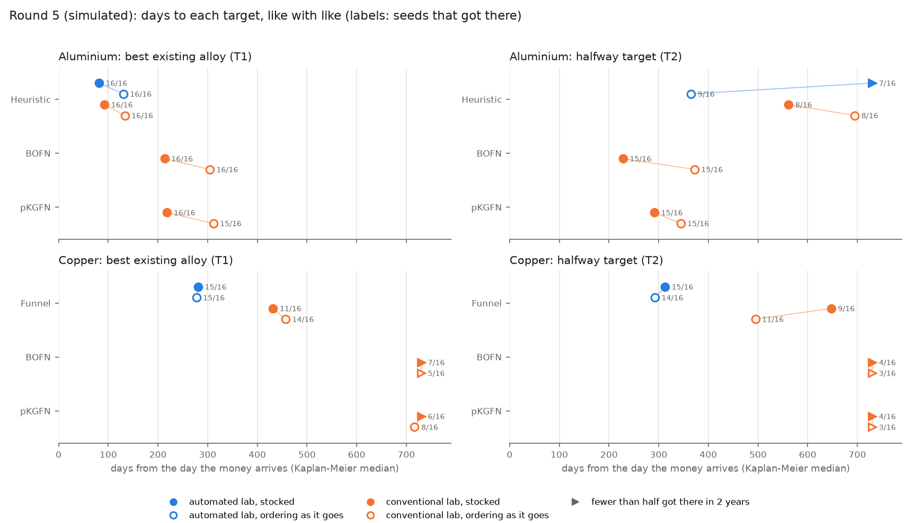
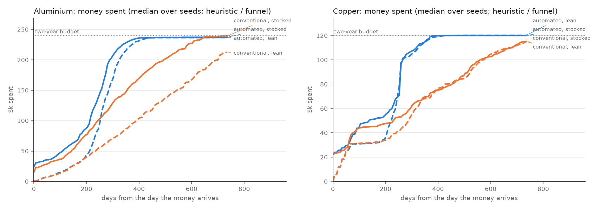
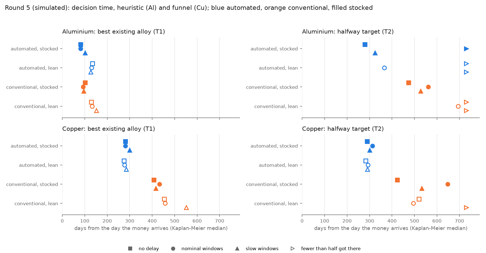
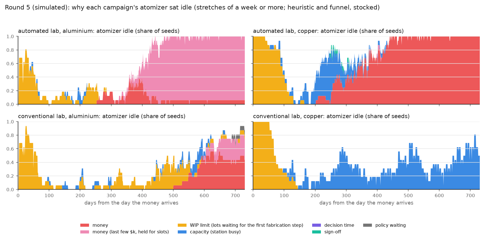

# Digital twin, round 5: two years from the day the money arrives

Sterling, on PR 400 (2026-11-27): "Twin round 5: two years from the day the money arrives, with enough runs to trust
every comparison." All money at t = 0; the facility ready between day 60 and day 100; used equipment by a rule;
real experiments from day 0; stock bought early by a heuristic, then a look back at what should have been bought;
shared equipment modelled as it's really used; decisions made by people take time. Compare like with like (four
ways), round 4's three plans and round 3's economics, on at least 12 seeds per arm. Four notes he added while it ran
are in section 0. Every planned run is now done (488 rows): the first job left 69, which six compute slices made and
this write-up folds in (section 9).

Round 4 is [`twin_round4.md`](twin_round4.md), round 3b [`twin_round3b.md`](twin_round3b.md). Everything here is
simulated: synthetic truths, simulated instruments, assumed prices, capacities, lead times and schedules. It shows
how the labs, plans and policies interact in the model, not what the real lab will find. **No vendor has given a
lead time, and no used-equipment price or risk has been quoted, so every build-out date, used purchase and stock
lead rests on stand-ins.**

**In short.** All simulated, from the day the money arrives, over two years. 16 seeds per arm, both for the heuristic
(aluminium) and the funnel (copper) and for BOFN and pKGFN on both campaigns, in both labs; round 4's plans with BOFN
on 12. Every row includes Sterling's four notes (section 0). "Like with like" means the same policy and the same stock
rule in both labs.

- **Like with like, the automated lab's lead is copper's more than aluminium's, whatever the policy.**
  - Aluminium's best existing alloy (T1): **a tie with the heuristic**, 1.0× with both labs ordering metal as they go
    and 1.1× (0.7-1.9) with both stocked. **With BOFN or pKGFN, 1.2×, and every interval includes 1** (0.89-1.52).
    Both labs print aluminium's first alloys at the same partners, before the automated lab's in-house MIDI (day 180)
    and cell (day 201) are up.
  - Aluminium's halfway target (T2): with the heuristic about half the seeds get there in either lab, no lead. **With
    BOFN or pKGFN, 1.3-1.4× sooner** (1.05-1.78 ordering as they go; from 0.97 when stocked), in 16 seeds of 16
    against 15.
  - Copper: **1.5-2.1× sooner with the funnel** (first in 13-15 seeds of 16) **and at least 2.0-2.5× with BOFN or
    pKGFN** (the first target in 15-16 seeds of 16 against 5-8), mostly from the automated lab's in-house MX-Lab.
  - Round 3's pairing (automated stocked against conventional lean) gives 1.6× on aluminium's T1 with the heuristic
    and 1.7× with an optimizer: the stock is most of it (1.2-1.6× within either lab).
- **The policy does more than the lab for aluminium's halfway target.** In either lab BOFN and pKGFN reach it in 15-16
  seeds of 16 and the heuristic in 7-9. They are about twice as slow to aluminium's first target, and on copper they
  don't beat the funnel in the automated lab and do much worse than it in the conventional lab (section 9).
- **Money binds the automated lab.** With all of it at t = 0, both campaigns spend 90 % of two years' money by day
  312-354 with the cheap policies (day 371-434 with the optimizers) and then idle; the conventional lab, held to 8
  atomizations a week (note 1), spreads it over two years. Campaign spend to each target is about the same, or 25 %
  more on copper in the automated lab; with an optimizer and both labs ordering as they go, 1.6-1.8× on aluminium.
- **Decision time is a small part of each factor** at the nominal windows (DAL #256's Friday meeting, working-day
  reviews): with no delay the factors are the same within their intervals. Slow windows (biweekly meetings) push copper's
  factor to 1.9-2.5×. What each step waits for is weeks: partners' slots, the atomizer's 8 a week, consumables with
  7-8-week leads.
- **The atomizer's derived cycle** (note 2: about 2.2 h an aluminium composition, 76 a week, a design target that needs
  spare crucibles) **changes nothing measurable**: the same days at 3 h or 5.5 h. After the cell, money and the WIP limit
  bind, not atomizer hours.
- **Used equipment:** the rule bought four stations used (wire EDM, floor frame, chamber, nanoindenter), 15-48 days
  sooner and $360k cheaper, but no target came sooner.
- **The HPC stream** (note 4): 89.7 million candidates evaluated per campaign; the policies use 64 a day, and four
  times as many changes nothing. More compute would not have helped.
- **Round 4's plans:** ramping up in parallel beats waiting for the cell (now starting at day 247) by 3.4× on
  aluminium's T1 and 1.2-1.3× on copper; against external routes only it ties on aluminium's T1, **reaches aluminium's
  T2 in fewer seeds** (7 of 16 against 10), and is 1.5-1.7× sooner on copper. **With BOFN** (12 seeds): 1.7× against
  waiting on aluminium and 1.1-1.2× on copper; against external-only 1.2× on aluminium (intervals from 0.9), 1.5× on
  copper's T1, and the T2 deficit goes (12 of 12 against 11).
- **Economics** (round 3's model): per aluminium alloy, $12.0k with fixed costs against the conventional lab's $5.4k
  ($1.6k against $3.2k on campaign money alone); to each target with equipment, $1.8-3.5M against $49-180k. With an
  optimizer each lab tests about half as many alloys: $20-25k against $10-10.5k per aluminium alloy.
- **Stock:** the reorder heuristic doesn't make running out unlikely (85 % of the automated lab's aluminium charges
  waited for something, 90-91 % with an optimizer); the look-back's schedule, buying the per-run consumables in bulk
  on day 0 and every 8 weeks, halves aluminium's stock-out weeks and cuts copper's by three quarters for 2-3 % more
  money.
- **Shared stations and idle time** (note 3): of the stations both campaigns use, only the atomizer binds, in both
  labs and with every policy; the copper steps added (EDM, heat treatment, prep, hardness, PIP) run at a few percent.
  The automated lab's idle time is money; the conventional lab's is capacity (the partners' printers and Utah's
  monthly MX-Lab). With the heuristic and the funnel no stretch had money and free capacity and no start. **With BOFN
  and pKGFN some of copper's did, in both labs** (section 7.11, with a correction to the last write-up).
- **Reproducibility:** a heuristic or funnel row reruns bit for bit on every CPU tried. **A BOFN or pKGFN row doesn't
  on every CPU**, and the automated lab's were made on four models (below). No outcome differs between the two groups
  of rows beyond the seed-to-seed spread.

## 0. Sterling's notes while round 5 ran

He asked for notes starting `Round 5 note:` to be applied as they came. Four came, all from sgbaird, all applied to
every row (each row lists them in `r5.notes`). Note 4 arrived while the first batch ran, so that batch was stopped
and its 40 rows discarded; every row in `out/twin5/runs/` includes notes 1-4.

| Note | Time (UTC) | What it asked | What changed |
|---|---|---|---|
| 1 | 05:37 | "For the conventional lab, assume at most 8 atomizations per week." | The conventional lab's atomizer has two attended starts a day (08:00, 13:00), aluminium Mon-Wed and copper Friday, Thursday free as DAL #256's flex day: 8 a week. The automated lab's atomizer runs the same way until its cell is integrated (people run it then). |
| 2 | 05:41 | The automated lab's atomizer runs 24/7; derive the cycle for a unique composition from the lab's record, step by step, as a design target, with a sensitivity (derived, 3 h, slower). | Section 2. Derived: about 2.2 h a composition for aluminium (about 76 a week), 3.4 h for copper, from the cell's integration, both campaigns as they need it. Sensitivity: derived, 3 h, slow. |
| 3 | 05:51 | Round 3's automated lab sat idle for long stretches: give it its own 24/7 atomizer used by both campaigns as needed; check nothing but the spending plan causes the stall; idle time per station and campaign with a cause for each stretch; unambiguous counters. | The atomizer as in note 2; all money at t = 0; a daily log per campaign and the idle stretches with their causes (section 7.11); counters (designed, lots made, alloys made, alloys printed, alloys tested). |
| 4 | 06:11 | "Designed" at full computational capacity, outside the cost-aware choice: model the HPC available; keep it running both years; the simulation nodes not part of pKGFN's p or BOFN's cost; report HPC use, candidates evaluated, and whether more compute would have changed anything. | Section 6: an open-CALPHAD stream on a stand-in allocation of 256 cores (122,880 candidates a day), free to the campaigns; the policies see the newest 128 unexplored candidates, 64 new a day. |

## What changed from round 4, and why

| Round 4 | Round 5 | Why |
|---|---|---|
| Round 3's spending plan: 15 % of the money at day 0, all of it by 75 % of the horizon | All of each campaign's two-year money from day 0, in both labs | The request |
| The room fitted out in about four months (the atomizer room's 16 weeks); installation waited for it | The facility is ready between day 60 and day 100, drawn per seed (a stand-in); equipment is ordered on day 0 and may arrive earlier, but installation starts only once the space is ready | The request |
| Every station bought new | Used equipment where a used market exists, chosen by a rule (section 1) | The request |
| A standing stock bought at day 0 ("stocked") or each charge's metal ordered when needed ("lean") | "Stocked" is a reorder-point heuristic with safety stock from each item's lead and use, updated as the campaign runs, under three money rules (section 3); "lean" as before | The request; the money rules from the first runs |
| Copper's route skipped steps the real process needs, so sharing showed up as little more than the atomizer and the SEM | Copper's deposits are cut by wire EDM, heat treated, sectioned, polished, hardness-mapped and PIP-tested; coupons are prepared; aluminium's builds are sectioned for the crack check (section 4) | The request |
| Decisions were instantaneous | A person's decision waits for the next review or weekly meeting; the automated lab's own decisions stay hourly, with a sign-off for expensive steps (section 5) | The request |
| The atomizer: 3 attended starts a weekday and 1 on Saturday, aluminium Mon-Thu, copper Fri-Sat (16 a week), in every plan | The conventional lab: 8 a week. The automated lab: the same until its cell is integrated, then 24/7 at a derived cycle, either campaign at any time | Notes 1-3 |
| Simulations bought by the policies, $1-25 each, as a small pool | A continuous stream on the HPC allocation, free to the campaigns; open-CALPHAD only (Thermo-Calc is licence-limited) | Note 4 |
| The conventional lab was round 3's facility, ordered as it went (round 3b) | The conventional lab is round 4's external-only plan run by people: BYU's existing equipment and core facilities and the same partners, with the same money from day 0 | Like with like: the same outside world for both labs |
| Two engine rules for every policy (a WIP limit before the first fabrication step; money kept for the coming week's standing slots) | A third: money kept for the work in progress (section 3) | The first runs: without a spending plan, copper spent its money on powders it couldn't test |
| A standing slot took an action only once the slot started within its shipping time plus a day of the decision | For an action with steps before the slot (copper's blend screens: the doser on day shifts, then Utah's MX-Lab on Tuesdays), that window counts working hours from the end of those steps to the material's departure | The first BOFN runs: no moment satisfied round 4's rule, so copper's BOFN and pKGFN, whose new designs are blend screens, made 3 lots in two years. The heuristic and the funnel never use that path (a cheap row reran identical) |

Round 4's code is unchanged but for a hook (`Facility4.schedule`), so its results still reproduce. Round 5 is
[`twin/round5.py`](../twin/round5.py) (round 4's classes, subclassed), its runner
[`twin/bench5.py`](../twin/bench5.py), its comparisons [`twin/like5.py`](../twin/like5.py), its figures
[`twin/figures5.py`](../twin/figures5.py), and its tests [`twin/tests/test_round5.py`](../twin/tests/test_round5.py).

**Reproducibility.** Every row is made under round 3b's pin ([`twin/repro.py`](../twin/repro.py)) with
`TWIN_PIN=avx2`: one BLAS thread, the AVX2 kernels, `PYTHONHASHSEED=0`, the global generators seeded per run. Every
row records the CPU, the kernels, the package versions (numpy 2.5.5, scipy 1.18.1, torch 2.15.0 CPU, botorch 0.18.1,
gpytorch 1.15.2, linear_operator 0.6.1, as round 3b's; `out/twin5/requirements.txt`), the commit it was made from and
the notes it includes. `twin/tests/test_round5.py` reruns a short run and checks the row is identical.

* **The engine is one.** The heuristic's and the funnel's rows were made from `6895a09` (`hpc_more`'s from
  `f2b40fd`), before the blend-screen fix (`43ba098`), which doesn't touch them: a committed row reran identical
  after it, again on each slice's runner.
  BOFN's and pKGFN's rows were made after it: from `9ecef6f`, `3de9012` and, in the slices, six commits whose `twin/`
  is `b410477`'s. Between `9ecef6f` and `b410477` only `bench5.py`'s queue order and `like5.py` changed.
* **Some of this PR's own rows carry `twin_dirty: true`:** 72 BOFN and pKGFN rows (recorded commit `3de9012`) and the
  32 `hpc_more` rows (`f2b40fd`). They were made while files in `twin/` were edited and not yet committed, and the
  flag can't say which files. After `3de9012` only `like5.py` (analysis) changed. After `f2b40fd`, `bench5.py`, the
  analysis, a comment in `round5.py` and the blend-screen fix changed; `hpc_more` runs the heuristic and the funnel,
  which never reach that fix. The 69 slice rows are all clean.
* **A heuristic or funnel row reruns bit for bit on every CPU tried:** an AMD EPYC 9V45, 9V74 and 7763 and an Intel
  Xeon 6975P-C, the row and its event log byte for byte.
* **A BOFN or pKGFN row doesn't on every CPU, under the same pin.** It is deterministic on one machine. Rows made on
  the EPYC 9V45 and the EPYC 9V74 reran identical on the 9V45. A row made on the EPYC 7763 and a row made on the Xeon
  did not, and slice 6 found the same from the other side: conventional-lab BOFN and pKGFN rows made on the 9V45
  didn't reproduce on its Xeon. The records are
  [`check_gp_cpu.json`](../out/twin5/slices/check_gp_cpu.json) and
  [`check-gp.slice-6.json`](../out/twin5/slices/check-gp.slice-6.json).
  * **So the last write-up was wrong to say new rows would match on any x86-64 runner.** That holds for the cheap
    policies only. The pin fixes the instruction set, not everything the libraries choose by CPU. Slice 6's lead, not
    tested: torch's BLAS and LAPACK are MKL's, and `MKL_CBWR` is unset.
  * **How far a row moves:** in the two reruns here that differed, each target came within 0-32 days of the committed
    row's day and the final aluminium alloy within 0.03. In slice 6's three, the final aluminium alloy moved by 0.01,
    0.01 and 0.24.
  * **Which rows:** all 64 of the conventional lab's BOFN and pKGFN rows were made on the EPYC 9V45. Of the automated
    lab's 88 (the four arms and the two plans), 42 were made on the EPYC 9V45 or 9V74, 12 on the EPYC 7763 and 34 on
    the Xeon. `tables.md` lists each arm's seeds by CPU ("Where the rows were made").
  * **What it does to the comparisons:** each row is still a full run of the same engine and policy, and the seed's
    truth, facility and lead draws don't depend on the CPU, so seeds stay paired. Set against each other, the 46 rows
    made on the EPYC 7763 or the Xeon and the 42 made on the EPYC 9V45 or 9V74 differ in no outcome beyond the
    seed-to-seed spread (final alloys, days to each target: p = 0.09-0.98). The largest gap is days to aluminium's
    first target, 243 against 221 on average (p = 0.09, six outcomes tested). The two groups hold different seeds, so
    this would only show a large shift.

## 1. The facility window and used equipment

* **The space is ready at day U(60, 100)**, drawn per seed (`ROOM_DAYS`). Every item of PR 318's lab is ordered on
  day 0 with round 4's lead draws for the same seed; each is installed when it and the space are there, then
  commissioned (round 4's install and commissioning weeks), then ramps up on round 4's learning curve.
* **Used equipment** is allowed for the stations with a real used market (`USED_OK`): wire EDM, the tensile frames
  and chamber, ICP-MS, SEM, XRD, XRF, Mastersizer, micro-Vickers, nanoindenter, polishers, furnaces, digital
  microscope. Not the Aconity MIDI or InssTek MX-Lab (rare, and the vendors' installation and qualification are tied
  to new machines), the robots, Kardex or docks, the custom cells, the Plastometrex benchtop, or the CubXL (owned).
* **Stand-ins** (`USED`): a used unit ships 2 weeks after BYU's purchase order (itself 2 weeks, DAL PR 266) and costs
  45 % of new; 1 in 4 arrives faulty or needs refurbishment (6 weeks, 15 % of the new price); a week more
  commissioning (a service engineer's check and calibration).
* **The rule** (`used_rule`): buy used when the expected days saved, against the expected date the space is ready
  (day 80) and with the fault risk priced in, are at least 14. An item that arrives new before the space is ready
  saves nothing used, so the rule picks only the items whose new lead runs past the space.

**What the rule bought** (the automated lab, stocked, the heuristic and the funnel; 16 seeds; the counterfactual
online day of each item new is in every row):

| Item | bought used in | arrived faulty | days bought: median (worst) | the rule expected | money saved, mean |
|---|---|---|---|---|---|
| Wire EDM (FANUC ROBOCUT) | 16 seeds | 4 | 48 (0) | 39 | $118k |
| Instron 68FM-100 floor frame | 16 seeds | 1 | 27 (-7) | 25 | $95k |
| Instron 3119-608 chamber | 16 seeds | 2 | 30 (-7) | 25 | $27k |
| KLA iMicro nanoindenter | 16 seeds | 7 | 15 (-7) | 25 | $121k |

* **The rule picks the four items whose new lead runs past the space** (16-18 weeks against the space at day 61-100,
  day 81 median): the wire EDM, the floor frame, its chamber and the nanoindenter. Everything else of the used list
  arrives new before the space is ready, so used buys it nothing.
* **A faulty unit can cost a week against new** (the extra commissioning week, when a refurbishment eats the lead it
  saved). The in-house EDM comes online at day 124 (median) with it used.
* **It doesn't change the days to any target** (all new over with used, 16 seeds paired): aluminium's first target
  1.0× (day 81 either way; used later by about a day in 5 seeds), copper's first 1.0× (281 against 283), copper's
  halfway 1.0× (313 against 309; used later in 9 seeds, sooner in 4, by 10 days on average). None of the four items is
  on the targets' critical path (the partners' printers, the MX-Lab and money are), and a station online sooner also
  starts its learning curve sooner: the in-house EDM's first jobs fail and are redone.
* **It saves capital:** $360k of the $5.0M (45 % of new for the four items, less refurbishments).

## 2. The automated lab's atomizer (note 2)

The cycle per unique composition, from the lab's own records. `runs.csv` (DAL PR 286, `8320f13`) has no step
timings; the run records' lab-time timelines do (DAL `atomizer-runs/2026-10-08`, `-10-21`, `-10-28`, `-11-13`
READMEs), with the SOP (DAL PR 253), #219 and #256's schedule (which says "Nothing in the chain has been timed end to
end").

| Step | Observed or stated | Efficient and automated (what limits it) | Overlaps the next run? |
|---|---|---|---|
| Loading, set-up, close | 18.5 min (Oct 28, skull removal and nozzle check included); about 34 min (Nov 13) | 15-25 min; labour | the charge is made ahead |
| Pump-down, purge, washes | 19 min (Oct 21); 20 min (Oct 28, one extra wash); at least 21 min (Oct 8, three 500 °C washes); about 1.7 h (Nov 13, a sensor fault) | 15-20 min; the machine | no |
| Heat, melt, 2-min hold | about 6 min for 169 g of Al (Oct 21); about 8.5 min for 858 g of bronze (Oct 28) | 6-10 min; physics | no |
| Atomize | about 3 min (Oct 21); 3.5-3.7 min (Oct 27-28); about 6 min (Nov 13) | 3-5 min; physics | no |
| Cool to 400 °C, vent, until the furnace can be touched | "~1 h" (#256); "full cooldown about 30 min" (training); clean-up began about 37 min after the pour (Oct 21) | vent at 15-30 min, crucible out at about 60 min; physics | the powder is collected meanwhile |
| Powder collection | not timed on its own | about 35 min of arm work (`atom_timeline.py`, an estimate) | yes, inside the cool-down |
| Clean and rebuild, same family | about 50 min (Nov 7: full teardown, new nozzle, pin and plate, BN respray, #219); 1-2 h (#256); BN "sprayed the night before, dry" (SOP) | about 30 min on the critical path with a pre-coated spare crucible; the overnight dry is physics | only with spare crucibles |
| Copper to aluminium | "full clean (about 1 h)" (SOP); separate copper crucible, nozzle and rod; booster swap by a person | 1-2 h a switch | no |

* **Derived: about 2.2 h a composition for aluminium** (2.0-2.5 h): from the end of a pour to ready for the next
  charge about 1.6 h (about an hour of cooling with the powder collected meanwhile, then the crucible swap, lid and
  leak check), plus about 0.6 h for the next run (charge, 20 min of washes, 8 min of melting, 4 min of pouring).
  **About 76 a week at 24/7.** Bronze melts, pours and cools longer and needs a new nozzle and plate every run: about
  2.5-3 h, and the twin's yield model gives 3.4 h. These are the twin's own per-run hours
  (`atomize_yield.charge_plan`: 2.21 h Al, 3.36 h Cu at 225 cm3), so the derived case books them. A switch between
  an aluminium and a copper melt costs 1.5 h.
* **Next to the 3 h figure and the record:** 3 h is 56 a week; the lab's record is 10 runs in 43 days, 1.6-1.7 a
  week. The manual best times (a 35-minute run, a 50-minute turnaround) are already close to the derived cycle:
  automation gains hours of operation and overlap, not faster steps.
* **It is a design target, not a demonstrated rate, and it assumes pre-coated spare crucibles.** Each crucible is out
  of service about 14-16 h for its overnight BN dry, so a cycle of 2-3 h needs 6-8 coated crucibles per alloy family
  in rotation; the lab has one per family now, which allows at most 1 run a day (7 a week at 24/7), the record's best
  pace. Copper needs a new nozzle and plate every run and an empty cure for each fresh coat. Faults cost hours (Nov 13,
  1.5 h of purging; Oct 20, an afternoon). Charge preparation (1-1.5 h to dose and pack, 2-3.5 h with machined cups)
  is off the atomizer's critical path but adds up to 56-84 h a week at 56 runs.
* **The slow case:** #256's untimed step estimates one after another (a 2.5-3.5 h run, 1 h to cool, 1-2 h to clean),
  4.5-6.5 h: 5.5 h for aluminium, 6.5 h for copper, 2 h a switch.
* **When it applies:** from the day the cell is integrated (the robots tend the runs). Until then people run the
  atomizer as the conventional lab does, at most 8 a week (note 1). In the external-only plan it never changes.

Results: section 7.5.

## 3. Money and stock

* **All money at t = 0.** Each campaign has round 3's money a year for two years from day 0: aluminium $240k, copper
  $120k, in both labs. No spending plan. Round 4's reserve for the coming week's standing slots stays.
* **Money kept for the work in progress** (a third engine rule, for every policy in both labs): a new composition
  starts only if the money left after it still pays for the next steps of the lots made (or in the making) in the
  last 60 days whose alloy has no tested result yet: aluminium a build and a test each; copper a small deposit each
  and, for half of them, a large deposit, its tensile, screen and immersion. In the first test runs, with no spending
  plan and a 24/7 atomizer, copper spent its two-year money on powders by about day 330, 56 of its 72 charges waiting
  months for plates and nozzles, and could not pay to deposit or test them. Copper's atomizer consumables cost about
  $470 a run (a plate and a nozzle).
* **The stock heuristic** ("stocked", `REORDER`): for each item, a reorder point `s = dL + z sqrt(L sd(d)^2 + d^2
  sd(L)^2)` and an order-up-to level `s + 30 days of use`, with z = 1.65 (a 95 % cycle service level), sd(d) = d
  (lumpy demand, a charge at a time), sd(L) = L ln(gsd) from the item's own lead spread, and L its median lead plus the
  office's 3 days (Silver, Pyke & Thomas 2017, ch. 6). The daily use d starts from round 2's standing stock (about a
  month's use at the vertical lab's pace; 0.7 of it for the conventional lab's 8 runs a week) and is updated from the
  campaign's own use: the last 60 days blended with the prior, or the last 30 days if higher (the cell's atomizer is a
  surge). It is checked at every charge and once a day; orders go through the market model of rounds 1-4 (its prices,
  lead spreads, backorders and failing channels).
* **Three money rules on the stock**, each found in the first runs: no item is stocked beyond the days the money left
  lasts at the last 30 days' rate of spending, or beyond the campaign's end ($110k of aluminium stock was left unused
  without it); stock never spends the money kept for the work in progress; and the stock on hand and on order is
  worth at most 20 % of the money left (without the last two, copper's stocked arm spent its money on plates and
  nozzles by day 231 and reached its targets in fewer seeds than its lean arm).
* **"Lean"** is round 3b's: what is on hand at day 0 (DAL's own stock by November 2026), and each charge's metal and
  consumables ordered when it needs them (1.5 times the shortfall, at least the minimum order).

Results: sections 7.2, 7.3 and 7.9.

## 4. Shared equipment as the real process uses it

Every step of both campaigns against the real process (the proposals' networks, DAL's SOPs and #256's schedule).
Added (stand-in hours; `CU_STEPS`, `AL_STEPS`); "side" steps are booked and charged after the result and not waited
for:

| Campaign, action | Steps added | Why |
|---|---|---|
| Copper small DED, pre-placed and blend deposits | section, mount and polish (prep 1-1.5 h) before the SEM; micro-Vickers (0.25-0.5 h, side) | density, cracks, dilution, beta' and grain size are read off a polished cross-section |
| Copper large DED (1 kg in house, 2 kg at Mines) | wire EDM (1.5 h), heat treatment (3 h), prep (1.5 h) before the SEM; hardness, a PIP map on the section and ICP-MS of the deposit (side) | the block must be cut off its thick substrate and into bar blanks, coupons and a section; a temper anneal before testing, as for NAB-type alloys; PIP and hardness give strength on the section; ICP-MS the deposit's composition |
| Copper corrosion screen and immersion | the coupon face ground and polished (prep 0.5 h) before the CubXL or the vials; after 30 days the coupon sectioned (prep 1 h) for the selective-attack depth | electrochemistry and immersion need a prepared face; selective attack is read on a section |
| Aluminium builds | a cube sectioned and polished (prep 1 h) for the crack check | the crack check reads a polished section |
| Unchanged | copper tensile (machining 1 h, frames 0.6 h; blanks already cut by EDM); copper and aluminium powder (cups, doser, atomizer, sieve, PSD, SEM/EDS, ICP-MS on request); aluminium test, promote, PIP and section | already as the real process |

In the conventional lab the EDM is the Provo service (7 days, $150), PIP the Plastometrex service, prep, hardness
and the furnaces BYU's own on day shifts; in the automated lab, the in-house stations once online.

Results: section 7.10.

## 5. Decisions made by people take time

Sterling, on PR 400: "Someone has to look at the results, think, maybe discuss them at a weekly meeting, and then
act." His earlier comments on the human element: DAL #283 (2026-11-26), the goal is new alloys "in a tenth of the
normal wall time ... compared with traditional research (manual experiments, human decision making)"; DAL #277
(2026-11-24), "Weekly 30 minute meetings, 10 minutes of which we spend on our computers, triggering prompts and
recording"; DAL #276, compare "the 'conventional lab' it's compared against, against how this lab actually works
today"; DAL #54, "building hours, ... automated vs. manual steps, the morning and evening shift schedules, 6 days a
week". The schedule he moved to DAL #256 (2026-11-24) is the nearest thing to a decision cadence: "Friday optimizer
update: refit on the data through Thursday and pick next week's batch", "The 30-min meeting on Friday, so it doubles
as the decision meeting", powder handled within 48 h. DAL PR 297's clocked benchmark decided its conventional rounds
"at Monday 09:00 meetings once the previous round's bars are back". None of these gives a number for the delay itself,
so the windows below are stand-ins built on those cadences (`DECISIONS`). Day 0 is a Monday; no decisions at weekends.

| Kind of decision | Conventional lab (all decisions are people's) | Automated lab |
|---|---|---|
| Routine next steps on a lot, part or deposit, and stopping a test | the next working-day review at 13:00, once 2 results wait or the oldest has waited 40 h ("powder handled within 48 h") | the lab's own, hourly |
| Choosing new compositions and promoting an alloy (the results that score an alloy: tensile, copper's screen, tensile and immersion) | the Friday 13:00 meeting (#256) | the heuristic: the Friday meeting (a person's rule of thumb in either lab); the optimizers and the funnel: their own, hourly |
| A gas-atomized lot, the validation network's verdict, the full-part test | the day after a meeting | a sign-off: the next working day |
| Any action over $2k (a Mines session, a partner's E8 plate) | (at the meeting or review that chose it) | a sign-off at the next working-day 10:00, at least 2 h after it is first proposed |

* **Slow:** reviews twice a week (Tue, Thu) once 4 results wait or the oldest has waited 100 h; meetings every other
  Monday at 09:00 (PR 297's rounds); sign-offs two working days later. **No delay:** everything as it comes (rounds 1-4).
* **How it works in the engine** (`Twin5.run_async`): a result a person must look at is held until its decision point
  and only then shown to the policy; when the result is an alloy's score, the alloy counts as demonstrated at the time
  the result came back, not when someone looked at it, so the window slows the next decision, not the measurement.

Results: section 7.4.

## 6. The HPC stream (note 4)

* **Compute.** The open-CALPHAD node (pycalphad, what the policies' candidate pools use) at 0.05 core-hours a
  candidate (rounds 1-4), on a stand-in allocation of 256 cores of BYU's Office of Research Computing (FLAIME App. 2
  counts about 28,000 cores on the cluster): 122,880 candidates a day, every day of the two years, counted.
  Thermo-Calc's nodes are limited by licence seats, not cores, and stay as before.
* **Outside the money and the acquisitions.** The stream costs the campaigns nothing, and the policies' own
  open-CALPHAD calls are free too. In BOFN and pKGFN (`twin/opt/net3.py`) the acquisition already chose among physical
  actions only: the simulation node kept a pool of 48-64 simulated candidates topped up. The stream replaces that.
* **What the policies see.** No policy can use 122,880 candidates a day. The twin keeps the newest 128 unexplored
  candidates visible to them, 64 new a day spread over the day; every candidate a policy makes, builds or tests stays
  visible. `hpc_more` runs four times that (512 kept, 256 a day).

Results: section 7.6.

## 7. Results

*All simulated. Checked against [`out/twin5/tables.md`](../out/twin5/tables.md) and
[`out/twin5/like5.json`](../out/twin5/like5.json) (`python -m twin.like5`), from the rows in
[`out/twin5/runs/`](../out/twin5/runs/) (xz-packed JSON lines) and the event logs in
[`out/twin5/events/`](../out/twin5/events/).*

* **Days** count from the day the money arrives. Medians are Kaplan-Meier over seeds: a seed that never gets there
  is censored at day 730; ">730" means fewer than half got there in two years.
* **Targets** are round 3's, new alloys only: T1 is the best existing alloy on this synthetic benchmark (aluminium
  0.42, copper 0.56), T2 halfway from it to the best the oracle found (0.64, 0.66).
* **Factors** are the conventional lab's median over the automated lab's, with a 95 % paired-bootstrap interval over
  the seeds both arms have; ">=" or "<=" is a bound where fewer than half of one arm's seeds got there.
* **The policies:** the heuristic on aluminium and the funnel on copper (round 3's cheap policies; "heuristic" and
  "funnel" below) on 16 seeds per arm. BOFN and pKGFN on both campaigns are in section 9.
* **The labs:** "automated" is round 4's parallel plan with round 5's set-up; "conventional" is BYU's existing
  equipment, core facilities and the same partners, run by people. "Stocked" is the reorder heuristic, "lean" ordering
  as it goes.

### 7.1 Like with like, four ways (comparison 1; the heuristic and the funnel, 16 seeds)

| Target | both ordering as they go | both stocked | automated stocked, conventional lean (round 3's pairing) | automated lean, conventional stocked |
|---|---|---|---|---|
| Al T1 (heuristic) | **1.0×** (0.8-1.1); 16/16 vs 16/16 | **1.1×** (0.7-1.9); 16/16 vs 16/16 | 1.6× (1.0-2.3) | 0.7× (0.5-1.2) |
| Al T2 (heuristic) | 1.9× (0-∞); 9/16 vs 8/16 | **<= 0.8×**; 7/16 vs 8/16 | <= 1.0×; 7/16 vs 8/16 | 1.5× (0-∞); 9/16 vs 8/16 |
| Cu T1 (funnel) | **1.6×** (1.4-2.1); 15/16 vs 14/16 | **1.5×** (1.2-∞); 15/16 vs 11/16 | 1.6× (1.4-2.2) | 1.6× (1.3-∞) |
| Cu T2 (funnel) | **1.7×** (1.4-∞); 14/16 vs 11/16 | **2.1×** (1.4-∞); 15/16 vs 9/16 | 1.6× (1.2-∞) | 2.2× (1.6-∞) |

Median days (seeds there): aluminium T1, automated 81 stocked and 130 lean against conventional 92 and 133; copper T1,
281 and 278 against 432 and 457; copper T2, 313 and 293 against 647 and 495.



* **Aluminium's best existing alloy is a tie, like with like:** 1.0× with both labs ordering as they go, 1.1× both
  stocked (first in 9 and 10 seeds of 16 against 7 and 6). Both labs get there before the automated lab's cell is
  integrated (day 201, median) and before its in-house MIDI is up (day 180, median; 152-216): 14 of the 16 first T1 alloys in the
  stocked automated lab were printed at Utah's MIDI or 3D Powder Tech, and all 16 in the conventional lab. Until the
  cell, the automated lab's atomizer is run by people at 8 a week, as the conventional lab's is.
* **Round 3's pairing overstates it again:** the stocked automated lab against the lean conventional lab gives 1.6×,
  and the reverse pairing 0.7×. What the stock buys within either lab (1.4-1.6× on aluminium's first target, section
  7.3) is most of that.
* **Aluminium's halfway target, with the heuristic, is reached in about half the seeds in either lab.** Paired, the
  automated lab is first in 8 seeds and the conventional lab in 3 with both lean, 6 and 3 with both stocked; the
  Kaplan-Meier medians go the other way when both are stocked (7 of 16 seeds get there in the automated lab, 8 in the
  conventional lab), so the factor is a bound below 1. The heuristic reaches T2 in only about half the seeds in any lab
  (round 4 found the same); BOFN and pKGFN are the policies for that target (section 9).
* **Copper comes 1.5-2.1× sooner in the automated lab**, first in 13-15 seeds of 16 in every pairing, and gets there
  in more seeds (15 of 16 against 9-14). 12 of the 15 first copper T1 alloys in the stocked automated lab came from its
  in-house MX-Lab (online at day 228, median; 186-414); the conventional lab's came from Mines (11 of 11).
* **Cost on one basis (campaign spend to the target; fixed costs and equipment left out):** about the same, or more in
  the automated lab: 0.9-1.1× on aluminium's first target, 0.8× on copper's (the automated lab spends about 25 % more
  campaign money to reach copper's targets). Section 7.8 adds the fixed costs and equipment.

### 7.2 Money: the automated lab spends its two years' money in about ten to twelve months

| Arm (heuristic and funnel) | 90 % of aluminium's money spent by (median day) | 90 % of copper's |
|---|---|---|
| automated, stocked | 318 | 312 |
| automated, lean | 354 | 318 |
| conventional, stocked | 556 | 658 |
| conventional, lean | 730 (not reached in half the seeds) | 637 |



* With all the money at t = 0 and no spending plan, **the automated lab runs out of money in its first year** in both
  campaigns, and then idles (section 7.11: money is the cause of most of its idle stretches from about day 300). The
  conventional lab, held to 8 atomizations a week, spreads its money over the two years.
* **Where the automated lab's money goes:** aluminium makes 1.8-2.2 times the conventional lab's powder lots (319-364
  against 164-179) and tests 2.0-2.5 times the alloys (153-166 against 66-76); copper tests about four times the alloys (19-21
  against 5). Materials are the largest part: atomizer consumables cost about $120 a run for aluminium and $470 for
  copper (a plate and a nozzle each run).
* **It doesn't make the automated lab's final alloys better on aluminium** (0.64 ± 0.02 in both automated arms against
  0.63-0.65 in the conventional lab), and its copper alloys end higher (0.69 ± 0.02 against 0.61-0.67).

### 7.3 What the stock buys within a lab (lean over stocked, same policy)

| Lab | Al T1 | Al T2 | Cu T1 | Cu T2 |
|---|---|---|---|---|
| automated | 1.6× (1.0-2.4) | <= 0.5×; 7/16 vs 9/16 | 1.0× (0.9-1.1) | 0.9× (0.8-1.1) |
| conventional | 1.4× (0.9-2.0) | 1.2× (0-∞); 8/16 vs 8/16 | 1.1× (0-1.4); 11/16 vs 14/16 | 0.8× (0-1.2); 9/16 vs 11/16 |

* **The stock speeds aluminium's first result by 1.4-1.6× in both labs**: the first charges don't wait weeks for
  their metal.
* **It doesn't help copper** (0.8-1.1×; in the conventional lab the stocked arm reaches copper's targets in fewer
  seeds, 11 and 9 of 16 against 14 and 11), and in the automated lab it costs aluminium's halfway target two seeds: the
  stock spends money earlier, and money is what runs out.

### 7.4 Decision time: none, nominal, slow (the heuristic and the funnel, 16 seeds)

The four-way factors with no decision delay (rounds 1-4), the nominal windows and the slow windows (section 5):

| Target | Pairing | no delay | nominal | slow |
|---|---|---|---|---|
| Al T1 | both ordering as they go | 1.0× (0.8-1.2) | 1.0× (0.8-1.1) | 1.2× (0.8-1.7) |
| Al T1 | both stocked | 1.2× (0.9-1.7) | 1.1× (0.7-1.9) | 0.9× (0.7-1.8) |
| Al T2 | both stocked | 1.7× (0-∞) | <= 0.8× | 1.6× (1.1-∞) |
| Cu T1 | both ordering as they go | 1.7× (1.4-∞) | 1.6× (1.4-2.0) | 1.9× (1.1-∞) |
| Cu T1 | both stocked | 1.4× (1.2-2.3) | 1.5× (1.2-∞) | 1.4× (1.1-1.6) |
| Cu T2 | both ordering as they go | 1.8× (1.4-∞) | 1.7× (1.4-∞) | >= 2.5× |
| Cu T2 | both stocked | 1.5× (1.1-∞) | 2.1× (1.4-∞) | 1.8× (1.3-∞) |

Each arm's median day (seeds there), no delay / nominal / slow:

| Arm | Al T1 | Cu T1 | Cu T2 |
|---|---|---|---|
| automated, stocked | 81 / 81 / 102 | 281 / 281 / 300 | 289 / 313 / 300 |
| automated, lean | 134 / 130 / 126 | 275 / 278 / 284 | 283 / 293 / 291 |
| conventional, stocked | 102 / 92 / 95 | 408 / 432 / 416 | 424 / 647 / 533 |
| conventional, lean | 129 / 133 / 151 | 454 / 457 / 552 | 520 / 495 / >730 (7 of 16) |



* **Decision time is a small part of each factor at the nominal windows.** With no delay at all, aluminium's first
  target is still a tie (1.0-1.2×) and copper's targets still come 1.4-1.8× sooner in the automated lab. The
  differences between no delay and nominal are within the intervals, and the arms' medians move in both directions
  (the conventional lab's stocked arm reaches aluminium's first target at day 92 with the windows and 102 without):
  seed-to-seed noise, not decision time.
* **Why so little:** the nominal windows hold a result 1-4 days (the conventional lab's reviews a median of a day, its
  Friday meetings three; section 5), while what each next step waits for is measured in weeks: the partners' next
  slot, the atomizer's 8 starts a week, and atomizer consumables with 7-8-week median leads (section 7.9).
* **The slow windows cost the conventional lab more:** reviews twice a week and meetings every other week push its
  lean arm's aluminium first target from day 133 to 151 and copper's from 457 to 552, and copper's halfway target past
  two years in 9 seeds of 16. Copper's factor rises to 1.9× (first target) and at least 2.5× (halfway) with both
  labs ordering as they go.
* **In the automated lab the heuristic is a person's decision too** (section 5): its slow windows push aluminium's
  first target from day 81 to 102 when stocked. The funnel decides by itself, so copper's automated arms barely move.

### 7.5 The automated atomizer's cycle (note 2; the automated lab, the heuristic and the funnel, 16 seeds)

| Cycle per composition | Stock | Al T1 | Al T2 | Cu T1 | Cu T2 | atomizer runs in two years (Al, Cu) |
|---|---|---|---|---|---|---|
| derived (2.2 h Al, 3.4 h Cu) | stocked | 16/16; 81 | 7/16; >730 | 15/16; 281 | 15/16; 313 | 637, 139 |
| 3 h | stocked | 16/16; 81 | 7/16; >730 | 15/16; 281 | 14/16; 313 | 637, 137 |
| slow (5.5 h Al, 6.5 h Cu) | stocked | 16/16; 82 | 8/16; 341 | 14/16; 289 | 13/16; 313 | 648, 138 |
| derived | lean | 16/16; 130 | 9/16; 365 | 15/16; 278 | 14/16; 293 | 728, 137 |
| 3 h | lean | 16/16; 130 | 8/16; 400 | 16/16; 275 | 16/16; 275 | 724, 135 |
| slow | lean | 16/16; 130 | 7/16; >730 | 16/16; 282 | 15/16; 289 | 720, 134 |

* **The cycle changes nothing measurable.** The same targets come on the same days, with the same number of runs,
  whether a composition takes 2.2 h, 3 h or 5.5 h.
* **Why:** the automated cycle applies only from the cell's integration (day 201, median), aluminium's first target
  falls before it in every seed, and from about day 300 the money is gone. In between, what limits the atomizer is the
  WIP limit (lots already waiting for the in-house MIDI) and money, not its hours: even at 5.5 h a run it offers about
  30 runs a week, and the campaigns' 637-728 aluminium runs and about 135 copper runs (an average of 7-8 a week
  together over two years) fall almost all in the first fifteen months, a sixth of them before the cell and the most in
  the cell's first three months.
* So a faster atomizer would pay only in a lab with the money and the downstream capacity to use it; here neither.

### 7.6 The HPC stream (note 4)

* **Utilization:** the stream keeps the stand-in allocation (256 cores) busy all two years by construction: **89.7
  million candidates evaluated per campaign** (122,880 a day), of which the policies saw 46,720 (aluminium) and 43,182
  (copper): 64 a day, plus their own. The policies' own simulation hours on the HPC station were 0 for the heuristic
  and 13 for the funnel (its screens of 256).
* **Four times the candidates seen** (512 kept, 256 new a day; both labs stocked, 16 seeds), against the nominal pool:

| Lab | Al T1 | Al T2 | Cu T1 | Cu T2 |
|---|---|---|---|---|
| automated | 1.0× (1.0-1.0) | >= 2.1×; 8/16 vs 7/16 | 0.9× (0.8-1.1) | 1.0× (0.8-1.1) |
| conventional | 1.0× (1.0-1.5) | 1.4× (0-∞); 9/16 vs 8/16 | 1.1× (0.9-∞); 14/16 vs 11/16 | 1.3× (0-∞); 10/16 vs 9/16 |

* **More compute would not have changed anything here.** The allocation supplies about 1,900 times the candidates
  the policies take in; one core (480 a day) would still supply more than their 64. Showing the policies four times as
  many gives the same days within noise (one more seed of 16 at aluminium's halfway target in each lab, whose medians
  sit on the half-line). The heuristic never reads the simulations; the funnel's shortlist gets more to choose from,
  but copper waits for deposition slots, consumables and money, not for candidates. BOFN and pKGFN choose their new
  designs from this pool (section 9), so a bigger pool might matter more for them; not run.


### 7.7 Round 4's three plans under the facility window and advance ordering (comparison 2; the heuristic and the funnel, stocked, 16 seeds)

| Plan | starts (median day) | Al T1 | Al T2 | Cu T1 | Cu T2 | Al best | Cu best |
|---|---|---|---|---|---|---|---|
| Wait for the cell (every station in) | 247 | 16/16; 277 | 7/16; >730 | 16/16; 362 | 14/16; 380 | 0.63 ± 0.02 | 0.70 ± 0.01 |
| **Ramp up in parallel** | 0 | **16/16; 81** | 7/16; >730 | **15/16; 281** | **15/16; 313** | 0.64 ± 0.02 | 0.69 ± 0.02 |
| External routes only | 0 | 15/16; 82 | **10/16; 399** | 13/16; 434 | 9/16; 542 | 0.62 ± 0.04 | 0.60 ± 0.04 |

| Parallel against | Al T1 | Al T2 | Cu T1 | Cu T2 |
|---|---|---|---|---|
| waiting: factor; parallel first / other first | **3.4×** (2.1-4.0); 16 / 0 | neither; 7 / 3 | 1.3× (1.1-1.4); 15 / 1 | 1.2× (1.1-1.4); 14 / 2 |
| external only | 1.0× (0.9-1.1); 7 / 7 | **<= 0.5×; 4 / 7** | 1.5× (1.2-2.6); 15 / 1 | 1.7× (1.2-∞); 15 / 0 |

* **The facility window and advance ordering bring the waiting plan's start from day 270 (round 4) to day 247.**
  Every station is in by then; the MX-Lab is the last in most seeds.
* **Ramping up in parallel still wins against waiting:** aluminium's first target 3.4× sooner (day 81 against 277,
  first in all 16 seeds), copper's 1.2-1.3× sooner.
* **Against external routes only, aluminium's first target is a tie** (day 81 against 82, 7 seeds each way), as in
  round 4, and **external-only reaches aluminium's halfway target in more seeds** (10 of 16 against 7; first in 7
  seeds against 4). External-only spends its money over the two years (90 % by day 511), the parallel plan by day 318:
  the heuristic's slow search for T2 needs money in the second year. The cell pays on copper: 1.5-1.7× sooner, first
  in 15 seeds of 16.
* In one seed (9) external-only made 158 aluminium alloys and printed only 29: the heuristic carried a poor atomizing
  setting forward (median 19 g of usable powder a lot against 57 g in the conventional lab's seed 9). A failure of the
  rule of thumb, not of the routes.

**The same three plans with BOFN on both campaigns** (stocked; 12 seeds each for waiting and external-only, and the
parallel plan on the same 12, seeds 0-11; its 16-seed row is in section 9):

| Plan | starts (median day) | Al T1 | Al T2 | Cu T1 | Cu T2 | Al best | Cu best |
|---|---|---|---|---|---|---|---|
| Wait for the cell (every station in) | 257 | 12/12; 305 | 12/12; 339 | 12/12; 380 | 11/12; 403 | 0.78 ± 0.01 | 0.69 ± 0.01 |
| **Ramp up in parallel** | 0 | **12/12; 176** | **12/12; 196** | **12/12; 333** | 10/12; **338** | 0.79 ± 0.01 | 0.69 ± 0.01 |
| External routes only | 0 | 12/12; 207 | 11/12; 229 | 9/12; 487 | 5/12; >730 | 0.76 ± 0.02 | 0.59 ± 0.04 |

| Parallel against | Al T1 | Al T2 | Cu T1 | Cu T2 |
|---|---|---|---|---|
| waiting: factor; parallel first / other first | **1.7×** (1.3-1.9); 12 / 0 | **1.7×** (1.4-1.9); 11 / 1 | 1.1× (1.0-1.3); 9 / 3 | 1.2× (0.8-1.4); 8 / 4 |
| external only | 1.2× (0.9-1.3); 9 / 3 | 1.2× (0.9-1.7); 7 / 5 | **1.5×** (1.1-2.3); 11 / 1 | **>= 2.2×**; 10 / 2 |

* **Parallel still beats waiting, by less than with the heuristic:** 1.7× on both aluminium targets (day 176 against
  305 on the first; with the heuristic 81 against 277, 3.4×). BOFN is slower to the first target in every plan, so the
  parallel plan's head start counts for less. On copper it is 1.1-1.2×, and the intervals reach 1.0 and 0.8. The
  waiting plan reaches copper's halfway target in one more seed (11 of 12 against 10).
* **Against external routes only, aluminium is 1.2× and not clear** (the intervals start at 0.9; parallel first in 9
  and 7 seeds of 12). The cell pays on copper: 1.5× on the first target, and the halfway target in 10 seeds of 12
  against 5.
* **External-only no longer reaches aluminium's halfway target in more seeds.** With the heuristic it did (10 of 16
  against 7). With BOFN the parallel plan gets there in 12 of 12 and external-only in 11. BOFN finds T2 before the
  parallel plan's money runs out (90 % spent by day 402).
* The waiting plan starts at day 257 here and 247 above only because these are seeds 0-11, not 0-15. The start day
  depends on the seed's facility and lead draws, not on the policy.

### 7.8 Economics (comparison 3; round 3's model)

Bases (`twin/like5.py`, `economics`): each lab's annual fixed costs from round 2's model (`twin/econ.py`:
depreciation, service, utilities and space, fixed staff), from day 0 for both years (the automated lab's in full from
day 0, though its stations arrive over months: conservative for it), split between the campaigns by their money
(aluminium 2/3, copper 1/3). The automated lab: $1.18M a year ($600k of it depreciation); the conventional lab: $121k
($64k depreciation).

| Arm | Campaign | spend + fixed, 2 years | new alloys tested | per alloy, with fixed costs | per alloy, campaign money only | to T1 with equipment | to T2 with equipment |
|---|---|---|---|---|---|---|---|
| automated, stocked | Al | $1.82M | 150 | $12.0k | $1.6k | $2.10M (16/16) | $3.46M (7/16) |
| automated, stocked | Cu | $0.91M | 19 | $41.4k | $5.5k | $1.80M (15/16) | $1.84M (15/16) |
| conventional, stocked | Al | $0.39M | 74 | $5.4k | $3.2k | $49k (16/16) | $180k (8/16) |
| conventional, stocked | Cu | $0.20M | 5.4 | $39.0k | $22.8k | $98k (11/16) | $110k (9/16) |

(The lean arms are within a few percent of these; `tables.md` has them.)

* **Per aluminium alloy the automated lab is dearer with its fixed costs** ($12.0k against $5.4k), and half the price
  on campaign money alone ($1.6k against $3.2k): in-house builds and tests cost less than partners' and core
  facilities', and the automated lab makes more of them.
* **Per copper alloy the two labs cost about the same with fixed costs** ($41k against $39k); on campaign money alone
  the automated lab's is a quarter of the conventional lab's.
* **To each target with equipment, the automated lab costs $1.8-3.5M against $49-180k:** its capital is committed on
  day 0 (deposits, and used items paid in full), long before its first result.

**With BOFN or pKGFN** (stocked, 16 seeds; `tables.md` has the lean arms):

| Arm | Campaign | spend + fixed, 2 years | new alloys tested | per alloy, with fixed costs | per alloy, campaign money only | to T1 with equipment | to T2 with equipment |
|---|---|---|---|---|---|---|---|
| automated, BOFN | Al | $1.82M | 75 | $24.7k | $3.2k | $3.35M (16/16) | $3.36M (16/16) |
| automated, BOFN | Cu | $0.91M | 9.3 | $100.9k | $13.2k | $1.81M (16/16) | $1.81M (12/16) |
| automated, pKGFN | Al | $1.82M | 86 | $20.3k | $2.7k | $3.35M (16/16) | $3.43M (16/16) |
| automated, pKGFN | Cu | $0.91M | 9.5 | $95.9k | $12.5k | $1.81M (16/16) | $1.83M (14/16) |
| conventional, BOFN | Al | $0.34M | 33 | $10.5k | $5.4k | $98k (16/16) | $109k (15/16) |
| conventional, BOFN | Cu | $0.17M | 3.4 | $58.6k | $31.6k | $102k (7/16) | $118k (4/16) |
| conventional, pKGFN | Al | $0.35M | 37 | $10.1k | $5.4k | $100k (16/16) | $130k (15/16) |
| conventional, pKGFN | Cu | $0.17M | 3.5 | $52.2k | $27.6k | $82k (6/16) | $107k (4/16) |

* **The optimizers test about half as many alloys as the cheap policies in either lab** (aluminium 75-86 against 150
  in the automated lab, 33-37 against 74 in the conventional lab), so each alloy costs about twice as much.
* **Per aluminium alloy the automated lab is still twice as dear with its fixed costs** ($20-25k against $10-10.5k) and
  about half the price on campaign money alone ($2.7-3.2k against $5.4k).
* **Per copper alloy the automated lab is now dearer with fixed costs** ($96-101k against $52-59k; with the funnel the
  two were about the same). On campaign money alone it is under half ($12.5-13.2k against $27.6-31.6k).
* **To aluminium's targets with equipment, $3.35-3.43M against $98-130k.** The optimizers reach aluminium's first target
  later than the heuristic (day 176-179 against 81), when more of the equipment has been paid for, so that target costs
  the automated lab $3.35M with them and $2.10M with the heuristic.

### 7.9 Stock and the purchasing look-back

| Arm | Campaign | charges | charges that waited for stock | mean wait (days) | stock bought | left at the end |
|---|---|---|---|---|---|---|
| automated, stocked | Al | 579 | 85 % | 28.3 | $125.9k | $5.5k |
| automated, stocked | Cu | 108 | 62 % | 60.4 | $99.7k | $0.8k |
| conventional, stocked | Al | 311 | 37 % | 27.2 | $58.3k | $4.8k |
| conventional, stocked | Cu | 66 | 69 % | 76.7 | $90.1k | $0.8k |
| automated, lean | Al | 648 | 100 % | 40.4 | (as it goes) | $2.3k |
| conventional, lean | Al | 293 | 99 % | 43.0 | (as it goes) | $1.7k |

* **The heuristic does not make running out unlikely.** Its money rules cap it, and the market model's leads are long
  and wide for the items every charge needs: atomizer plates (56 days median), crucibles and nozzles (49 days), with a
  geometric spread of 1.8, backorders and failing channels. Charges wait less with it than ordering as they go (a mean
  of 27-28 days against 40-43 for aluminium), but most still wait in the automated lab, whose use jumps when its cell's
  atomizer starts.
* **Copper's charges wait two to three months** in every arm: each copper run needs a new plate and nozzle, and those
  leads are long.
* **With BOFN or pKGFN more charges wait, not fewer** (stocked, 16 seeds):

| Arm | Campaign | charges | charges that waited for stock | mean wait (days) | stock bought | left at the end |
|---|---|---|---|---|---|---|
| automated, stocked, BOFN | Al | 661 | 90 % | 38.0 | $179.6k | $12.0k |
| automated, stocked, BOFN | Cu | 146 | 97 % | 33.8 | $86.7k | $0.9k |
| automated, stocked, pKGFN | Al | 653 | 91 % | 38.6 | $177.7k | $11.8k |
| automated, stocked, pKGFN | Cu | 150 | 97 % | 34.7 | $86.3k | $0.9k |
| conventional, stocked, BOFN | Al | 288 | 42 % | 33.1 | $85.6k | $12.4k |
| conventional, stocked, BOFN | Cu | 46 | 91 % | 37.9 | $62.6k | $3.9k |
| conventional, stocked, pKGFN | Al | 291 | 45 % | 33.1 | $86.3k | $11.9k |
| conventional, stocked, pKGFN | Cu | 44 | 94 % | 40.4 | $63.1k | $4.1k |

  * In the automated lab 90-91 % of aluminium's charges waited (85 % with the heuristic), for 38-39 days on average
    (28). The optimizers make more lots (472-476 against 319), each a new composition, and spend $178-180k of
    aluminium's $240k on stock (the heuristic $126k).
  * Copper: 97 % of the automated lab's charges waited and 91-94 % of the conventional lab's (62 % and 69 % with the
    funnel), though for about half as long (34-40 days against 60-77).
  * The look-back below was made for the heuristic's and the funnel's arms only.
* **The look-back** (both labs' stocked arms; each rule set against each seed's own weekly use; `tables.md` has the
  per-item schedules):

| Arm | Campaign | rule | bought | left at the end | item-weeks short |
|---|---|---|---|---|---|
| automated, stocked | Al | the heuristic, as it ran | $125.7k | $5.5k | 201 |
| automated, stocked | Al | look-back schedule, q = 0.75 | $121.6k | $8.2k | 173 |
| automated, stocked | Al | look-back schedule, q = 0.9 | $130.0k | $15.5k | 91 |
| automated, stocked | Cu | the heuristic, as it ran | $99.7k | $0.8k | 349 |
| automated, stocked | Cu | look-back schedule, q = 0.75 | $100.7k | $4.2k | 195 |
| automated, stocked | Cu | look-back schedule, q = 0.9 | $102.9k | $6.1k | 98 |
| conventional, stocked | Al | the heuristic, as it ran | $58.3k | $5.1k | 93 |
| conventional, stocked | Al | look-back schedule, q = 0.75 | $53.9k | $5.5k | 103 |
| conventional, stocked | Al | look-back schedule, q = 0.9 | $61.6k | $12.2k | 61 |
| conventional, stocked | Cu | the heuristic, as it ran | $89.7k | $0.6k | 346 |
| conventional, stocked | Cu | look-back schedule, q = 0.75 | $90.1k | $3.0k | 139 |
| conventional, stocked | Cu | look-back schedule, q = 0.9 | $91.7k | $4.4k | 70 |

  * **The recommended schedule (q = 0.75 or 0.9)** orders the known per-run consumables in bulk on day 0 and every
    8 weeks after, timed to arrive as each period starts: plates and crucibles for aluminium, plates, nozzles and
    copper bar for copper. For copper in the automated lab (q = 0.75): 70 plates, 70 nozzles, 11 crucibles and
    48 kg of copper bar on day 0, then plates and nozzles every 8 weeks for the first year.
  * **For 2-3 % more money than the heuristic spent, the q = 0.9 schedule halves aluminium's item-weeks short (201 to
    91 in the automated lab, 93 to 61 in the conventional lab) and cuts copper's by about three quarters (349 to 98,
    346 to 70).** It leaves more on the shelf at the end ($4-16k against $1-6k). The q = 0.75 schedule costs about the
    same as the heuristic and still roughly halves copper's.
  * **What makes the difference** is buying the per-run consumables early and in bulk: they are cheap next to the
    budget (a plate $350, a nozzle $120), their leads are the longest (49-56 days, widely spread), and every charge
    needs them. The heuristic learns the use rate from the campaign's own history, so it reorders after the use has
    risen, a lead time too late.

### 7.10 Shared stations

Use of each station kind over the unit-hours it offered while online, by quarter, mean over seeds (both labs
stocked; partners as jobs over their standing slots; `tables.md` has all four arms and every station):

| Station | automated lab: Q1, Q2, Q3, Q4, Q5-Q8 | aluminium's share | conventional lab: Q1, Q2, Q3, Q4, Q5-Q8 | aluminium's share |
|---|---|---|---|---|
| atomizer | 44 %, 79 %, 48 %, 28 %, 0-7 % | 74 % | 41 %, 87 %, 82 %, 75 %, 29-76 % | 64 % |
| people (operators) | 15 %, 33 %, 41 %, 22 %, 1-4 % | 78 % | 14 %, 28 %, 28 %, 27 %, 10-26 % | 77 % |
| Utah MIDI (slots) | 30 %, 61 %, 18 %, 3 %, 1-2 % | Al | see `tables.md` | Al |
| Utah MX-Lab (slots) | 6 %, 66 %, 60 %, 64 %, 35-47 % | Cu | see `tables.md` | Cu |
| Mines X2 (slots) | 0 %, 11 %, 39 %, 25 %, 0-32 % | Cu | see `tables.md` | Cu |

* **The atomizer is the shared station that binds, in both labs.** In the conventional lab it runs at 75-87 % of its 8
  starts a week from the second quarter to the fifth, aluminium taking 64 % of the hours. In the automated lab it binds
  in the second quarter (79 % of the hours people offer before the cell), then the cell's 24/7 atomizer has hours to
  spare, and from the fifth quarter it is idle because the money has gone.
* **No other shared station binds in either lab** with these policies. The stations copper's added steps use (wire EDM,
  furnaces, prep, hardness, PIP, SEM, ICP-MS) run at a few percent of their hours: copper makes 33-42 lots in two
  years, aluminium 164-364, and each copper lot is a few hours of these stations.
* **Utah's MX-Lab slots run at 60-66 % for copper** through the first year in the automated lab, and copper's first
  fabrication step (small DED) is copper's binding constraint in the conventional lab (section 7.11).
* **People:** the conventional lab's three people are 27-28 % busy through the first six quarters; the automated lab's
  are busiest before the cell (41 % in the third quarter) and then the robots take over.
* **With BOFN or pKGFN the same holds** (stocked, 16 seeds). Of the stations both campaigns use, only the atomizer
  passes 70 %: 70-71 % in the automated lab's second quarter, 75-77 % in the conventional lab's second and third. The
  doser stays under 15 % and the rest at a few percent. Utah's MX-Lab slots, which only copper uses, run fuller than
  with the funnel in the automated lab (74 % and 80-84 % in the second and third quarters, against 60-66 %), because
  the optimizers' new copper designs are blend screens deposited there. In the conventional lab they run at 68-90 %
  from the second quarter to the end.

### 7.11 Idle stretches (note 3)



Stretches of at least a week in which a campaign started nothing at its pacing station (the atomizer, or its first
fabrication step), each given the cause the campaign's daily log shows most (days per seed, mean; stocked arms):

| Arm, campaign | atomizer: idle days, by cause | first fabrication step: idle days, by cause |
|---|---|---|
| automated, aluminium | 409: money (incl. the last few $k held for the partners' slots) 347, WIP limit 57, capacity 6 | 412: money 309, WIP limit 60, capacity 39 |
| automated, copper | 559: money 397, WIP limit 94, capacity 66, sign-off 3 | 609: money 360, capacity 133, WIP limit 116 |
| conventional, aluminium | 241: WIP limit 107, money 111, capacity 20, policy waiting (results in flight) 3 | 351: capacity 137, WIP limit 121, money 92 |
| conventional, copper | 287: capacity 204, WIP limit 83 | 697: capacity 584, WIP limit 113 |

* **The automated lab's idle time is money.** From about day 300 both campaigns have spent their two years' money, and
  the lab sits idle; in aluminium the last few thousand dollars are held back by round 4's reserve for the partners'
  standing slots, which the in-house MIDI no longer needs (named so in the tables).
* **The conventional lab's idle time is capacity:** aluminium's atomizer waits for the partners' printers (the WIP
  limit: lots already waiting for a build), and copper's small deposits wait for Utah's monthly MX-Lab session.
* **Round 3's stall is gone.** With all the money at t = 0 nothing pauses the automated lab between day 90 and 150;
  before the money runs out its idle stretches are the WIP limit and the partners' capacity.
* **No stretch was flagged in these four arms** (nor in the lean arms or the plans with the heuristic and the funnel):
  in no seed did a campaign have money and free capacity at its pacing station for two weeks and start nothing.
  Decision time never stopped a pacing station for a week (the conventional lab's reviews and meetings hold results
  1-4 days, section 7.4); it slows each step instead.
* Every day's log is in each run's event log (`round5.daily`); `tables.md` has every arm and the plans.

**With BOFN or pKGFN** (stocked, 16 seeds; days per seed, mean; pKGFN's totals are within 10 days of BOFN's):

| Arm, campaign | atomizer: idle days, by cause | first fabrication step: idle days, by cause |
|---|---|---|
| automated, BOFN, aluminium | 311: money (incl. the last few $k held for the partners' slots) 209, WIP limit 86, policy waiting 12 | 420: money 231, WIP limit 108, capacity 72, policy waiting 6 |
| automated, BOFN, copper | 598: money 388, capacity 176, policy waiting 21, sign-off 14 | 576: money 328, capacity 228, policy waiting 19 |
| conventional, BOFN, aluminium | 192: WIP limit 179, capacity 7, policy waiting 5, money 1 | 485: capacity 274, WIP limit 203, policy waiting 7, money 1 |
| conventional, BOFN, copper | 464: capacity 425, policy waiting 38, decision time 1 | 698: capacity 655, policy waiting 40, decision time 2 |

* **The causes are the same with the optimizers:** money in the automated lab, and capacity and the WIP limit in the
  conventional lab. The automated lab's money lasts longer with them (90 % spent by day 371-434 against 312-354,
  section 9), and aluminium's atomizer idles about 100 days less than with the heuristic (311 against 409).
* **With the optimizers some stretches are flagged, mostly copper's, in both labs.** A flagged stretch lasted at
  least 14 days, the campaign had at least $5,000 left on 80 % of them, the station was under half busy, and on most
  of its days the daily log shows the policy waiting: it was asked, nothing it proposed was turned away, and it
  started nothing at that station. In copper it nearly always had results still in flight.

| Lab, optimizers' four arms | copper's first fabrication step | copper's atomizer | aluminium |
|---|---|---|---|
| automated | 2-3 seeds of 16 an arm; 2-6 stretches; 29-292 days over all 16 seeds | 3-6 seeds of 16; 3-6 stretches; 144-350 days | none |
| conventional | 5-8 seeds of 16; 11-14 stretches; 529-646 days | 5-6 seeds of 16; 5-6 stretches; 342-614 days | one seed (7) of BOFN, stocked: 3 stretches at the atomizer (80 days), 2 at the first fabrication step (106 days) |

  * The optimizers' new copper designs are blend screens (the doser, then the MX-Lab), which don't use the atomizer,
    so an idle copper atomizer is not by itself a stall. The first fabrication step is the telling one.
  * Why the policy started no deposit in those stretches was not traced here: the log shows only that it was asked,
    refused nothing and had results coming.
  * It is a small part of copper's idle time at the first fabrication step: 2-18 flagged days a seed of 568-580 idle
    days in the automated lab, and 33-40 of 697-703 in the conventional lab.
* **A correction to the last write-up,** which said no stretch was flagged. That holds for the heuristic's and the
  funnel's four arms and their plans. It did not hold for three of their sensitivity arms (the slow atomizer, no
  decision delay, four times the candidates: 5 stretches of 14-26 days in aluminium, around day 228-283), nor for the
  conventional lab's BOFN and pKGFN arms, which already had 16 seeds then. `tables.md` lists every flagged stretch's
  arm ("Flagged stretches").

### 7.12 Counters (note 3)

Mean per run, stocked arms (`tables.md` has all):

| Arm | Campaign | designed (on the HPC) | seen by the policy | lots made | alloys made | alloys printed or deposited | alloys tested | tests |
|---|---|---|---|---|---|---|---|---|
| automated | Al | 89.7M | 46,927 | 319 | 207 | 163 | 153 | 248 |
| automated | Cu | 89.7M | 43,411 | 42 | 42 | 36 | 19 | 20 |
| conventional | Al | 89.7M | 46,841 | 179 | 119 | 84 | 76 | 120 |
| conventional | Cu | 89.7M | 43,411 | 33 | 33 | 17 | 5 | 5 |
| automated, BOFN | Al | 89.7M | 47,155 | 476 | 475 | 163 | 76 | 76 |
| automated, BOFN | Cu | 89.7M | 43,571 | 30 | 87 | 87 | 10 | 10 |
| automated, pKGFN | Al | 89.7M | 47,155 | 472 | 471 | 160 | 86 | 86 |
| automated, pKGFN | Cu | 89.7M | 43,571 | 30 | 91 | 91 | 10 | 10 |
| conventional, BOFN | Al | 89.7M | 46,771 | 204 | 204 | 64 | 34 | 34 |
| conventional, BOFN | Cu | 89.7M | 43,228 | 13 | 21 | 18 | 3 | 3 |
| conventional, pKGFN | Al | 89.7M | 46,771 | 203 | 203 | 63 | 38 | 38 |
| conventional, pKGFN | Cu | 89.7M | 43,228 | 13 | 21 | 18 | 4 | 4 |

* **Designed** counts candidates the HPC stream evaluated (122,880 a day for two years) and **seen** the ones that
  entered the policies' pool (64 a day, plus the policies' own); **lots made** counts powder lots, several per alloy;
  **alloys made** the compositions with at least one lot; **alloys printed or deposited** those built or deposited at
  least once; **alloys tested** those through the whole chain (aluminium's tensile; copper's tensile and immersion on a
  large deposit), which early stopping keeps selective by design; **tests** counts tested parts.
* **The optimizers make one lot per composition and test one part per alloy;** the heuristic makes several lots of
  each. Copper's alloys made outnumber its lots with the optimizers because most are blends of powders already
  made (blend screens), not new atomized lots.

### 7.13 Median seed for both campaigns together

The one seed whose aluminium and copper days to both targets are all closest to the arm's medians (the largest of
the four distances, each in units of that target's interquartile range over seeds, is the smallest), for a
continuous replay of both campaigns:

| Arm | seed | Al T1, T2 (arm's medians) | Cu T1, T2 (arm's medians) | event log |
|---|---|---|---|---|
| automated, stocked | 8 | 75, >730 (87, >730) | 295, 365 (288, 323) | [`r5_vertical_parallel_fast_reorder_s8`](../out/twin5/events/r5_vertical_parallel_fast_reorder_s8.json.xz) |
| automated, lean | 12 | 122, 444 (135, 405) | 262, 262 (283, 295) | [`r5_vertical_parallel_fast_lean_s12`](../out/twin5/events/r5_vertical_parallel_fast_lean_s12.json.xz) |
| conventional, stocked | 11 | 134, >730 (99, 646) | 695, >730 (540, 681) | [`r5_conventional_external_fast_reorder_s11`](../out/twin5/events/r5_conventional_external_fast_reorder_s11.json.xz) |
| conventional, lean | 12 | 115, >730 (137, 712) | 451, 451 (462, 548) | [`r5_conventional_external_fast_lean_s12`](../out/twin5/events/r5_conventional_external_fast_lean_s12.json.xz) |

The medians in brackets here are the plain medians of the seeds' days (censored days count as 730), which is what
the distance uses; the Kaplan-Meier medians in section 7.1 differ where seeds never got there. `tables.md` lists the
median seed of every arm, the plans' included.

With BOFN or pKGFN (16 seeds an arm; the plans 12). None of the four cheap-policy rows above changed.

| Arm | seed | Al T1, T2 (arm's medians) | Cu T1, T2 (arm's medians) | event log |
|---|---|---|---|---|
| automated, stocked, BOFN | 1 | 176, 182 (176, 189) | 291, 291 (298, 339) | [`r5_vertical_parallel_bofn3_reorder_s1`](../out/twin5/events/r5_vertical_parallel_bofn3_reorder_s1.json.xz) |
| automated, lean, BOFN | 5 | 272, 272 (259, 271) | 340, 340 (342, 364) | [`r5_vertical_parallel_bofn3_lean_s5`](../out/twin5/events/r5_vertical_parallel_bofn3_lean_s5.json.xz) |
| automated, stocked, pKGFN | 3 | 175, 226 (179, 219) | 267, 360 (294, 362) | [`r5_vertical_parallel_pkgfn3_reorder_s3`](../out/twin5/events/r5_vertical_parallel_pkgfn3_reorder_s3.json.xz) |
| automated, lean, pKGFN | 12 | 266, 295 (255, 272) | 302, 335 (303, 377) | [`r5_vertical_parallel_pkgfn3_lean_s12`](../out/twin5/events/r5_vertical_parallel_pkgfn3_lean_s12.json.xz) |
| conventional, stocked, BOFN | 14 | 214, 214 (217, 241) | >730, >730 (>730, >730) | [`r5_conventional_external_bofn3_reorder_s14`](../out/twin5/events/r5_conventional_external_bofn3_reorder_s14.json.xz) |
| conventional, lean, BOFN | 12 | 339, 417 (310, 383) | >730, >730 (>730, >730) | [`r5_conventional_external_bofn3_lean_s12`](../out/twin5/events/r5_conventional_external_bofn3_lean_s12.json.xz) |
| conventional, stocked, pKGFN | 5 | 218, 305 (220, 295) | >730, >730 (>730, >730) | [`r5_conventional_external_pkgfn3_reorder_s5`](../out/twin5/events/r5_conventional_external_pkgfn3_reorder_s5.json.xz) |
| conventional, lean, pKGFN | 8 | 319, 344 (315, 348) | >730, >730 (723, >730) | [`r5_conventional_external_pkgfn3_lean_s8`](../out/twin5/events/r5_conventional_external_pkgfn3_lean_s8.json.xz) |
| waiting, BOFN | 1 | 305, 318 (311, 340) | 379, 418 (388, 411) | [`r5_vertical_wait_bofn3_reorder_s1`](../out/twin5/events/r5_vertical_wait_bofn3_reorder_s1.json.xz) |
| external only, BOFN | 0 | 207, 207 (218, 256) | 392, 676 (495, >730) | [`r5_vertical_external_bofn3_reorder_s0`](../out/twin5/events/r5_vertical_external_bofn3_reorder_s0.json.xz) |

In the conventional lab's optimizer arms the median seed never reaches copper's targets: fewer than half its seeds do.

## 8. Where the automated lab doesn't win, plainly

Like with like throughout: the same policy and the same stock rule in both labs unless a line says otherwise.

* **Aluminium's best existing alloy: a tie with the heuristic, and not clear of one with an optimizer.** With the
  heuristic, 1.0× with both labs ordering as they go and 1.1× (0.7-1.9) with both stocked. With BOFN or pKGFN in both
  labs, 1.2×, and all four intervals include 1 (0.89-1.52). Both labs print aluminium's first alloys at the same
  partners, before the automated lab's in-house MIDI and cell are up, and its atomizer runs at the conventional lab's
  8 a week until then. The tie holds with no decision delay (1.0-1.2×) and with slow windows (0.9-1.2×).
* **Aluminium's halfway target with the heuristic: no lead.** About half the seeds get there in either lab; with both
  stocked the conventional lab gets there in one more (8 of 16 against 7), so the factor is a bound below 1 (paired,
  the automated lab is first in 6 seeds, the conventional lab in 3). With an optimizer in both labs the automated lab
  is 1.3-1.4× sooner, and with both stocked the intervals still include 1 (from 0.97).
* **For that target the policy does more than the lab.** In either lab BOFN and pKGFN reach it in 15-16 seeds of 16
  and the heuristic in 7-9. The lab, under the same optimizer, is worth 1.3-1.4×.
* **In the automated lab the optimizers cost aluminium's first target and gain nothing on copper.** They reach
  aluminium's first target at day 176-255, the heuristic at day 81-130. On copper they are no sooner than the funnel
  and reach the halfway target in no more seeds (12-14 of 16 against 14-15).
* **A stocked conventional lab keeps up with a lean automated lab on aluminium.** With an optimizer in both, 0.8-1.1×,
  and the conventional lab is first in 9 seeds of 16 on three of the four lines. With the heuristic, 0.7× on the first
  target.
* **Money runs out in the automated lab.** With the cheap policies both campaigns spend 90 % of their two-year money
  by day 312-354; with the optimizers by day 371-434. The lab then idles. The conventional lab, at 8 atomizations a
  week, spreads its money over two years.
* **Campaign money to each target is no lower.** With the cheap policies it is about the same, or about 25 % more on
  copper. With an optimizer it is the same when both labs are stocked, and 1.6-1.8× the conventional lab's on
  aluminium when both order as they go.
* **Against external routes only** (no cell, the same partners). With the heuristic, the parallel plan ties on
  aluminium's first target (day 81 against 82) and reaches aluminium's halfway target in fewer seeds (7 of 16 against
  10), because external-only keeps spending into the second year. With BOFN that deficit goes (12 of 12 against 11),
  but aluminium is only 1.2× sooner and the intervals start at 0.9.
* **Against waiting for the cell, with BOFN,** the parallel plan's copper lead is 1.1-1.2× with intervals reaching 1.0
  and 0.8, and the waiting plan reaches copper's halfway target in one more seed (11 of 12 against 10).
* **Per alloy, with fixed costs, the automated lab is dearer.** Aluminium: $12.0k against $5.4k with the heuristic,
  $20-25k against $10-10.5k with an optimizer. Copper: about the same with the funnel, $96-101k against $52-59k with
  an optimizer. To each target with its equipment it has committed $1.8-3.5M against the conventional lab's $49-180k.
* **The faster atomizer, used equipment and more simulated candidates change no target** (sections 7.5, 1 and 7.6;
  the heuristic and the funnel only): the automated lab is limited by money and the WIP limit after its cell, not by
  atomizer hours, its four used stations or candidates.
* **Its charges wait for stock more often:** 85 % of the stocked automated lab's aluminium charges against 37 % of the
  conventional lab's with the heuristic, and 90-91 % against 42-45 % with an optimizer. Its use jumps when the cell's
  atomizer starts, and the reorder heuristic learns the rate too late.
* **Decision time explains little of either lab's speed** at the nominal windows (run for the heuristic and the funnel
  only); the automated lab's copper lead is its in-house MX-Lab, not faster decisions.
* **With the optimizers, copper sometimes sits with money and free capacity and starts nothing:** flagged stretches
  at copper's first fabrication step in 2-3 seeds of 16 in the automated lab's arms (and in 5-8 in the conventional
  lab's). Section 7.11.
* **Its BOFN and pKGFN rows can't all be reproduced on one machine.** They were made on four CPU models, and such a
  row reruns bit for bit on some models and not others ("Reproducibility" near the top). The conventional lab's were
  all made on one.

Where it does win, like with like:

* **Copper: 1.5-2.1× sooner with the funnel** (first in 13-15 seeds of 16 in every pairing, and in more seeds: 15 of
  16 against 9-14) **and at least 2.0-2.5× with BOFN or pKGFN** (15-16 seeds of 16 against 5-8 on the first target,
  12-14 against 3-4 on the halfway target). Its copper alloys end higher (0.67-0.69 against 0.51-0.67).
* **Aluminium's halfway target with an optimizer: 1.3-1.4× sooner,** in 16 seeds of 16, first in 12-13.
* **Against waiting for the cell:** 3.4× sooner to aluminium's first target with the heuristic and 1.7× with BOFN.

## 9. BOFN and pKGFN (time-aware, on both campaigns), like with like

**What ran.** All eight arms (BOFN and pKGFN, stocked and lean, in both labs) on 16 seeds each, and round 4's waiting
and external-only plans with BOFN on 12 (section 7.7). The conventional lab's 64 rows and the automated lab's first
3-5 seeds an arm were made in the first job. The other 69 rows were made in six compute slices (PRs 418-423) and
folded in ("The fold" below). A conventional-lab run takes 3-5 minutes (people decide at their reviews and meetings,
so the optimizers refit rarely); an automated-lab run takes 21-61 minutes (hourly decisions on a lab that runs round
the clock after its cell).

### 9.1 The same optimizer in both labs (16 seeds)

Each cell: the conventional lab's median day over the automated lab's, its 95 % paired interval, then the seeds that
got there (automated vs conventional).

| Target | Policy | both ordering as they go | both stocked | automated stocked, conventional lean (round 3's pairing) | automated lean, conventional stocked |
|---|---|---|---|---|---|
| Al T1 | BOFN | **1.2×** (0.89-1.51); 16/16 vs 16/16 | **1.2×** (0.96-1.49); 16/16 vs 16/16 | 1.7× (1.1-2.0) | 0.8× (0.7-1.0) |
| Al T1 | pKGFN | **1.2×** (0.94-1.52); 16/16 vs 15/16 | **1.2×** (0.98-1.49); 16/16 vs 16/16 | 1.7× (1.2-2.0) | 0.9× (0.8-1.1) |
| Al T2 | BOFN | **1.4×** (1.06-1.78); 16/16 vs 15/16 | **1.3×** (0.98-1.71); 16/16 vs 15/16 | 2.0× (1.4-2.8) | 0.8× (0.7-1.1) |
| Al T2 | pKGFN | **1.3×** (1.05-1.42); 16/16 vs 15/16 | **1.4×** (0.97-1.64); 16/16 vs 15/16 | 1.6× (1.3-1.8) | 1.1× (0.8-1.3) |
| Cu T1 | BOFN | **>= 2.1×**; 16/16 vs 5/16 | **>= 2.5×**; 16/16 vs 7/16 | >= 2.5× | >= 2.1× |
| Cu T1 | pKGFN | **2.4×** (1.4-∞); 15/16 vs 8/16 | **>= 2.5×**; 16/16 vs 6/16 | 2.5× (1.6-∞) | >= 2.4× |
| Cu T2 | BOFN | **>= 2.0×**; 14/16 vs 3/16 | **>= 2.2×**; 12/16 vs 4/16 | >= 2.2× | >= 2.0× |
| Cu T2 | pKGFN | **>= 2.0×**; 12/16 vs 3/16 | **>= 2.0×**; 14/16 vs 4/16 | >= 2.0× | >= 2.0× |

Median day in each lab (automated, conventional), then the seeds in which each got there first (automated /
conventional):

| Target | Policy | both ordering as they go | both stocked |
|---|---|---|---|
| Al T1 | BOFN | 255, 304; 12 / 4 | 176, 214; 11 / 5 |
| Al T1 | pKGFN | 253, 311; 10 / 6 | 179, 218; 10 / 6 |
| Al T2 | BOFN | 270, 372; 13 / 3 | 182, 228; 12 / 4 |
| Al T2 | pKGFN | 270, 344; 13 / 3 | 213, 292; 12 / 4 |
| Cu T1 | BOFN | 340, >730; 14 / 2 | 295, >730; 15 / 1 |
| Cu T1 | pKGFN | 302, 717; 14 / 2 | 291, >730; 14 / 2 |
| Cu T2 | BOFN | 359, >730; 14 / 0 | 338, >730; 12 / 0 |
| Cu T2 | pKGFN | 373, >730; 12 / 0 | 360, >730; 13 / 2 |


* **Aluminium's best existing alloy: 1.2× sooner in the automated lab, and not clear of a tie.** All four intervals
  include 1 (their lower ends are 0.89-0.98). The automated lab is first in 10-12 seeds of 16.
* **Aluminium's halfway target: 1.3-1.4× sooner.** With both labs ordering as they go the intervals clear 1
  (1.05-1.78); with both stocked they just include it (from 0.97). Both labs get there in nearly every seed (16 of 16
  against 15), and the automated lab is first in 12-13.
* **The stock counts as much as the lab on aluminium.** A stocked conventional lab against a lean automated lab is
  0.8-1.1× (the conventional lab first in 9 seeds of 16 on three of the four lines). Round 3's pairing, the other way
  round, gives 1.6-2.0×. Within either lab the stock is worth 1.2-1.6× (section 9.3).
* **Copper: at least 2.0-2.5× sooner.** The automated lab reaches copper's first target in 15-16 seeds of 16 (day
  291-340) and its halfway target in 12-14 (day 338-373). The conventional lab reaches them in 5-8 and 3-4, so its
  medians are past two years on every line but one (pKGFN, ordering as it goes, first target: day 717) and the
  factors are lower bounds. The automated lab is first in 12-15 seeds.
* **Where the lead comes from.** In the automated lab the first copper alloy past T1 was deposited on its in-house
  MX-Lab in 10-15 seeds of 16 (online at day 228, median); every one of the conventional lab's came from Mines.
  Aluminium's first alloy past T2 was printed on the in-house MIDI in 15 seeds of 16 when lean and 8-12 when
  stocked; the rest, and all of the conventional lab's, at the partners.
* **Campaign money to each target** (fixed costs and equipment left out; conventional over automated): with both
  stocked, the same (1.0-1.1× on aluminium, intervals 0.76-1.30). With both ordering as they go, the automated lab
  spends about 1.6-1.8× as much to reach aluminium's targets (0.6×; for T2 the intervals stay below 1, 0.46-0.86).
  Section 7.8 adds fixed costs and equipment.

### 9.2 The arms (16 seeds; median day, seeds there)

| Arm | Al T1 | Al T2 | Cu T1 | Cu T2 | Al best | Cu best | 90 % of the money spent by (Al, Cu) |
|---|---|---|---|---|---|---|---|
| automated, BOFN, stocked | 16/16; 176 | 16/16; 182 | 16/16; 295 | 12/16; 338 | 0.79 ± 0.01 | 0.69 ± 0.01 | day 402, 371 |
| automated, BOFN, lean | 16/16; 255 | 16/16; 270 | 16/16; 340 | 14/16; 359 | 0.79 ± 0.01 | 0.69 ± 0.01 | day 434, 385 |
| automated, pKGFN, stocked | 16/16; 179 | 16/16; 213 | 16/16; 291 | 14/16; 360 | 0.80 ± 0.01 | 0.69 ± 0.01 | day 392, 371 |
| automated, pKGFN, lean | 16/16; 253 | 16/16; 270 | 15/16; 302 | 12/16; 373 | 0.79 ± 0.01 | 0.67 ± 0.02 | day 427, 378 |
| conventional, BOFN, stocked | 16/16; 214 | 15/16; 228 | 7/16; >730 | 4/16; >730 | 0.77 ± 0.01 | 0.53 ± 0.04 | not in two years |
| conventional, BOFN, lean | 16/16; 304 | 15/16; 372 | 5/16; >730 | 3/16; >730 | 0.76 ± 0.01 | 0.54 ± 0.03 | not in two years |
| conventional, pKGFN, stocked | 16/16; 218 | 15/16; 292 | 6/16; >730 | 4/16; >730 | 0.76 ± 0.02 | 0.51 ± 0.05 | not in two years |
| conventional, pKGFN, lean | 15/16; 311 | 15/16; 344 | 8/16; 717 | 3/16; >730 | 0.74 ± 0.03 | 0.56 ± 0.03 | not in two years |
| (automated, the heuristic and the funnel, stocked) | 16/16; 81 | 7/16; >730 | 15/16; 281 | 15/16; 313 | 0.64 ± 0.02 | 0.69 ± 0.02 | day 318, 312 |
| (conventional, the heuristic and the funnel, stocked) | 16/16; 92 | 8/16; 562 | 11/16; 432 | 9/16; 647 | 0.65 ± 0.02 | 0.61 ± 0.03 | day 556, 658 |

* **The automated lab still runs out of money with the optimizers,** two to three months later than with the cheap
  policies: 90 % of aluminium's money is spent by day 392-434 and copper's by day 371-385. The conventional lab
  doesn't spend 90 % of either in two years.
* **The automated lab's final alloys are a little better on aluminium** (0.79-0.80 against 0.74-0.77) **and much
  better on copper** (0.67-0.69 against 0.51-0.56).

### 9.3 What the optimizer and the stock buy within each lab (the same seeds)

The cheap policy's median day over the optimizer's (above 1: the optimizer is sooner), BOFN then pKGFN, with the
seeds there (optimizer vs cheap policy) where they differ:

| Lab, stock | Al T1 | Al T2 | Cu T1 | Cu T2 |
|---|---|---|---|---|
| automated, stocked | 0.5× (0.3-0.7); 0.5× (0.3-0.7) | >= 4.0×, 16/16 vs 7/16; >= 3.4× | 1.0× (0.8-1.1); 1.0× (0.8-1.1) | 0.9× (0.5-1.1), 12/16 vs 15/16; 0.9× (0.7-1.1), 14/16 vs 15/16 |
| automated, lean | 0.5× (0.4-0.8); 0.5× (0.4-0.7) | 1.4× (1.0-∞), 16/16 vs 9/16; 1.4× (1.0-∞) | 0.8× (0.7-1.0); 0.9× (0.7-1.1) | 0.8× (0.7-1.0), 14/16 vs 14/16; 0.8× (0.7-1.0), 12/16 vs 14/16 |
| conventional, stocked | 0.4× (0.3-0.8); 0.4× (0.3-0.7) | 2.5× (1.3-∞), 15/16 vs 8/16; 1.9× (1.1-∞) | <= 0.6×, 7/16 vs 11/16; <= 0.6×, 6/16 vs 11/16 | <= 0.9×, 4/16 vs 9/16; <= 0.9× |
| conventional, lean | 0.4× (0.3-0.6); 0.4× (0.3-0.6) | 1.9× (0.6-∞), 15/16 vs 8/16; 2.0× (0.6-∞) | <= 0.6×, 5/16 vs 14/16; 0.6× (0-1.0), 8/16 vs 14/16 | <= 0.7×, 3/16 vs 11/16; <= 0.7× |

* **In either lab the optimizers reach aluminium's halfway target in 15-16 seeds of 16; the heuristic in 7-9.** They
  are about twice as slow to aluminium's first target (day 176-255 against 81-130 in the automated lab), as round 4
  found: they are selective early.
* **For aluminium's halfway target the policy matters more than the lab.** Changing the policy takes either lab from
  about half its seeds to nearly all of them; changing the lab under the same optimizer is 1.3-1.4×.
* **On copper the optimizers don't beat the funnel in the automated lab** (the first target 10-14 days later when
  stocked, day 291-295 against 281, and 24-62 days later when lean; the halfway target in 12-14 seeds against 14-15),
  **and do much worse than it in the conventional lab** (the first target in 5-8 seeds of 16 against 11-14). Their new copper designs are blend
  screens, and the conventional lab gets one MX-Lab session a month for them.
* **What the stock buys with the optimizers** (lean over stocked): on aluminium 1.3-1.5× in the automated lab and
  1.2-1.6× in the conventional lab, both targets. On copper 1.0-1.2× in the automated lab, where the stocked BOFN arm
  reaches the halfway target in two fewer seeds than the lean one (12 against 14) and the stocked pKGFN arm in two
  more (14 against 12).

Economics, stock waits, shared stations, idle causes, counters and median seeds for these arms are in sections
7.8-7.13.

### The fold: how the 69 slice rows were checked

[`out/twin5/slices/fold_check.py`](../out/twin5/slices/fold_check.py), with its record in
[`fold_check.json`](../out/twin5/slices/fold_check.json):

* **Every planned run is there exactly once:** 488 rows for 488 planned runs. The 69 slice rows are the 69 runs that
  were left, each in exactly one slice, none already packed, and they are in the packed files byte for byte.
* **Every slice row is clean and pinned as this PR's own rows:** `twin_dirty` is false, the pin is `avx2`, hashing is
  pinned, nothing was drawn from torch's global generator, notes 1-4 are in, and its `env` equals ours in everything
  but the CPU (its model, and whether it has AVX-512). Its event log is there and names the same run. No slice has an
  errors file.
* **`twin/` at each recorded commit is identical to `b410477`'s:** the slice rows record six commits (`b410477`,
  `21d9b1a`, `88d5161`, `6ee4cd5`, `662621d`, `c7767b2`), because each worker reads its commit once and the slices
  pushed while running.
* **Each slice's determinism check matched:** a rerun of `arms`' `r5_conventional_external_fast_lean_s0` gave the
  committed row and event log exactly on all six runners (four CPU models). Slice 2 left no record file for it; its
  result is in PR 419's text and a commit message only.
* **That check doesn't exercise BOFN or pKGFN** (the row fits no GP), and those rows turn out to depend on the CPU.
  See "Reproducibility" near the top.

## Limits

All simulated: synthetic truths, simulated instruments, assumed capacities, prices, lead times and schedules.

* **Stand-ins everywhere a quote belongs.** The facility window (day 60-100), every lead and installation time
  (round 4's), the used-equipment leads, prices and fault rates, the copper and aluminium step hours added in
  section 4, the decision windows, the sign-off threshold and the HPC allocation are assumptions, labelled as such.
  The comparisons move with them.
* **The atomizer's design cycle is not a demonstrated rate.** It assumes pre-coated spare crucibles in rotation (6-8
  per family for a 2-3 h cadence) that the lab doesn't have; with today's hardware the ceiling is about 1 run a day.
* **Money binds the automated lab.** Round 3's money a year (aluminium $120k, copper $60k), two years' worth from
  day 0, runs out in the automated lab around day 300-350 in both campaigns (day 370-430 with BOFN or pKGFN), and the
  lab then idles. A lab that fast
  would be planned with more money or paced spending; neither was run here. The third engine rule (money kept for the
  work in progress) and the stock's money rules are round 5's own and hold for every policy in both labs.
* **The stock heuristic is a simple rule with money caps**, not an optimized policy. With the market model's lead
  spreads (a geometric spread of 1.5-1.8, backorders, failing channels and office lapses) and the money caps, it
  doesn't make running out unlikely; the look-back shows what buying would have.
* **The look-back uses each seed's use as it happened**, which itself depended on the stock-outs of that run; a
  different buying rule would have changed the use a little.
* **The decision windows are cadences, not measured delays.** No source gives the time from a result to the next
  decision in this lab; the windows are built on its meeting and handling cadences (DAL #256, #277, PR 297).
* **The HPC stream is bounded for the policies' sake.** 122,880 candidates a day are counted, but the policies see 128
  at a time, 64 new a day. Thermo-Calc's nodes stay licence-limited.
* **The policies are round 3's**, with round 4's and round 5's engine rules. They don't pace money over two years,
  don't know that partner slots are scarce, and weren't retuned for a lab that is half built.
* **Not in the model:** hiring and training; the room's own risks (switchgear can take 40-80 weeks, VCL #343);
  shipping damage and customs; the partners' downtime beyond their slots; a used unit's shorter life.
* **BOFN's and pKGFN's rows depend on the CPU they were made on,** and the automated lab's were made on four models
  while the conventional lab's were made on one ("Reproducibility" near the top). The like-for-like factors for those
  policies rest on that mix.
* **Decision time, the atomizer's cycle, used equipment and the bigger HPC pool were run with the heuristic and the
  funnel only.** Whether they matter more with an optimizer wasn't run.
* **The plans with BOFN have 12 seeds, the other arms 16.**

## What's left

**Nothing of the plan is left.** [`out/twin5/left.md`](../out/twin5/left.md) (`python -m twin.bench5 status`): 488
runs planned, 488 done, each once.

| Experiment | Arms | seeds an arm | runs |
|---|---|---|---|
| arms | 4 (both labs, stocked and lean; the heuristic and the funnel) | 16 | 64 |
| net, net_more | 8 (both labs, stocked and lean; BOFN, pKGFN) | 16 (12 + 4) | 128 |
| plans | 2 (waiting, external-only; the heuristic and the funnel) | 16 | 32 |
| plans_net | 2 (waiting, external-only; BOFN) | 12 | 24 |
| dec_none, dec_slow | 4 each | 16 | 128 |
| atom | 4 (3 h and slow, stocked and lean) | 16 | 64 |
| noused | 1 | 16 | 16 |
| hpc_more | 2 | 16 | 32 |

* **No arm has fewer than 12 seeds,** so every arm is reported and no command is needed to finish one.
* **No `Round 5 note:` comment was posted on PR 405** between 10:56 UTC on 2026-11-27 and this write-up, so nothing
  is held over from one.

**Not run, for a follow-up** (each would add rows; none is mixed into this round's):

* **BOFN's and pKGFN's rows on one CPU model.** Either rerun the automated lab's 46 rows made on the EPYC 7763 and
  the Xeon on a runner that matches the first job's (an EPYC 9V45 or 9V74), or first find what the pin misses
  (`MKL_CBWR` is the untested lead) and remake all 152. The second changes `twin/repro.py`, so it belongs to a new
  round.
* **Why copper's optimizers sometimes start nothing with money and free capacity** (the flagged stretches, section
  7.11). The daily logs are in the event logs; it wasn't traced.
* **A bigger HPC pool, the decision windows and the atomizer's cycle with BOFN or pKGFN** (run with the cheap policies
  only).
* **The "current hardware" atomizer case** (about 1 run a day: one crucible per family, BN dried overnight).
* **Fixed costs that start as each station arrives** (the economics charges the automated lab's in full from day 0).

To rebuild the tables and figures from the committed rows:

```bash
cd vertical-lab
export PIP_TIMEOUT=600 PIP_RETRIES=2
pip install --index-url https://download.pytorch.org/whl/cpu torch==2.15.0
pip install -r out/twin5/requirements.txt
python -m twin.bench5 status                     # 0 runs left
python -m twin.like5 && python -m twin.figures5
python out/twin5/slices/fold_check.py after      # the packed rows against the fold's record
```

## Sources

1. Round 5's tables: [`out/twin5/tables.md`](../out/twin5/tables.md), [`out/twin5/like5.json`](../out/twin5/like5.json)
   (`twin/like5.py`); figures in [`out/twin5/fig/`](../out/twin5/fig/) (`twin/figures5.py`); the rows in
   [`out/twin5/runs/`](../out/twin5/runs/) and event logs in [`out/twin5/events/`](../out/twin5/events/)
   (`twin/bench5.py`; `bench5.read_events` reads one); what is left in [`out/twin5/left.md`](../out/twin5/left.md).
2. The engine: [`twin/round5.py`](../twin/round5.py); tests in [`twin/tests/test_round5.py`](../twin/tests/test_round5.py).
3. Sterling's notes on PR 400: comments 7210796066, 7210847455, 7210999554, 7211302355 (2026-11-27).
4. The atomizer's record: DAL PR 286 (`atomizer-runs/runs.csv` at `8320f13` and the run READMEs of Oct 8, 21, 28 and
   Nov 13), DAL PR 253 (the atomizer SOP), DAL #219, #159, #256 (`al-campaign-schedule/README.md` at `6ff7717`);
   `twin/instruments/atomize_yield.py`; `vertical-lab/atom_timeline.py` (arm times, estimates).
5. Decisions: DAL #283, #277, #276, #54, #256 (comment 7123300072), DAL PR 297 (`benchmarks/bofn-clocked/MODEL.md`).
6. Stock: Silver, Pyke & Thomas, *Inventory and Production Management in Supply Chains*, 4th ed. (2017), ch. 6;
   `twin/supply.py` (the market model of rounds 1-4: DAL's procurement experience).
7. Round 4's build-out, routes and learning curve: [`twin_round4.md`](twin_round4.md) and its sources.
8. The six compute slices: PRs 421, 419, 423, 420, 422 and 418 (slices 1-6), their drivers and checks in
   [`out/twin5/slices/`](../out/twin5/slices/); the fold's check (`fold_check.py`, `fold_check.json`) and the CPU
   check (`check_gp_cpu.py`, `check_gp_cpu.json`) there too. Sterling's request for this write-up: PR 405, comment
   7219480588 (2026-11-27).
