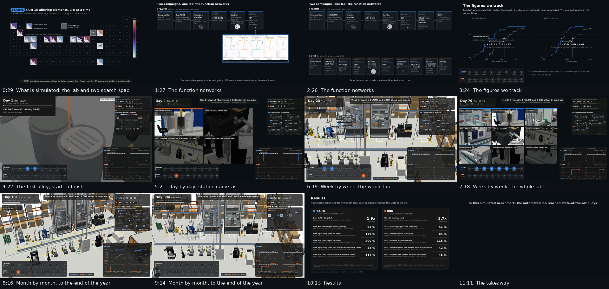
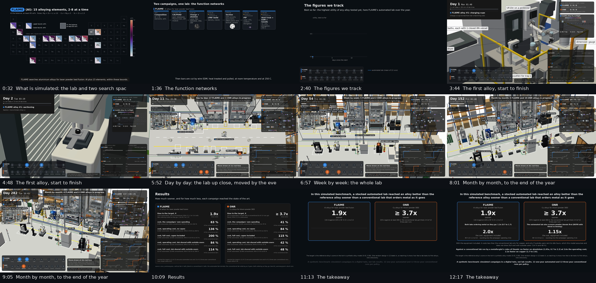
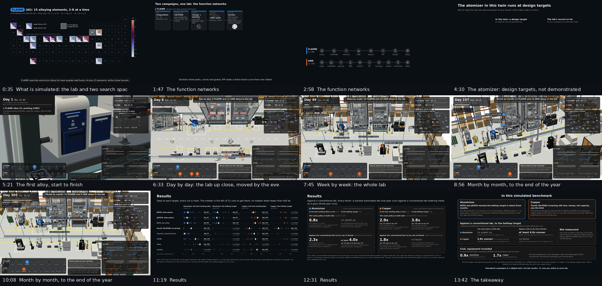
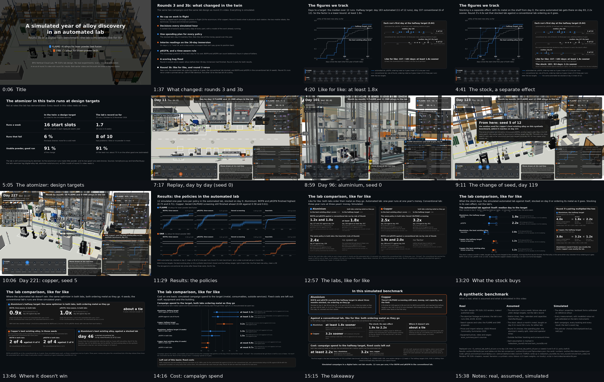
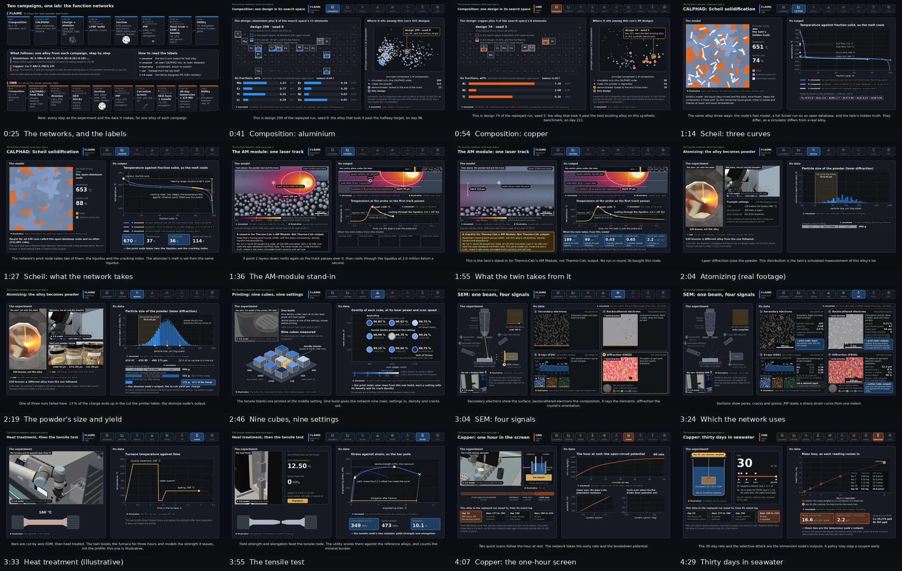

# The campaign video: a year of the twin, replayed

Round 2's video: the two campaigns' year in the vertical lab, replayed from the twin's own event log, with the figures
we track and what the benchmark found. **Everything in it is simulated**, except the lab design's 3-D renders (PR 318),
the lab's own atomizer footage and photos, the search spaces (the proposals) and the prices and their sources.

**On YouTube:** [Pz7hxqfODmE](https://www.youtube.com/watch?v=Pz7hxqfODmE) (public, subscribers not notified; uploaded 2026-11-26 from commit 73b155f).

**The animated cut** (PR 393, 2026-11-26): the same video with the replay's day-by-day, week-by-week and month-by-month
parts showing PR 318's 3-D lab moved by the event log, instead of station clips and lit stills. Unlisted:
[tX8Ik8oKnhk](https://www.youtube.com/watch?v=tX8Ik8oKnhk) (11:41, uploaded 2026-11-26 from commit dee5887; the public cut is untouched). Its 60 s preview, one simulated week from above: [FR3Fl1onJU0](https://www.youtube.com/watch?v=FR3Fl1onJU0) (unlisted, uploaded 2026-11-26 from commit b16bd36). See
[The animated lab](#the-animated-lab) below.

**The narrated cut** (PR 393, 2026-11-26): the animated cut with a voice at the places that need one, and its takeaway,
results and notes reworded as DAL's audit of the first cut suggested (digital-alloy-lab PR 293). Unlisted, 12:50:
[s854ahFNihU](https://www.youtube.com/watch?v=s854ahFNihU); its 60 s preview: [xoRI1OaA81k](https://www.youtube.com/watch?v=xoRI1OaA81k). See [The narrated cut](#the-narrated-cut) below.

**Round 3's video** (PR 394, 2026-11-26): a new cut from round 3's results, with the corrections DAL's audit of round 2's video asked for. Public, subscribers not notified: [7DjfEBGe4Jw](https://www.youtube.com/watch?v=7DjfEBGe4Jw) (14:18). See [Round 3's video](#round-3s-video) below.

**Round 3b's re-cut** (PR 400, 2026-11-27): round 3's cut again with round 3b's results: the lab comparison like for like, the stock as its own effect, and the replay on the replay arm's two median seeds. Public, subscribers not notified: [97BZNOI5V1w](https://www.youtube.com/watch?v=97BZNOI5V1w) (15:42). See [Round 3b's re-cut](#round-3bs-re-cut) below.

**The experiments chapter, a private preview** (PR 403, 2026-11-27): the function-network chapter rebuilt so that each step is shown as the experiment and the data it makes, for one alloy of each campaign. Private, 4:48: [4bAAygzrX10](https://www.youtube.com/watch?v=4bAAygzrX10). Not a cut of the whole video, and no public upload. See [The experiments chapter](#the-experiments-chapter-a-preview) below.

## What is on screen

| Part | What it shows | Code |
|---|---|---|
| Title | | `compose.title_frame` |
| What is simulated | The lab (the bird's-eye 3-D still) and the two search spaces as periodic-table heatmaps in DAL's style (each element's lower and upper bound) | `compose.simulated_frame`, `ptable.bounds_figure` |
| The function networks | Each campaign's network built full screen node by node, with the twin's simulated instrument data popping out at its node (SEM, EDS, EBSD, XRD, laser diffraction, tensile, PIP, corrosion), then collapsed to icons and docked in a corner | `dag_anim` |
| The figures we track | Best so far against days and against money, with dynamic axes; the state-of-the-art target; the conventional lab's curve; how the acceleration factor (X = days conventional / days automated) and the cost ratio (Y = cost automated / cost conventional) are read off; instrument utilization | `figs_anim.explain_frame` |
| The campaign year, replayed | Day 1 in 80 s of video (37 lab hours): one alloy start to finish, each step shown by PR 318's render of that station (and the lab's own melt and pour footage at the atomizer). Then day by day: the station cameras in 2 × 2 and 3 × 3 grids, each lit while a campaign uses it. Then week by week and month by month: the whole lab from above, each station lit from the event log, as the replay speeds up to about 60 lab hours a second. Throughout: the docked networks with each node lit while it is being evaluated, the compositions in flight as small periodic-table heatmaps, counters, and the live best-so-far plots | `compose.replay_frame`, `birdseye`, `ptable.multiples_panel`, `figs_anim.PlotPanel` |
| Results | The automated lab against the conventional lab for each policy both ran; how much sooner and for how much less each campaign reached the state of the art; cost per experiment; utilization and the capacity left over for outside users | `figs_anim.results_frame` |
| The takeaway | "X times faster at Y of the cost", per campaign, with what Y includes | `figs_anim.takeaway_frame` |
| Notes | What is real, what is assumed and what is simulated | `compose.notes_frame` |

**Speeding up and pulling back.** The replay covers 37 lab hours in its first 80 s, then speeds up: 1.5 lab hours per video second at 80 s, then
5, 15, 42 and finally about 60, and the camera moves from one station's render (day 1) to grids of station cameras
(days 2-23) to the whole lab from above (from about day 23 to the end of the year), as asked.

**Acceleration factor.** AF = the median days (or dollars) the conventional lab needed to first reach the target ÷
the automated lab's, with Kaplan-Meier medians when some seeds never get there and percentile-bootstrap intervals over
seeds (after Rohr et al., Chem. Sci. 2020, whose factor is a ratio of numbers of experiments, sequential
learning against random selection; here it is applied to days and dollars between two labs: `twin/accel.py`,
`notes/twin_econ.md`). The target is the state of the art: the
best reference alloy's true utility on this synthetic truth.

## The cut

1920 × 1080 at 30 fps, 11:41, captions only (no narration), built by `python -m twin.video.compose final` in 11.6 min
on the 4-core runner (3 encoders, x264 `medium`) beside the benchmark. Chapters (the description's):

| Starts | Chapter |
|---|---|
| 0:00 | What is simulated: the lab and two search spaces |
| 0:54 | The function networks |
| 2:39 | The figures we track |
| 3:41 | The first alloy, start to finish |
| 5:01 | Day by day: station cameras |
| 6:19 | Week by week: the whole lab |
| 7:43 | Month by month, to the end of the year |
| 9:41 | Results |
| 11:11 | The takeaway |
| 11:26 | Notes: real, assumed, simulated |



- **The replayed run** is `out/twin2/events/vertical_lab_bofn_blend_s0.json`: seed 0 of the main benchmark's BOFN set B
  (plain BOFN for FLAIME, BOFN with blend screening for copper), both campaigns, one year.
- **The numbers on screen** come from `out/twin2/bench2_summary.json` (curves; the conventional lab's are its own 12
  seeds) and `out/twin2/econ/econ_summary.json` (acceleration factors, cost ratios, cost per experiment,
  utilization), through `twin/video/data.py`. The takeaway compares the stocked vertical lab running BOFN
  (with blend screening for copper) against the conventional lab ordering as it goes and running plain BOFN (DAL's
  audit, digital-alloy-lab PR 293, §4: not "the lab's own contribution", as this said before). Its footer and the description add the comparison
  against the conventional lab run with a metallurgist's heuristic (aluminium 1.1×, copper 2.2×), and the description
  says where BOFN doesn't win.
- **The bird's-eye stills** (`out/twin2/video/birdseye/`, four views at 2880 × 1620) are rendered once from the set-up
  movie's lab by `twin/video/birdseye_render.py` (VTK with cadquery for the tessellation, 589 s, peak RSS 3.45 GB) and
  committed, so the cut can be rebuilt without the 3-D stack. Each station's anchor is projected into the still, and
  the replay lights it from the event log.
- **Reused renders.** The station cameras and day 1's shots are PR 318's own clips; the melt and pour are the lab's
  atomizer footage (DAL #159, #219).

```bash
cd vertical-lab
python -m twin.video.compose preview      # about 57 s touching every part, veryfast
TWIN_VIDEO_WORKERS=3 python -m twin.video.compose final   # out/twin2/video/campaign.mp4, youtube_meta.json, sheet.png
python -m twin.video.upload --yes         # public, subscribers not notified; recorded in out/youtube.json
```

## Limits

Everything the video says about alloys, results and costs is simulated (`notes/twin_round2.md`, `notes/twin_econ.md`).
The DED machine has no 3-D model of its own, so its cell is a crop of the bird's-eye still. The video shows one seed's
year; the results and takeaway are over 12 seeds of each lab.

## The animated lab

Sterling, on PR 393: "I was hoping to see the lab actually move: the trays going up and down in the two Kardex towers and
out to the openings, and the MiR250 bases with their UR12e arms driving between openings and working at them." The
animated cut (`python -m twin.video.compose final3d`, `campaign_lab3d.mp4`) keeps everything else in the video and
replaces the replay's camera grids and lit stills with the set-up movie's lab, moved by the replayed run's event log.

**What moves, and why** (`twin/video/lab3d_sched.py`):

- **A booking on a tray** (the doser, Mastersizer, SEM, furnace, metallography, Vickers, PIP, CubXL, VHX and the
  machining tray: `TRAY_OF`, as `birdseye.STATION_ANCHOR` places them) brings its tray to its Shuttle's opening when it
  starts (the unit loads it) and again when it ends (the unit unloads it). In between, the instrument runs in storage
  on its dock, as in the timelapse. A booking on a floor machine (atomizer, sieving cell, MIDI, wire EDM, the Instrons,
  DED, the ICP-MS hood: `DOCK_OF`) docks a unit at its front at both ends. HPC bookings ask for nothing. Idle trays
  stay in their slots.
- **The tower's own moves:** `setup_lab.TwoLab.fetch/store`'s, step by step: the extractor at 1333 mm/s (at least
  0.6 s) to the tray's slot, the 2.2 s slide onto it, the lift to the opening, the shutter (0.7 s), the slide out, the
  shutter. Storing reverses them. One extractor per Shuttle, so one tray out of its slot at a time.
- **The units' own moves:** `warehouse.Amr.route`'s drive at 1.5 m/s, pivoting on the spot at 60°/s, along the dock's
  line to its open end, out to a lane of the aisle and in along the next dock's line, backing in where the floor plan
  says (`BACK_IN`). At the dock, the arm unfolds and passes over three poses that the arm's own IK solves
  (`timelapse.Movie.work`'s targets: over the presented tray's front, or half a metre in front of the machine), then
  folds. The pick and place take `animate.pick/place`'s 3.8 s each. A unit with nothing to do for 2.5 s of video goes
  back to its charger.
- **Two clocks.** The replay runs at 1.5 to 60 lab hours a video second. A tray change takes 8-12 s and a drive 5-15 s,
  so at the replay's speed each move would last a few thousandths of a video second, and the lab would look still. The
  moves run on a second clock instead: 8× real time at a day's pace, rising to 16× at a month's (`move_rate`). Each
  move starts when the replay's clock reaches its booking. A tray change then takes about 1.2 s of video, slow enough
  to follow its six steps.
- **When the moves can't keep up.** At 15-60 lab hours a second, Shuttle 1 is asked for 4-14 trays a video second and
  can show one every two or three seconds. When a Shuttle or a unit comes free, it takes the latest request that has
  reached the clock and drops the older ones still waiting. A request for the tray already at the opening is served
  there. A tray waits at most 2.5 s for a unit, and a machine 2 s. The panel at the bottom says how many requests were
  drawn: in the preview's week (days 120-126), 73 of 138 tray requests and 40 of 58 machine visits. So the moves show what the lab is doing, not how much. The counters,
  the lit stations and the networks still count every booking.

**How it is drawn** (`twin/video/lab3d.py`): the scene is `birdseye_render.build`'s, the set-up movie's lab with both
Shuttles see-through and every tray loaded. A frame's state goes onto it through the set-up movie's own objects: each
tray's `[y, z]` and lamp (`L.tray`, `L.where`), each Shuttle's extractor and shutter (`L.use(shuttle)`, `L.lift_z`,
`L.shutter`, `L.apply_state()`), the MiR250s (`setup_lab.Unit.set`) and the arms (`robot.Robot.set`). Nothing is
rebuilt. `kin.json` (`out/twin2/video/lab3d/`) carries what the scheduler needs from the built scene: slots, docks,
chargers, the aisle and the arm's work poses. The overlays are the replay's own (the clock, the stations lit by
`birdseye.Birdseye.frame_live` on the render's projected anchors, the docked networks, the periodic-table insets, the
live plots), plus a tag on each tray presented and each unit on the move, the moves panel, and an inset from a second
camera on the two Shuttles.

**Render budget** (measured on the 4-core runner, llvmpipe): the 589 s the bird's-eye still took was mostly building
the scene. That is 983 s the first time, for the tessellation, and 90-125 s once it is cached, at 3.0 GB. A 1920 × 1080
frame of the whole lab (3,034 actors, 7.9 M triangles) takes 0.9 s of wall time with depth peeling and 0.6 s without,
and from above the two look the same. Of the three options:

- *Keyframes per lab event and interpolate:* the scheduler already works this way. Every move is scheduled per event
  and interpolated analytically. An image can't be interpolated between keyframes without ghosting, though, so each
  frame still needs its own render.
- *A lighter level of detail:* would cost the trays the detail that shows what is on them, and the full scene is
  already cheap enough.
- *Chosen: a lower frame rate with held frames.* The 3-D lab renders at 15 fps day by day (each render held for two
  frames of the 30 fps cut) and at 10 fps from week by week on, at 15-60 lab hours a second (held for three). A render
  is reused whenever the plan's state hasn't changed (`Plan.key`), so an idle lab costs nothing. The overlays are
  drawn at 30 fps on top.

What it cost on the runner (2026-11-26):

| | 3-D frames | renders (the rest reused) | render workers | wall time |
|---|---|---|---|---|
| The preview's week: the main view, 15 fps | 900 | 850 | 3 at 1920 × 1080 | 7.5 min |
| The preview's inset, 15 fps | 720 | 709 | 1 at 960 × 540 | 7.5 min |
| The re-cut's replay: main views (15 fps day by day, then 10) | 3,231 | 3,083 | 2 at 1920 × 1080 | 30 min |
| The re-cut's replay: insets | 1,554 | 1,458 | 1 at 960 × 540 | (the same 30 min) |

Each worker builds the scene once (about 115 s), renders its batch of chunks (`lab3d_cut.run_jobs`), and holds 3.0 GB.
With llvmpipe at two threads a worker, three workers keep the four cores busy, at about 1.1 s a 1080p render. Few
renders are reused, because once the replay is past a day's pace something is nearly always moving. The overlays and
the encode come after (`compose final3d`: 6.2 min for the whole 11:41 on three workers).

In the re-cut's replay (from day 2 to the end of the year), the event log makes 2,625 tray requests and 1,576
machine requests, one at each booking's start and end. The Shuttles drew 119 presentations, serving 1,049 of the
tray requests: a request for a tray already out, or one asked for again while the Shuttle was busy, is served by the
presentation that brings it out. The units made 226 machine visits, serving 1,107 machine requests.


**Cameras** (`lab3d.VIEWS`): `towers_c` (both openings close, from the west along the aisle, under the cable tray)
and `plan` (straight down on the aisle and docks) day by day; `high` (the still's view 1.5 m to the east and a little
wider, so every booked station clears the panels), `sw` and `se` from week by week on, with a return to `towers_c`.
Cameras from the east or south-east look through the cable tray.

```bash
cd vertical-lab
VIZ3D_SIZE=1920x1080 xvfb-run -a python -m twin.video.lab3d kin      # kin.json, from the built scene
python -m twin.video.lab3d_cut preview                                # the week: out/twin2/video/lab3d_week.mp4
TWIN_VIDEO_LAB3D=1 TWIN_VIDEO_WORKERS=3 python -m twin.video.compose final3d   # campaign_lab3d.mp4, sheet_lab3d.png
python -m twin.video.upload --yes --file out/twin2/video/campaign_lab3d.mp4 \
    --meta out/twin2/video/youtube_meta_lab3d.json --privacy unlisted
python -m pytest -q twin/tests/test_lab3d_sched.py
```

**Limits of the animation.** The moves are drawn 8-16 times faster than real time but thousands of times slower than
the clock, so at the replay's speeds most requests are not drawn (see above). The units' routes ignore each other:
the two lanes keep them from meeting head on, but nothing stops them from crossing at a dock's entry. An arm's work is
the same three poses at every dock. It shows that the arm works there, not what it does. Bookings on stations without
a 3-D model of their own (the DED machine) move a unit to their reserved footprint.

## The narrated cut

Sterling asked for narration "at least at the strategic places", on top of the animated re-cut
([PR 393](https://github.com/vertical-cloud-lab/byu-vcl/pull/393#issuecomment-7180846741)): what is simulated and what is
real, the function networks as each is built, how to read the best-so-far plots and the acceleration factor, the first
alloy, the switch to the whole lab, the results, the takeaway with what "Y of the cost" includes, and the closing
notes. Elsewhere the captions and the pictures carry it: 25 lines, 5.5 min of speech in 12:50. It is
built on the animated cut ([The animated lab](#the-animated-lab)), so the replay is PR 318's 3-D lab moved by the event
log.

**On YouTube:** [s854ahFNihU](https://www.youtube.com/watch?v=s854ahFNihU) (unlisted; uploaded 2026-11-26, built from commit 3230776, then its track brought to -16 LUFS with the picture copied (`python -m twin.video.compose remux`)), and its 60 s preview
[xoRI1OaA81k](https://www.youtube.com/watch?v=xoRI1OaA81k) (unlisted; its track is at the level before `loudnorm`, -20.5 LUFS): the opening, then the 3-D lab taking over on day 2 and the first view of the whole lab from above. The
public cut (Pz7hxqfODmE) and the animated re-cut's upload are left as they are.



**The voice** is Kokoro v1.0 (82 M parameters, Apache-2.0 open weights), run on the runner's CPU through kokoro-onnx
0.6.1, with its stock voice `af_heart` at 0.96 speed: no reference audio, nobody's voice cloned or imitated. It is the
same model and voice as the long-form video's narration (`longform.py`). Each line is spoken from phonemes:
`narration.SAY` respells what the voice would misread (FLAIME said as "flame"; ONR, BOFN, DED, LPBF, SEM letter by
letter; "aluminium" as the American "aluminum", since the voice is American), and `narration.IPA` gives CALPHAD
("KAL-fad"), Kardex, Sobol and "doser" their phonemes.

**Heard back.** Every line was transcribed by faster-whisper (base.en and small.en) and compared word by word with what
it should say: 0.44 % (small.en) and 1.2 % (base.en, which once repeats a phrase that was said once) word error over 915 words. The differences are spellings ("grey"/"gray") and "CALPHAD", a
word the recognizers don't know (`out/twin2/video/narration/check.json`; `lines.ogg` has every line in a row, to listen
to).

**Every spoken number** is on screen while it is said, and comes from `econ_summary.json` or `bench2_summary.json` at
the commit the cut was built from. Each line's `src` in `twin/video/narration.json` says where. Where a number wasn't
on screen, the caption was changed to show it (below). "Simulated" is said wherever it applies, and the copper result is
given as it is: tiered CALPHAD screening finished ahead.

**Captions in step.** These change on the narrated cut only, so the cuts without narration build exactly as before:

- the results' first caption names the leaders the voice names: in the automated lab, BOFN finished highest on
  aluminium; on copper, tiered CALPHAD screening finished ahead of BOFN with blend screening (0.69 against 0.67),
  computed from `bench2_summary.json` (`figs_anim._leaders`);
- the takeaway's footnote says what the operating cost includes: materials, outside fees, labour, service contracts,
  utilities and space, without the equipment's capital cost;
- the notes frame names the voice instead of "Captions only, no narration";
- the takeaway (15 to 51 s) and the notes (15 to 19 s) are longer, to fit their lines.

**Where the lines sit.** Each line is anchored on a segment (`seg`, `at`) or on a named moment inside one (`mark`:
each network card's arrival, day 1's steps, the 3-D lab taking over, the first view from above;
`narration.marks`), so it follows the cut when segments are re-timed. `python -m twin.video.narration plan` prints
each line's time and the caption on screen meanwhile; a line that would overlap the one before, or run past its
segment, is reported. The two lines about the animated lab (`needs: lab3d`) are placed only on the animated cut.

**Rebuilding it.** The audio sources are committed: each line's FLAC (24 kHz, 16-bit) in
`out/twin2/video/narration/`, with its text, phonemes, voice and speed in `lines.json`, so the cut rebuilds without the
speech model. A line is spoken again only when its text changes, which needs `/tmp/kokoro/kokoro-v1.0.onnx` and
`voices-v1.0.bin` from kokoro-onnx's `model-files-v1.0` release (their sha256 in `lines.json`). The track is mixed at
48 kHz, each line levelled to -19 dBFS RMS, the whole track brought to -16 LUFS by one linear gain (ffmpeg's
`loudnorm`, two passes; YouTube plays at -14 and only turns louder videos down) and muxed in as AAC; the subtitles are `narration/narration.srt` (the upload
token can't add a caption track, so they aren't on YouTube).

```bash
cd vertical-lab
python -m twin.video.narration plan      # each line's time in the narrated cut, and the caption on screen meanwhile
python -m twin.video.narration tts       # speak the lines whose text changed (Kokoro), into out/twin2/video/narration/
python -m twin.video.narration check     # heard back by faster-whisper
# the 3-D lab needs the set-up movie's stack (VTK, cadquery: twin/video/lab3d.py), so run these with that Python
TWIN_VIDEO_LAB3D=1 TWIN_VIDEO_NARRATION=1 TWIN_VIDEO_WORKERS=3 python -m twin.video.compose final3d
TWIN_VIDEO_LAB3D=1 TWIN_VIDEO_NARRATION=1 python -m twin.video.compose npreview   # out/twin2/video/preview_narrated.mp4
python -m twin.video.upload --yes --file out/twin2/video/campaign_lab3d_narrated.mp4 \
    --meta out/twin2/video/youtube_meta_lab3d_narrated.json --privacy unlisted
```

### The script, with its times in the cut

| Time | Part | Line |
|---|---|---|
| 0:00-0:09 | Opening | This is a simulated benchmark: two alloy discovery campaigns, replayed for a whole year in a digital twin of our planned automated lab. |
| 0:10-0:26 | Opening | Some of it comes from real sources: the lab's design and its 3-D model, footage from our own atomizer, the search spaces in the two proposals, and published prices. Everything else is simulated: every alloy, every measurement, and every result. |
| 0:54-1:07 | The function networks | Each campaign is a function network: a chain of steps, where each step's results feed the next. BOFN, Bayesian optimization over function networks, models every step, not just the final score. |
| 1:09-1:15 | The function networks | For aluminium, the lab makes each alloy's powder itself, then prints it and checks every build. |
| 2:02-2:10 | The function networks | For copper, a one-hour corrosion screen ranks the DED deposits, and thirty days in seawater come before a utility is known. |
| 2:25-2:31 | The function networks | Both campaigns share one lab. From here on, each step is an icon that lights up while it runs. |
| 2:39-2:58 | Reading the figures | Best so far is the highest utility of any alloy tested yet. The dotted line is the target: the best reference alloy's score on the twin's synthetic alloy model. One random design in twelve beats it, so reaching it shows how fast a lab tests its first alloys, not a discovery. |
| 2:58-3:10 | Reading the figures | Against money, the same curve shows what the progress cost. The grey dashed curve is the conventional lab: the same optimizer through partner and core facilities, ordering its metal as it goes. |
| 3:15-3:28 | Reading the figures | Where each first reaches the target, the median over the runs, gives the acceleration factor: here 220 days over 116, or 1.9 times. Money gives the cost ratio the same way. |
| 3:41-3:53 | The campaign year | Day one follows a single simulated aluminium alloy from start to finish. Its cup is machined, its metals are dosed and pressed under vacuum, then melted and atomized into powder. |
| 3:55-3:59 | The campaign year | The melt and the pour are real footage, from the lab's own atomizer. |
| 4:17-4:24 | The campaign year | After sieving and powder checks, it's printed by laser powder bed fusion, then inspected, sectioned and indented. |
| 4:51-4:58 | The campaign year | Wire EDM cuts its bars, and a tensile test scores it, about a day and a half after its cup was machined. |
| 5:01-5:14 | The campaign year | From day two, the event log moves the lab's 3-D model: each booking brings its tray to a Shuttle's opening and back, and a mobile arm drives over to serve it. Trays nobody has booked stay in their slots. |
| 5:35-5:46 | The campaign year | Now the whole lab from above, with the two Shuttles up close from a second camera. The moves run on a clock of their own, so you can follow them; the panel at the bottom counts how many were drawn. |
| 6:20-6:29 | The campaign year | This replay is one seed of twelve, and aluminium's luckiest: it reaches the target on day 20, where the median seed takes 116 days. |
| 9:41-10:05 | Results | Each panel is one policy: twelve one-year runs in the automated lab, twelve three-year runs in the conventional one. BOFN finished highest on aluminium. On copper, tiered CALPHAD screening finished ahead of BOFN with blend screening, 0.68 against 0.58 over 24 seeds, and plain BOFN did no better than random. |
| 10:07-10:29 | Results | Against a conventional lab that orders metal as it goes and runs plain BOFN, the stocked automated lab reached the target 1.9 times sooner on aluminium, and at least 3.7 times sooner on copper, where the conventional lab got there in 6 of its 12 runs. With both labs ordering as they go, aluminium's factor is 1.2. |
| 10:31-10:43 | Results | Per demonstrated alloy, the automated lab costs more while the two campaigns carry its equipment alone. It costs less only if outside users fill it to sixty percent, which the model assumes. |
| 10:47-11:04 | Results | The two campaigns use 5.8 percent of the lab's hours, weighted by capital cost. With an assumed ten hours a week of outside work per instrument, the spare hours would net about 1.2 million dollars a year, 2.1 times the lab's depreciation. |
| 11:12-11:31 | The takeaway | So: in this simulated benchmark, a stocked automated lab reached an alloy better than the reference alloy sooner than a conventional lab that orders metal as it goes: aluminium in 116 days against 220, and copper in 225 days against at least 840. |
| 11:32-11:43 | The takeaway | Most of aluminium's gain is the stock: with both labs ordering as they go, it's 1.2 times. And for copper, the automated lab also screens powder blends first. |
| 11:44-12:08 | The takeaway | To get there, with the equipment included, the automated lab cost 2.0 times as much for aluminium, and 1.15 times for copper; counting only what the campaigns spent, 0.6 and 0.4 times. With the equipment, it costs less only for copper, and only if outside users rent its idle hours, which this model assumes and does not show. |
| 12:09-12:22 | The takeaway | Against a conventional lab run by a metallurgist's rules of thumb, the automated lab is no faster on aluminium, at 2.6 times the operating cost, and 2.2 times faster on copper. |
| 12:24-12:48 | Closing notes | Everything here is simulated: the alloys, the results, and every measurement, with modelled noise not yet calibrated on the lab's instruments. Station times, fees and schedules, the stock on the shelf, the atomizer's failure rate and yield, and who staffs the lab are assumptions. It shows how the lab's design and its optimizer interact in a model, not what the real lab will find. |

### DAL's audit, and what the narrated cut takes from it

DAL audited the first cut's claims while this was being written
([digital-alloy-lab PR 293](https://github.com/vertical-cloud-lab/digital-alloy-lab/pull/293),
`audits/twin-round2-video/README.md`). Its verdict: the arithmetic reproduces, but the two headline factors are not a
measure of what automation does, and the takeaway's "84 %" means two different things. The narrated cut follows its
suggested rewording (§4), in the voice and on screen:

- **The takeaway card and the description's two bullets** (§4, first item). The narrated card says what was compared:
  "a stocked automated lab reached an alloy better than the reference alloy sooner than a conventional lab that orders
  metal as it goes", aluminium in 116 days against 220 (1.9×, 95 % CI 1.1 to 3.4) and copper in 225 days against at
  least 840 (≥ 3.7×; the conventional lab got there in 6 of 12 three-year runs). It adds "both labs ordering metal as
  they go: 1.2× (0.7 to 1.7)" for aluminium, and that copper's automated lab also screens powder blends first. Voice:
  `take1`, `take1b`, `res2`. The results' ratio panel shows "≥ 3.7x" and "at least 840 d (6 of 12 runs got there)".
- **Cost** (§4). There is one basis for both campaigns, led by the one with the equipment: 2.0× and 1.15× the
  conventional lab's cost, and 0.6× and 0.4× counting only the campaigns' spending. The voice adds "with the equipment,
  it costs less only for copper, and only if outside users rent its idle hours, which this model assumes and does not
  show". This replaces the card's "84 %", which meant operating cost with outside users for aluminium and operating
  cost without the equipment for copper. Voice: `take2`, and `res3` ("only if outside users fill it to sixty percent,
  which the model assumes").
- **"State of the art"** (§4). The target is "the best reference alloy's score on the twin's synthetic alloy model. One
  random design in 12 beats it, so reaching it shows how fast a lab tests its first alloys, not a discovery". This is in
  the explainer's target caption and the takeaway. Voice: `fig1`.
- **The heuristic line** (§4). "No faster on aluminium (1.05×, 0.7 to 2.2) at 2.6× the operating cost, and 2.2× faster
  on copper (1.7 to 2.6)", on the card and in the description. Voice: `take3`.
- **Copper in "Where BOFN doesn't win"** (§4). "0.68 against 0.58 over 24 seeds (0.69 against 0.67 in the first 12);
  plain BOFN did no better than random (0.33 against 0.35)", in the results caption and the description. Voice: `res1`.
- **The replay** (§4). A badge for its whole length: "One seed of 12: here aluminium reaches the target on day 20; the
  median seed takes 116 days". Voice: `seed1`, which also says it is aluminium's luckiest seed (the audit's §1, row 9).
- **Run counts** (§4). "12 one-year automated and 12 three-year conventional runs per policy" replaces "twin-years" in
  the results caption, the ratio panels' footnotes and the takeaway's footer. Voice: `res1`.
- **The notes frame** (§4). "Assumed" gains "the automated lab's feedstock stock on day 0; the atomizer's failure rate and
  yield; who staffs the automated lab". "Every measurement, with noise" becomes "Every measurement, with modelled noise
  not yet calibrated on the lab's instruments". Voice: `note1`.
- **This file's account of the takeaway's comparison** (§4, last item). It is reworded in [The cut](#the-cut).
- Also from the audit's claims table, not its §4: the explainer's grey curve says the conventional lab orders its metal
  as it goes (rows 1 and 15; voice `fig2`). The acceleration factor's definition below now says how Rohr et al.'s
  differs (row 16). The narrated description drops "the same campaigns run the conventional way", and says the
  conventional lab is the proposals' plan (row 14).

Not taken: §5's experiments, which would settle the open claims rather than reword them (stocking the conventional lab,
the same copper method in both labs, more seeds, one horizon, the logged atomizer). They need new benchmark runs.

Every number those use is read from this commit's data: aluminium with both labs ordering as they go is recomputed with
`twin.accel` (as `econ_summary.json` computes the headline) from `bench2_summary.json`'s `stock` runs against the
conventional lab, 1.16 (0.73 to 1.67), against the audit's 1.16 (0.72 to 1.66) from 20,000 resamples. Copper over 24
seeds is `main` plus `cu_seeds`, and "one random design in 12" is `oracle.json`'s `frac_above_sota` (0.082, both spaces).
Where the audit's own bootstrap and `econ_summary.json` differ in the last digit, the video uses `econ_summary.json`:
copper against the heuristic is 2.2× (1.7 to 2.6) there, 1.8 to 2.6 in the audit.

## Round 3's video

Sterling, on [PR 394](https://github.com/vertical-cloud-lab/byu-vcl/pull/394#issuecomment-7191541976) (2026-11-26):
"Make a new campaign video from round 3's results, with the corrections from the DAL audit of the round-2 video ...
and upload it as a new video, public, with subscribers not notified. ... Use round 3's committed results and event
logs. If a round-3 result isn't committed, say so and leave it out rather than reusing round 2's."

**On YouTube:** [7DjfEBGe4Jw](https://www.youtube.com/watch?v=7DjfEBGe4Jw) (public, subscribers not notified; uploaded
2026-11-26, built from commit 01afb5e), 14:18. The earlier uploads (Pz7hxqfODmE, tX8Ik8oKnhk, s854ahFNihU) are
as they were.



It is the narrated, animated cut's pipeline, switched to round 3 by `TWIN_VIDEO_ROUND=3`: `twin/video/data.py` reads
`out/twin3/` (the runs, `fig/numbers.json`, `econ/econ_summary.json`, the event log) and writes to `out/twin3/video/`.
Without the switch, round 2's cuts build as before. Everything in it is simulated, except what the closing notes list
as real.

### What is on screen

| Part | What it shows | Code |
|---|---|---|
| Title; what is simulated | As round 2's cut: the lab and the two search spaces | `compose.title_frame`, `simulated_frame` |
| Round 3: what changed in the twin | No cap on work in flight, decisions every simulated hour, one spending plan, interim immersion readings and a stop, pKGFN and the time-aware rule, the scoring bug | `figs3.changes_frame` |
| The function networks | As round 2's cut. Copper's immersion caption adds the interim readings | `dag_anim` |
| The figures we track, and the two targets | Best new alloy so far (aluminium, pKGFN, mean of 12 runs). The first target, called what it is, with the share of random designs that beat it. The halfway target. The conventional lab run by rule of thumb. Each run's first day at the halfway target as marks, both labs, with the medians: why 337 / 83 days is "at least 4.0x" | `figs3.explain_frame` |
| The atomizer: design targets, not demonstrated rates | The twin's start slots, runs used, failure chance and yield beside the lab's log (1.7 runs a week; problems in 8 of 10 runs) | `figs3.assume_frame` |
| The campaign year, replayed | Day 1, then PR 318's 3-D lab moved by the event log, as in the animated cut. The live plots show the best new alloy against both targets. A badge names the seed for the whole replay | `compose.replay_frame`, `lab3d_cut`, `figs_anim.PlotPanel` |
| Results | Five parts: the curves of four policies; days to both targets for all eight, every run a mark; copper and money (where the money goes, three times the copper money); the lab against a conventional lab; the cost on one basis | `figs3.results_frame` |
| The takeaway | What the policies found per campaign; the halfway-target comparisons for both campaigns, the same policy beside rule of thumb, and what was not measured; the cost, equipment included | `figs3.takeaway_frame` |
| Notes | Real, assumed, simulated | `compose.NOTES_R3` |

### Round 3's results the video uses, and what it leaves out

- **Sources.** `out/twin3/fig/numbers.json` (the tables' numbers), `out/twin3/econ/econ_summary.json` (the
  lab-against-lab factors, the cost, the utilization), `out/twin3/runs/*.jsonl` (each run's own days, the paired
  differences of the three-times-money test, where the money went) and the replayed event log. `twin/video/numbers3.py`
  reads them and writes [`out/twin3/video/numbers.json`](../out/twin3/video/numbers.json), which every card, every
  spoken number and the description are drawn from. Nothing is typed in.
- **Not committed in round 3, so left out and said on screen:**
  - *Both labs ordering metal as they go, or both stocked.* `main` is the vertical lab stocked; `conventional` is the
    conventional lab ordering as it goes; `twin/bench3.py` has no other pairing. So every lab-against-lab factor is
    labelled "a stocked automated lab against a conventional lab ordering metal as it goes", and the explainer, the
    results and the takeaway say that the stock's share was not measured. No factor is in a headline.
  - *BOFN and pKGFN in the conventional lab* (`conventional_net`). The same-policy comparisons are the ones round 3
    has: tiered screening in both labs for copper and the heuristic in both for aluminium.
  - *Tiered screening in the vertical lab against the heuristic in the conventional lab* is not among
    `econ_summary.json`'s comparisons. Copper's comparison against the lab run by rule of thumb is pKGFN's.
- **The replayed seed.** Round 3 committed event logs for seed 0 only. The replay is seed 0 of time-aware BOFN
  (`r3_vertical_lab_bofn3_s0.json`). For aluminium it is the median seed of the 12: it reaches the halfway target on
  day 96, the Kaplan-Meier median itself (the first target on day 96, 7th of 12; its final alloy is 6th of 12). For
  copper it is one of the 4 seeds of 12 that never reach the first target (the median seed gets there on day 221).
  The badge and the line `seed1` say both.
- **A re-run did not reproduce.** Seed 5 is near the median in both campaigns (aluminium's halfway target on day 94,
  copper's first target on day 221), so it was re-run for its event log, with seed 0 beside it as a check. Neither
  reproduced its committed row on this runner (torch 2.15.0, botorch 0.18.1, numpy 2.5.5): the event logs are identical
  for the first 25 simulated days (1,010 events) and then diverge. Seed 0's re-run reached aluminium's halfway target
  on day 104 against the committed 96, with 74 builds against 129. So the re-run's log is not the committed run's and
  is not used or committed. Round 3's BOFN and pKGFN rows therefore depend on the numerical environment.
  Round 3b found the cause: the BLAS kernels the CPU selects. Forced to AVX2 kernels, an AVX-512 runner departs at the
  same booking, 1,010, so this run's runner most likely had no AVX-512. Round 3b pinned the kernels, and every seed now
  has an event log ([`twin_round3b.md`](twin_round3b.md)).
- **Two numbers corrected against the tables.**
  - `notes/twin_round3.md` and PR 394's description gave BOFN's gain from three times the copper money as
    +0.17 ± 0.04, from its first 3 seeds. `cu_money.jsonl` has 4, and `tables.md` gives +0.14 ± 0.04 (final alloy
    0.69 ± 0.02; both targets in 4 of 4). The video uses the tables, and the notes' row is corrected.
  - "Nothing else reaches aluminium's halfway target in more than 2 of 12" leaves out BOFN per dollar, which reaches
    it in 7. The video says "BOFN per dollar in 7, and no other policy in more than 2".
- **Two median rules.** Round 3's tables use the Kaplan-Meier median for every arm (the 6th of 12 runs to get there).
  `econ_summary.json` (`twin/accel.py`) takes the ordinary median for an arm whose 12 runs all got there, as the audit
  noted for round 2. The two differ for aluminium's first target: day 70 and 164 in `econ_summary.json` against day 67
  and 159 in the tables, which makes its factors 2.3x and 6.8x where one rule would give 2.4x and 6.6x. The video
  shows `econ_summary.json`'s factors and intervals as committed, and shows the days beside a factor only where both
  sources agree to the day (`numbers3`: `days_ok`). No spoken factor is affected: the three spoken ones are to the
  halfway target, where both rules agree.

### The audit's points, and what addresses each

The audit is `audits/twin-round2-video/README.md` on
[digital-alloy-lab PR 293](https://github.com/vertical-cloud-lab/digital-alloy-lab/pull/293) (read at `0f43b53`).
"Point" is its "What to believe" list, "row" its table of claims, "§4" its suggested rewording.

| Audit | What round 3's video does | Where |
|---|---|---|
| Point 1: everything checked reproduces | Every number is read from the committed summaries by `numbers3`; `python -m twin.video.narration nums` checks the 54 spoken numbers and 17 worded claims against them | `numbers3.py`, `narration.check_numbers` |
| Point 2, row 1, §4 takeaway: aluminium's factor is mostly stock; say which lab is stocked | Every factor is labelled "a stocked automated lab against a conventional lab ordering metal as it goes". Round 3 has no run with both ordering as they go, so the video says the stock's share is not known, three times. No factor is a headline | lines `fig3`, `fig5`, `res4`, `take2`; the labs card's footer; the takeaway's "Not measured" |
| Point 3, row 2: copper compared two optimizers; its reference median was the last of six | The same policy in both labs sits beside the comparison against the lab run by rule of thumb, for both campaigns and both targets, all eight cells, including the three with no factor. "At least" wherever the conventional lab reached the target in half its runs or fewer. Run counts on every factor | `figs3._res_labs`, `takeaway_frame`; lines `fig4`, `res4`, `take2` |
| Point 4, rows 3 and 4, §4 cost: the "84 %" meant two things | One basis on the cost card and the takeaway, the same for both campaigns: equipment included. The 60 %-shared bar is hollow and labelled "assumed, not shown by any data" | `figs3._res_cost`, `takeaway_frame`; lines `res5`, `take3` |
| Point 5, row 5, §4 "state of the art": a low bar | Called "the best existing alloy on this synthetic benchmark" everywhere, with "one random design in 12 beats it: a low bar". The halfway target is on every plot and card | lines `fig1`, `fig2`; the explainer's table; the live plots; the days card |
| Point 6, row 6, §4 the heuristic line | The comparison against the conventional lab run by rule of thumb is a column of the labs card and of the takeaway | `figs3._res_labs`; lines `res4`, `take2` |
| Point 7, row 9, §4 the replay | The seed is named on a badge for the whole replay and in a line. It is the median seed for aluminium, not the luckiest, and the badge says copper never reaches its first target, as in 4 of 12 seeds | `compose.seed_words3`; line `seed1` |
| Point 8, §2: the atomizer's assumptions against the lab's record | Its own card and line before the replay: 16 start slots a week and about 10 used, a 6 % base chance of failure and 91 % yield, beside 1.7 runs a week, problems in 8 of 10 runs and 91 % on the best run. "Design targets, not demonstrated rates". Also first in the closing notes' "Assumed" | `figs3.assume_frame`; line `asm1`; `compose.NOTES_R3` |
| Row 7, §4 copper: tiered screening against BOFN | Copper as round 3 finds it: tiered screening ahead (0.69 against 0.58 and 0.61) and months sooner to both targets; money, not capacity, the limit; the three-times-money test with its 4 runs stated | lines `res1`, `res2`, `res3`, `take1`; `figs3._res_money` |
| Row 8: the heuristic reaches aluminium's first target sooner | Said: day 24, then it stalls (the halfway target in 1 of 12 runs) | line `res2`; the days card; the takeaway |
| Row 10, §4 run counts: one-year against three-year runs | "12 one-year runs" and "12 three-year runs" wherever the two labs meet. Each factor also shows the runs that got there inside the first year of both labs | `figs3._lab_cell` ("inside the first year") |
| Row 11: cost per alloy; the 60 % bars rest on assumed demand | Cost per demonstrated alloy with the equipment, per campaign and for both. The shared case is a labelled sensitivity | `figs3._res_cost` |
| Row 12: utilization holds; outside revenue is open | The 7 % utilization is stated. The outside-revenue tiles are dropped | `figs3._res_cost`; line `res5` |
| Row 13, §4 notes frame | "Assumed" now leads with the atomizer's rates and adds the stock on day 0, who staffs the lab and round 3's own choices. "Modelled noise not yet calibrated on the lab's instruments" | `compose.NOTES_R3`; line `note1` |
| Row 14: "the same campaigns run the conventional way" | The conventional lab is described as what it is in the twin: partner and core facilities, ordering metal as it goes, run by rule of thumb or by the same policy. The video does not call it how the lab works today | lines `fig3`, `res4` |
| Row 15, §4 `twin_video.md` | This section says what each comparison is | above |
| Row 16 and "The acceleration-factor method" | A factor is days in the conventional lab over days in the automated lab, between two labs, and is shown with its runs. The two median rules: see above. Unequal horizons: the first-year counts. Choice among many: the comparisons are fixed in `numbers3` (the same policy, and against rule of thumb, for each campaign and both targets) and all are shown | `numbers3.numbers()["labs"]` |
| §5: experiments that would settle the open claims | Not run here: they are new benchmark runs (both labs ordering as they go, BOFN in the conventional lab, more seeds, the logged atomizer) | |

### The script, with its times in the cut

`twin/video/narration3.json`: 30 lines, 7.5 min of speech in 14:18. Each line's `nums` gives every number
it speaks with its path in `out/twin3/video/numbers.json`.

| Time | Part | Line |
|---|---|---|
| 0:00-0:10 | Opening | This is a simulated benchmark, in its third round: two alloy discovery campaigns, replayed for a whole year in a digital twin of our planned automated lab. |
| 0:11-0:27 | Opening | Some of it comes from real sources: the lab's design and its 3-D model, footage from our own atomizer, the search spaces in the two proposals, and published prices. Everything else is simulated: every alloy, every measurement, and every result. |
| 0:54-1:14 | What changed in round 3 | Round three removes the cap on how much work is in flight. What sets the pace now is physical: stations, robots, people and fixtures. Decisions come every simulated hour, one spending plan paces the money for every policy, and the thirty-day immersion gives interim readings and can be stopped early. |
| 1:16-1:29 | The function networks | Each campaign is a function network: a chain of steps, where each step's results feed the next. BOFN, Bayesian optimization over function networks, models every step, not just the final score. |
| 1:31-1:37 | The function networks | For aluminium, the lab makes each alloy's powder itself, then prints it and checks every build. |
| 2:24-2:32 | The function networks | For copper, a one-hour corrosion screen ranks the DED deposits, and thirty days in seawater come before a utility is known. |
| 2:47-2:53 | The function networks | Both campaigns share one lab. From here on, each step is an icon that lights up while it runs. |
| 3:01-3:15 | Reading the figures | Best so far is the highest utility of any new alloy tested yet. The first dotted line is the best existing alloy on this synthetic benchmark. One random design in twelve beats it, so it is a low bar. |
| 3:16-3:22 | Reading the figures | The second line is the halfway target: halfway from there to the best alloy the twin's own search found. |
| 3:23-3:34 | Reading the figures | The grey dashed curve is a conventional lab run by rule of thumb, through partner and core facilities. It orders its metal as it goes, while the automated lab starts stocked. |
| 3:35-3:57 | Reading the figures | Days to a target are the median over twelve runs. Here the automated lab reaches the halfway target on day 83, in 10 of its 12 runs. The conventional lab does on day 337, in only 6 of 12, so its median is its last run to get there. The factor is therefore a lower bound: at least 4.0 times. |
| 3:58-4:06 | Reading the figures | Round three did not run both labs ordering metal as they go, so how much of a factor comes from the stock on the shelf is not known. |
| 4:09-4:30 | The atomizer's assumptions | One assumption matters more than the rest. In the twin, the atomizer has sixteen start slots a week and uses about ten, and a run fails six percent of the time, more for a cold melt. The lab's own record so far is 1.7 runs a week, with problems in eight of ten runs. These are design targets, not demonstrated rates. |
| 4:34-4:48 | The campaign year | Day one follows a single simulated aluminium alloy from start to finish: the reference alloy, which the lab makes first. Its cup is machined, its metals are dosed and pressed under vacuum, then melted and atomized into powder. |
| 4:49-4:53 | The campaign year | The melt and the pour are real footage, from the lab's own atomizer. |
| 5:10-5:17 | The campaign year | After sieving and powder checks, it's printed by laser powder bed fusion, then inspected, sectioned and indented. |
| 5:44-5:49 | The campaign year | Wire EDM cuts its bars, and a tensile test scores it on the second day. |
| 5:54-6:07 | The campaign year | From day two, the event log moves the lab's 3-D model: each booking brings its tray to a Shuttle's opening and back, and a mobile arm drives over to serve it. Trays nobody has booked stay in their slots. |
| 6:27-6:39 | The campaign year | Now the whole lab from above, with the two Shuttles up close from a second camera. The moves run on a clock of their own, so you can follow them; the panel at the bottom counts how many were drawn. |
| 7:12-7:33 | The campaign year | This replay is seed zero of twelve, running time-aware BOFN: the only seed whose event log was saved. For aluminium it is the median seed: it reaches the halfway target on day 96. For copper it is one of the four seeds that never reach the first target; the median seed gets there on day 221. |
| 8:36-8:47 | The campaign year | Aluminium has now passed both targets: in this seed, on day 96. Copper stays below its first target all year, as it does in four of the twelve seeds. |
| 10:34-10:56 | Results | Twelve simulated one-year runs per policy in the automated lab. On aluminium, time-aware BOFN and pKGFN finished highest, at 0.73 and 0.71. On copper, tiered CALPHAD screening still finished ahead, at 0.69 against 0.58 and 0.61. |
| 10:58-11:28 | Results | Days to each target, with every run a mark. Time-aware BOFN and pKGFN reach aluminium's halfway target on day 96 and day 83, in 11 and 10 of 12 runs. BOFN per dollar does in 7, and no other policy in more than 2. The heuristic reaches the first target soonest, on day 24, and then stalls. On copper, tiered screening reaches the halfway target on day 148, in 10 of 12 runs. |
| 11:30-11:53 | Results | Removing the cap did not speed copper up: money is its limit. More than four fifths of each campaign's spending is orders of metal and consumables. With three times the copper money, BOFN and pKGFN gain 0.14 and 0.08 over four runs each, and draw level with tiered screening, which is still first to both targets. |
| 11:54-12:32 | Results | Against a conventional lab. Every factor here compares a stocked automated lab with a conventional lab that orders metal as it goes. With the same policy in both labs, tiered screening reaches copper's halfway target 3.8 times sooner, and the heuristic shows no speed-up on aluminium's. Against a conventional lab run by rule of thumb, pKGFN reaches aluminium's halfway target at least 4.0 times sooner: the conventional lab got there in 6 of 12 runs. BOFN and pKGFN were not run in the conventional lab. |
| 12:33-12:51 | Results | Cost, on one basis for both campaigns: equipment included. A demonstrated alloy costs about 35 thousand dollars in the automated lab, against 8 thousand in the conventional lab, while the two campaigns carry the lab alone. They use 7 percent of its capacity. |
| 12:55-13:10 | The takeaway | So, in this simulated benchmark. On aluminium, BOFN and pKGFN reached the halfway target in about three months. On copper, tiered CALPHAD screening still won, and money, not capacity, was the limit. |
| 13:11-13:36 | The takeaway | Against a conventional lab, to the halfway target, with the automated lab stocked and the conventional lab ordering as it goes. With the same policy in both labs: no speed-up on aluminium, and 3.8 times sooner on copper. Against a lab run by rule of thumb: at least 4.0 times sooner on aluminium, and no factor on copper. How much of any factor is the stock, round three did not measure. |
| 13:37-13:49 | The takeaway | With the equipment included, reaching the first target cost 0.9 times the conventional lab's cost for aluminium, and 1.7 times for copper. Both intervals include one. |
| 13:53-14:14 | Closing notes | Everything here is simulated: the alloys, the results, and every measurement, with modelled noise not yet calibrated on the lab's instruments. The atomizer's rates, station times and fees, the stock on the shelf and the spending plan are assumptions. It shows how a lab design and its policies interact in a model, not what the real lab will find. |

**Checked.** `python -m twin.video.narration nums` (with `TWIN_VIDEO_ROUND=3`): 54 spoken numbers and 17 worded
claims, all as the summaries have them at the build commit. It also fails on any figure in a line that has no source.
**Heard back.** Every line was transcribed by faster-whisper and compared word by word with what it should say: 0.89 % (small.en) and 2.9 % (base.en) word error over 1,230 words; 24 and 22 of the 30 lines word-perfect (`out/twin3/video/narration/check.json`; `lines.ogg` has every line in a row, to listen to). small.en's differences: "CALPHAD" as "calfed" (twice), "pKGFN" written "PKG, FN" (twice), "speed-up" as "speedup", "this synthetic benchmark" as "the synthetic benchmark", and "35 thousand dollars" written "$35,000", which the comparison counts as a difference. base.en also repeats a phrase after three lines, as it did in round 2's check. One line was reworded after the first pass: "work in flight" came back as "work and flight" from both recognizers, so it says "how much work is in flight". Two stretches of the encoded file's own audio (the lab-against-lab line and the line in the replay) were transcribed too and matched the script.

### Rebuilding it

```bash
cd vertical-lab
export TWIN_VIDEO_ROUND=3 TWIN_VIDEO_LAB3D=1 TWIN_VIDEO_NARRATION=1
python -m twin.video.numbers3            # out/twin3/video/numbers.json, and the claims
python -m twin.video.narration nums      # every spoken number against the summaries
python -m twin.video.narration tts       # speak the lines whose text changed (Kokoro), into out/twin3/video/narration/
python -m twin.video.narration check     # heard back by faster-whisper
# the 3-D lab needs the set-up movie's stack (VTK, cadquery), so run this with that Python
TWIN_VIDEO_WORKERS=3 python -m twin.video.compose final3d   # out/twin3/video/campaign_lab3d_narrated.mp4
python -m twin.video.upload --yes --file out/twin3/video/campaign_lab3d_narrated.mp4 \
    --meta out/twin3/video/youtube_meta_lab3d_narrated.json --privacy public \
    --key twin3/video/campaign_lab3d_narrated.mp4
```

**What it cost on the runner** (2026-11-26, 4 cores). The replay's 3-D track: 21 jobs, 4,785 frames, 56 min on three workers (two at 1920 × 1080, one for the 960 × 540 inset). That is slower than round 2's 30 min because the lines were being spoken and the cards drawn on the same cores, and the first scene build tessellated for about 17 min (the cache isn't committed). The encode: 23 pieces on four workers, 35 min, of which 28 min were the two results pieces holding the days card, which recomputed every run's days on each frame. `data.arm3` now computes each arm once (the card draws in 23 ms a frame instead of 430), so a rebuild's encode should take about 15 min.

## Round 3b's re-cut

Sterling, on [PR 400](https://github.com/vertical-cloud-lab/byu-vcl/pull/400#issuecomment-7208857759) (2026-11-27):
"Re-cut the round 3 campaign video with round 3b's results, and upload it as a new video, public, with subscribers
not notified. ... Build on round 3's cut ... Change what round 3b changes, and keep the rest."

**On YouTube:** [97BZNOI5V1w](https://www.youtube.com/watch?v=97BZNOI5V1w) (public, subscribers not notified; uploaded
2026-11-27, built from commit 734ff1f), 15:42. The earlier uploads (7DjfEBGe4Jw, Pz7hxqfODmE, tX8Ik8oKnhk,
s854ahFNihU) are as they were: their titles, privacy, lengths and descriptions were read before and after the upload
and are the same (`out/twin3b/video/earlier_uploads.json`). The upload token can only add a video.



It is round 3's cut switched to round 3b by `TWIN_VIDEO_ROUND=3b`: `twin/video/data.py` still reads round 3's runs
and summaries (`out/twin3/`), adds `out/twin3b/like3b.json` (what [`tables.md`](../out/twin3b/tables.md) prints) and
the event logs in `out/twin3b/events/`, and writes to `out/twin3b/video/`. `TWIN_VIDEO_ROUND=3` still builds round
3's cut as it was. Everything in the video is simulated, except what the closing notes list as real.

### What changed from round 3's cut (7DjfEBGe4Jw)

| Part | Round 3's cut | Round 3b's re-cut | Code |
|---|---|---|---|
| Title | "Round 3 of a digital-twin benchmark" | "Round 3b ...: the lab comparison, like for like". The card stays for the whole opening line | `compose.title_frame`, line `open1` |
| What changed in the twin | Six changes | A seventh: round 3b's new arms, and round 3's runs rerun under a pinned set-up (338 of 348 identical, the other 10 to the last bit of a utility) | `figs3b.changes_frame`, line `chg2` |
| The figures we track | The stocked automated lab against a conventional lab ordering as it goes: "at least 4.0x", with "how much of it is the stock is not known" | Like for like: both labs ordering metal as they go, day 183 against day 337, "at least 1.8x" (11 of 12 runs against 6 of 12). Then the stock as a separate effect: the same automated lab stocked gets there on day 83, 2.2x sooner. Round 3's 4.0x is shown as the two multiplied | `figs3b.explain_frame`, lines `fig3` to `fig5` |
| The replay | Seed 0 for the whole year. A badge said its copper never reached the first target | Seed 0 to day 119, then seed 5 (below). A badge names the seed on screen and what it is the median seed for, a card says the change, and a tag marks each target as it is passed. The copper badge is gone | `data.Replay2`, `compose.seed_badge3b`, `switch_card`, `target_tags`; lines `seed1`, `mid1`, `cu1` |
| The replay's live plots | Dashed: the conventional lab run by rule of thumb, ordering as it goes | Dashed: the same policy in a stocked conventional lab (4 seeds), like for like with the stocked runs replayed | `figs_anim.Ctx` (`base_replay`) |
| Results: the policies | Four policies' curves with the conventional lab's first year dashed behind them | The same curves without the conventional lab's: that pairing was a stocked lab against one ordering as it goes. The days card and the money card are unchanged | `figs3._res_curves` |
| The lab comparison | One card of round 3's pairing (3.8x, at least 4.0x), with "not run" for the rest | Its own chapter of four cards: like for like to both targets, with round 3's pairing small and labelled beside each factor; what the stock buys; where the automated lab doesn't win; the cost | `figs3b.labs_frame` |
| Cost | Equipment included: cost per demonstrated alloy, and the cost of reaching the first target | Campaign spend to the target, one basis, both labs ordering as they go. A box says what the basis leaves out, with round 3's fixed costs and cost per alloy | `figs3b._lab_cost`, line `cost1` |
| The takeaway | Round 3's pairing to the halfway target, and "not measured" | Like for like, the stock as its own effect, "about a tie" against the same optimizer, campaign spend with fixed costs left out | `figs3b.takeaway_frame` |
| Notes | Round 3's | The stock as an assumption for either lab; both replayed runs named | `compose.NOTES_R3B` |

Kept as they were: what is simulated, the function networks, the atomizer's design targets against the lab's record,
day 1's alloy, the 3-D lab moved by the event log, the days card and the money card, and 19 of the 34 lines of the
script with their recorded audio.

### The replay: two median seeds in one year

Round 3b's notes name each arm's median seed for a replay (`like3b.json`, `median_seeds`; section 3 of
[`twin_round3b.md`](twin_round3b.md)). For the replay arm, time-aware BOFN in the stocked automated lab, they are two
different seeds: seed 0 for aluminium's halfway target (day 96) and seed 5 for copper's best existing alloy (day
221). `data.replay3b_parts()` reads them from that file, so nothing is typed in.

**The replay stays one simulated year and changes seed once.**
- Seed 0 is on screen from day 1 to day 119. Its aluminium campaign passes both targets on day 96.
- Seed 5 is on screen from day 119 to day 365. Its copper campaign passes the best existing alloy on day 221, and
  the halfway target on day 288 (5 of 12 seeds reach that one, and the tag says so).
- The change falls where the cut already changes camera, at the start of "month by month". The clock keeps running.
- At the change, both seeds' aluminium is past both targets (seed 5's since day 94) and neither has a new copper
  alloy yet, so the plots change little. The counters step: 57 aluminium lots made in seed 0, 72 in seed 5.

**What says which seed is on screen:**
- a badge under the moves panel, for the whole replay: the seed, what it is the median seed for and on which day,
  and the other seed with its day;
- a card for 7 s at the change: "From here: seed 5 of 12", the same lab and policy, and where seed 5's own year
  stands;
- a tag above the plots for 8 s as a campaign passes a target, with the seed and how many of the 12 seeds reach it;
- the chapter titles, the closing notes and the description;
- three lines of the narration (`seed1`, `mid1`, `cu1`).

**Each question goes to the run on screen** (`data.Replay2`): the plots, counters, compositions, lit network nodes
and lit stations are always one run's own. Seed 5's curves include its year before the change. The 3-D lab has one
move plan per run (`lab3d_cut.part_clock`). Seed 5's plan starts 8 s of video before it is on screen, so its lab is
in the middle of its work at the change and "the last 7 days" counts are its own.

**Two alternatives, and why not.** Replaying seed 0 for the whole year with seed 5's copper curve beside it would
show a lab moved by one run under a plot of another. Two full years one after the other would add about four minutes
for a second year in which aluminium looks the same.

### The numbers

`twin/video/numbers3b.py` reads `out/twin3b/like3b.json` on top of round 3's numbers and writes
[`out/twin3b/video/numbers.json`](../out/twin3b/video/numbers.json). Every card, every spoken number and the
description are drawn from it.

- **Like for like** is like3b's "both lean": both labs ordering metal as they go. The cut leads with aluminium's
  halfway target, BOFN and pKGFN against the conventional lab run by rule of thumb (1.8x; 11 of 12 runs against 6
  of 12), and copper's halfway target, tiered screening in both labs (3.2x, 1.9 to 4.8).
- **A lower bound is shown as one.** `tables.md` prints aluminium's factor as "1.8x (1.3-∞)". The conventional lab
  got there in exactly half its runs, so its median is its last run to get there. The cut says "at least 1.8x", as
  round 3's cut did for 4.0x. The same rule gives "at most" where the automated lab got there in half its seeds.
- **The stock** is like3b's `stock_effect`: the automated lab against itself, stocked against ordering as it goes,
  on the same seeds. BOFN 1.9x (0.7 to 3.3) and pKGFN 2.2x (1.0 to 5.1) to aluminium's halfway target.
- **Round 3's pairing** (a stocked automated lab against a conventional lab ordering as it goes) appears on four
  cards and in two lines, each time labelled as round 3's and beside the like-for-like factor: the explainer, every
  cell of the like-for-like card, the stock card ("at least 4.0x = at least 1.8x × 2.2x", and "3.8x = 3.2x × 1.2x"
  for copper) and the takeaway; the lines are `fig5` and `stk1`.
- **Where it doesn't win:** the same optimizer in both labs, both ordering as they go: 0.9x (BOFN) and 1.0x (pKGFN)
  on aluminium's halfway target, on 4 seeds. In those seeds the conventional lab reached copper's best existing alloy
  more often (4 of 4 against 2 of 4 for BOFN, 3 of 4 against 2 of 4 for pKGFN). A stocked conventional lab run by
  rule of thumb reaches aluminium's best existing alloy on day 46, before the automated lab ordering as it goes with
  any policy.
- **Cost** is like3b's `usd`: campaign spend on the day the target was first reached. The card's box says what that
  leaves out, with round 3's numbers for it ($1.18M a year of fixed costs against $121k; $35k against $8.0k per
  demonstrated alloy with the equipment). Round 3b didn't redo that model.
- **The reruns** (338 of 348 identical, the other 10 to the last bit of a utility) are
  `twin.bench3b.rerun_report()`. They are on the "what changed" card. The voice says only that round 3's results
  reproduce when they are rerun under a pinned set-up.

### The script, with its times in the cut

`twin/video/narration3b.json`: 34 lines, 9.1 min of speech in 15:42. Each line's `nums` gives every
number it speaks with its path in `out/twin3b/video/numbers.json`. Lines marked * have round 3's text and round 3's
recorded audio, byte for byte.

| Time | Part | Line |
|---|---|---|
| 0:00-0:13 | Opening | This is a simulated benchmark, in its third round: two alloy discovery campaigns, replayed for a whole year in a digital twin of our planned automated lab. This cut compares the two labs like for like. |
| 0:16-0:32 | Opening | Some of it comes from real sources: the lab's design and its 3-D model, footage from our own atomizer, the search spaces in the two proposals, and published prices. Everything else is simulated: every alloy, every measurement, and every result. * |
| 1:01-1:20 | What changed in round 3 | Round three removes the cap on how much work is in flight. What sets the pace now is physical: stations, robots, people and fixtures. Decisions come every simulated hour, one spending plan paces the money for every policy, and the thirty-day immersion gives interim readings and can be stopped early. * |
| 1:21-1:37 | What changed in round 3 | Round three b adds the runs that the lab comparison was missing: both labs ordering their metal as they go, both labs stocked, and the same optimizers in the conventional lab. And round three's results reproduce when they are rerun under a pinned set-up. |
| 1:40-1:53 | The function networks | Each campaign is a function network: a chain of steps, where each step's results feed the next. BOFN, Bayesian optimization over function networks, models every step, not just the final score. * |
| 1:54-2:00 | The function networks | For aluminium, the lab makes each alloy's powder itself, then prints it and checks every build. * |
| 2:47-2:55 | The function networks | For copper, a one-hour corrosion screen ranks the DED deposits, and thirty days in seawater come before a utility is known. * |
| 3:11-3:17 | The function networks | Both campaigns share one lab. From here on, each step is an icon that lights up while it runs. * |
| 3:24-3:38 | Reading the figures | Best so far is the highest utility of any new alloy tested yet. The first dotted line is the best existing alloy on this synthetic benchmark. One random design in twelve beats it, so it is a low bar. * |
| 3:39-3:45 | Reading the figures | The second line is the halfway target: halfway from there to the best alloy the twin's own search found. * |
| 3:46-3:58 | Reading the figures | The grey dashed curve is a conventional lab run by rule of thumb, through partner and core facilities. Here both labs order their metal as they go: the comparison is like for like. |
| 3:59-4:21 | Reading the figures | Days to a target are the median over twelve runs. Here the automated lab reaches the halfway target on day 183, in 11 of its 12 runs. The conventional lab does on day 337, in only 6 of 12, so its median is its last run to get there. The factor is therefore a lower bound: at least 1.8 times. |
| 4:21-4:42 | Reading the figures | Stocking is a separate effect. With its metal on the shelf from day zero, the same automated lab gets there on day 83: 2.2 times sooner. Round three's figure of 4.0 times set that stocked lab against a conventional lab ordering as it goes, so it counted the stock as well as the lab. |
| 4:43-5:04 | The atomizer's assumptions | One assumption matters more than the rest. In the twin, the atomizer has sixteen start slots a week and uses about ten, and a run fails six percent of the time, more for a cold melt. The lab's own record so far is 1.7 runs a week, with problems in eight of ten runs. These are design targets, not demonstrated rates. * |
| 5:08-5:22 | The campaign year | Day one follows a single simulated aluminium alloy from start to finish: the reference alloy, which the lab makes first. Its cup is machined, its metals are dosed and pressed under vacuum, then melted and atomized into powder. * |
| 5:23-5:27 | The campaign year | The melt and the pour are real footage, from the lab's own atomizer. * |
| 5:44-5:51 | The campaign year | After sieving and powder checks, it's printed by laser powder bed fusion, then inspected, sectioned and indented. * |
| 6:18-6:23 | The campaign year | Wire EDM cuts its bars, and a tensile test scores it on the second day. * |
| 6:28-6:41 | The campaign year | From day two, the event log moves the lab's 3-D model: each booking brings its tray to a Shuttle's opening and back, and a mobile arm drives over to serve it. Trays nobody has booked stay in their slots. * |
| 7:01-7:13 | The campaign year | Now the whole lab from above, with the two Shuttles up close from a second camera. The moves run on a clock of their own, so you can follow them; the panel at the bottom counts how many were drawn. * |
| 7:46-8:07 | The campaign year | This part of the replay is seed zero of twelve, running time-aware BOFN in the stocked lab. It is the median seed for aluminium's halfway target, which it reaches on day 96. Later, the replay changes to seed five, the median seed for copper's best existing alloy, on day 221. |
| 9:10-9:25 | The campaign year | Aluminium has passed both targets: in seed zero, on day 96. From here the replay is seed five, with the same lab and the same policy: the median seed for copper's best existing alloy on this synthetic benchmark. |
| 10:03-10:12 | The campaign year | Day 221. In seed five, copper's best new alloy passes the best existing alloy on this synthetic benchmark. |
| 11:08-11:30 | Results | Twelve simulated one-year runs per policy in the automated lab. On aluminium, time-aware BOFN and pKGFN finished highest, at 0.73 and 0.71. On copper, tiered CALPHAD screening still finished ahead, at 0.69 against 0.58 and 0.61. * |
| 11:32-12:02 | Results | Days to each target, with every run a mark. Time-aware BOFN and pKGFN reach aluminium's halfway target on day 96 and day 83, in 11 and 10 of 12 runs. BOFN per dollar does in 7, and no other policy in more than 2. The heuristic reaches the first target soonest, on day 24, and then stalls. On copper, tiered screening reaches the halfway target on day 148, in 10 of 12 runs. * |
| 12:04-12:27 | Results | Removing the cap did not speed copper up: money is its limit. More than four fifths of each campaign's spending is orders of metal and consumables. With three times the copper money, BOFN and pKGFN gain 0.14 and 0.08 over four runs each, and draw level with tiered screening, which is still first to both targets. * |
| 12:29-12:59 | The lab comparison, like for like | Now the two labs, like for like: both order their metal as they go. To aluminium's halfway target, BOFN and pKGFN in the automated lab are at least 1.8 times sooner than a conventional lab run by rule of thumb. They got there in 11 of 12 runs, against 6 of 12, so this is a lower bound. To copper's halfway target, with tiered screening in both labs, the automated lab is 3.2 times sooner, with an interval from 1.9 to 4.8. |
| 12:59-13:21 | The lab comparison, like for like | Stocking is its own effect, and it is not the lab's. In the automated lab, having the metal on the shelf brings BOFN and pKGFN to aluminium's halfway target 1.9 and 2.2 times sooner than ordering as they go. Round three's 4.0 times was that stock multiplied by the lab's 1.8. |
| 13:22-13:47 | The lab comparison, like for like | Where the automated lab does not win. Against the same optimizer in a conventional lab, with both ordering as they go, it is about a tie on aluminium's halfway target: 0.9 times for BOFN and 1.0 for pKGFN, on four seeds. And in those seeds the conventional lab, with three years and three years' money, reached copper's best existing alloy more often. |
| 13:48-14:16 | The lab comparison, like for like | Cost, on one basis: what a campaign had spent when it reached the target. With both labs ordering as they go, the automated lab spent at least 2.2 times less to aluminium's halfway target than the lab run by rule of thumb, and 3.2 times less to copper's, with tiered screening in both. Against the same optimizer, it spent about the same, or more. This basis leaves out fixed costs: staff, equipment and the building, where round three found the automated lab costs more. |
| 14:19-14:37 | The takeaway | So, in this simulated benchmark. On aluminium, BOFN and pKGFN reached the halfway target in about three months with the metal in stock, and in about six when ordering it as they went. On copper, tiered CALPHAD screening still won, and money, not capacity, was the limit. |
| 14:38-15:02 | The takeaway | Against a conventional lab, like for like, with both ordering metal as they go: at least 1.8 times sooner to aluminium's halfway target than a lab run by rule of thumb, and 3.2 times sooner to copper's, with tiered screening in both. Stocking adds its own 1.9 to 2.2 times on aluminium. And against the same optimizer in a conventional lab, it is about a tie. |
| 15:03-15:14 | The takeaway | On campaign spend alone, it reached those two targets for at least 2.2 and for 3.2 times less. Fixed costs, where the automated lab costs more, are left out. |
| 15:17-15:38 | Closing notes | Everything here is simulated: the alloys, the results, and every measurement, with modelled noise not yet calibrated on the lab's instruments. The atomizer's rates, station times and fees, the stock on the shelf and the spending plan are assumptions. It shows how a lab design and its policies interact in a model, not what the real lab will find. * |

**Checked.** `python -m twin.video.narration nums` (with `TWIN_VIDEO_ROUND=3b`): 73 spoken numbers and 29 worded
claims, all as `like3b.json` and round 3's summaries have them. `twin/tests/test_video_round3b.py` (10 tests) also
checks that the cells the cut leads with are in `tables.md` as printed, that the replay's two logs are the committed
runs, that a line speaking a factor of round 3's pairing says it is round three's, that the upload is recorded as
public with subscribers not notified, and that the earlier uploads read the same before and after.

**Heard back.** Every line was transcribed by faster-whisper and compared word by word with what it should say: 1.24 % (small.en) and 3.0 % (base.en) word error over 1,530 words; 27 and 23 of the 34 lines word-perfect (`out/twin3b/video/narration/check.json`; `lines.ogg` has every line in a row, to listen to). The encoded file's own audio was heard back too, line by line from the MP4: 1.05 % (small.en), 24 of 34 lines word-perfect (`out/twin3b/video/encoded_audio_check.json`). small.en's differences, on the lines and in the encoded file alike, are spellings and words it doesn't know: "set-up" as "setup", "round three's" as "round 3's", "this synthetic benchmark" as "the synthetic benchmark" (twice), "CALPHAD" as "calfed" and "pKGFN" written "PKG, FN" (both in round 3's own recordings too), and once each "pour" as "pore" and "stocking" as "stalking" in the encoded file. base.en adds a phrase after one line and repeats one in another, as in round 3's check. Between the lines the encoded track is silent.

**A fault the check found: decimals without "point".** On the first pass every decimal in the eight new lines that have one came back without it ("at least one eight times sooner"), from both recognizers. The cause is the phonemizer on this runner (phonemizer-fork 3.3.1 under kokoro-onnx 0.4.7): asked to keep punctuation, it splits a number at its point, and Kokoro then reads "1.8" as "one. eight". Round 3's recordings were made where it didn't (their phonemes have "pɔɪnt"). `narration.phonemes` now respells a decimal before the phonemizer sees it ("1.8" as "1 point 8", with "point" unstressed as espeak says it inside a number). With that, round 3's six lines with decimals phonemize here to exactly their recorded phonemes, and the eight lines were spoken again. One sentence was also reworded after the first pass: a sentence-initial "Rerun" came back from base.en as "we run", so the line says "round three's results reproduce when they are rerun under a pinned set-up".

### Limits of this cut

- **One year from two seeds.** The lab on screen isn't continuous at the change: seed 5's trays and units follow
  seed 5's own bookings, and the counters step. Each stretch is a committed run, replayed as it ran.
- **The tie rests on 4 seeds.** BOFN and pKGFN ran in the conventional lab on seeds 0-3, and the live plots'
  dashed reference is the mean of those 4 runs.
- **The cost is campaign spend.** It leaves out fixed costs, and the cut says so on the card, in the takeaway and
  in two lines.
- **Round 3's limits stand:** the atomizer's design targets, the spending plan, and a synthetic truth.

### Rebuilding it

```bash
cd vertical-lab
export TWIN_VIDEO_ROUND=3b TWIN_VIDEO_LAB3D=1 TWIN_VIDEO_NARRATION=1
python -m twin.video.numbers3b           # out/twin3b/video/numbers.json, and the claims
python -m twin.video.narration nums      # every spoken number against the tables
python -m twin.video.narration tts       # speak the lines whose text changed (Kokoro), into out/twin3b/video/narration/
python -m twin.video.narration check     # heard back by faster-whisper
# the 3-D lab needs the set-up movie's stack (VTK, cadquery), so run this with that Python
TWIN_VIDEO_WORKERS=3 python -m twin.video.compose final3d   # out/twin3b/video/campaign_lab3d_narrated.mp4
python -m twin.video.upload --yes --file out/twin3b/video/campaign_lab3d_narrated.mp4 \
    --meta out/twin3b/video/youtube_meta_lab3d_narrated.json --privacy public \
    --key twin3b/video/campaign_lab3d_narrated.mp4
```

**What it cost on the runner** (2026-11-27, 4 cores, 1 h 15 min from the request to the upload).
- The 3-D scene's first build: 6 min. The tessellation cache isn't committed.
- The replay's 3-D track: 21 jobs, 4,785 frames, 40 min on three workers (two at 1920 × 1080, one for the 960 × 540 inset), while the lines were spoken and the cards drawn on the same cores.
- The encode: 25 pieces on four workers, 14 min. The eight replay pieces took about 4 min each.
- Two sentences on the stock card and the tie card were corrected after that, before the upload. Only their segments were encoded again: `python -m twin.video.compose finish labs notes` (4 pieces, 2 min), which also redoes the join, the narration, the record, the description and the contact sheet. The notes segment was among them so that the commit it shows is the one every frame comes from.

**Not on YouTube:** the subtitles. The upload token can't add a caption track. They are `out/twin3b/video/narration/narration.srt`.

## The experiments chapter (a preview)

**A private preview** (PR 403, 2026-11-27): the function-network chapter (about 1:40 to 3:17 of round 3b's cut,
[97BZNOI5V1w](https://www.youtube.com/watch?v=97BZNOI5V1w)) rebuilt so that it shows each step of the two networks as
the experiment and the data it makes, not only the network diagram. It is a standalone chapter, not a cut of the whole
video: [4bAAygzrX10](https://www.youtube.com/watch?v=4bAAygzrX10) (private; 4:48; built from commit b0c027d). No public video was uploaded and no earlier
upload was touched.



### What it follows, and where its data comes from

**One alloy from each campaign**, read from the committed event logs of the two runs round 3b's cut replays
(`exp_data.follow()`; nothing is typed in):

| Campaign | Run | Design | What it did in that run | Composition (wt%) |
|---|---|---|---|---|
| FLAIME (Al, LPBF) | time-aware BOFN, stocked automated lab, seed 0 | 299 | took the run past the halfway target on day 96 (the replay's first target tag) | Al-3.33Mn-0.77Cr-0.31Ti-0.29Li-0.24Er-0.20Zr-0.07Ni-0.07Sn |
| ONR (Cu, DED) | the same arm, seed 5 | 74 | took the run past the best existing alloy on this synthetic benchmark on day 221 (the second tag) | Cu-7.39Al-2.68Ni-0.26Ti |

**The event logs hold no raw data and no process settings.** The campaign's instruments run in their fast mode, which
returns numbers only, and a log keeps a design's composition, its bookings and its true utility. So the chapter makes
each alloy again:

- through the twin's own truth (`twin/truth_al.py`, `twin/truth_cu.py`) with the run's seed, so it is the same hidden
  alloy. A check: the part made here has a true yield strength of 349 MPa and 11.5 % elongation, against
  361 MPa and 11.2 % in the run's record for design 299; copper's is 279 MPa and 26.6 % against 278 MPa and
  28.0 % (`test_same_hidden_alloy_as_the_run`);
- measured by the twin's own instrument simulators at full fidelity (`twin/instruments`), which make the raw data a
  real instrument would (micrographs, spectra, orientation maps, load records) and then run the analysis a lab runs.

That makes every curve and map on screen this alloy's simulated data from the benchmark's own models, but **not the
replayed run's own draws**, and the atomizer and laser settings are **stated example settings** (the instrument
gallery's, and a 3 × 3 power × speed grid for the nine cubes), not the settings the policy chose. The engine is not
changed: `exp_data.py` calls it.

### What the network uses, and what round 3b's runs did not buy

Read from `twin/opt/policies2.py` (the nodes' data) and `twin/campaign.py` (what each step measures), and checked
against all 436 of round 3b's committed event logs (`facts.json`, `sim_kinds`):

| Step | What the lab measures | What the replayed policy's network takes |
|---|---|---|
| CALPHAD | the open-database node: liquidus, freezing range, Kou's cracking index, growth restriction (Al); liquidus, freezing range, β at 900 °C, κ at 700 °C (Cu) | Al: the cracking index and the liquidus, as inputs of the print node (and the liquidus sets the atomizer's melt temperature). Cu: freezing range, β, κ and liquidus, as inputs of the DED node |
| Atomize | yield, size distribution, SEM (SE) of the powder, EDS, oxygen | the in-cut yield per charge (the atomize node's output); the powder's oxygen and satellite share (inputs of the print node) |
| Print (Al) | per cube: Archimedes density and a section's porosity and cracks | per cube and its settings: density (the lower of the two readings) and crack density, the print node's two outputs |
| Section | SEM (BSE), EBSD, Vickers | EBSD's grain size and equiaxed share, the section node's two outputs |
| PIP | yield, UTS, uniform elongation from one indent | all three, the PIP node's outputs |
| Tensile | yield, UTS, elongation of three bars | yield and elongation, the tensile node's outputs, and from them the utility |
| Screen (Cu) | OCP, EIS, LPR, cyclic polarization | the early rate and the breakdown potential |
| Immersion (Cu) | interim mass readings on days 1, 3, 7, 14; at day 30 the cleaned mass loss, a section, ICP-MS | the 30-day rate and the selective attack; each interim reading, through a node that predicts the 30-day rate from it |

- **EDS is measured on every lot and is not an input of any node.**
- **Every simulation call in round 3b is the open-database node: 232,005 calls in 436 logs.** The twin also has a
  Thermo-Calc Scheil stand-in (`sim_tc`: the truth with a few percent error) and an AM-Module stand-in (`sim_am`:
  Rosenthal's point source with 10 % error). No policy among round 3b's arms buys either, and no log has one. The
  chapter shows both models and says so on screen and in the narration. The AM-module's model is also inside the
  truth, where it decides every simulated build's porosity and cell size.
- **No run booked a hot tensile test** (0 bookings of the 250 °C station in 436 logs), so the chapter's tensile
  caption drops the old chapter's "and at 250 C".

### The parts, and what each thing on screen is

Every panel carries a tag that says what it is: **simulated** (the twin's own output for that alloy), **computed**
(an open CALPHAD tool on an open database), **illustrative** (a schematic, drawn to explain), **real** (the lab's own
footage or photograph) or **3-D model** (PR 318's renders of the lab as designed). The intro explains the tags before
the first part.

| Part (module) | Length | The experiment | Its data | What is not the twin's output for this alloy |
|---|---|---|---|---|
| The networks (`experiments.Intro`) | 27 s | the two networks, as the cut has always drawn them, built quickly; a pulse along each | what follows, and how to read the tags | - |
| Composition (`exp_composition`) | 28.5 s | a periodic table: the search space's elements outlined, the design's lighting up and filling to their share of each upper bound; aluminium, then copper | the fractions as bars; the design among every design of the run, on the first two principal components of composition | the map is a projection that carries 19 % (Al) and 40 % (Cu) of the spread, and says so |
| Scheil solidification (`exp_scheil`) | 33.5 s | a melt freezing, its solid share following the curve being drawn | temperature against fraction solid: the open-database node's curve, an independent pycalphad + scheil run with its phases, the twin's hidden truth; liquidus, freezing range, cracking index, Q; the two the print node takes | the picture of the melt is illustrative; the pycalphad run is tagged computed (see below) |
| The AM module (`exp_am`) | 28 s | one laser track over a powder bed from above, the model's temperature field carried with the laser, the liquidus isotherm as the pool | the centre-plane section with the pool's width and depth; the thermal history of a point two layers down, drawn as the laser passes; the five numbers the twin takes | the powder bed and the scanned tracks are illustrative. The model is the twin's stand-in (Rosenthal's point source), **not Thermo-Calc output**, said on screen for the whole part |
| Atomizing (`exp_atomize`) | 24 s | the lab's own footage of the melt and the pour, and the 3-D model's crucible and plate | the powder's size distribution building up with the printer's cut shaded; the mass balance of three runs; the in-cut yield | the footage is **real but of another alloy** (630 bronze, 27 Oct 2026, run k7m2q9, DAL #219), written on the picture; the jars are that run's photograph; the 3-D model is a render |
| Printing (`exp_print`) | 27 s | PR 318's printer close-up, and a schematic of this build: nine cubes and the blanks growing layer by layer | laser power against scan speed, each cube's density and crack reading arriving; lack of fusion and keyholing where the twin's indices peak; the middle setting ringed | the render shows another build (four tensile bars); the build schematic is illustrative; the grid is an example grid |
| SEM (`exp_sem`) | 38 s | a schematic of the column, the beam and the four detectors, the scan position shared with the panels; an inset of the lab's desktop SEM | the secondary-electron image of the powder, the backscattered-electron image of the section, the EDS spectrum counting up, the EBSD map with a Kikuchi pattern; the twin's analysis of each; which the network uses | the schematic is illustrative (and one scan stands for what are separate scans); the **element maps are illustrative**: the twin simulates a spectrum, not maps |
| Heat treatment and tensile (`exp_mech`) | 31 s | the 3-D model's furnace, then its load frame; a specimen that heats, stretches with the record's strain, necks and breaks | the furnace profile drawn as it runs; the stress-strain curve drawn as the bar pulls, to fracture; yield, UTS and elongation marked | the **furnace profile is illustrative** (the T6 in the lab's 3-D model: 530 °C, quench, 160 °C): the twin books three furnace hours and models the strength after heat treatment, not a profile. The specimen is a schematic |
| Corrosion (`exp_corrosion`) | 34 s | the 3-D model's CubXL and a cell schematic; then a coupon in seawater with a day counter; this alloy's own days in the replayed run, from its event log | the open-circuit potential across the hour, the linear and cyclic scans, the early rate and breakdown potential; then mass loss as each reading arrives on days 1, 3, 7, 14 and 30, the 30-day rate and the selective attack | the cell and the beaker are illustrative; the day counter runs slowly over the first days so the early readings can be read |
| Both at once (`experiments.Outro`) | 17.5 s | the old chapter's own closing: both networks, what they share, the cards collapsing to the icons the replay lights | - | - |

**The open-database Scheil run** (`python -m twin.video.exp_data scheil`, 12 s, committed as
`out/twin3b/video/experiments/scheil_open.json`): pycalphad 0.12.0 and scheil 0.3.0 on MatCalc's mc_al v2.037
(TU Wien, ODbL 1.0; downloaded and checked by sha256 as `twin/calphad.py` does), 1 K steps from 860 °C. It covers Mn,
Cr, Zr, Ti and Ni; **Li, Er and Sn are not in that database** and are left out and named on screen. It finds primary
Al4Cr from 789 °C and Al3Ti from 744 °C, the fcc matrix from 660 °C, then Al6Mn, Al3Zr and Al3Ni, and ends at
648 °C. The package reports `converged: false`: the run reaches 98.1 % solid and the last 1.9 % freezes in its final
step; the curve is drawn as it is. This is a third view of the same alloy, beside the two the twin has: the open node's
fast model (liquidus 670 °C, no primary phases) and the truth (primary Al3Ti at 731 °C). They differ, which is the
twin's point about simulators, and the chapter says so.

**The numbers on screen** are read from the models, never typed: `out/twin3b/video/experiments/facts.json`
(`python -m twin.video.exp_data`) lists them, and `test_facts_are_current` recomputes it. The narration's numbers
point into that file and are checked (`python -m twin.video.experiments nums`: 17 spoken numbers).

### The script, with its times in the preview

29 lines, 3:27 of speech in 4:48 (Kokoro v1.0, `af_heart`, speed 0.96, as the cuts). The old
chapter's four lines (`dag1` to `dag4`) are kept word for word and moved to where their step now is; they are marked
with an asterisk.

| Time | Part | Line |
|---|---|---|
| 0:00-0:13 | The networks | Each campaign is a function network: a chain of steps, where each step's results feed the next. BOFN, Bayesian optimization over function networks, models every step, not just the final score. * |
| 0:15-0:25 | The networks | Here is each step itself, for one alloy from each campaign: the experiment, and the data it makes. Everything is simulated by the twin, unless a label says otherwise. |
| 0:27-0:36 | Composition | The aluminium alloy is design number 299: aluminium with eight additions, manganese and chromium the largest. |
| 0:36-0:42 | Composition | On this map of the search space, it is one of 435 designs the run simulated. |
| 0:44-0:50 | Composition | The copper alloy is design number 74: an aluminium bronze, with a little nickel and titanium. |
| 0:56-1:05 | Scheil | CALPHAD comes first. As the melt cools, a Scheil model follows how much of it has frozen. This curve is the one the optimizer sees. |
| 1:07-1:15 | Scheil | A full Scheil run on an open database adds the phases as they form. The twin's hidden truth differs again, as a real alloy would. |
| 1:16-1:21 | Scheil | From its curve, the network takes two numbers: the liquidus, and a hot-cracking index. |
| 1:22-1:28 | Scheil | Every run in round three b used this open node. The Thermo-Calc stand-in was never bought. |
| 1:30-1:39 | The AM module | The twin stands in for the AM module with a moving point source of heat. It gives the melt pool's width and depth, and how fast the metal cools. |
| 1:47-1:55 | The AM module | This is not Thermo-Calc output, and no run bought this node. But the same model decides the porosity of every simulated build. |
| 1:57-2:03 | Atomizing | For aluminium, the lab makes each alloy's powder itself, then prints it and checks every build. * |
| 2:03-2:11 | Atomizing | This footage is real: our own atomizer, running a bronze. The size distribution beside it is the twin's, for this alloy. |
| 2:13-2:18 | Atomizing | Here, one of three runs failed, and 13 percent of the charge ended up in the printer's size range. |
| 2:22-2:26 | Printing | One build is nine cubes, each at its own laser power and speed. |
| 2:32-2:40 | Printing | Each cube's density and crack reading goes on the map. Too little energy leaves lack of fusion. Too much makes keyhole pores. |
| 2:42-2:46 | Printing | One build gives the network's print node nine data points. |
| 2:48-2:55 | SEM | In the SEM, one electron beam scans the sample line by line, and four detectors each catch a different signal. |
| 2:56-3:08 | SEM | Secondary electrons show the powder's surface. Backscattered electrons show the section's pores and cracks. X-rays give the elements, and diffraction gives each grain's orientation. |
| 3:08-3:12 | SEM | Every image here is simulated by the twin, for this alloy. |
| 3:13-3:23 | SEM | The network uses three of them: satellites on the powder, the section's pores and cracks, and the grain size. EDS only checks the composition. |
| 3:27-3:34 | Heat treatment, tensile | Bars are heat treated, then pulled. The furnace profile here is only illustrative: the twin models the strength it leaves. |
| 3:36-3:40 | Heat treatment, tensile | The curve is the twin's simulated record of the test, up to fracture. |
| 3:48-3:56 | Heat treatment, tensile | Yield strength, 349 megapascals, and elongation, 10.1 percent, are the two numbers the network keeps. |
| 3:57-4:05 | Corrosion | For copper, a one-hour corrosion screen ranks the DED deposits, and thirty days in seawater come before a utility is known. * |
| 4:06-4:11 | Corrosion | After an hour at rest, two quick scans give an early corrosion rate and a breakdown potential. |
| 4:14-4:21 | Corrosion | In immersion, the coupon is weighed on days 1, 3, 7 and 14. After any reading, the policy may stop it. |
| 4:24-4:29 | Corrosion | On day 30 it is cleaned and weighed: 16.6 micrometres a year. |
| 4:39-4:45 | Both at once | Both campaigns share one lab. From here on, each step is an icon that lights up while it runs. * |

**Heard back.** Every line was transcribed by faster-whisper and compared word by word with what it should say: 1.72 % (small.en) and 2.41 % (base.en) word error over 580 words; 22 and 19 of the 29 lines word-perfect (`out/twin3b/video/experiments/narration/check.json`; `lines.ogg` has every line in a row, to listen to). small.en's differences are spellings and words it doesn't know: "CALPHAD" as "calfad", "Scheil" as "shyle" or "shile", "Thermo-Calc" as "thermocalc" (twice), "megapascals" written "MPa", "lack of fusion" as "lack a fusion", and "pores" as "pours". Five lines were reworded after the first pass: "design 299" and "design 74" came back as "designed" from both recognizers, so they say "design number"; and a possessive before an s was swallowed three times ("the twin's stand-in", "the twin's simulation", "the powder's satellites"). Two respellings came from reading the phonemes before any audio: a lone "a" before "Scheil" was read as the letter, and "AM" as "uh em" (`experiments.IPA_MORE`). Four lines were also transcribed from the encoded file at their recorded times and match the script; the file's track is at -16.0 LUFS.

### Limits of the preview

- **Not the replayed run's own data.** The alloys are the run's, the models are the benchmark's, the draws and the
  settings are not (see above). Numbers on screen are close to the run's record, not equal to it.
- **The crack reading scatters.** The middle cube's section reads 0.07 to 0.10 mm of crack per mm², its true value is
  0.046, and the lab's gate is 0.05. One 2 mm field finds zero to a few short cracks. The chapter shows the reading
  and the true value and does not say that the alloy passes or fails.
- **The screen shown is not the one the run did.** In seed 5's log, design 74 was screened on day 10, on a block
  deposited from blended elemental powders; its powder was atomized on days 173 to 188, the larger deposit made on
  day 190, and the coupon was in seawater from day 190 to day 220. The chapter screens the larger deposit, made again
  at example settings, and its left card says so and shows the run's own days.
- **The interim and final masses use different constants** in the engine (`Campaign._interim`: a nominal density and
  area; the instrument: the alloy's density and the coupon's own area), so the five points are plotted as reported
  and no curve is drawn through them.
- **Two steps have no part of their own:** PIP (the SEM part's last caption) and copper's small DED blocks (a line in
  the corrosion part).
- **The 3-D model's clips are PR 318's**, made for an Al-10Si route: they show the stations, not this alloy's run, and
  are cropped clear of their own inset figures.
- **It is long:** 4:48 against the old chapter's 1:45. Each part stands alone, so a cut can take some of them.
- **No subtitles on YouTube:** the upload token can't add a caption track. They are
  `out/twin3b/video/experiments/narration/narration.srt`.

### Using the parts in another cut

Each part is a class with `DURATION`, `frame(t)`, `captions`, `marks` and `sources`, drawn from an `exp_data.Alloy`.
`exp_data.Alloy(campaign, seed, design, events)` follows any design of any run with an event log, so round 5's
re-cut (two years, one continuous seed) can point the same parts at its own alloys: `follow()` is the one place that
chooses them. `experiments.Chapter()` is the whole chapter behind the interface the cut uses for the old one
(`intro_frame(t)`, `DURATION`, `captions`), plus `marks` for the narration. To drop it in:

1. in `compose.segments()`, give the `dag` segment `Chapter().frame` and `Chapter().DURATION` (its last part is
   already `dag_anim`'s own closing, so the dock into the replay follows as before);
2. add `experiments.marks()` to `narration.marks()` (offset by the segment's start);
3. move the lines of `narration_exp.json` into the cut's script with `seg` set to the cut's segment name, and
   `SAY_MORE` / `IPA_MORE` into `narration.SAY` / `IPA`.

### Rebuilding it

```bash
cd vertical-lab
export TWIN_VIDEO_ROUND=3b
pip install numpy scipy pillow matplotlib scikit-image scikit-learn pycalphad scheil kokoro-onnx soundfile \
    faster-whisper jiwer num2words google-api-python-client google-auth-oauthlib   # and ffmpeg
python -m twin.video.exp_data scheil     # the open-database Scheil run -> scheil_open.json (12 s; needs the network once)
python -m twin.video.exp_data            # facts.json
python -m twin.video.experiments nums    # every spoken number against facts.json
python -m twin.video.experiments tts     # speak the lines whose text changed (Kokoro) -> experiments/narration/
python -m twin.video.experiments check   # heard back by faster-whisper
TWIN_VIDEO_WORKERS=4 python -m twin.video.experiments build   # experiments_preview.mp4, record.json, sheet.png
python -m twin.video.experiments build sem mech                # only these parts again, then the join and the sound
python -m twin.video.upload --yes --file out/twin3b/video/experiments/experiments_preview.mp4 \
    --meta out/twin3b/video/experiments/youtube_meta.json --privacy private \
    --key twin3b/video/experiments/experiments_preview.mp4
python -m pytest -q twin/tests/test_video_experiments.py
```

**What it cost on the runner** (2026-11-27, 4 cores): about 65 minutes from the request to the upload.
- Reading the twin, then the data layer, the shared drawing code and the first part (tensile): 25 minutes.
- The other eight parts were written in parallel by four forks of the same session, each against the shared code and each checking its own stills: 13 to 22 minutes each. Their frames were then reviewed here, and three shared faults they found were fixed once (faded text that did not fade on this Pillow; a held last frame that re-seeked its clip on every frame; the header's fit).
- The lines' speech: 2 minutes. The heard-back check: 2 minutes, twice.
- The encode: 36 pieces on four workers, about 5 minutes for 8655 frames; the join, the narration and the sound mix: 20 seconds (`experiments finish`).
