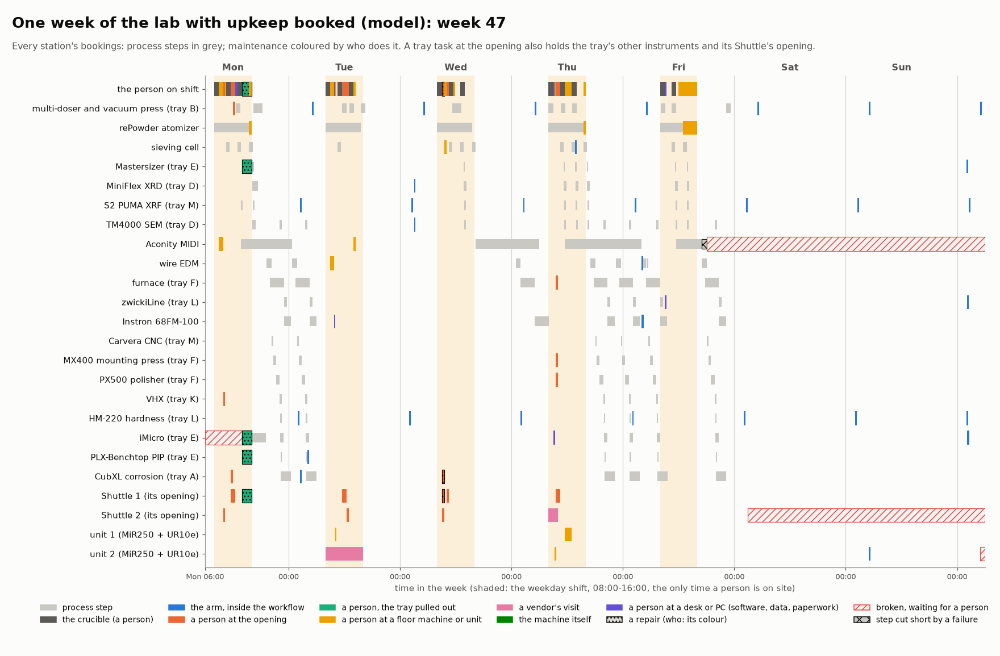
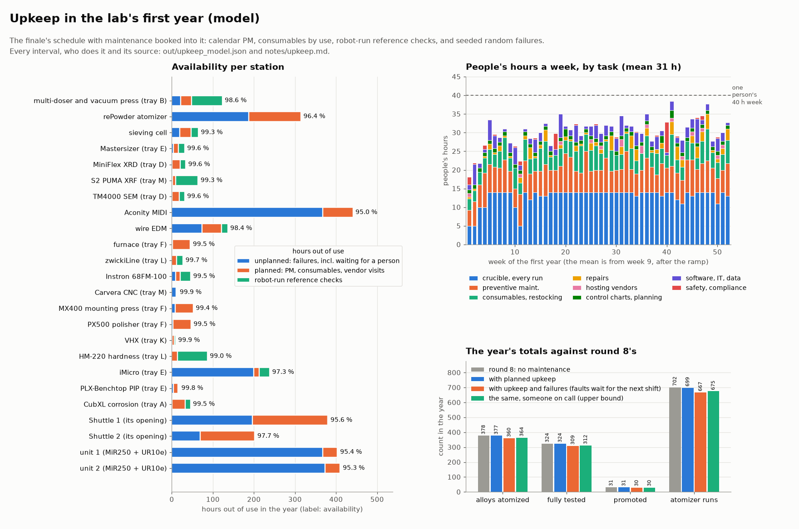

# Upkeep: how maintenance is handled in the workflow (`upkeep.py`)

Sterling, on PR #318 (2026-11-07): "Something that's been on my mind is maintenance over long-term and how that gets
handled in workflows."

**The short answer.** Maintenance is booked like any experiment step, into the same schedule (`timelapse.simulate`)
that runs the alloys:
- Each task has a station, an interval, who does it, how long the station is out and the spares it uses.
- The scheduler fits it around the work, and the work waits for it.

It comes in four kinds:
1. calendar preventive maintenance;
2. consumables changed by use;
3. reference checks the arm runs between jobs, onto control charts;
4. random failures.

Five kinds of hand do it:
- the arm;
- one person on the weekday day shift (at a Shuttle's opening, at a floor machine or at a desk);
- a vendor;
- the machine itself;
- once a year, a person with a tray pulled out onto Kardex's extraction table.

Over a modelled year:
- **The one person.** 31 of their 40 hours a week on average, at most 39: 13 at the atomizer's crucible and 18 on
  upkeep.
- **Availability.** The route's stations are available 98.9 % of the year on average. The lowest are the Aconity
  MIDI (95.0 %), the two MiR250 + UR10e units (95.3-95.4 %), Shuttle 1's opening (95.6 %) and the atomizer
  (96.4 %).
- **Alloys.** The lab fully tests **309 alloys a year with upkeep and failures, against 324 with none** (360 atomized
  against 378).
- **What causes the gap.** Planned upkeep alone costs nothing measurable, because it fits round the atomizer's staffed
  run slots, which set the pace. The failures cost the 15. That is the unlucky seed: seven others give 312-321
  ([caveats](#caveats)).
- **On call.** Someone on call for faults at night would win back 7 of them.

Everything here is a model. 72 of the 121 tasks and all 28 failure modes have assumed intervals or rates; the 49 with
a maker's figure or a standard behind them cite it ([what is sourced](#sourced-and-assumed)).

The clip [`out/mp4/upkeep_clip.mp4`](../out/mp4/upkeep_clip.mp4) shows three of these happening: the week's
schedule, the arm's daily balance check with its control chart, and a person changing the iMicro's tip with tray E
on the extraction table ([notes](upkeep_clip.md)). The finale [`out/mp4/timelapse.mp4`](../out/mp4/timelapse.mp4)
shows the whole year of it ([notes](timelapse.md)).

```bash
python3 upkeep.py            # the model -> out/upkeep_model.json, out/upkeep_year.png, out/upkeep_week.png
python3 timelapse.py model   # the finale's model, which books the same upkeep -> out/timelapse_model.json
VIZ3D_FPS=6 xvfb-run -a python3 upkeep_clip.py     # the clip: notes/upkeep_clip.md
```

## A week of it



[`out/upkeep_week.png`](../out/upkeep_week.png): week 36, chosen as the steady-state week with the most kinds of
hand at work. Grey is process steps; colour is upkeep, by who does it.
- **The top row is the one person.** Their crucible hours (dark) come first. Their upkeep fills the gaps on the
  weekday shift and stops at 16:00.
- **The arm's checks (blue) run at night,** between jobs, on the station they check.
- **Pink on Friday morning is a vendor** verifying the zwickiLine's force and the HM-220. Both are on tray L, so the
  tray is held at Shuttle 2's opening for the visit (row "Shuttle 2").
- **Hatched red is a fault waiting for a person.** The units' faults wait early on Friday. The CubXL's comes on Friday
  evening and waits all weekend. A fault that needs a hand waits for the next shift, since nobody is on call.

## The four kinds

| Kind | How it becomes due | Tasks | Examples (`out/upkeep_model.json` has all 121, each with its source) |
|---|---|---|---|
| Calendar PM | every so many days: at night for the machine itself, on a weekday shift for a person, from a Tuesday-Thursday 08:00 for a vendor | 85 | Kardex service twice a year; the MIDI's chamber and laser window weekly; MiR250 wheels and charging pads monthly; the fume hood's face velocity yearly; IT patches and backups |
| Consumables, by use | so many hours of a machine's work (7), so many of its steps (11), so many mating cycles (1) | 19 | the EDM's wire and resin by cutting hours; the PX500's foils and cloths by polishes; the atomizer's crucible stock and thermocouple by runs; the Berkovich tip every 600 indentation runs; the MIDI's circulation filter by build hours |
| Reference checks by the arm | daily or weekly (15), or by use (2), booked like a step: a unit brings the reference, the tray comes to the opening, the result goes on a control chart | 17 | the HR-202i with a 100 g E2 weight daily (the clip); the HM-220's reference block daily; the iMicro on fused silica weekly; the Mastersizer's QAS3002 reference; the XRF's drift monitor; the sieves' cloths imaged every 20 sievings |
| Failures | random, seeded: per operating hour for a machine (22 modes), per calendar hour for the Shuttles, the units, the twelve powered trays' Pis and the chiller (6) | 28 modes, 83 in the year | a recoater crash; a melt fault on the atomizer; a lost localization on a MiR; a light-curtain trip at an opening; a camera's SD card |

**A check's control chart decides what happens next** (`upkeep_clip.py` part 2 shows one).
- A reading inside the limits passes.
- A reading outside them is repeated once.
- Still outside, the station is flagged and no more jobs are booked on it. A person's task (clean, level, calibrate)
  is booked for the next shift.

The limits are ours: ±0.3 mg on the HR-202i, from its ±0.2 mg linearity plus the E2 weight's ±0.16 mg tolerance
(OIML R 111-1, Table 1).

The HR-202i has **no internal calibration mass.** A&D's [HR-i manual](https://www.aandd.jp/products/manual/balances/hr-i.pdf)
calibrates it "using a weight that you have", so the lab's 100 g E2 weight is both its daily check and its monthly
calibration. That weight lives in tray J's store and rides on the MiR's deck.

**Round 11: the stores are passive.** Since b3a4d42 trays J, N and O have no UPS, dock plate or cameras
(`setup_lab.PASSIVE`, `r8_store.PASSIVE_TRAYS`). The per-tray tasks (`dock_inspect`, `ups_test`, `cams_wipe`) and the
trays' Pi or dock failures now run on the twelve powered trays (`upkeep.POWERED`), not all fifteen. Their restocking
tasks (`store_j`, `store_n`, `store_o`) stay. The finale counts 26 stream cameras, not 32. The spares tray's proposed
slot moved to Shuttle 2's 515 mm at the top of its rear column. Re-run, the year moved from 304 to 309 alloys fully
tested (354 to 360 atomized). Part of that is the seed: 12 tray assets instead of 15 change the order of the random
failure draws. The person's mean week stayed at 31.0 h.

## Who does it

| Who | In the year (planned + repairs) | People's hours | How it holds the lab |
|---|---|---|---|
| the arm, inside the workflow | 1,628 checks | 0 | its station, as a step does; a unit's transfer |
| the machine itself | 627 (UPS self-tests on the twelve powered trays, purifier regenerations) | 1.5 | its station, for the time it takes (most take none) |
| a person at a Shuttle's opening | 495 + 24 repairs | 270 | the tray held at the opening: its instruments stop, and **the Shuttle presents no other tray** until it goes back |
| a person, the tray pulled out | 0 + 2 repairs | 4 | as at the opening, with the tray on Kardex's extraction table (notes/maintenance.md) |
| a person at a floor machine or a unit | 683 + 53 repairs | 469 | that machine; a unit on its charger |
| a person at a desk (IT, data, paperwork) | 248 | 135 | nothing physical; patches and re-validations hold their instrument's PC |
| a vendor | 19 visits + 4 repairs | 23 (hosting) | the machine for the visit. On a tray instrument (the furnace's survey, the XRD's and SEM's service) the tray is held at the opening too, so its Shuttle presents nothing else that day |

The person's hours by kind, weekly mean after the ramp (weeks 9-52):

| Kind | h/week |
|---|---|
| the crucible, every run | 13.3 |
| preventive maintenance | 7.2 |
| consumables and restocking | 4.8 |
| software, IT and data | 2.3 |
| repairs | 1.5 |
| control charts and planning | 1.0 |
| safety and compliance | 0.5 |
| hosting vendors | 0.3 |
| **total** | **31.0** (max 38.6) |

## How it is booked against the work

`upkeep.Upkeep`'s hooks run inside `timelapse.simulate`, so maintenance and experiments share one set of bookings.

- **Calendar tasks are booked first,** before any alloy. Each gets a stable offset, so tasks with the same interval
  don't all fall on the same day.
- **The atomizer's crucible hours come first.** The atomizer is the bottleneck, so a person's planned task never takes
  a run slot's first hour, and a task on the atomizer itself stays clear of its runs.
- **Mon-Thu 14:00-16:00 is kept free of calendar PM,** for repairs and for tasks that use makes due (an assumed
  policy).
- **A person's task at an opening holds the tray and the Shuttle.** The tray's instruments stop, and no step on any
  other tray of that Shuttle can load or unload until it is done (`Upkeep.presentable`). The other Shuttle carries on.
  This is why a Shuttle's opening is the most-held asset: Shuttle 1's is out 388 h a year, 192 of them planned.
- **Usage-driven tasks are counted, not dated.** Each finished step adds to its station's hours and step count. When
  a task falls due it is booked from that moment.
- **A step can fail part-way.** It is cut short, the station is repaired, and the step runs again (the interrupted
  run's time is lost).
- **A repair goes ahead of planned work, but never at night.** A fault that needs a person waits for the next shift.
  A vendor's repair also waits for parts: 48-120 h, assumed.
- **A vendor's visit falls due on a Tuesday to Thursday at 08:00.** It slides to the next weekday on which everything
  it holds is free; week 36's slid to a Friday. The person hosts each visit for an hour.

## A year of it



[`out/upkeep_year.png`](../out/upkeep_year.png):
- left, the hours each station is out of use, by cause;
- top right, the person's week, by kind;
- bottom right, the year's totals against round 8's schedule, which had no maintenance.

| | Atomized | Fully tested | Promoted | Atomizer runs |
|---|---|---|---|---|
| no maintenance (round 8's schedule) | 378 | 324 | 31 | 702 |
| planned upkeep only | 377 | 324 | 31 | 699 |
| upkeep and failures, faults waiting for the next shift (**the lab as modelled**) | 360 | 309 | 30 | 667 |
| the same, someone on call (upper bound: no call-out time) | 364 | 312 | 30 | 675 |

**Availability, the share of the year a station could work** (`out/upkeep_model.json` `availability`):

| Station | Available | Out, unplanned h | Out, planned h | Checks h | Someone on call |
|---|---|---|---|---|---|
| Aconity MIDI | 95.0 % | 367 | 74 | 0 | 96.9 % |
| unit 1, unit 2 (MiR250 + UR10e) | 95.4 %, 95.3 % | 367, 373 | 35, 36 | 1 | 98.5 %, 99.5 % |
| Shuttle 1's opening | 95.6 % | 196 | 184 | 0 | 96.7 % |
| rePowder atomizer | 96.4 % | 188 | 127 | 0 | 96.7 % |
| iMicro (tray E) | 97.3 % | 200 | 13 | 26 | 97.9 % |
| Shuttle 2's opening | 97.7 % | 70 | 133 | 0 | 98.4 % |
| wire EDM | 98.4 % | 73 | 48 | 16 | 99.3 % |
| multi-doser and press (tray B) | 98.6 % | 21 | 26 | 75 | 98.8 % |
| HM-220 (tray L) | 99.0 % | 0 | 14 | 73 | 99.0 % |
| the other fifteen stations | 99.3-99.9 % | | | | |

## The biggest risks and single points of failure

1. **Faults at night wait for the morning.** The two units are out 741 h a year for faults, 714 of them waiting for
   someone.
   - The cause is 36 protective stops or lost localizations a year (assumed: one per 400 h each, half an hour to
     clear) and one drive fault for the vendor.
   - With one unit down, the other carries every transfer.
   - Someone on call, or a remote reset for the faults that allow one, takes the units from 95.3 % to 98.5-99.5 % and
     wins back 3 alloys a year.
   - **This is the cheapest fix the model finds,** before any spare machine.
2. **The atomizer is the bottleneck, and it has no twin.** Its faults cost 294 h, and the year's one part from
   AMAZEMET (an assumed 120 h wait) cost 149 h by itself. Each staffed run slot it misses is gone, since nothing makes
   it up at night. Mitigations:
   - spares on site: a coil, a seal, a nozzle;
   - a service contract with a guaranteed response.
3. **One person.** The crucible and all of the upkeep rest on one person: 31 h of a 40 h week on average, 39 at most.
   Holidays, sickness and training aren't modelled. So the 9 h of slack is the lab's whole margin.
   - Anyone trained to cover the crucible covers the upkeep too.
   - Sterling's crucible notes (`notes/crucible_automation.md`) are why the crucible stays a person's job.
4. **A Shuttle's opening is shared by every tray in it.** Shuttle 1's opening is out 388 h a year: 192 planned (tray
   work, the Kardex visits) and 196 for faults, most of them waiting for the next shift.
   - A vendor on a tray instrument holds it all day: the furnace's temperature survey is 8 h.
   - Kardex offers up to six access openings per unit (brochure p. 5, notes/maintenance.md), so a second opening for
     maintenance is worth asking about.
   - The other Shuttle keeps working meanwhile, but no tray moves between them. So a held opening stops every
     instrument in its Shuttle at its next load or unload.
5. **The trays' couplings are a slow risk,** not a first-year one.
   - Shuttle 1's bay dock mates 9,400 times a year. At Stäubli's 100,000 rated cycles that is 10.6 years. The stores
     J, N and O are passive (no plate, no UPS, no cameras, since b3a4d42), so they don't count.
   - The busiest tray plates (B, D, E, L, M) last 22-24 years.
   - The UPS batteries' float life (3-5 years) comes due before either.
6. **Unit 1 does 70 % of the transfers,** because the greedy schedule takes the first free unit. It would wear out its
   battery's 3,000 cycles in 2.5 years against unit 2's 4.9. Alternate the units, as a real fleet manager would.
7. **Stream video.** Kept whole it is 102 TB a year from 26 cameras (round 11: the passive stores have none) against
   2 TB of instrument data. The assumed retention policy keeps 1.9 TB a year:
   - a 30-day rolling buffer;
   - a clip round each of the year's 231 anomalies;
   - a time-lapse.

## Beyond the first year

Not booked in the year, but counted in `out/upkeep_model.json` (`beyond_the_first_year`):

| Item | Interval |
|---|---|
| UPS batteries (12, the powered trays) | 3-5 years at 25 °C, or 8-10 if lithium |
| MiR250 batteries | at least 3,000 cycles |
| 2F-85 overhaul | 2 million cycles |
| N₂ generator catalyst | about 3 years |
| glovebox purifier catalyst | 3-8 years |
| glovebox O₂/H₂O sensors | 1-2 years |
| SEM turbo pump | 3-5 years |
| XRD tube | about 10,000 h of beam |
| EDM power-feed cables | 3 years |
| UR10e CMOS battery | up to 10 years |

The iMicro's Berkovich tip (every 600 runs, about two years at 309 a year) is the task the clip shows.

## Sourced and assumed

**Sourced:** 49 of the 121 tasks, cited in `upkeep.SRC` and in each task's `source` in `out/upkeep_model.json`:
- **Kardex** (service twice a year);
- **Stäubli CombiTac** (100,000 mating cycles);
- **Eaton 5PX** (a weekly self-test; 3-5 year batteries);
- **MiR250 and Universal Robots maintenance plans**;
- **Robotiq 2F-85 manual** (fingertips at 1 million cycles, overhaul at 2 million);
- **Parker UHPN2** (a 12-month filter kit);
- **ThermoFlex** (3,000 h PM timer);
- **Inert PureLab** and EPFL glovebox guidelines;
- **OSHA 1910.1450**;
- **Retsch, Gilson**;
- **EOS circulation filters** (Yasin et al. 2024: 2,500 build hours);
- **FANUC and MMS on wire EDM**;
- **ZwickRoell, Instron, ISO 7500-1 / ASTM E4**;
- **AMS2750** (thermocouples);
- **LECO, Rigaku, Hitachi, Malvern, Keysight, Plastometrex, Mitutoyo**;
- **A&D HR-i manual** and USP <41> (10 weighings);
- **OIML R 111-1** (the E2 weight's tolerance);
- **Gamry**;
- **ISO 8655 via Sartorius**.

**Assumed:**
- the other 72 tasks' intervals and durations;
- every failure rate and repair time (`upkeep.FAILS`);
- the policies above: crucible first, the Mon-Thu reserve, no one on call, vendor days;
- the one person;
- the extraction table's size (Kardex publishes none).

A rate we have no figure for is a guess, and is labelled as one.

## Caveats

- **One seed, one year, and seed 303 is the unlucky one.** The failures are random draws. Over seeds 1-7 the same
  model fully tests 312-318 alloys, not 309: the failures cost 6-12 alloys, not 15 (round 11's re-run, with the
  twelve powered trays).
  - Steady across seeds: the person's mean week (31.1-31.6 h).
  - Not steady: the busiest week, 35-39 h; the units' availability, 92.4-96.5 %; the atomizer's, 96.2-98.1 %.
  - The figures here are seed 303's, the ones the finale shows.
- **No holidays, no sickness, no learning curve.** The ramp is only the atomizer's commissioning weeks.
- **A repair's time is the person's hands-on time.** Diagnosis by phone, a vendor's travel and parts shipping are in
  the waits.
- **Spares are assumed in stock,** apart from the vendors' parts. A spares tray is proposed for them: Shuttle 2's free
  515 mm at the top of the rear column takes a 350 mm tray without a UPS or cameras. Shuttle 1 has 265 mm there, 265
  at the top of its front column and 168 under its access table (round 11's tray plan, `notes/tray_plan.md`).
- **The finale shows this schedule** (notes/timelapse.md):
  - its person and vendor are drawn where their task is;
  - its beacons go amber for upkeep and red for a fault that waits;
  - its upkeep card counts the person's week, the hours and tasks so far, and availability so far.
