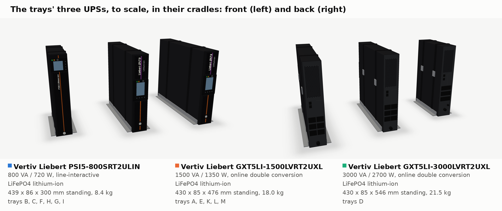
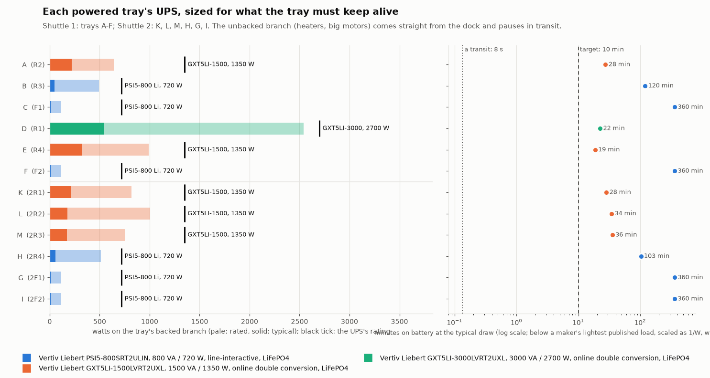

# The trays' UPSs: real units, sized tray by tray

Sterling (PR #318, 2026-11-18): "you should also probably identify real UPS's rather than what looks like a
placeholder there, and we might need multiple types of UPS units (i.e., multiple capacities depending on the tray
requirements)".

[`ups.py`](../ups.py) does this. Until now every powered tray carried the same box: an Eaton 5PX1500RTNG2 drawn as a
grey slab with "UPS" on it, and everything on the tray drew through it. That couldn't work, and it hid how different
the trays are:

- **Tray F** put 3.7 kW (the furnace's 2.8 kW and the polisher) through a 1440 W unit.
- **Tray C's** two printers, up to 1.47 kW, would have overloaded it the moment the dock let go.
- **Tray D** was counted at 1.2 kW. Its MiniFlex alone is rated 1.0–1.1 kVA (Rigaku), not the 600 W of its tube.
- **The heat budget** (`services.py`) covered trays A–F only, so six of the twelve powered trays had no load at all.

## Two branches on every tray

The dock brings 208Y/120 V on a 30 A breaker. On the tray it goes to the distribution box at the back right corner
(the box `vlm.tray()` already draws as the tray's socket), and from there to two branches:

| Branch | Fed from | What's on it | In a transit |
|---|---|---|---|
| **Backed** | the tray's UPS | whatever loses state, needs a long warm-up or must not stop | carries on, on battery |
| **Unbacked** | the dock, through the box | heaters, big motors, vacuum pumps | stops for the 6–8 s, then restarts |

Most instruments have one plug, so the split is by plug, not by load inside a machine. The schedule never moves a
tray while something on its unbacked branch is working (a print, a heat treatment, a polish, a press cycle).

Three things decide that an instrument is backed, each from its maker:
- **A long warm-up.** A&D asks for at least an hour after the HR-202i is switched on. Malvern asks for 30 min of
  laser stabilisation on the Mastersizer 3000.
- **A vacuum or a beam.** The TM4000's turbo coasts down and the chamber leaks up, so a cut means a full pump-down.
- **A PC, or a measurement in progress.** Windows PCs, the potentiostat holding a cell, the OT-2's controller.

And three things let an instrument go unbacked:
- **Heaters keep their heat.** Nabertherm's B500/B510 controller resumes its program after an outage under about
  2 min, and always after one under 5 s, so the furnace rides the transit unbacked.
- **Power-loss recovery.** The Bambu printers have it; the printers aren't moved mid-print anyway.
- **It restarts on its own switch.** The vacuum pumps do. The Autotouch, the LECO machines, the Form 4 and the Carvera
  should be checked for this before they go on the unbacked branch (see "Open" below).

## The rule

`ups.choose()` takes the smallest unit in the family that:

1. carries the backed branch at its machines' **rated** draw, so nothing trips the UPS if a machine happens to be
   busy when the dock lets go; and
2. runs at least **10 minutes** at the branch's **typical** draw.

10 minutes is not for the transit, which takes 6–8 s. It is for a tray stranded off its dock: a lift fault with a tray
on the extractor, or a building outage. The UPS's network card then tells the tray's PCs to save and shut down, and
the SEM and the MiniFlex run their own shutdowns, with time to spare.

One more condition sets the topology. Six trays carry a PC, a vacuum, a beam or a measurement in progress (A, D, E,
K, L, M: `ups.ONLINE_ONLY`). They take an **online** (double-conversion) unit whatever their load. Its inverter always
carries the load, so when the dock lets go nothing switches at all, up to 4,546 times a year on tray D (`upkeep.py`).
The other six take a **line-interactive** unit. Their backed branch is cameras, the switch and controllers on their
own adapters, none of which minds a 4–6 ms transfer. An online unit's own no-load draw (20–40 W, ENERGY STAR) would be
more than their whole branch (16 W on C, F, G and I).

## The pick: three real units, one maker

| Unit | Size | Kind | Size as it stands (H x thickness x depth) | kg | Trays |
|---|---|---|---|---|---|
| Vertiv Liebert **PSI5-800SRT2ULIN** | 800 VA / 720 W | line-interactive, 4–6 ms | 439 x 86 x 300 mm (2U, short depth) | 8.4 | B, C, F, G, H, I |
| Vertiv Liebert **GXT5LI-1500LVRT2UXL** | 1500 VA / 1350 W | online | 430 x 85 x 476 mm (2U) | 18.0 | A, E, K, L, M |
| Vertiv Liebert **GXT5LI-3000LVRT2UXL** | 3000 VA / 2700 W | online | 430 x 85 x 546 mm (2U) | 21.5 | D |

All three use lithium iron phosphate batteries, carry Vertiv's 5-year warranty on the unit and battery, and take the
same IntelliSlot RDU120 network card (the "N" bundles). So one card, one piece of software (SNMP, or NUT for the lab's
own monitoring) and one spares kit cover all twelve trays.

**Why lithium.** Every tray goes on battery once per transit: 34 to 4,546 times a year (`upkeep.py`), each a small
fraction of a percent of the battery. Cycles aren't what wears a battery here, but three other things are:
- **Heat.** A lead-acid battery's float life halves for every 8–10 °C over 25 °C, and the inside of a Shuttle runs
  warm (the heat budget below).
- **Weight.** The lithium units weigh 8.4–21.5 kg, against 17.7–31.3 kg for the lead-acid units of the same size.
- **Getting the battery out.** Each unit stands with its front, where the battery comes out, facing the middle of its
  tray, and most trays have an instrument or a camera post within a few hundred millimetres of it. Changing a
  lead-acid battery every 3–5 years would mean pulling the tray onto Kardex's extraction table and unstrapping the
  unit. Vertiv gives "up to 10 years" for its lithium batteries.

**Why Vertiv.** It is the only maker with all three of the following:
- **A short lithium line-interactive unit.** The PSI5-800SRT2ULI is 300 mm deep. Eaton's smallest lithium unit,
  the 5P1500R-L, is 554 mm deep, which is more than tray F has in front of its furnace.
- **Lithium online units deep enough to fit.** The GXT5LI-1500 is 476 mm deep, inside the 530 mm that trays K and M
  leave in front of their camera posts. APC's lithium online units (Smart-UPS Ultra) start at 2.2 kVA and are 560 mm
  deep.
- **One card across the range.**

Eaton's 9PX Li-ion (1500 and 3000 VA, online, 450 and 605 mm deep) is the close alternative for the online trays. It
publishes the fullest runtime tables of any, but has nothing small enough for the light trays.

**The runtimes are the conservative ones.** Where a datasheet and ENERGY STAR's certification database disagree, the
sizing uses the lower:
- GXT5LI-1500: Vertiv's guide gives 14 min at full load; ENERGY STAR gives 9 min at 50 % and 3 min at 100 %.
- GXT5LI-3000: Vertiv's guide gives 6 min at full load; ENERGY STAR gives 9 min at 50 % and 3 min at 100 %.

Below a maker's lightest published load the runtime is scaled as 1/W, which understates it. That is where the 360 min
of the camera-only trays comes from.

## Tray by tray

| Tray | Slot | Backed: rated / typical W | Unbacked, rated W | UPS | Load at rated | Runtime at typical | Its own loss | kg |
|---|---|---|---|---|---|---|---|---|
| A | R2 | 641 / 221 | 0 | GXT5LI-1500 | 47 % | 28 min | 38 W | 18.0 |
| B | R3 | 493 / 48 | 950 | PSI5-800 | 68 % | 120 min | 4 W | 8.4 |
| C | F1 | 114 / 16 | 1470 | PSI5-800 | 16 % | 360 min | 4 W | 8.4 |
| D | R1 | 2541 / 540 | 0 | GXT5LI-3000 | 94 % | 22 min | 59 W | 21.5 |
| E | R4 | 991 / 325 | 1200 | GXT5LI-1500 | 73 % | 19 min | 42 W | 18.0 |
| F | F2 | 114 / 16 | 5000 | PSI5-800 | 16 % | 360 min | 4 W | 8.4 |
| K | 2R1 | 820 / 214 | 550 | GXT5LI-1500 | 61 % | 28 min | 38 W | 18.0 |
| L | 2R2 | 1004 / 176 | 0 | GXT5LI-1500 | 74 % | 34 min | 36 W | 18.0 |
| M | 2R3 | 749 / 171 | 730 | GXT5LI-1500 | 55 % | 36 min | 36 W | 18.0 |
| H | 2R4 | 514 / 56 | 1740 | PSI5-800 | 71 % | 103 min | 4 W | 8.4 |
| G | 2F1 | 114 / 16 | 2810 | PSI5-800 | 16 % | 360 min | 4 W | 8.4 |
| I | 2F2 | 114 / 16 | 2500 | PSI5-800 | 16 % | 360 min | 4 W | 8.4 |

*Rated* is the sum of the backed machines' nameplates (or their supplies'), which they don't all draw at once. *Typical* is what
the backed branch draws while the tray waits or moves: instruments idle, X-rays off, beam off. Every row, with its
source and what a 5–30 s cut does to the machine, is in `ups.TRAY_LOADS` and [`out/ups.json`](../out/ups.json):
77 items, 52 of their power figures published by the maker, 2 from search snippets and 23 ours.

What is on each branch:

| Tray | Backed (typical / rated W) | Unbacked (rated W) |
|---|---|---|
| A | OT-2 120/220; CubXL gantry 30/100; EZstat Pro 10/30; its EZware PC 40/150; the CubXL's Pi 5/27 | none |
| B | multi-doser 25/395 (its NEMA 34 stays energised, so the chain can't creep in transit); HR-202i 11/11 | Autotouch 15T 400; Edwards RV3 550 |
| C | cameras and switch only | H2D 1320; A1 mini 150 |
| D | SEM 200/500; its PC 60/200; AZtecOne EDS 60/400; MiniFlex 150/1100 (X-rays off); its PC 50/200 | none |
| E | PLX-Benchtop 80/200; iMicro 120/300; Mastersizer + Aero S 65/200; its PC 40/150 | the Aero S's extractor 1200 |
| F | cameras and switch only | PX500 740; NAT 15/65 2800; MX400 1400; quench lift 60 |
| K | glovebox controller, O2 and H2O sensors, valves, balance, capper 57/162; VHX-7000 controller 120/430; its stand 20/130; PiKVM 5/12 | antechamber pump 550 |
| L | zwickiLine (Eco mode) 40/500; its PC 40/150; HM-220 40/90; its PC 40/150 | none |
| M | S2 PUMA 120/600; Sentry Air hood 35/35 (it keeps capturing) | the S2 PUMA's vacuum pump 300; Carvera 430 |
| H | LumenPnP 15/300; its OpenPnP PC 25/100 | stencil printer 240; T-962A 1500 |
| G | cameras and switch only | Form 4 x2 960; Form Wash 50; Form Cure 1800 |
| I | cameras and switch only | SnowPod x2 2000; NitroPod 500 |

Every tray also backs its stream cameras (a Pi 5 each, 4 W typical, on a 27 W supply) and its network switch (a
Ubiquiti USW-Lite-8-PoE class switch, 8 W).

## How each unit is drawn

`ups.unit_parts()` builds a unit from its published front (width and height as it sits in a rack) and depth, and
its family's face and back read off the maker's photos (`ups.FACES`, `ups.REARS`). The faces are fractions of the
front, so one entry draws every size of a family.
- **PSI5 Lithium-Ion short depth:**
  - a black diamond-mesh grille the length of the front, with a thin orange stripe along it;
  - Vertiv's round badge at one end and the "PSI5 Lithium-ion" tag on the stripe;
  - a display module at the other end: four LEDs over a colour LCD, with four keys under it.
- **GXT5 Lithium-Ion:**
  - black diamond-mesh grilles either side of a display module (a colour LCD, keys at its side, the power key);
  - an orange stripe and the Vertiv badge on one grille;
  - a purple stripe and "Liebert GXT5 / Lithium-ion" on the other.
- **The backs:** receptacles in two groups, the card slot, ports, a vent and the input cord.

Each unit stands on its side (Vertiv's tower orientation, display at the top), its back at x = 1060 mm on the tray,
where round 4's box had its back, so the tray's mains line still ends there. Its own input cord runs from its back
to the tray's distribution box at the back right corner.

**The cradle is ours.** A tray starts and stops at up to about 1 m/s², and a maker's tower feet aren't made to be
bolted down. So each unit stands between two 25 x 25 x 3 mm steel angles bolted to the tray floor, under two black
ratchet straps hooked into them. The angles stay when a unit is changed.

The two status LEDs on each front are separate parts, so a clip lights them: green on mains, amber on battery
(`services.set_ups`). The side towards the front of the tray carries an asset label: "UPS D Vertiv Liebert
GXT5LI-3000LVRT2UXL", with its rating and chemistry.

`python3 ups.py` writes [`out/ups.json`](../out/ups.json) and prints the table above. `python3 ups.py figure` draws
the sizing chart, `xvfb-run -a python3 ups.py lineup` the three units to scale, and `xvfb-run -a python3 ups.py still`
each one on its own.

## What it changes elsewhere

- **The heat budget** (`services.heat_budget`, in `out/services.json`) now covers all twelve powered trays and both
  Shuttles. Each UPS's own loss is ENERGY STAR's efficiency at its tray's typical draw, starting from its no-load input.
  - **Idle:** every backed branch waiting, heaters off, plus the UPSs, comes to about **1.3 kW in Shuttle 1** and
    **0.8 kW in Shuttle 2**. That is a 4.3 K and 2.5 K rise with no ventilation, or about 790 and 460 m³/h of air to
    hold 5 K. Round 4 had guessed 60 W a tray.
  - **The UPSs' own share is 274 W across the twelve trays,** 249 W of it from the six online units.
- **`upkeep.py`** works out each tray's depth of discharge per transit from its own unit's battery and its own backed
  draw (round 10's single 220 Wh figure was the old Eaton's).
- **`setup_lab.py fit`** now checks each UPS against the tray's camera posts too: they used to be skipped as
  services.py's own parts, which was safe only while every UPS was the same box. Its loading caption gives the UPSs'
  real masses.
- **The tray plan** keeps every instrument where it was. Each unit fits the room the old box had, as follows:
  - the PSI5 is 147 mm shorter than the old box;
  - the GXT5LI-1500 is 29 mm longer, within the 530 mm in front of K's and M's camera posts;
  - the GXT5LI-3000 is 99 mm longer, on tray D, which has the room.

## Findings

- **Tray D can't use a 1500 VA unit.** At its nameplates its backed branch reaches 2.5 kVA, 94 % of the GXT5LI-3000.
  The MiniFlex counts for 1.1 kVA of that, with its internal chiller, plus 0.2 kVA for its PC.
  - If the MiniFlex went on the unbacked branch instead, a GXT5LI-1500 would do. But its front panel has momentary
    on/off buttons, so after a cut it probably stays off until someone presses on. That is why it is backed.
  - Its X-rays must be off at least 5 minutes before a move, as the dock cuts its chilled water in transit.
- **Tray F's unbacked branch is 5.0 kW,** right at the dock's 5 kVA continuous rating. The furnace (2.8 kW) and the
  MX400 (1.4 kW) shouldn't heat at the same time.
- **The unbacked branch should come back through a contactor once the dock has seated, with the heavy loads
  staggered.** Otherwise every pump motor, the T-962A's lamps and every supply's inrush start together.
- **The Form Cure's rating needs Formlabs.** Its North American listing says 15 A, which looks like its circuit rather
  than its draw; another Formlabs page says 7 A. It is counted at 1800 W.

## Open

- **Not yet on screen.** The set-up movie, the alloy chapters and the finale haven't been re-rendered. The hookups
  clip will show the new units once it is re-rendered with the coupling run's new dock.
- **To check on the machines, before anything goes on the unbacked branch:**
  - that each restarts on its own: the Autotouch, the LECO PX500 and MX400, the Form 4 and the Carvera;
  - whether the TM4000's running turbo tolerates the lift's accelerations (translation only). That is a question for
    Hitachi.
- **Ours, not published:**
  - 23 of the 77 power figures: the EZstat Pro, the CubXL, the PLX-Benchtop, the iMicro, the PX500, the SnowPod and
    NitroPod, the glovebox controller and the instruments' idle draws;
  - the PSI5-800's no-load draw: 4 W assumed, as APC's line-interactive units of this size.
- **Prices:**
  - the GXT5LI-1500 is $2,707 at CDW (a snippet);
  - the GXT5LI-3000's and the PSI5-800's weren't found;
  - #331's quote list should add all three.

## Sources

- Vertiv, *Liebert GXT5 Lithium-Ion 1000–3000VA rack/tower guide specifications*, REV0 04-2022
  ([PDF](https://prep.vertiv.com/491871/globalassets/products/critical-power/uninterruptible-power-supplies-ups/liebert--gxt5-lithium-ion-1000-3000va-rack-tower-guide-specifications.pdf)).
- Vertiv, [GXT5LI-1500LVRT2UXL product page](https://www.vertiv.com/en-us/products-catalog/critical-power/uninterruptible-power-supplies-ups/gxt5li-1500lvrt2uxl/): 18 kg, 476 mm deep, RDU120, 5-year warranty.
- Vertiv, [Liebert PSI5 Lithium-Ion catalogue page](https://www.vertiv.com/en-us/products-catalog/critical-power/uninterruptible-power-supplies-ups/vertiv-liebert-psi5-lithium-ion-ups/): PSI5-800SRT2ULI, 800 VA / 720 W, 3.39 x 17.28 x 11.81 in, 18.5 lb, and the family photo.
- Vertiv, *Liebert PSI5 Lithium-Ion UPS data sheet* SL-70581 ([42u.com copy](https://www.42u.com/pdf/Liebert-Vertiv/PSA5/liebert-psi5-lithium-ion-ups-data-sheet.pdf)) and *short-depth data sheet* [SL-70889](https://www.vertiv.com/48fe01/globalassets/products/critical-power/uninterruptible-power-supplies-ups/liebert-psi5-lithium-ion-short-depth-ups-data-sheet-sl-70889.pdf).
- ENERGY STAR certified UPS dataset ([data.energystar.gov](https://data.energystar.gov/resource/ifxy-2uty.json)): the
  makers' own test submissions. Efficiency at 25/50/75/100 % load, input at no load, runtime at 50 and 100 % load.
- Eaton, *9PX Li-ion 1500–3000VA 2U technical specifications* ([PDF](https://assets.tripplite.com/technical-datasheet/eaton-9px-li-ion-ups-1500-3000va-2u-models-technical-specifications.pdf)): the alternative's runtime tables.
- APC Smart-UPS data sheets (SMT, SMTL, SRT, SRTL Ultra), Eaton 5P/5PX/9PX data sheets and Vertiv GXT5 guides, for the
  44 units compared: their figures, with a source per figure, are in `out/ups.json` (`catalogue`) only for the three
  chosen. The comparison above quotes the others' depths and sizes from the makers' sheets.
- The instruments' figures: the makers' pages and manuals listed per row in `ups.TRAY_LOADS` (A&D HR-i manual,
  Malvern Mastersizer 3000 manual, Hitachi TM4000 brochure, Rigaku MiniFlex brochure, Nabertherm B500 manual, Bambu Lab
  spec sheets, Opentrons OT-2 specs and others).
