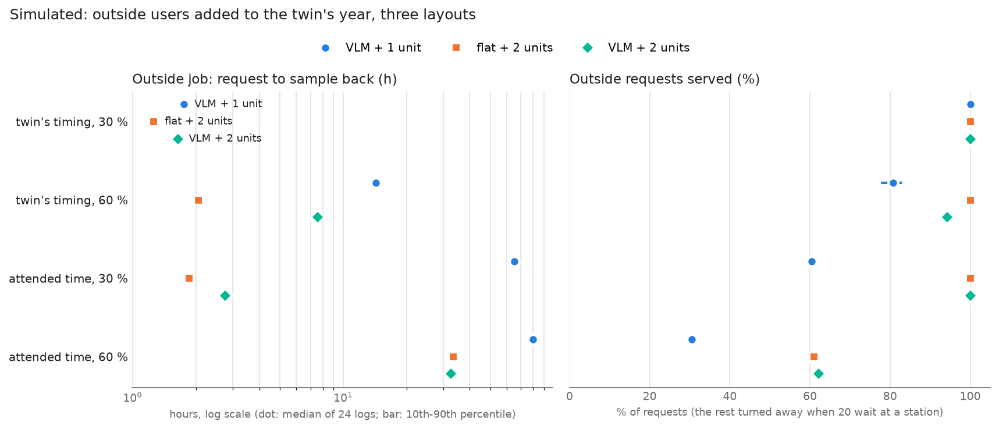

# Is the vertical lab worth it? Gains, bottlenecks, and VLMs against mobile manipulators

Sterling, on [#407](https://github.com/vertical-cloud-lab/byu-vcl/issues/407) (2026-11-27): "Is the vertical lab worth
it? ... Be willing to conclude that it isn't, or that it is only under conditions we should name. What I want is an
honest answer, not a defence of the design."

"The vertical lab" here means the part of PR 318's design that is vertical: desktop-sized instruments on the trays of
two Kardex Shuttle XP 500 vertical lift modules (VLMs), brought to an opening where a MiR250 + UR12e works at them.
The alternative is the same instruments on benches, served by mobile manipulators that drive to them ("flat"). The
floor machines (atomizer, printers, DED, EDM, frames) stand on the floor in both. Automation against a conventional lab
is a different question, which the twin's rounds 3-5 answer; this note doesn't revisit it.

Everything quantitative here is either sourced (vendor documents, papers, the Acceleration Consortium's own records),
taken from the twin and PR 406's floor plans (simulated and designed, not built), or a stand-in that is marked as one.
The queue model is [`twin/worth_it.py`](../twin/worth_it.py); its tables are
[`out/worth_it/tables.md`](../out/worth_it/tables.md) and [`out/worth_it/sens.md`](../out/worth_it/sens.md).

## The short answer

**For the lab the twin simulates, no. The VLM is worth it only under conditions we don't have now** (the decision table
at the end names them).

- **Transport is not what binds us, so the VLM has nothing to speed up.**
  - In the twin's year the mobile manipulators are 1-2 % busy and the Shuttles' openings about 1 %.
  - Replaying the twin's 24 event logs through either layout moves no target by more than 0.15 days.
  - What binds is money, the shared atomizer, DED capacity, the 30-day immersion and, from round 5, people's decision
    time. The VLM touches none of them, except money, which it spends.
- **Its one real gain is floor: 29 % less** (281 against 398 m², [PR 406](https://github.com/vertical-cloud-lab/byu-vcl/pull/406)).
  - That floor is only worth something if we pay for space by the square metre: about $51k a year at the twin's rates.
  - It comes with a 9.15 m bay, 31.5 ft to the sprinklers.
  - It is the same work in less floor, not more work in the same floor. The twin's campaigns use about 7 % of the lab's
    capacity (round 3), so more in the same floor isn't something we need.
- **With outside users, the VLM is worse, not better** (simulated, 24 logs):
  - At 60 % outside load, two mobile manipulators on benches serve every request, in 2.0 h on average.
  - The VLM with one unit turns away 9.5 % and takes 10.5 h; with two units, 6 % and 7.6 h.
  - The limit is the trays, not the robots: instruments that share a tray can't be loaded while any of them is
    running. Tray D (SEM and XRD) is held 85-89 % of the time. If trays could move while their instruments run, the
    two plans would tie; for a measurement in progress, they can't.
  - A second unit at the VLM barely helps. One unit on benches (7.9 h) does about as well as two at the VLM, but one
    unit is too few on any plan at 60 %: it loses atomizer slots (below).
- **If the arm has to stay at the instrument for part of each step,** as PR 332 assumed, the number of units binds
  whatever the layout:
  - one unit can't carry 30 % outside load (about 60 % of requests served, about 58 h each);
  - two units carry it on either plan (1.7 h on benches, 2.5 h at the VLM);
  - neither plan carries 60 %.

  The remedy is another unit, not a VLM.
- **Cost.** Two 9.15 m Shuttles with their couplings and UPSs are about $0.5M in the twin's own estimates, the price of
  about 3.5 mobile manipulators.
  - Kardex's own maintenance guidance is 10-20 % of the purchase price a year, against the twin's 3 %.
  - Kardex lists no powered tray, and no air or data to a tray (PR 318's search and ours), so PR 318 had to design its
    own couplings and fit a UPS to every powered tray.
- **No precedent.** Neither our searches nor Edison found any lab that runs instruments inside a VLM.
  - The group that got furthest, the Acceleration Consortium, had its Kardex lab's technical requirements met, then
    dropped it in November 2025 "due to perceived risks" ([ac-dev-lab #471](https://github.com/AccelerationConsortium/ac-dev-lab/issues/471)).

**What a VLM is good at, and might still do for us:** storing many passive items densely and handing them to a robot
at one opening. Our powder jars (1,506 in PR 318's racks) and sample stores are that kind of load; running instruments
are not.



*Simulated (`python -m twin.worth_it_figure`). The twin's year of internal work, 24 event logs, plus outside jobs at
30 % and 60 % of each instrument's clock. Left: request to sample back on the rack, log scale. Right: requests served;
the rest are turned away when 20 wait at one station. "Attended time" is PR 332's share of each step the arm stays.
The tables are below.*

## 1. The gains, one by one

| Gain claimed for VLM trays | What it is for a warehouse | For us | How big |
|---|---|---|---|
| **Floor space** | Dense storage up the height of the room; vendors claim "up to 85-92 %" | **Real, and the only big one.** 281 m² against 398 m² for the same 43 instruments ([PR 406](https://github.com/vertical-cloud-lab/byu-vcl/pull/406), [`twin_floorspace.md`](https://github.com/vertical-cloud-lab/byu-vcl/blob/72177f1/vertical-lab/notes/twin_floorspace.md) on its branch). The saving is benches and their aisles: 31 benchtop instruments go into 18 m² of Shuttle footprint | 117 m² less, 29 %. Worth about $51k a year at the twin's space rates ($215/m² a year to run it plus $222/m² a year of building, [`twin/econ.py`](../twin/econ.py) `RATES`), and nothing if the room is already ours. It needs a 9.15 m bay. The vertical lab is not smaller in volume |
| **Throughput** | Goods-to-person: the picker stops walking | **Not a gain.** The replay never finds the VLM faster for internal work, and with outside users it is slower (section 6) | Driving falls from 51-81 s a task on benches to 29-61 s at the VLM. That doesn't matter while the robots are 1-2 % busy |
| **Positioning at a fixed bay** | One pick face, known geometry | **Real but small.** For the benchtop instruments the arm calibrates at 2 openings instead of at every bench. A MiR250 docks to a VL-marker to ±3 mm in up to 14 s (MiR250 spec, 2023), and an arm camera takes that to about 1 mm (Enabled Robotics' ER-VISION). Liverpool's touch-off reached ±0.12 mm (Burger et al. 2020). Kardex doesn't publish the extractor's repeatability at the opening; PR 318's coupling needs 4 mm ([`services.md`](services.md)) | Seconds a visit. Vision calibration takes about 5 s, touch-off about 53 s (Edison, mobile manipulators) |
| **Enclosure** (dust, light, temperature, humidity) | Kardex sells climate-controlled, clean-room and low-humidity units | **Mixed.** It keeps out dust and light, but every watt a stored tray uses stays inside the cladding: 1.3 kW in Shuttle 1 when idle, 3.7 kW with a printer and the furnace running, which needs 1,100-2,200 m³/h of forced air ([`services.md`](services.md)). A room's HVAC does this for benches | Small, and partly a cost |
| **Safety and access control** | Items released only to an authorized user at one opening | **Real but small.** People never reach into a moving machine, and the opening is the only access. The robots still drive the floor in both layouts. A badge-locked room gives most of the access control | Small. It matters more with outside users |
| **Tracking and provenance** | Every pick logged against a slot | **Negligible.** The lab's scheduler logs every step anyway (the twin's event logs do). Provenance that matters, who ran what on which instrument with which calibration, comes from our software, not from the store | None beyond what we'd build anyway |

Two things count against the VLM in the same table:

- **Every visit moves the instrument.** Tray presentations run from 4-6 a day (the twin's own work) to as many as 185
  a day (with outside users).
  - The Acceleration Consortium measured a Kardex tray with a microscope on it ([ac-dev-lab #216](https://github.com/AccelerationConsortium/ac-dev-lab/issues/216)).
    Peaks were 1.0-4.3 m/s², logged once a second, so short peaks are missed. It vibrates "with the most intensity
    when going in and out of the open port, not really when going up or down". A stored tray read about 0, and the
    microscope stayed usable. No VLM vendor publishes acceleration or vibration figures.
  - Moving an instrument can trigger a check before its data count:
    - balances: re-level, warm up, then a check with weights at the new place;
    - Rockwell hardness: ASTM E18 makes a move trigger direct verification;
    - XRD: a reference check (Edison, moving instruments, with its caveats).
    - On a tray, every presentation is a move.
  - Kardex can slow a tray ("slower speeds for fragile items"), at a cost in time (section 4).
- **A single point of failure.** "If a single machine goes down for maintenance, all the inventory it holds becomes
  temporarily unavailable" ([Kardex](https://www.kardex.com/en-us/blog/how-many-vertical-lift-modules)).
  - Here that inventory is 7-8 instruments a Shuttle.
  - A power cut during a lift leaves the machine "with no reference", which needs Kardex's service login
    ([Kardex knowledge base](https://info.kardex-remstar.com/knowledge/recover-from-power-outage)).
  - We found no procedure for getting a stored tray out by hand.
  - On benches, a broken robot leaves every instrument where a person can use it.

## 2. Does any of this touch what binds?

| What binds (the twin) | Where it says so | Does a VLM touch it? |
|---|---|---|
| **Money** | Round 3: "about 80 % of each campaign's spending goes to orders of metal and consumables" and the spending plan holds copper back ([`twin_round3.md`](twin_round3.md)); round 4: "Money binds both plans that start on day 0" ([PR 397](https://github.com/vertical-cloud-lab/byu-vcl/pull/397)) | **Only the wrong way.** It costs about $0.5M of capital (section 5) |
| **The shared atomizer** | Round 4: "about three new aluminium designs a week in every plan"; round 3: it runs 55-71 % of what its start slots allow | **No.** It is a floor machine in both layouts. The replay keeps every atomizer slot in both layouts unless one unit is overloaded (section 6) |
| **DED capacity** | Round 4: "Copper waits for DED capacity" | **No.** The MX-Lab is a floor machine |
| **The 30-day immersion** | 24 vial positions; a coupon holds one for a month | **No.** The vials ride tray A on the CubXL's deck; the VLM changes neither their number nor their month |
| **Decision time** | Round 5 ([PR 405](https://github.com/vertical-cloud-lab/byu-vcl/pull/405)): "A person's decision waits for the next review or weekly meeting." Its results haven't landed (its notes' summary is still a placeholder on 2026-11-27) | **No.** A decision that waits for a meeting waits days; the VLM saves or costs minutes |
| *(not binding)* the robots | Round 3: "the robots are about 1.5 % busy"; here 1-2 % in every layout | This is the one resource a VLM could relieve, and it isn't short |

The replay confirms it. With no outside work, every layout reproduces the twin's year:

- internal steps end 0.04-0.07 h *earlier* than the twin's (the twin allowed 6 min a step for the transfer);
- no atomizer slot is lost;
- no target moves by more than 0.15 days.

## 3. Why VLMs are popular, and what carries over

VLMs earn their place in warehouses, pharmacies and biobanks by storing **many passive items** densely and bringing
them to a person or robot at one opening. Edison's review of lab, biobank and pharmacy deployments
([answer](../out/edison/worth_it_vlm_lab_storage/answer.md)) puts each claimed benefit against "a small number of
instruments that run in place":

- **Floor-space savings** ("up to 85-92 %"): they come from consolidating many trays. Running instruments "still
  require benches, service clearances, ventilation, power, data, gases, fluids, and stable utility connections".
  Independent figures are smaller than vendors' (a UK hospital dispensary robot saved about 29 % of its area,
  Pharmaceutical Journal 2009).
- **Pick throughput** (100-400 lines an hour): "Instruments that run in place are not repeatedly picked, so this
  metric is largely irrelevant."
- **Ergonomics** (less walking and bending), **pick accuracy** (99.9 %), **traceability**: these help when people
  pick many similar items, and apply weakly or not at all to robots loading a few distinctive instruments.
- **Access control and security**: partly, but "badge-controlled rooms, locked enclosures, software logins, or cages
  usually provide it without a retrieval machine".
- Even for passive stock, the goods-to-person literature finds a VLM uneconomic at low utilization, and some firms
  find them "too slow for efficient order picking" (Edison, [goods-to-person](../out/edison/worth_it_goods_to_person/answer.md);
  Tavira et al., WSC 2024). A case study found one VLM slower than open shelving in most scenarios (Singh et al.,
  WSC 2019).

**What carries over is the store, not the instruments.** Our items are instruments that need power, data, nitrogen,
chilled water or exhaust, and that are busy for hours. Neither we nor Edison
([answer](../out/edison/worth_it_instruments_in_storage/answer.md)) found an installed system that runs instruments
inside a VLM. Edison's precedent search found:

- **Two Vidir patents**: a vertical carousel that powers its shelves while they move (CA3162492C, 2025), and a VLM
  that powers trays once they are stowed (US20240116714A1, 2024). Neither shows a built system or names an
  instrument.
- **Powered trays from two VLM makers**, to keep cold boxes running and to charge batteries:
  - Hänel's trays with a plug-in contact, for cold boxes down to −80 °C;
  - Modula's 240 V socket, on at most 10 trays a machine.
  - Kardex lists neither.

Labs that move instruments do it differently: on docking carts with utilities at the dock (HighRes Biosolutions'
patent US 7,560,071; Ginkgo's carts). Self-driving labs leave instruments where they stand and move the samples
(Liverpool, A-Lab, ASTRAL; the industrial metals labs of FLSmidth, Herzog and Polysius).

**Doing more in the same floor or the same in less?** The vertical lab does the same in 29 % less floor. Doing more
in the same floor would matter if capacity bound us, but the twin's campaigns use about 7 % of the lab's
capex-weighted capacity (round 3). The same work in less floor matters only if the floor costs us something:

- if the lab goes into a building we pay for by the square metre, it saves about $51k a year at the twin's rates;
- if it goes into a room we already have, it saves nothing;
- it needs a room at least 9.17 m tall with 31.5 ft to the sprinkler deflectors (33 ft under ESFR;
  [`kardex_height.md`](kardex_height.md)). PR 344 found no building near BYU over 36 ft, and that PR 318's lab with
  its earlier 3.95 m Shuttles needed only 16-18 ft clear.

## 4. Is there a speed gain from trays over driving?

**Vendor figures.**

- **Kardex Shuttle 500, configured at 6.75 m tall:**
  - 20 s on average (23 s at most) to fetch a tray;
  - 38 s (45 s) to put one away and fetch the next;
  - 94 trays an hour.

  These are at 100 % speed, but units ship with the extractor at 70 %, and an always-closed door adds about 6 s
  ([configuration sheet](https://products.storemorestore.com/hubfs/StoreMoreStore/Kardex-Vertical-Lift-Module/VLM-Option-1-96x34-Light-Specification-Sheet.pdf)).
  Kardex publishes no figure for taller units beyond "can increase", and for robot handling "a prior consultation
  with the factory is recommended".
- **Modula:** "Tray delivered to the bay in under 30 seconds", up to 120 trays an hour.
- **The MiR250:**
  - 2.0 m/s at most, accelerating at 0.3 m/s², so it needs 9.5 m to reach that speed;
  - docks to a VL-marker in up to 14 s and undocks in up to 11 s
    ([MiR250 specifications, 2023](https://www.hartfiel.com/wp-content/uploads/2024/04/MiR250-Specs.pdf)).
  - Nobody publishes how long the arm takes to calibrate at a station. Edison found vision-based calibration at about
    5 s a station and touch-off at about 53 s.

**In the model** (handling table in [`tables.md`](../out/worth_it/tables.md)):

- A task's driving is 29-61 s at the VLM and 51-81 s on PR 406's benches.
- At the VLM the arm waits 10-22 s for its tray after it arrives, even though the Shuttle starts fetching when the unit
  is assigned.
- Either way it is about a minute, against instrument steps of 0.5-8 h. The VLM saves about half a minute of driving a
  visit, and it doesn't matter while the units are 1-2 % busy.

**Slowing the trays for sensitive instruments.**

- Kardex trays "can be programmed ... slower speeds for fragile items", with no figures.
- A dealer told the Acceleration Consortium that speed can be cut at order, and that "many companies, especially in
  research/aerospace tend to do this".
- Nearly every instrument tray in PR 318 holds something sensitive: the SEM, the XRD, the Mastersizer, the
  nanoindenter, the PIP, the microscope, the hardness tester, and the doser's balance. So a slow profile would apply to
  almost every tray.
- The sensitivities run every tray at 2.5× its time ([`sens.md`](../out/worth_it/sens.md), 4 logs). The cost is
  small, because the openings have slack:
  - at 60 % outside load with the twin's timing, the VLM's turnaround goes from 10.5 h to 11.8 h with one unit and
    from 7.5 h to 7.9 h with two, and the busiest opening from 28 % to 32-33 %;
  - at 30 % it adds about 0.1 h;
  - with attended time at 30 % and two units, it adds 0.4 h (2.5 to 2.9 h; the opening 60 % to 64 %).

  What costs time is a measurement holding its tray, not the tray's speed.

**How fast can a mobile manipulator go near people?** No standard caps it at walking speed. What they say, and what
people set:

- **ISO 3691-4 (driverless trucks).** With person detection on and more than 0.5 m clear on each side, the truck may run
  at its rated speed. Where detection is muted, as when docking, the limit is 0.3 m/s
  ([TÜV Rheinland's extract](https://tuv-rheinlandprod-media.e-spirit.cloud/f117df9a-386d-4f14-b01c-221f621297b3/example-media/industrial-lifecycle/tuv-rheinland-automatic-guided-vehicles-whitepaper-en_neu.pdf)).
  It covers stationary people only. MiR mutes the fields at every marker but the L-marker, and asks for a marked hazard
  zone at least 1 m around such a dock, with no workstations inside.
- **ANSI/RIA R15.08-1.** A MiR250 with a UR arm is a Type C "mobile manipulator". Presence sensing "may be suspended
  under 300 mm/s", and speed limits must allow for the base and arm moving together (the R15.08 interim chair's 2022
  slides; we didn't read the standard itself).
- **ISO 10218 (2025) and ISO/TS 15066.** 250 mm/s is the arm's reduced speed. ISO/TS 15066 sets contact forces, not
  speeds. For a UR10e, a hand clamped against a surface implies an arm speed under 0.28 m/s (Kirschner et al. 2022).
- **What labs set.** Liverpool's robot chemist capped its base at 0.3 m/s and its arm at 0.4 m/s (0.1 m/s near
  fixtures), and moved the arm only with the base stopped (Burger et al. 2020, SI). A hospital TUG (Aethon T3) tops
  out at 0.76 m/s.
- **People.** They walk at 1.2-1.5 m/s, but about 1.0 m/s beside a moving robot, and comfort falls as the robot's speed
  rises from 0.35 to 1.7 m/s (Neggers et al. 2022). At ≤ 0.4 m/s passing robots were "never perceived as
  intimidating" (Pacchierotti et al. 2006, small samples).

The model drives at 0.8 m/s (a stand-in, between Liverpool's cap and a hospital robot's), with sensitivities at
0.3 m/s and 1.5 m/s:

- At 0.3 m/s, Liverpool's cap, two units on benches go from 2.0 h to 2.1 h at 60 % outside load, and the VLM doesn't
  change. Only a single unit on benches suffers (15.2 h).
- At 1.5 m/s nothing changes but the single unit on benches (6.3 h).

So with two units, a mobile manipulator can drive at a pace people are comfortable with, at or below walking speed,
for almost nothing.

## 5. Cost and implementation

**Capital and running cost of each option.** The twin's prices ([`twin/econ.py`](../twin/econ.py)) unless marked; none
is a quote.

| | Two Shuttles, as PR 318 has them | One more mobile manipulator |
|---|---|---|
| Purchase | 2 × $210k: Kardex's "$6,000-8,000 per vertical foot" × 30 ft is $180-240k ([Kardex](https://www.kardex.com/en-us/blog/how-much-does-a-vertical-lift-module-cost)); a 6.75 m Shuttle 500 lists at $166k, product only ([reseller, 2026](https://storemorestore.com/shelving-and-racks/industrial-shelving/kardex-shuttle-xld-500-vertical-lift-module-96-x-34-light-duty-storage-trays)) | $140k: MiR250 (no list price; the twin uses $59-65k), UR12e $44,636 ([Vention, 2026](https://vention.com/parts/universal-robots-ur12e-collaborative-robot-arm-3443)), gripper $5,240, integration. A MiR250 + FANUC CRX package lists from $159,615 (search snippet only) |
| What only the VLM needs | CombiTac couplings on 12 powered trays and 2 bays, 14 × $4k (estimate); a UPS on every powered tray, $22k; tray cameras; forced ventilation for the heat; a 9.17 m room; a slab for up to 70 t a unit on about 8.5 m² (a 6.75 m unit fully loaded is 39.5 t, Kardex configuration sheet) | Docking targets; benches for the 31 benchtop instruments (not priced here) |
| Capital | **about $0.50M** | **about $0.14-0.16M** |
| Service a year | Twin: 3 %, $12.6k. Kardex's own guidance: **10-20 %** of the purchase price, $42-84k ([Kardex](https://info.kardex-remstar.com/knowledge/how-much-should-i-budget-for-asrs-maintenance)); integrators 5-10 %; two preventive visits a year to keep the warranty | Twin: 5 %, $7k. The MiR250's design life is 5 years or 20,000 h (spec sheet), so a base is replaced within ten years |
| Floor | 117 m² less; about $51k a year at the twin's rates, if the space is paid for | none |
| **Ten years** | $0.62M (the twin's 3 % service) to $1.34M (Kardex's 20 %); **less $0.51M of floor**, if it is paid for at the twin's rates: **$0.11M to $0.83M** | **about $0.2-0.3M** |

So the VLM is close to cost-neutral against another unit only if we would otherwise build or lease about 117 m² at
the twin's high-bay rate and Kardex's service is as cheap as the twin assumed. Even then it buys floor, not
throughput. "A VLM with all the extras may cost about the same as another mobile manipulator" holds per Shuttle only
within a factor of two: about $250k against about $150k. PR 318 has two Shuttles.

**The engineering a VLM needs that a standard one doesn't** (all from PR 318's own design notes):

- **Services to a stored tray.** Kardex powers a tray in its slot and at the opening, but not in transit. It lists
  no powered tray and no air or data, so PR 318 designed a CombiTac coupling for mains, Ethernet, compressed air,
  N₂ and chilled water ([`services.md`](services.md), [`coupling.md`](coupling.md)). A retractable line was tried and
  dropped: while its tray was out it spanned the shaft, so no other tray could be fetched.
- **A UPS on each powered tray** ([`ups.md`](ups.md)).
  - Each tray has a backed branch for whatever loses state, and an unbacked one for heaters, motors and pumps.
  - The schedule "never moves a tray while something on its unbacked branch is working".
  - Tray F's unbacked branch, 5.0 kW, sits at the dock's 5 kVA rating.
- **Heat.** Every stored watt stays in the cladding: forced air at 1,100-2,200 m³/h. Kardex hasn't said what its
  drives tolerate.
- **Load and height.** 555 kg a tray, 70 t a unit, 727.5 mm the tallest item. The N₂ generator (889 mm) doesn't fit a
  tray. A room over 30 ft.
- **Installation and faults.**
  - The Acceleration Consortium's install was planned at "about a week instead of three days" because of tight
    clearances.
  - Its site needed its own disconnect, "since the VLM's built-in emergency shutoff doesn't actually cut transformer
    power" ([ac-dev-lab #471](https://github.com/AccelerationConsortium/ac-dev-lab/issues/471)).
  - Recovering from a power cut mid-lift needs Kardex's service login.
- **Questions only Kardex can answer** (all but the access times are on [`services.md`](services.md)'s list): the
  heat a tray may give off, the interior temperature rating, the extractor's repeatability against the coupling's
  4 mm, whether a slot's power stays on while a tray is stored, and access times for a 9.15 m unit served by a robot.

**What each option fixes.**

| Pain point | VLM | Another mobile manipulator |
|---|---|---|
| Floor or room size | Yes: 29 % less floor, in a tall room | No |
| Robot-hours: outside users, or an arm that attends steps | No; the opening and the trays add their own queues | **Yes**: the binding resource in every case where something binds (section 6) |
| A single point of failure | Adds one: 7-8 instruments behind each Shuttle | **Removes one**: two units back each other up |
| Instruments that must not be moved | Makes it worse: every presentation moves a tray | Nothing moves |
| Dust, light, access | Some help | No |
| Dense passive storage (powder jars, samples) | **Yes**: what VLMs are built for | No |

## 6. Outside users: the queue model

**What it is.** [`twin/worth_it.py`](../twin/worth_it.py) replays the twin's committed event logs through a transport
layer, and adds outside jobs. Eighteen tests are in [`twin/tests/test_worth_it.py`](../twin/tests/test_worth_it.py).

- **The logs.** Round 3b's vertical lab for a year ([`out/twin3b/events/`](../out/twin3b/events)): 12 seeds of
  time-aware BOFN and 12 of the funnel, each campaign's best policy. That is 2,500 or so in-house steps a log.
- **The layouts:**
  - **VLM**: PR 318's tray plan ([`tray_plan.md`](tray_plan.md)). Each Shuttle has one extractor and one opening. A
    running instrument holds its tray, so tray-mates wait for each other: the SEM and XRD on D; the Mastersizer,
    nanoindenter and PIP on E; the furnace, polisher and mounting press on F; the zwickiLine and HM-220 on L.
  - **Flat**: PR 406's "automated, same floor plan", with its docks. One unit in an aisle at a time.
  - Each layout runs with one or two units.
- **Two timings:**
  - **The twin's**: a load and an unload a step. The twin books a 6 min transfer inside each step, and the replay
    credits it back.
  - **PR 332's attended time**: the arm stays at the instrument for a share of each step, from
    [PR 332](https://github.com/vertical-cloud-lab/byu-vcl/pull/332)'s `ATTEND`, "assumed ... from the chapters".
    Examples: XRD 0.5, tensile 0.5, PSD 0.3, SEM 0.2. In the VLM the tray stays at the opening meanwhile. The powder
    line has a cell with its own arm, as PR 332's rung R5 proposes.
- **Outside jobs** arrive at random at the instruments in [`twin/cloud.py`](../twin/cloud.py)'s catalogue: SEM, XRD,
  XRF, PSD, PIP, tensile, hardness, nanoindentation, the corrosion cell, the LPBF and DED machines, the furnace and the
  EDM. Each runs for its catalogue hours, at 0 %, 30 % or 60 % of each instrument's clock.
- **The rules, the same in both layouts:**
  - time-critical work first (the atomizer's start slots, the furnace's cycles and the steps feeding them), then
    internal loads and every unload, then outside loads;
  - outside work takes only the gaps the twin's plan leaves before the next internal step at its station, or anywhere
    on its tray in the VLM;
  - one unit charges at a time.
- **Handling (stand-ins unless marked):**
  - driving at 0.8 m/s, accelerating at 0.3 m/s² (vendor);
  - 60 s to dock and localize, and 60 s plus 20 s to load and pick from a rack;
  - a tray takes 26 s each way: Kardex's 20 s plus 3 s for each coupling;
  - 10 s for a camera look at a newly presented tray;
  - a charge lasts 4.5 h of work and takes an hour (MiR's MC250, vendor).

### The results

Medians over 24 logs (full tables, with 10th-90th percentiles: [`tables.md`](../out/worth_it/tables.md)).

**The twin's timing:**

| Outside load | Layout | Units busy | Busiest opening busy | Busiest tray held | Outside requests served | Outside jobs a day | Request to sample back (h): mean, 95th pct | Atomizer runs off their slot |
|---|---|---|---|---|---|---|---|---|
| 0 % | VLM + 1 | 2 % | 1 % | 6 % (B) | - | - | - | 0 |
| 0 % | flat + 2 | 1 % | - | - | - | - | - | 0 |
| 0 % | VLM + 2 | 1 % | 1 % | 6 % (B) | - | - | - | 0 |
| 30 % | VLM + 1 | 41 % | 20 % | 70 % (E) | 100 % | 127 | 1.7, 5.2 | 0 |
| 30 % | flat + 2 | 21 % | - | - | 100 % | 127 | 1.3, 3.8 | 0 |
| 30 % | VLM + 2 | 20 % | 19 % | 70 % (E) | 100 % | 127 | 1.6, 4.9 | 0 |
| 60 % | VLM + 1 | 68 % | 28 % | 85 % (D) | 90.5 % | 230 | 10.5, 29.5 | 0 |
| 60 % | flat + 2 | 39 % | - | - | **100 %** | **255** | **2.0, 5.6** | 0 |
| 60 % | VLM + 2 | 33 % | 28 % | 89 % (D) | 94.0 % | 240 | 7.6, 24.7 | 0 |
| 60 % | flat + 1 | 74 % | - | - | 90.5 % | 231 | 7.9, 15.6 | **446, in all 24 logs** |

**PR 332's attended time:**

| Outside load | Layout | Units busy | Busiest opening busy | Busiest tray held | Outside requests served | Outside jobs a day | Request to sample back (h): mean, 95th pct | Atomizer runs off their slot |
|---|---|---|---|---|---|---|---|---|
| 0 % | all four | 1-2 % | 1 % | 2 % | - | - | - | 0 |
| 30 % | VLM + 1 | 82 % (its ceiling) | 41 % | 44 % (F) | 60.6 % | 77 | 57.0, 78.9 | 24, in 16 of 24 logs |
| 30 % | flat + 2 | 68 % | - | - | **100 %** | **127** | **1.7, 4.6** | 0 (2 logs any) |
| 30 % | VLM + 2 | 67 % | 60 % | 53 % (E) | 100 % | 127 | 2.5, 7.8 | 0 (2 logs any) |
| 30 % | flat + 1 | 82 % (its ceiling) | - | - | 59.3 % | 76 | 59.2, 81.1 | 8, in 19 of 24 logs |
| 60 % | VLM + 1 | 82 % | 31 % | 62 % (F) | 30.6 % | 78 | 72.6, 141.7 | 109, in 18 of 24 logs |
| 60 % | flat + 2 | 82 % | - | - | 61.2 % | 156 | 29.8, 39.9 | 0 (8 logs any) |
| 60 % | VLM + 2 | 82 % | 63 % | 65 % (F) | 62.8 % | 160 | 28.2, 53.7 | 0 (8 logs any) |
| 60 % | flat + 1 | 82 % | - | - | 29.7 % | 76 | 76.0, 132.5 | 124, in 19 of 24 logs |

"82 %" is a unit's ceiling: 4.5 h of work, then an hour on the charger.

**Days to the twin's targets.**

- With no outside load, no layout moves any target by more than 0.15 days.
- With outside load, a layout moves a target only where it loses atomizer slots:
  - with the twin's timing, flat + 1 at 60 %: the halfway targets come 7 days later for aluminium and 20 for copper
    (medians over the logs that reach them);
  - with attended time, one unit at 30 % or 60 % on either plan: 0.04-0.3 days later at the median, and 15-81 days
    in the worst log.
- Every layout with two units keeps every target within 0.11 days at the median. At 60 % with attended time, the worst
  log loses atomizer slots on either plan: up to 75-81 days later on benches, 15-20 days at the VLM.
- The replay keeps the twin's order of work. A lost atomizer slot therefore moves every later run, while the twin
  itself would have re-planned. Read those rows as "this many units can't carry this load", not as a forecast of the
  delay.

**What it shows:**

1. **Without outside work, the layout doesn't matter.** Units are 1-2 % busy and openings 1 %. Every target lands
   where the twin put it.
2. **With outside work and the twin's timing, the trays bind, not the robots.**
   - At 60 % outside load, tray D (SEM and XRD) is held by a running measurement 85-89 % of the time. Outside jobs at
     the VLM then take 7.6-10.5 h against 2.0 h on benches, and 6-10 % are turned away.
   - A second unit at the VLM cuts the turnaround from 10.5 h to 7.6 h but leaves it far above the benches. One
     unit on benches does about as well (7.9 h), but it loses atomizer slots, so it is not a real option at 60 %.
3. **With attended time, units bind on both plans.** One unit is not enough for 30 % outside load. Two carry 30 %,
   with a little more wait at the VLM: its opening is held 60 % of the time while the arm attends at a presented
   tray. Neither carries 60 %; both serve about 61-63 %.
   - At that saturation the VLM's tray locks hold back outside work, which leaves its units a little freer for
     internal work. VLM + 2 keeps the atomizer's slots in 16 logs of 24, and the benches in 16 too. Its worst-log
     delays are smaller (90th percentile of internal delay 1.1 h against 260 h).
   - That is the one place the VLM looks better: it rations outside work by locking trays, which a scheduler could do
     on benches just as well.
4. **"A request waits while another tray is in the bay"** is real, but it is not the main queue. The arm waits 10-22 s
   for a tray after arriving, and the opening is 19-28 % busy at most with the twin's timing. Tray locks, a
   measurement holding the tray for hours, are the main queue.

**Sensitivities** (4 logs, 30 % and 60 % outside load; [`sens.md`](../out/worth_it/sens.md)):

- **The tray lock is the VLM's whole disadvantage.** If trays could move while their instruments run, two units at the
  VLM would match two on benches: 2.0 h, everything served at 60 %. They can't, for a measurement in progress, and
  [`ups.md`](ups.md) forbids it for heaters, printers, polishers and presses.
- **Slowing the trays costs little** (section 4); neither does turning off the pre-fetch (10.5 h to 11.6 h with one
  unit at 60 %).
- **Handling time matters more than the layout.**
  - With docking at 150 s and loading at 120 s, one unit fails at 30 % on either plan. Two on benches still serve
    60 % in 4.4 h; two at the VLM take 10.7 h and serve 89 %.
  - At 30 s each, one unit on benches serves 60 % in 1.9 h, while the VLM still takes 6.5-7.4 h.
- **The battery decides whether one unit is enough.** MiR's MC250 runs 4.5 h a charge.
  - With a bare MiR250's 13 h, one unit on benches serves 60 % in 3.1 h and keeps every atomizer slot. With the
    MC250's battery it loses them.
  - The VLM with one unit doesn't change: its trays bind first.
- **Carrying every outside sample from packaging** roughly doubles the units' work. At 60 %, two units on benches
  still serve everything (3.0 h); two at the VLM take 9.5 h and serve 90 %; one unit fails on either plan.
- **Without gaps kept for internal work, outside users cost the campaigns atomizer runs.** At 60 % with the twin's
  timing, 285 of about 500 runs a year miss their slot at the VLM with two units, against 68 on benches with two. A
  scheduler that keeps internal work first matters on any layout, and more at the VLM.
- **If the units also tend the powder line** (PR 332's shares everywhere), every layout loses most of the atomizer's
  slots. The powder line needs a cell of its own, as PR 332 concluded.
- Driving speed and shared aisles change almost nothing with two units.

## 7. Is it justified? The decision table

| Condition | The VLM wins | Another mobile manipulator wins | What would change the answer |
|---|---|---|---|
| **The lab as the twin runs it** (two campaigns, no outside users) | No: nothing to speed up, and every target lands on the same day | Neither is needed: two units are 1-2 % busy. The money is better spent where the twin says it binds (metal, the atomizer, DED) | A twin in which transport binds: none of rounds 3-5 has that |
| **Floor** | If we must pay for floor by the m² (new build or lease) at about the twin's rate, **and** a 9.2 m+ bay is available or cheap, **and** Kardex's service comes in near the twin's 3 % rather than its own 10-20 % | If the lab goes into space we already have, or into an ordinary-height room | A site decision (PR 344); Kardex's service quote; the cost of a 31.5 ft room against a 14-18 ft one |
| **Outside users at 30 %** | No: slower (1.6-2.5 h against 1.3-1.7 h) | Yes, if the arm attends steps: one unit can't carry it on either plan, two can | A measured attended share at our instruments (PR 332's are assumptions) |
| **Outside users at 60 %** | No: trays bind; 6-10 % turned away, 7.6-10.5 h | Yes: two units on benches serve everything in 2 h with the twin's timing; with attended time, a third unit or fixed arms at the busiest instruments | Who the outside users are and what they send; one busy instrument a tray (the two plans tie when no tray is shared); measured handling times (at 150 s to dock and 120 s to load, one unit fails at 30 % on either plan) |
| **Sensitive instruments** (balances, the SEM, XRD, the nanoindenter, microscopes) | Only if measurements show tray moves harmless and requalification is unnecessary after a presentation | Yes: benches never move them | A vibration and requalification test with our instruments on a Kardex tray (the AC's microscope test is the only one, at 1 Hz) |
| **Passive storage** (1,506 powder jars, sample stores) | **Yes: this is what a VLM is for.** A store VLM can be shorter and needs no services | Not on its own: shelves plus an arm also work for this volume | Our own jar and sample counts and how often the robots fetch them (not modelled here; our count from one log is about 1.2 store visits a day for the twin's prints and lots) |
| **Reliability** | No: a Shuttle down takes 7-8 instruments with it, and recovery needs Kardex | Yes: two units back each other up, and every instrument stays reachable by hand | Kardex's figures for downtime and manual retrieval, which no vendor publishes |
| **Precedent and risk** | No: no lab runs instruments in a VLM; the AC dropped its own | Yes: Liverpool, Argonne, the A-Lab and others all fix instruments and move samples | Someone running instruments in a VLM for a year and publishing it |

**Bottom line.** Keep instruments on benches (or the floor) and add mobile manipulators as outside work grows. If a
VLM stays in the design, make it the store for powder and samples, not the home of the instruments, and size it for
that. What would make the instrument VLM worth it:

- a site where floor is scarce and dear and a tall room is cheap;
- a vibration and requalification test that comes back clean;
- Kardex answers on heat, repeatability, powered slots and service that come in near the twin's assumptions.

## 8. Sources, stand-ins and limits

**Edison** (seven queries submitted 2026-11-27 06:17 UTC; answers and full trajectories committed):

| Query | Job | Answer | Trajectory |
|---|---|---|---|
| Instruments running inside automated storage (precedent) | PRECEDENT | [answer](../out/edison/worth_it_instruments_in_storage/answer.md) | [trajectory](../out/edison/worth_it_instruments_in_storage/trajectory.json.gz) |
| VLMs and AS/RS in labs, biobanks, pharmacies | LITERATURE_HIGH | [answer](../out/edison/worth_it_vlm_lab_storage/answer.md) | [trajectory](../out/edison/worth_it_vlm_lab_storage/trajectory.json.gz) |
| Goods-to-person and VLM economics | LITERATURE | [answer](../out/edison/worth_it_goods_to_person/answer.md) | [trajectory](../out/edison/worth_it_goods_to_person/trajectory.json.gz) |
| Mobile manipulators in labs (speeds, docking, reliability, standards) | LITERATURE_HIGH | [answer](../out/edison/worth_it_mobile_manipulators/answer.md) | [trajectory](../out/edison/worth_it_mobile_manipulators/trajectory.json.gz) |
| Facility-scale automated labs and their layouts | LITERATURE | [answer](../out/edison/worth_it_lab_layouts/answer.md) | [trajectory](../out/edison/worth_it_lab_layouts/trajectory.json.gz) |
| Moving precision instruments routinely | LITERATURE | [answer](../out/edison/worth_it_vibration_moving_instruments/answer.md) | [trajectory](../out/edison/worth_it_vibration_moving_instruments/trajectory.json.gz) |
| Queueing in shared automated labs | LITERATURE | [answer](../out/edison/worth_it_shared_lab_queueing/answer.md) | [trajectory](../out/edison/worth_it_shared_lab_queueing/trajectory.json.gz) |

The script that submits, waits and fetches is [`twin/worth_it_edison.py`](../twin/worth_it_edison.py). Edison's answers
are not checked line by line; where this note leans on one, it says so.

**The research ledgers**, every figure with its URL, a short quote and a reliability tag:
[`out/worth_it/sources/vendors.md`](../out/worth_it/sources/vendors.md) (VLMs, mobile manipulators, the standards on
speed) and [`out/worth_it/sources/cases.md`](../out/worth_it/sources/cases.md) (automated labs, stores in labs,
pharmacies and biobanks, practitioners).

**Vendor documents** (read, not copied; figures and short quotes above):

- **Kardex:**
  - the Shuttle XP brochure ([reseller copy](https://www.supplycore.com/wp-content/uploads/2022/01/Shuttle-XP-Vertical-Lift-Module-1108-1.pdf));
  - two configured Shuttle 500 sheets ([option 1](https://products.storemorestore.com/hubfs/StoreMoreStore/Kardex-Vertical-Lift-Module/VLM-Option-1-96x34-Light-Specification-Sheet.pdf),
    [option 6](https://products.storemorestore.com/hubfs/StoreMoreStore/Kardex-Vertical-Lift-Module/VLM-Option-6-120x34Medium-Specification-Sheet.pdf));
  - its price and maintenance pages, power requirements and power-outage recovery.
- **Hänel and Modula:**
  - [Hänel's Lean-Lift drive](https://www.hanel.us/us/products/lean-lift/design-high-speed-drive/) and
    [its electrified containers](https://www.haenel.de/en/products/multi-space/multifunction-containers);
  - [Modula's electrified tray](https://www.modula.eu/options/tray-accessories/electrified-tray/) and
    [Modula with MiR](https://modula.us/wp-content/uploads/2022/07/Modula-and-MIR-Brochure-2022.pdf).
- **Robots:** the [MiR250 specifications](https://www.hartfiel.com/wp-content/uploads/2024/04/MiR250-Specs.pdf) and
  [MiR's MC250 one-pager](https://www.airhydropower.com/media/documents/mir/AHP-MiR-Mobile-Cobot-1-pager[2].pdf),
  UR's datasheets, and the KUKA KMR iiwa and Omron LD-250 guides.

**Practitioners.**

- **Reddit.** We tried it through the CubXL Pi's network (BYU, AS6510) over an SSH SOCKS tunnel, as the issue asked.
  On 2026-11-27, old.reddit.com redirected every search to a login page (`reason=lor2`), www.reddit.com returned 403
  to its JSON search, and the RSS search returned 404. Reddit now needs an account even from a residential or campus
  address, and we have none. Nothing was installed or written on the Pi.
- **Forums.** Eight searches of eng-tips, PLCtalk, Practical Machinist and others found no threads on operating a VLM.
  What we found instead:
  - a 2017 NIOSH investigation of a technician crushed inside a powered vertical storage machine during a repair
    ([NIOSH](https://stacks.cdc.gov/view/cdc/164913));
  - a biobank's account of two automated stores that took about four years from decision to production
    (KU Leuven, Linsen et al. 2020, via Edison);
  - a 2026 Rostock dissertation on lab mobile robots, whose failures clustered at a narrow aisle by a door and rose
    when people were near.

**Case studies.**

- **Emerald Cloud Lab:** about 15,000 sq ft and more than 100 instruments on ordinary benches, served by staff with
  carts. Its users' limit is "only one instrument capable of doing a specific procedure", not transport (Arias and
  Taylor, CMU).
- **Strateos:** moved away from its public robotic lab in 2023. Lilly's lab run with Strateos was sold to Arctoris
  in 2024.
- **The Acceleration Consortium:** its VLM records are in ac-dev-lab
  [#216](https://github.com/AccelerationConsortium/ac-dev-lab/issues/216), [#370](https://github.com/AccelerationConsortium/ac-dev-lab/issues/370),
  [#371](https://github.com/AccelerationConsortium/ac-dev-lab/issues/371), [#374](https://github.com/AccelerationConsortium/ac-dev-lab/issues/374)
  and [#471](https://github.com/AccelerationConsortium/ac-dev-lab/issues/471).
- **Liverpool:** its robot drove about 1 % of the time (our arithmetic: 2.17 km in 8 days at its 0.3 m/s cap) and
  was charged but idle 32 %. GC was the slow step (Burger et
  al. 2020). Its solid-state workflow spent 8 of 9 h on PXRD (Lunt et al. 2024).
- **The A-Lab:** furnaces in batches of eight; failures came from chemistry, not handling (Szymanski et al. 2023).
- **Samsung's ASTRAL:** one arm on a rail.
- **Ginkgo's carts and Automata's LINQ:** stacked tiers, but fixed.
- **Industrial metals labs** (FLSmidth's QCX/RoboLab, over 200 installed): instruments fixed and passive samples
  moved, with every unit operable by hand.
- **Biobanks and pharmacies:** KU Leuven's stores picked 660-1,800 tubes an hour, but 30 % of acceptance tests
  failed. NHS pharmacy robots report "sustained unplanned periods of downtime".

**Stand-ins** (each marked in `Params`):

- the handling times: driving 0.8 m/s, docking and localizing 60 s, loading 60 s, a rack pick 20 s, the camera look
  10 s;
- PR 332's attended shares;
- the outside demand (rates of 0/30/60 % of each instrument's clock, the catalogue's hours and spreads);
- the queue limit of 20, and 30 min of grace at a start slot;
- the 3 s per coupling;
- the twin's prices and space rates;
- that a running instrument holds its tray (the design's rule for unbacked loads, extended here to measurements).

**Limits.**

- **A replay, not a re-plan.** The twin's decisions are fixed, so a lost slot can't be made up by choosing other work.
  The days-to-target shifts are upper bounds where slots are lost and exact where none are.
- **Missing traffic.** Store visits for powder jars and samples aren't modelled: about 1.2 a day for the twin's prints
  and lots (our count from one log), through Shuttle 2's opening. Neither are outside samples' trips from packaging (a sensitivity), failures of
  the robots or the Shuttles, maintenance windows, or the requalification after a tray move.
- **Fixed floor plans.** PR 406's flat plan is the conventional one automated as it stands. A flat plan designed for
  robots might be smaller, which would narrow the floor gap.
- **Round 5's logs** (decision time) weren't committed when this ran. The model reads any log in round 3b's format,
  so it can rerun on them when they land.

**For a follow-up:**

1. When round 5 lands, rerun on its logs:

   ```bash
   cd vertical-lab
   python -m twin.worth_it run      # after pointing EVENTS and MAIN_LOGS at its logs
   python -m twin.worth_it tables
   python -m twin.worth_it_figure
   ```

2. Ask Kardex the six questions in [`services.md`](services.md), and for a service quote.
3. Time a MiR250 + UR12e docking, calibrating and loading at one instrument, and a Shuttle tray change with a
   coupling. These replace the biggest stand-ins.
4. Put a balance, and if possible the microscope or XRD, on a Kardex tray at Johnstone (as the AC did), with an
   accelerometer logging faster than 1 Hz. Check them against references after each presentation.
5. Searching Reddit needs a Reddit account or API credentials.

## Rebuilding

```bash
cd vertical-lab
python -m twin.worth_it run            # about 7 min on 4 cores: out/worth_it/results.json.xz and tables.md
python -m twin.worth_it sens           # about 8 min: out/worth_it/sensitivity.json.xz and sens.md
python -m twin.worth_it tables         # the tables again from the saved results
python -m twin.worth_it_figure         # out/worth_it/worth_it.png
python -m pytest -q twin/tests/test_worth_it.py
python twin/worth_it_edison.py fetch   # the Edison answers and trajectories (needs EDISON_PLATFORM_API_KEY)
```

The model is standard-library Python. Only the days to targets (`twin.spaces`) and the figure (matplotlib) need
numpy.
