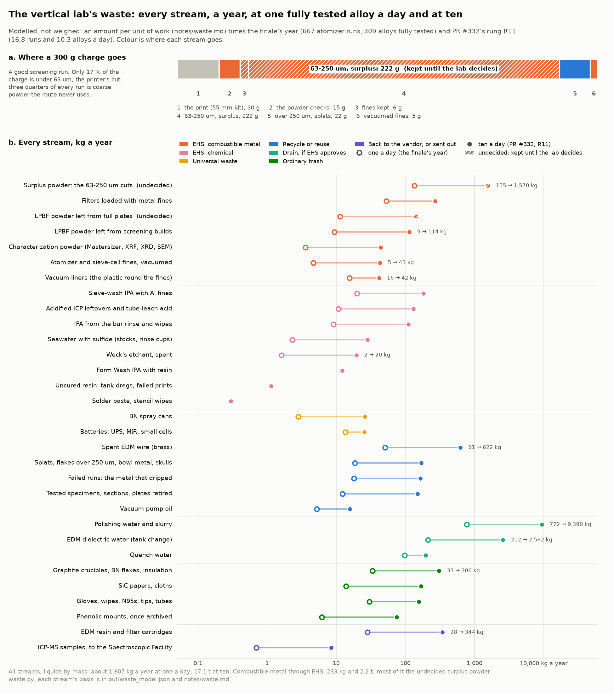
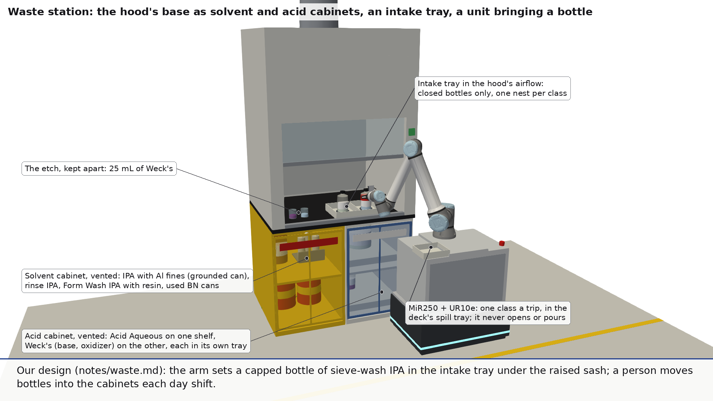

# Waste: where each stream goes, how it is picked up, and how to make less of it (`waste.py`)

Sterling, on PR #318 (2026-11-20): "consider waste and disposal procedures. Where does each waste go, how do we get
pickups, and what can we do to minimize the hazard and risk, and thereby the cost of disposal?"

```bash
python3 waste.py            # out/waste_model.json, out/waste_streams.png (a few seconds; matplotlib only)
python3 waste.py table      # the streams, printed
python3 waste.py markdown   # the table below
xvfb-run -a python3 waste_station.py   # the 3-D still of the waste station -> out/waste_station_still.png
```

Everything here is a model, not a measurement: nothing has been weighed. Each stream is an amount per unit of work (an
atomizer run, an alloy, a build, a polish, an hour of the wire EDM, a corrosion night) times the units in a year, in two
schedules:

- **One a day** is the finale's year (`timelapse.py`, `out/timelapse_model.json`): 667 atomizer runs, 360 alloys
  atomized, 309 fully tested, 30 promoted to a full plate, with upkeep and failures.
- **Ten a day** is PR #332's rung R11 (`bottleneck.py` at `cc31ddc`): 16.8 runs, 12.0 screening builds and 10.3 alloys
  fully tested a day, with three rePowders, four MIDIs, two furnaces, two CubXLs and promoted alloys from 684 g charges.

Every amount says where it comes from: a workflow note, `upkeep.py`'s consumables, a maker's figure, or "assumed"
(most are). What the numbers are good for is the relative size of the streams and how they scale, which is what
decides containers, pickups and where effort pays.

## The short answer



[`out/waste_streams.png`](../out/waste_streams.png): (a) where one 300 g charge goes; (b) every stream in kg a year,
one a day (hollow) against ten a day (filled), coloured by where it goes.

- **Where it goes.** Everything hazardous leaves through **BYU Risk Management**, which collects "unwanted laboratory
  material" from labs. The lab already does this for the atomizer: waste powder and sweepings go in Risk Management's
  lined, labelled *Solid Material* bucket, full vacuum liners in a labelled metal bucket, used filters in a grounded
  can under sand, and a pickup is requested at <https://riskapps.byu.edu/apps/pickuprequest/> when a bucket is full
  (DAL's [lab-safety page](https://github.com/vertical-cloud-lab/digital-alloy-lab/blob/93fdb54/SOP/lab-safety.md#metal-powder-waste-risk-management-pickup),
  2026-07-17 and 2026-07-20). Batteries and aerosol cans are universal waste, metal scrap is recycled, and three
  waters can go down the drain only if Risk Management says so. [Who picks it up](#who-picks-it-up-and-how) has the
  procedure.
- **How much.** About 1.6 t a year at one a day and 17 t at ten, liquids by mass. Most of it is water (polishing,
  the EDM's tank, the quench) that may be drained. What leaves through Risk Management is about **90 kg of
  combustible metal and 60 kg of chemicals a year at one a day, 0.5 t and 0.5 t at ten**, if the surplus powder is
  kept or recycled; with it thrown away, the metal is 230 kg and 2.2 t.
- **The biggest hazardous stream is one the lab hasn't decided about yet: the surplus powder.** Only 17 % of a
  charge is under 63 µm, the printer's cut. 74 % comes out at 63–250 µm, which the route never uses: 222 g of every
  300 g run, **135 kg a year at one a day and 1.6 t at ten**. It fills the 581-jar store in 65 days at one a day and in
  8 at ten (PR #332). Kept, it is stock; thrown away, it is most of the lab's hazardous waste.
- **The cheapest cuts**, in order (the table in [What it costs, and the levers](#what-it-costs-and-the-levers)):
  1. **Decide what the surplus powder is for** before the store fills: DED feedstock for the same alloy, the next
     run of a promoted alloy, metal scrap by family, a reference sample kept. Make less of it with a finer atomization
     if AMAZEMET's higher-frequency sonotrodes allow it.
  2. **Get Risk Management's ruling on the three waters** (polishing, EDM, quench). If the polishing water can't go
     down the drain, settle and filter it so that only the sludge is collected: it would otherwise be the biggest
     collected stream by far, 770 L a year at one a day and 9.4 m³ at ten.
  3. **Change vacuum liners by fill, not by the calendar.** At a liner a week per vacuum the plastic weighs three
     times the fines it holds, and the liners set how often the metal bucket fills.
  4. **Recycle the metal**: the EDM's brass wire (51 kg a year, 620 kg at ten), and the splats, drips, skulls and
     tested specimens by family.
  5. **Keep the families and the classes apart**: Al from Cu (a thermite pair), the oxidizer (Weck's) from IPA, the
     acid from the sulfide and from aluminium fines. A single-component, well-labelled waste is the cheapest kind to
     profile and the safest to store.
- **Choices already made that keep hazard down:** no HF (Weck's reagent replaced Keller's, `notes/lab_r8.md`); ICP-MS
  digestion done by the BYU Spectroscopic Facility, not here; lithium iron phosphate UPS batteries (up to 10 years, no
  lead-acid; `notes/ups.md`); a dedicated vacuum per alloy family (`notes/atom_vacuum.md`).

## The streams

`python3 waste.py markdown`. "Per unit of work" is the model's amount; the day columns are the year divided by 365.
Liquids are in L, the figure turns them into kg. The basis of each line (sources and assumptions) is in
[`out/waste_model.json`](../out/waste_model.json) and in the sections after the table.

<!-- waste-table -->
| Stream | Goes to | Per unit of work | One a day: a day | a year | Ten a day: a day | a year |
|---|---|---|---|---|---|---|
| Surplus powder: the 63-250 um cuts *(undecided)* | EHS: combustible metal | see basis | 0.37 kg | 135 kg | 4.3 kg | 1,570 kg |
| Filters loaded with metal fines | EHS: combustible metal | see basis | 0.15 kg | 53 kg | 0.74 kg | 269 kg |
| LPBF powder left from full plates *(undecided)* | EHS: combustible metal | 380 g a full plate | 31 g | 11 kg | 391 g | 143 kg |
| LPBF powder left from screening builds | EHS: combustible metal | 26 g a screening build | 26 g | 9.4 kg | 312 g | 114 kg |
| Characterization powder (Mastersizer, XRF, XRD, SEM) | EHS: combustible metal | 10 g an alloy atomized | 9.9 g | 3.6 kg | 120 g | 44 kg |
| Atomizer and sieve-cell fines, vacuumed | EHS: combustible metal | 7.0 g an atomizer run | 13 g | 4.7 kg | 117 g | 43 kg |
| Vacuum liners (the plastic round the fines) | EHS: combustible metal | 52 liners a vacuum a year | 0.43 liners | 156 liners | 1.1 liners | 416 liners |
| Sieve-wash IPA with Al fines | EHS: chemical | 38 mL an atomizer run | 69 mL | 25 L | 637 mL | 233 L |
| Acidified ICP leftovers and tube-leach acid | EHS: chemical | 0.14 L a corrosion night | 0.03 L | 11 L | 0.36 L | 131 L |
| IPA from the bar rinse and wipes | EHS: chemical | 0.03 L an EDM hour | 0.032 L | 12 L | 0.39 L | 141 L |
| Seawater with sulfide (stocks, rinse cups) | EHS: chemical | 0.03 L a corrosion night | 0.0063 L | 2.3 L | 0.077 L | 28 L |
| Weck's etchant, spent | EHS: chemical | 5.0 mL an alloy tested | 4.2 mL | 1.5 L | 51 mL | 19 L |
| Form Wash IPA with resin | EHS: chemical | 0.3 L a week | 0.043 L | 16 L | 0.043 L | 16 L |
| Uncured resin: tank dregs, failed prints | EHS: chemical | 0.02 L a week | 0.0028 L | 1.0 L | 0.0028 L | 1.0 L |
| Solder paste, stencil wipes | EHS: chemical | see basis | 0.0008 kg | 0.3 kg | 0.0008 kg | 0.3 kg |
| BN spray cans | Universal waste | 0.035 cans an atomizer run | 0.065 cans | 24 cans | 0.59 cans | 216 cans |
| Batteries: UPS, MiR, small cells | Universal waste | see basis | 0.037 kg | 14 kg | 0.07 kg | 25 kg |
| Spent EDM wire (brass) | Recycle or reuse | 0.13 kg an EDM hour | 0.14 kg | 51 kg | 1.7 kg | 622 kg |
| Splats, flakes over 250 um, bowl metal, skulls | Recycle or reuse | 31 g a good run | 51 g | 19 kg | 468 g | 171 kg |
| Failed runs: the metal that dripped | Recycle or reuse | 270 g a failed run | 49 g | 18 kg | 453 g | 165 kg |
| Tested specimens, sections, plates retired | Recycle or reuse | 40 g an alloy tested | 34 g | 12 kg | 412 g | 150 kg |
| Vacuum pump oil | Recycle or reuse | 6.0 L a rePowder a year | 0.016 L | 6.0 L | 0.049 L | 18 L |
| Polishing water and slurry | Drain, if EHS approves | 2.5 L a polish | 2.1 L | 772 L | 26 L | 9,390 L |
| EDM dielectric water (tank change) | Drain, if EHS approves | 0.55 L an EDM hour | 0.58 L | 212 L | 7.1 L | 2,582 L |
| Quench water | Drain, if EHS approves | 98 L a furnace a year | 0.27 L | 98 L | 0.54 L | 196 L |
| Graphite crucibles, BN flakes, insulation | Ordinary trash | 50 g an atomizer run | 91 g | 33 kg | 838 g | 306 kg |
| SiC papers, cloths | Ordinary trash | 45 g a polish | 38 g | 14 kg | 463 g | 169 kg |
| Gloves, wipes, N95s, tips, tubes | Ordinary trash | 0.12 kg a person-day | 0.082 kg | 30 kg | 0.43 kg | 156 kg |
| Phenolic mounts, once archived | Ordinary trash | 20 g an alloy tested | 17 g | 6.2 kg | 206 g | 75 kg |
| EDM resin and filter cartridges | Back to the vendor, or sent out | 0.073 kg an EDM hour | 0.077 kg | 28 kg | 0.94 kg | 344 kg |
| ICP-MS samples, to the Spectroscopic Facility | Back to the vendor, or sent out | 0.009 L a corrosion night | 0.0019 L | 0.69 L | 0.023 L | 8.5 L |

| Goes to | One a day, kg a year | Ten a day, kg a year |
|---|---|---|
| EHS: combustible metal | 233 | 2,224 |
| EHS: chemical | 58 | 486 |
| Universal waste | 16 | 51 |
| Recycle or reuse | 105 | 1,124 |
| Drain, if EHS approves | 1,082 | 12,168 |
| Ordinary trash | 83 | 706 |
| Back to the vendor, or sent out | 29 | 353 |
<!-- /waste-table -->

"EHS" here means BYU Risk Management's environmental programme, which runs the pickups. "Ordinary trash" and "drain"
are what the stream would be if Risk Management agrees, not a ruling: until it has said so, treat each as a collected
waste. Not in the table: feedstock that is no longer wanted (tray N's 204 jars), broken glass jars, and equipment
parts with their own take-back (below).

**What scales and what doesn't.** Almost everything scales with the work, so ten a day is about ten times one a day.
The exceptions: tray G's resin printing and tray H's PCB line are off the route and stay the same; the filters are half
fixed (vacuums and machines) and half by use; the batteries scale with the equipment (×1.86, PR #332's count).
Promoted alloys from 684 g charges make ten a day's surplus powder grow a little faster than its runs.

## Each stream: what it is, how it is kept, where it goes, how to cut it

Classifications are the generator's call, and at BYU the generator's determination is made with Risk Management
(40 CFR 262.11; Utah adopts the federal rules in R315-260 to R315-273). What follows is what the chemistry suggests,
to bring to them, not a ruling. "D001" and the like are the RCRA characteristic codes of 40 CFR 261.21-24: D001
ignitable (a liquid with a flash point under 60 °C, or a solid that can cause fire through friction, moisture or
spontaneous change and burns persistently, or an oxidizer), D002 corrosive (pH ≤ 2 or ≥ 12.5), D003 reactive (among
others: reacts violently with water, or gives toxic gas with it), D004-D043 toxic by the TCLP leach test (chromium
D007 at 5.0 mg/L, lead D008 at 5.0 mg/L, silver D011 at 5.0 mg/L). None of the lab's wastes is a listed (F, K, P or U)
waste as far as this survey goes.

### Combustible metal: fines, liners, filters, LPBF leftovers, characterization powder

**Where it comes from.**
- The atomizer chamber, plate, cone, bowl and floor after each run: brushed into the cup first, then what is left
  vacuumed with the Nilfisk CFM 118EXP by arm 2 (`notes/atom_vacuum.md`); assumed 5 g a run.
- The sieve cell's downdraft enclosure: spills, the tipper's trough and the wash module's filter cake (2 g a run,
  assumed).
- The Aconity MIDI: the powder left round each screening build (the 55 mm kit's 30 g less about 4 g of specimens),
  vacuumed by the lance and freed in the depowdering box under argon (`notes/alloy_workflow.md`); a full plate's
  380 g, kept while the alloy may be built again.
- Tray D's and E's powder checks: about 5 g into the Mastersizer's Aero S (its extractor keeps it), an XRF cup
  and an XRD holder (`notes/alloy_powder.md`).
- Filters: the rePowder's safety and pump filters (checked every 20 h of running, replaced when worn) and its main
  HEPA filter about every two months; the Nilfisks' main and two HEPA filters; the MIDI's circulation filter (every
  1,000 build hours, upkeep `ac_filter`); the depowdering box's (monthly); the Mastersizer extractor's.

**What it is.**
- Al-family powders (AlSi10Mg, Al-Si, Al 4047, 6063) are flammable solids: the AlSi10Mg SDS gives H228 (flammable
  solid) and H261 (in contact with water releases flammable gas), cited in PR 80. Aluminium powder SDSs rate it
  NFPA 704 health 0, flammability 3, instability 1, with the W (water-reactive) mark
  ([Vanderbilt's SDS](https://www.vanderbilt.edu/vinse/facilities/safety_data_sheets/Aluminum_powder.pdf),
  [CAMEO](https://cameochemicals.noaa.gov/chemical/14008)). As a waste: D001 as an ignitable solid, and D003 if
  Risk Management judges it water-reactive (PR 80's disposal SOP assumes D001 and likely D003). DOT: aluminium powder,
  coated, **UN1309**, class 4.1, or uncoated, **UN1396**, class 4.3, packing group II or III
  ([NJ fact sheet](https://www.nj.gov/health/eoh/rtkweb/documents/fs/0054.pdf)); gas-atomized powder has its own
  oxide, and which entry applies is Risk Management's call. Magnesium and the Al-Li master alloy are worse
  (magnesium powder is UN1418, 4.3 with a 4.2 subsidiary).
- Filter condensate is the most reactive of all. The rePowder's manual warns that "metal condensate can spontaneously
  ignite" (DAL's manual notes), and the MIDI's circulation filter collects the laser's nanometre condensate, which
  LPBF makers wet before the housing is opened (upkeep cites GE US12172115B2).
- Cu-family powders (Cu-Ni, NAB, bronze) are much less ignitable but are kept apart all the same: aluminium with
  copper oxide is a thermite pair (DAL SOP 253; PR 80).
- Alloys with chromium (DAL #146 buys Cr) could fail the TCLP for chromium (D007) in any of these streams. Keep a
  Cr-bearing alloy's waste in its own labelled container, so the rest stays out of D007.
- NFPA 484 (combustible metals) and NFPA 652/654 govern the handling; the lab's NFPA 652 dust hazard analysis is
  still open in PR 80.

**How it is kept: the lab's own rules, unchanged** (PR 80's disposal and operating SOPs, DAL's lab-safety page):
- Dry. No water and no mineral oil on the powder or the liner (PR 80: water makes hydrogen and damp fines self-heat;
  oil adds a flammable liquid and complicates the waste profile). Dry-wipe before any IPA, and never IPA on visible
  powder (hybrid mixtures ignite more easily than either).
- The vacuum's liner sealed in place with a gooseneck twist and conductive tape or two steel ties, lifted into a
  labelled, grounded steel pail, **lid set on but not crimped** (Waste Management: a crimped lid raises the explosion
  hazard; an uncrimped one vents trace hydrogen).
- Loose waste powder and sweepings into Risk Management's lined, labelled *Solid Material* bucket.
- Used filters as the AMAZEMET manual says: the container ready and grounded before the filter comes out, the filter
  straight in, backfilled with dry sand, closed, wrapped in plastic and marked with the waste code.
- **One pail per alloy family**, a Class D extinguisher within reach (never water, CO₂ or ABC), the pails away from
  sinks, acids, oxidizers and metal-oxide powders.
- A person seals the liner and carries it to the pail; the arms don't (`notes/atomizer_automation.md`: it stays a
  person's job).

**Wetting or passivating the fines (Sterling's question): mostly no.**
- **Water**: no, for storage or transport. Aluminium fines and water make hydrogen
  (2 Al + 6 H₂O → 2 Al(OH)₃ + 3 H₂), faster when fine, warm or alkaline, and wet fines can self-heat; a sealed can of
  wet aluminium dust is a pressure and fire hazard. PR 80's Edison-reviewed SOP and the AlSi10Mg SDS agree.
- **Mineral oil**: no (PR 80): it adds a combustible liquid, mixing it lofts dust, and an oily metal waste is harder to
  profile.
- **Sand**: yes, where the maker says so. It smothers and dilutes, and it is what AMAZEMET specifies for its filters.
  But it multiplies the mass: a filter in its sand is about 6 kg against 0.5 kg alone, and those six filters a year are
  two thirds of the filter stream. Use the smallest grounded can the filter fits, not a pail of sand.
- **Controlled wetting of LPBF condensate**: only inside the MIDI's filter housing, by Aconity's procedure, as upkeep
  books it ("the old one wetted (passivated) first"), with the container vented afterwards for the hydrogen. Ask
  Aconity for their procedure; it is the one place where water is the standard answer.
- **Inerting on the way in**: some LPBF filter units pre-coat their cartridges with an inert powder so that the cake
  can't burn; the lab's units don't, and it isn't proposed.

**Making less of it.**
- **Liners**: at a liner a week per vacuum (PR 80's "after each use or weekly"), 156 liners a year carry 4.7 kg of
  fines in 16 kg of conductive plastic, and each sealed liner takes room in the metal bucket. Agree with Risk
  Management to change a liner at 25 % fill, at a family switch, or monthly, whichever comes first: about a quarter of
  the liners.
- **Fines**: brush into the cup before vacuuming (DAL's order already), so that the vacuum gets only what the brush
  can't; keep the cell's dry stages in their enclosures.
- **LPBF leftovers**: print screening builds in the 55 mm kit (30 g, not 440 g); sieve a full plate's leftover back
  into its own jar while the alloy may be rebuilt, then let it go with the alloy's other surplus.
- **Characterization**: the Mastersizer's 5 g is the biggest piece; a wet (liquid) dispersion would use less powder
  but adds a liquid waste with aluminium in it. Keep the dry method; return the XRD holder's powder to the alloy's jar
  if the zero-background holder is clean.

### The surplus powder: decide what it is for

Each good screening run makes 51 g under 63 µm: 30 g goes to the print, 15 g to the powder checks and 6 g stays.
The other 222 g is coarser (`waste.py charge_split`, DAL #219's yields). Over a year that is 135 kg of 63–250 µm Al
alloy powder at one a day and 1.6 t at ten. While it is in tray O's jars it is stock, not waste; once the lab decides to
discard it, it is a combustible metal waste like the fines, and by far the largest one.

What it could be instead, roughly from best to worst:
1. **Feedstock for DED.** DED takes 45–105 and 100–200 µm cuts (DAL PR #220), and 70 % of the bronze run fell in
   50–200 µm (DAL #219). The floor's DED machine (and PR #332's MX-Lab, rung D3) feeds powder of this size, so the
   same alloy's coarse cut on a DED block is a second data point, not waste.
2. **The next run of a promoted alloy.** A promoted alloy takes 8 more 300 g runs (3 at 684 g) for its 440 g of
   fines. Pressing the earlier runs' coarse cut into the next charge cups (the vacuum press already presses cups) would
   cut the new metal those runs need by up to three quarters. The cost is oxide: every particle brings its skin into
   the melt. Worth a trial on one alloy, with oxygen measured.
3. **Make less of it.** For a capillary-wave (ultrasonic) atomizer, the particle size scales roughly as
   frequency^(−2/3) (Lang, *J. Acoust. Soc. Am.* 34, 6 (1962)), so going from 40 kHz to 60 or 80 kHz would shift much of
   the 63–125 µm into the printer's cut. Ask AMAZEMET which sonotrode frequencies the rePowder takes and what they do to
   yield (#331's `procurement/production.md` has AMAZEMET's contacts and its other open questions).
4. **A reference sample and the rest melted into scrap.** Keep 10–20 g of each cut sealed (tray O, or gasketed metal
   cans for anything under 63 µm, `notes/lab_r8.md`) and melt the rest by family into a slug: in the rePowder's
   furnace between runs, or in a small induction melter under argon. A slug is scrap metal and goes to BYU's metal
   recycling; powder isn't and doesn't (EPA RO 14888, below). The Aluminum Association adds that fines "may be
   recycled through companies that process aluminum scrap and/or aluminum dross"
   ([F-1](https://www.aluminum.org/sites/default/files/2021-11/Safe_Handling-Aluminum_Fine_Particles.pdf)), but that
   is a shipment of a hazardous waste to a recycler, Risk Management's to arrange.
5. **Hazardous waste**, through Risk Management, as for the fines. The fallback, and the most expensive per kg.

A rule is needed either way, because the store fills in 65 days at one a day and 8 at ten (PR #332): for example,
keep every cut for 90 days, then keep the reference sample and send the rest down the list above.

### Solvents and chemicals

| Stream | What it is | Kept in | Notes and cuts |
|---|---|---|---|
| Sieve-wash IPA with Al fines | IPA, flash point about 12 °C: D001. DOT UN1219, 3, PG II. NFPA 704 1-3-0 ([NJ fact sheet](https://www.nj.gov/health/eoh/rtkweb/documents/fs/1076.pdf)). With suspended Al and Si fines | A grounded metal safety can of its own, in the flammables cabinet, labelled "IPA with aluminium fines: no water, no acid, no oxidizer" | `notes/alloy_print.md` already says "the rinse slurry is hazardous waste, kept wet": the fines stay under the IPA, which keeps them from drying into a dust (immersion in a closed vessel raises no dust cloud, unlike the IPA wipe on visible powder that PR 80 forbids). Two cuts: a two-stage wash (settle the fines, decant the clear IPA and use it for the next sieve's first rinse) and washing only on a family change or a sensitive alloy (DAL #234: a sieve set per family). At ten a day, a small solvent still may pay (below) |
| IPA from the bar rinse and wipes | D001. The EDM rinse jar (alloy_workflow.md) and pre-wetted wipes for seals | Rinse IPA with the general waste IPA; IPA-wet wipes in a closed metal can, not the trash | The jar's IPA picks up EDM water; change it when cloudy, not on a timer |
| Form Wash IPA with resin | D001; tell the collector it holds "small amounts of methacrylated monomers and oligomers" ([Formlabs](https://formlabs.com/uk/support/How-can-I-dispose-of-resin-and-used-solvent/)); never down a drain | Its own container: resin-laden IPA kept apart so the other IPA stays recyclable | Formlabs: replace at 10 % resin, read with its hydrometer ([Formlabs](https://formlabs.com/blog/announcing-resin-washing-solution/)); its Resin Washing Solution is sold as non-flammable and holds 20 % resin before it is spent, which would likely take this stream out of D001 and halve it |
| Uncured resin, failed prints | Uncured resin "may be classified as hazardous waste"; cured resin is ordinary solid waste ([Formlabs](https://formlabs.com/support/Disposing-of-resin/)) | Cure dregs, supports, failed prints and resin-soaked towels in the Form Cure or in sunlight (Formlabs: 1-10 days for a container), then trash; liquid resin that won't be cured in its bottle to Risk Management | Formlabs' own guidance |
| Weck's etchant, spent | 4 g KMnO₄ and 1 g NaOH in 100 mL water (lab_r8.md; PACE's recipe has 4 g NaOH): pH about 13.4, so D002; permanganate is an oxidizer, so D001 is likely (261.21(a)(4)) and Risk Management decides. PACE's SDS ships it as UN3266, class 8, marked OX ([SDS](https://metallographic.com/MSDS/SDS-OSHA/Wecks-KMnO4-etchants.pdf)) | Its own small bottle in the base tray of the corrosives cabinet, **away from IPA and every organic** (permanganate and alcohol is a fire), from the sulfide, and **never in an aluminium container or with aluminium swarf**: strong base on aluminium makes hydrogen (a 4 L aluminium can of basic waste burst, [ACS Chem. Health Saf. 2021](https://doi.org/10.1021/acs.chas.0c00079)) | Mix 25 mL fresh for a session, not 100 mL; etch only the mounts that need it (most are imaged as polished). No HF anywhere (lab_r8.md) |
| Acidified ICP leftovers, tube-leach acid | 62 mM HNO₃ (pH about 1.2) with µg/L of Cu, Ni, Fe, Mn, Al: D002; far under every TCLP limit | Risk Management's *Acid Aqueous* container, acid tray of the corrosives cabinet | Reuse the 2 % HNO₃ leach bath for several batches of tubes (DAL leaves the method to "choose"): the leach bath is most of this stream |
| Seawater with sulfide | ASTM D1141 water at pH 8.2 with 0.1-10 mg/L S as Na₂S: far below any reactive-sulfide level, but **never mixed with the acid** (hydrogen sulfide) or the permanganate | Its own 1 L bottle on tray A, where it is made, labelled "sulfide, pH 8, no acid"; picked up from there | 2.3 L a year at one a day: collecting it costs less than asking for a drain ruling. DAL makes both stocks fresh every night; a smaller deck vial (ot2_corrosion.md) would make less. The solid Na₂S the 10 mg/L stock is made from is a corrosive, sulfide-bearing chemical: keep it dry, away from acids |
| Solder paste, stencil wipes | Lead-free paste (SAC305) has 3 % silver (TCLP D011 possible) and flux solvents | A closed can | Buy **lead-free** paste only (leaded paste would be D008); keep the jar sealed and cold so it doesn't expire |
| Vacuum pump oil | Used oil (Utah R315-15) | A labelled "Used Oil" container | Recycled, not hazardous waste, if it isn't mixed with solvent |

**Solvent recovery.** At one a day the lab makes about 55 L of waste IPA a year (sieve wash, rinse and wipes, the Form
Wash): too little for a still. At ten a day it is about 390 L. A small recycling still (a few gallons a batch) would
recover most of the clean-IPA streams (the sieve wash after settling, the bar rinse); the resin-laden Form Wash IPA and
the still bottoms remain waste. The recycling itself needs no permit ("the recycling process itself is exempt from
regulation", 40 CFR 261.6(c)(1); Utah R315-261-6(c)(1) says the same), but the spent IPA waiting for the still is still
a regulated waste and the bottoms carry its code (EPA [RO 11420](https://rcrapublic.epa.gov/files/11420.pdf)). At BYU,
"chemical deactivation" needs Environmental Management first, so a still does too (open question 5).

### Universal waste: batteries and aerosol cans

- **Batteries.** Twelve LiFePO₄ UPS batteries (up to 10 years, Vertiv, `notes/ups.md`), the MiR250s' Li-NMC packs
  (3,000 cycles: unit 1 in about 2.5 years, unit 2 in 4.9, `notes/upkeep.md`), and small cells. Universal waste under
  Utah R315-273, and Environmental Management takes "all battery waste" (RMS FAQ). Keep them in a closed, labelled
  container, terminals taped, a damaged lithium pack bagged on its own; for transport lithium-ion batteries are UN3480,
  class 9, and Risk Management packs them. Electronics are not theirs: failed Pis, cameras and PCs go to OIT's
  electronic surplus at the Ellsworth Building ([OIT Surplus](https://itsurplus.byu.edu/)). No batteries are due in the
  first year; the long-run average is about 14 kg a year. Alternating the two MiRs (`notes/upkeep.md`, risk 6) also
  evens out their packs' wear.
- **BN spray cans** (Momentive Boron Nitride Spray II, 13 oz, propane and butane, `notes/atom_bn.md`): about 24 cans a
  year at one a day, 216 at ten. Utah takes aerosol cans as universal waste (R315-273-6), and BYU's Environmental
  Management takes "all aerosol can waste": it punctures them, collects the contents as hazardous waste and recycles
  the cans ([RMS FAQ](https://risk.byu.edu/environmental/faq)). Use each can until it is empty (the arm's inverted 4 s
  valve clear already empties the dip tube) and keep the used ones in the flammables cabinet until pickup. A 1 L
  refillable spray of BN slurry would end the cans altogether, if its coat is as good (ask Momentive).

### Metal to recycle

- **EDM wire**: 0.25 mm brass, a 15.9 kg spool every 120 h of EDM work (upkeep `edm_wire`): 51 kg a year, 620 kg at
  ten. Clean brass is valuable scrap. Keep the chopped wire dry in its own bin, away from aluminium.
- **Splats, flakes over 250 µm, bowl metal, skulls and drips**: "un-atomized metal is feedstock, not waste" (DAL SOP
  178). Bagged and labelled by run as now (DAL equipment.md), then re-used in the same family's runs or recycled as Al
  or Cu scrap. Skulls carry BN and slag, so they go to scrap, not back into a charge.
- **Tested specimens, sections, retired build plates**: kept as the record first, then Al scrap.

Recycling route: BYU Physical Facilities' recycling collects "industrial scrap metals" (recycling@byu.edu,
801-422-4662; [PF Recycling](https://pf.byu.edu/recycling)) and sells them locally to Western Metals Recycling
([BYU Sustainability](https://sustainability.byu.edu/recycling)). Scrap metal that is recycled is exempt from the
hazardous-waste rules (40 CFR 261.6(a)(3)(ii); wire is named in the definition, 261.1(c)(6)), **but powder is not
scrap metal**: EPA says "non-agglomerated ... powders would not meet the definition of scrap metal", and a powder with
a hazardous characteristic stays hazardous "even when sent for recycling" ([RO 14888](https://rcrapublic.epa.gov/files/14888.pdf)).
That is why the surplus powder has to be melted into a solid before it can go out as scrap.

### Down the drain, if Risk Management agrees (otherwise collected)

- **Polishing water and slurry** (the PX500's waste tank, emptied weekly, upkeep `px_waste`): SiC, alumina,
  colloidal silica and aluminium swarf in water. Probably not hazardous (no TC metal, unless a chromium alloy), but
  the solids shouldn't reach a drain. Settle it in a tank or bucket filter, drain the clear water if allowed, and send
  the sludge as a solid. A recirculating polisher feed with a filter would cut the water itself.
- **EDM dielectric water**: deionized water in a 550 L tank (a third-party listing of the α-C400iC), cleaned through
  its paper filters and resin; a tank change roughly every 1,000 h of work.
- **Quench water**: 8 L beside the furnace (`r8_test.QUENCH`), changed monthly (assumed).

### Ordinary trash, if Risk Management agrees

SiC papers and cloths; phenolic mounts once their archive time is up (cured phenolic is inert); graphite crucibles,
the BN flakes scraped off at each touch-up, the alumina-silica insulation (bag it: refractory ceramic fibre should not
be shed into the air) and thermocouple sheaths; gloves, wipes, N95s, pipette tips and tubes. **Anything with visible
powder goes in the metal pail, not the trash** (DAL: "nothing powder-contaminated goes into ordinary trash").

### Back to the vendor, or sent out

- **EDM deionizing resin**: many resin suppliers exchange or regenerate spent mixed-bed resin; the paper filter
  cartridges (with the sludge: aluminium alloy and brass fines) are dried and go to Risk Management.
- **ICP-MS samples**: the OT-2's 1 mL dilutions go to the BYU Spectroscopic Facility, which disposes of them.
- **Beyond the first year**: X-ray tubes (MiniFlex, S2 PUMA; their windows are beryllium) and SEM filaments back to
  the makers; the glovebox purifier's catalyst and sieve by the vendor; argon and helium cylinders back to the gas
  supplier.

## Who picks it up, and how

**Risk Management and Safety (RMS), through its Environmental Management unit**, which removes, stores and disposes
of "unwanted laboratory materials (ex: hazardous waste)" ([RMS environmental](https://risk.byu.edu/ehs/environmental)).
BYU's pages refuse automated requests (HTTP 403), so what follows was read from Internet Archive snapshots of them (2024-2026)
by a search for this note: check the live pages from campus before relying on a detail.

- **The rules BYU works under.** "At BYU, we operate under the EPA's RCRA 40 CFR Part 262, Subpart K"
  ([RMS FAQ](https://risk.byu.edu/environmental/faq)): the academic-laboratories rule, which Utah has adopted
  (R315-262-200 to -216). BYU as a whole is a **large quantity generator**, EPA ID UTD009094012, at the Chemicals
  Management Building; it shipped about 15-23 t of hazardous waste a year in 2023-2025 (EPA
  [ECHO](https://echo.epa.gov/detailed-facility-report?fid=110008175045)).
- **Containers.** Environmental Management supplies them: 5 gal *Acid Aqueous*, *Base Aqueous* and *Flammable
  Solvents* containers, 5 gal buckets for solids, 55 gal drums on request
  ([ULM procedures](https://risk.byu.edu/procedures-for-disposal-of-unwanted-laboratory-material-ulm)). The *Solid
  Material* bucket the atomizer uses now is one of theirs.
- **Labels.** Every component written out "in English ... Chemical structures and/or formulas are not appropriate
  substitutes", or a log sheet attached (ULM procedures); Utah's rule asks for the words "unwanted material" or an
  equivalent (R315-262-206). BYU's pages differ on the heading ("Unwanted Laboratory Materials" on the older page,
  "Hazardous Waste" in the 2021 chemistry hygiene plan): use the label Environmental Management issues.
- **Keeping it.** Closed "at all times except when adding or removing material", in the room where it was made,
  incompatibles apart; **no more than 55 gal of unwanted material in a laboratory** (one quart of liquid or 1 kg of
  solid if acutely hazardous, P-listed: the lab has none); **nothing older than 12 months**, with an automatic e-mail
  at 10 months (FAQ). The lab's "1-year clock" on a tagged pail (PR 80, the 2026-07-06 meeting with Waste Management)
  is this rule.
- **Asking for a pickup.** The [Pickup Request app](https://riskapps.byu.edu/apps/pickuprequest/) (BYU login; a
  professor grants students access; [training videos](https://risk.byu.edu/environmental/pickup-request-training)).
  "Schedule a pickup when a container is 80% full ... Overfilled containers will not be picked up." The request
  lists every component in the container and its container ID number, which ties it to the room and professor (FAQ).
  Pickups are on request, with no fixed round; a lab clean-out is booked by phone.
- **Contacts** ([RMS contacts](https://risk.byu.edu/about/contact-us)): RMS 801-422-4468, risk_mgmt@byu.edu;
  Environmental Management Office 801-422-6395; Hazardous Waste / Unwanted Materials 801-422-6548; the Hazardous
  Materials Manager, 103 CMB, 801-422-6382 (clean-outs); haz_waste@byu.edu.
- **Cost to the lab.** No charge for routine pickups was found; labs pay only for mixed (radioactive and chemical)
  waste (ULM procedures). So the cost that lands on the lab is the person's time, the containers, liners and filters,
  floor space and the limits above; the disposal bill lands on BYU.
- **The drain.** "Not permitted" without approval ([Laboratory and Chemical Safety Program](https://risk.byu.edu/00000177-ac92-d076-ab7f-aed6c1b00001/laboratory-and-chemical-safety-program),
  p. 40). "Chemical deactivation or drain disposal" needs Environmental Management first.
- **The rest.** Environmental Management takes "all battery waste ... and all aerosol can waste" but not electronics,
  which go to OIT's electronic surplus at the Ellsworth Building. Containers with under 3 % left are empty and go in
  an outside dumpster. Broken glass goes in a box marked "Broken Glass" (BYU doesn't recycle glass). Sharps are always
  biohazardous. Industrial scrap metal goes to Physical Facilities' recycling (all from the FAQ and the ULM procedures).
  BYU's guidance on water-reactive materials is "Contact Risk Management"; no BYU page on metal powders or combustible
  dust was found, which is why the lab's own SOPs (PR 80, DAL) carry that part.

**The lab already uses this route for the atomizer** (DAL's lab-safety page, 2026-07-17 and 2026-07-20): Risk
Management's *Solid Material* bucket for waste powder and sweepings, the lab's own labelled metal buckets for vacuum
liners, filters under sand, and the pickup link above. The vertical lab adds liquids, universal waste and volume.

**How often.** `python3 waste.py pickups` turns the table into Risk Management's containers (at 80 % full):

| | One a day | Ten a day |
|---|---|---|
| Collected waste, the surplus powder kept | about 350 L a year in 37 container loads | about 1,500 L in 200 |
| The same if the surplus powder is discarded | 450 L, 44 loads | 2,700 L, 280 loads |
| Standing in the lab just before a monthly pickup (surplus kept / discarded) | 28 / 37 L | 122 / **223 L** |
| Risk Management's limit for a laboratory | 208 L (55 gal) | 208 L (55 gal) |

- **One a day: a pickup a month is plenty**, and nothing comes near the 12 months or the 55 gal.
- **Ten a day: a pickup every week or two.** A monthly round would pass the 55 gal limit if the surplus powder were
  discarded. Whether the whole bay counts as one "laboratory" for that limit is a question for Risk Management.
- **The liners set the pace at one a day**: two thirds of the collected volume is sealed liners (234 L a year at a
  liner a week per vacuum), which is why changing liners by fill matters more than any chemical.
- **Where the lab sits matters.** On campus the vertical lab is part of BYU's large-quantity site and its Subpart K
  programme. On a separate site (the warehouse option, `notes/warehouse.md`) it would need its own EPA ID and its own
  generator category, which these numbers put in the **surplus powder's hands**. At one a day it would be a very small
  quantity generator either way (12-24 kg of hazardous waste a month, against the 100 kg line). At ten a day it is about
  80 kg a month with the surplus powder kept or melted into scrap, still under the line, and about 230 kg if the
  powder is thrown away, which makes a small quantity generator with its own rules. For scale: at ten a day the lab
  alone would add 4-7 % to what the whole university ships a year with the surplus kept out of it, 12-18 % with it.

## The waste station: where waste waits, and how the arms and MiRs move it

Where waste waits is set by two rules: unwanted material stays in the room where it was made, and incompatible
wastes are kept apart (RMS). So there isn't one bin for everything; there are four places, three of them where the
waste is made.

1. **The powder point, in the atomizer's taped area** (north row, beside the rePowder and the vacuums,
   `notes/atom_vacuum.md`): a grounded steel pail per alloy family for sealed liners, Risk Management's *Solid
   Material* bucket for waste powder and sweepings, grounded cans with dry sand for filters, the Class D extinguisher
   and the area sign. The sieve cell's and the printer line's vacuum (vacuum 3) has its own pail at the MIDI. A person
   seals and carries the liners (PR 80; `notes/atomizer_automation.md`). Powder waste never rides a MiR: it leaves the
   cell only with Environmental Management.
2. **The chemical waste station, under and in the ducted fume hood** (south row, x 1,500): the hood's base becomes a
   vented solvent cabinet (left: the three IPA containers and the used BN cans) and a vented acid cabinet (right: the
   *Acid Aqueous* container on one tray, the Weck's bottle on a second, a shelf apart). An **intake tray** on the hood's
   work surface, inside the airflow at the right-hand end and away from the etch, takes the closed bottles the arm
   brings. It is served from the hood's dock line, so it needs no new dock, and an arm on a MiR can reach into a hood
   under its 18 in sash (`notes/atom_bn.md`). Each day-shift a person moves the bottles from the tray into the
   cabinets' containers, checks the labels and dates, and files the pickup request.
3. **At the machine, where it is easier**: the EDM's wire bin (brass), the PX500's waste tank on tray F (upkeep
   `px_waste`, emptied weekly at Shuttle 1's opening), the sulfide-seawater bottle on tray A, the scrap bins by family
   beside the atomizer cell, and the battery pail by the MiR chargers.
4. **The archive**: tray O and the gasketed cans for the surplus powder, until it is decided.

**How the arms and MiRs move it.** Only the liquids from tray stations travel, in the bottles they are made in:
- The station that makes a liquid waste keeps a capped 1 L bottle in a nest (tray A's CubXL and OT-2, the sieve
  cell's wash module, the EDM's rinse jar). When the station's count says it is 80 % full, the next unit that passes
  swaps it for an empty one, as it swaps any vial: grasp, lift, set in a spill tray on the MiR's deck.
- **One class a trip**: never the IPA and the Weck's together, never the acid and the sulfide, never anything
  aqueous with powder waste. The unit's job list knows each bottle's class.
- At the hood the arm sets the bottle in the intake tray's matching nest (one nest per class, each in its own
  spill tray) and takes an empty from the rack beside it. **The arm never opens, pours or combines waste**: a person
  consolidates, in the hood, on the day shift.
- The bottle's label is printed with its contents in words by the packaging station's printer when the empty goes out,
  and the delivery is logged (bottle, station, volume, time), so the pickup request can be filled from the log.
- Booked like any transfer: about 6 min a trip (`timelapse` PARAMS `transfer_h`), a few a week at one a day.



[`out/waste_station_still.png`](../out/waste_station_still.png), from [`waste_station.py`](../waste_station.py): a
MiR250 + UR10e sets a capped bottle of sieve-wash IPA in the intake tray's right-hand nest, 230 mm inside the sash.
The unit stands on the hood's dock line, 760 mm right of the hood's centre: from there the script's search finds a
pose with the gripper 15° down, the forearm outside the hood's right post and the wrists under the raised sash, with
no point of the arm's or gripper's meshes within 10 mm of the posts, sash, fascia or work surface. That is a check of
this one pose, not the arm audit of a move. Our design throughout; the hood is `instruments_r7.FH`'s Labconco XStream
4 ft drawn as boxes (that module needs CadQuery), the cabinets are the hood's base, and the containers are typical
sizes.

**What is not done.** The station isn't in `setup_lab.py`'s floor plan or the set-up movie; the swap at a tray
station and the drive aren't animated or audited (`ARM_AUDIT=1`); and upkeep doesn't yet book the waste person-time
(about an hour a week at one a day: liners, consolidation, labels, requests). To resume: add a `waste` task to
`upkeep.TASKS` (weekly, 1 h, a person at the hood) and re-run `python3 upkeep.py && python3 timelapse.py model`.

## What it costs, and the levers

Risk Management doesn't charge the lab for routine pickups, so cost here means four things: what BYU pays to dispose
of it, what the lab buys to hold it, the person's hours, and the risk of a fire or a finding. The levers, roughly by
size:

| Lever | What it saves | Effort |
|---|---|---|
| A rule for the surplus powder: keep a reference sample, use the coarse cut (DED, the next run of a promoted alloy), melt the rest into scrap | 135 kg a year of class 4.1/4.3 powder at one a day, 1.6 t at ten; at ten a day, the difference between pickups every three weeks and every week | a policy now; a melt step later |
| Liners changed by fill, not weekly | about three quarters of the 156 liners a year, and of their 234 L | agree it with Risk Management |
| The waters drained, or settled and filtered | 770 L of collected liquid a year at one a day, 9.4 m³ at ten | a ruling, a settling tank |
| Brass and aluminium scrap recycled | 100 kg a year at one a day, 1.1 t at ten, out of the waste stream and sold | bins, a habit |
| A finer atomization (a higher-frequency sonotrode, if AMAZEMET has one) | a bigger share of each charge in the printer's cut, so less surplus | a question to AMAZEMET |
| Solvent: a two-stage sieve wash, Formlabs' Resin Washing Solution, a still at ten a day | half the sieve-wash IPA; the Form Wash stream out of D001; most of 390 L a year at ten a day | small |
| Weck's mixed 25 mL at a time, only for the mounts that need it | three quarters of a small stream | none |
| Families and classes kept apart | no thermite, no H₂S, no permanganate fire, simpler waste profiles | the rule already exists |

The person's time is the cost the lab feels most: at one a day, sealing liners, consolidating bottles, labels and the
monthly request come to about an hour a week (assumed), on top of upkeep's 31 h (`notes/upkeep.md`). At ten a day
it is a few hours a week of PR #332's 5.2 FTE.

## Open questions for BYU Risk Management

Bring these to Environmental Management (801-422-6395) before the lab is built; the answers change the station and
the numbers.

1. **Is the vertical lab one "laboratory" for the 55 gal limit?** At ten a day with the surplus powder discarded, a
   monthly pickup would pass it.
2. **The waters.** May the polishing water (after settling), the EDM's deionized water and the quench water go to the
   drain? If not, which containers?
3. **Aluminium alloy powder.** Which DOT entry and RCRA codes will Environmental Management use for the fines, the
   LPBF leftovers and the filters (D001, D003)? Will they take the surplus powder in bulk, or can the lab melt it into
   slugs for scrap metal recycling first?
4. **Liners and pails.** Is a liner changed at 25 % fill or monthly acceptable, rather than weekly? May the sealed
   liners go straight into the *Solid Material* bucket? Is the ESD wrist strap (PR 80's open item) required?
5. **Solvent.** May the lab run a small IPA still under BYU's programme at ten a day, and settle and decant the sieve-wash
   IPA for re-use?
6. **Weck's.** Is it D001 as well as D002 for BYU's profile, and is in-lab reduction of the permanganate allowed, or
   should it simply be collected (the plan here)?
7. **Scrap metal.** Will Physical Facilities' recycling take brass EDM wire and Al and Cu alloy scrap by family,
   including tested specimens and skulls?
8. **Robots carrying waste.** Is a capped 1 L bottle in a spill tray on a MiR, within the same room, acceptable
   handling? Does an intake tray in the hood count as the waste's accumulation point?
9. **The site.** If the lab goes off campus (the warehouse option), what does BYU need for a new generator site?

For Aconity and AMAZEMET: Aconity's procedure for wetting the MIDI's circulation filter; AMAZEMET's sonotrode
frequencies and how each changes the yield under 63 µm.

## Sources

- **The lab's own procedures**: byu-vcl PR 80 (closed), `vacuum-accessories-options.md` §10-14 and
  `vacuum-operating-sop.md` on `copilot/run-initial-test-vacuum`, and `edison/powder-disposal-sop/powder-disposal-sop.md`
  (an Edison-synthesized SOP with the 2026-07-06 Risk Management meeting's corrections); DAL PR 178 at `93fdb54`:
  [`SOP/lab-safety.md`](https://github.com/vertical-cloud-lab/digital-alloy-lab/blob/93fdb54/SOP/lab-safety.md),
  [`atomizer-training/equipment.md`](https://github.com/vertical-cloud-lab/digital-alloy-lab/blob/93fdb54/atomizer-training/equipment.md#waste)
  and [`manual.md`](https://github.com/vertical-cloud-lab/digital-alloy-lab/blob/93fdb54/atomizer-training/manual.md#filters)
  (the AMAZEMET manual's filter warnings); DAL's corrosion protocol at
  [`aeda51a`](https://github.com/vertical-cloud-lab/digital-alloy-lab/blob/aeda51a/alloy-corrosion/copper/protocol.md).
- **This repo**: `notes/alloy_*.md`, `notes/atom_*.md`, `notes/atomizer_automation.md`, `notes/cubxl_corrosion.md`,
  `notes/ot2_corrosion.md`, `notes/lab_r8.md`, `notes/upkeep.md` and `upkeep.py`'s consumables, `notes/ups.md`,
  `out/timelapse_model.json`; PR #332's `bottleneck.py` and `out/bottleneck.json` at `cc31ddc`.
- **BYU** (read through Internet Archive snapshots; the live pages return 403 to scripts):
  [RMS environmental](https://risk.byu.edu/ehs/environmental), [FAQ](https://risk.byu.edu/environmental/faq),
  [ULM procedures](https://risk.byu.edu/procedures-for-disposal-of-unwanted-laboratory-material-ulm),
  [the older ULM page](https://risk.byu.edu/ehs/environmental/unwanted-laboratory-materials-disposal),
  [contacts](https://risk.byu.edu/about/contact-us), [Pickup Request app](https://riskapps.byu.edu/apps/pickuprequest/),
  [Laboratory and Chemical Safety Program](https://risk.byu.edu/00000177-ac92-d076-ab7f-aed6c1b00001/laboratory-and-chemical-safety-program),
  [PF Recycling](https://pf.byu.edu/recycling), [Sustainability](https://sustainability.byu.edu/recycling),
  [OIT Surplus](https://itsurplus.byu.edu/); EPA [ECHO, UTD009094012](https://echo.epa.gov/detailed-facility-report?fid=110008175045).
- **Rules**: 40 CFR 261.21-24 (characteristics), 261.1(c)(6) and 261.6 (scrap metal, recycling), 262 Subpart K;
  Utah R315-261, R315-262-200 to -216, R315-273 (universal waste, with aerosol cans in R315-273-6), R315-15 (used oil);
  EPA letters [RO 14888](https://rcrapublic.epa.gov/files/14888.pdf) (powder is not scrap metal) and
  [RO 11420](https://rcrapublic.epa.gov/files/11420.pdf) (still bottoms); 49 CFR 172.101 (UN1309, UN1396, UN1418,
  UN1219, UN3480).
- **Hazards**: aluminium powder [CAMEO](https://cameochemicals.noaa.gov/chemical/14008) and an
  [SDS](https://www.vanderbilt.edu/vinse/facilities/safety_data_sheets/Aluminum_powder.pdf); the Aluminum
  Association's [F-1](https://www.aluminum.org/sites/default/files/2021-11/Safe_Handling-Aluminum_Fine_Particles.pdf)
  and TR-2; NJ fact sheets for [aluminium](https://www.nj.gov/health/eoh/rtkweb/documents/fs/0054.pdf) and
  [isopropanol](https://www.nj.gov/health/eoh/rtkweb/documents/fs/1076.pdf); PACE's
  [Weck's SDS](https://metallographic.com/MSDS/SDS-OSHA/Wecks-KMnO4-etchants.pdf); the aluminium-can rupture,
  [ACS Chem. Health Saf. 2021](https://doi.org/10.1021/acs.chas.0c00079); Formlabs on
  [resin](https://formlabs.com/support/Disposing-of-resin/) and
  [used solvent](https://formlabs.com/uk/support/How-can-I-dispose-of-resin-and-used-solvent/).
- **Makers**: the α-C400iC's 550 L tank and two paper filters (a third-party listing,
  [newequipment.com](https://directory.newequipment.com/classified/robocut--cic-series-254762.html)); Momentive BN Spray
  II (atom_bn.md); Lang, "Ultrasonic atomization of liquids", *J. Acoust. Soc. Am.* 34, 6 (1962).
