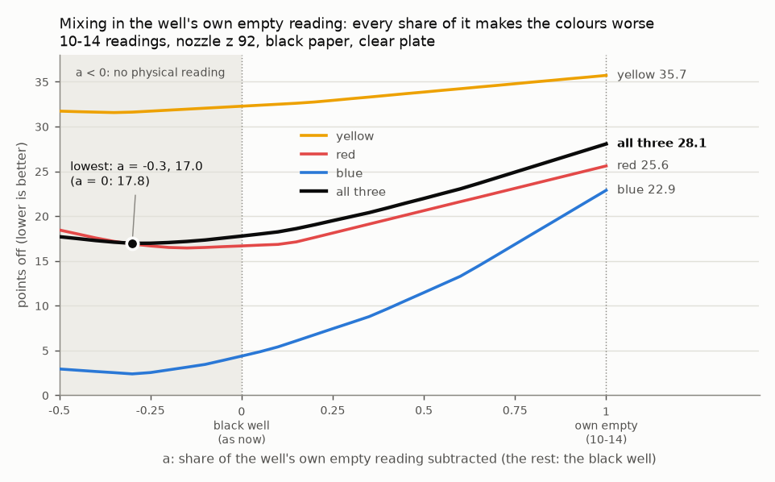

# 2026-10-20 — every well read empty before paint goes in, and kept (no motion)

Asked on [PR #202](https://github.com/vertical-cloud-lab/byu-vcl/pull/202) by @sgbaird on 2026-10-18,
replying to the 10-14 result (black well subtracted: 18 points off; the well's own empty reading
subtracted: 28):

> "Technically, we could probably leverage both. And anyway, we should be taking a background spectrum
> for the same well prior to dispensing in the way described above, regardless of whether or not we use
> it. We should have that as a backup for all experiments, always. Open up a new pull request based on
> this"

That comment had no `@claude`, so it waited until the 10-20 ping. Nothing on the robot or the Pi moved.

## The rule

**Before any paint goes into a well, read that well empty**, at the height and with the sensor settings
its painted reading will use, and keep the reading with the result even when the analysis doesn't use
it. That includes the white and black reference wells, which are filled by hand: read their spots empty
before filling them.

## How

1. **Enclosure trip, wells empty.** At each well: `xy <x> <y>` (at z ≥ 125), `z 92`, then
   **`background 4`** (with the same `gain=… atime=… led_ma=…` the painted read will use), then `z 125`.
   `background` is `read` that refuses unless the nozzle is centred over a plate well (within 0.5 mm),
   tags the rows `empty-<well>` and marks them `role: background`.
2. **Transfers.** `paint_transfer.py … --backgrounds <trip-1 folder>/readings.jsonl`. With paint aboard,
   `well <name>` and `dispense` are refused, before anything moves, for a well with no empty reading
   taken over that well of a plate in `--plate-slot` within `--background-max-age-h` (12 h). It won't
   start without `--backgrounds` or an explicit `--skip-background-check` (for a refill, or a well that
   already holds paint); that flag is logged at every dispense.
3. **Enclosure trip, wells painted.** The same wells at the same height, plus the white and black wells:
   `read 4 <paint>-<well>`, as on 10-14.

Every `readings.jsonl` row now also records `plate_slot` and `well`. The well comes from the nozzle's
position ([`deck.well_at`](deck.py)), so a mistyped tag can't attach a reading to the wrong well; between
wells it is `null`. Older rows have neither field, so an old `readings.jsonl` can't satisfy the check by
accident.

[`test_background_first.py`](test_background_first.py) runs both drivers with `--simulate` in a scratch
folder against a stand-in sensor: **25/25 pass.** It checks that `tip_cal.well_xy` is unchanged for all
288 wells checked, that `background` records the right wells and refuses between them, that the filter
counts only rows over the right well, slot and age, and that the transfer is refused into F3 (never read
empty) and allowed into F6 (read empty).

## "Leverage both": a mix of the two subtractions

[`analyse_background_blend.py`](analyse_background_blend.py) re-scores the 10-14 readings (the only run
with each paint well read empty and painted) with a share `a` of the well's own empty reading in place of
the black well:

```
R(a) = Rb + (Rw − Rb) · (paint − [(1 − a)·black + a·empty]) / (white − black)
```

`a = 0` is the black well alone (every run since 09-30); `a = 1` is the own empty reading alone (10-14).
Points off, 440–670 nm, lower is better:

| | all three | yellow F3 | red F6 | blue F9 |
| --- | --- | --- | --- | --- |
| `a = 0`, black well (as now) | **17.8** | 32.3 | 16.7 | 4.4 |
| `a = 0.5` | 22.0 | 33.9 | 20.6 | 11.5 |
| `a = 1`, own empty (10-14) | 28.1 | 35.7 | 25.6 | 22.9 |
| lowest in the scan, `a = −0.3` | 17.0 | 31.6 | 16.9 | 2.4 |
| `a` picked on the other two paints, leave-one-out | 17.1 | 31.7 (`a` −0.25) | 16.9 (−0.3) | 2.8 (−0.2) |

- **On this clear plate, every share of the own empty reading makes the colours worse.** The score rises
  steadily from `a = 0` to `a = 1`, for each paint separately and for all three together.
- **The lowest score is at `a ≈ −0.3`, outside the range that means anything physically,** and it's
  0.8 points better than `a = 0`: the size of the gap between neighbouring read heights, from three
  wells in one run. Not a finding.
- **Correcting the empty readings for the 1–2% drift between the two trips changes neither conclusion**
  (`a = 1` 25.9, lowest 17.3 at −0.3, leave-one-out 17.5).
- So the black-well correction stays the standard one. The empty readings are the backup.



## What the empty readings are for, even when unused

- **A backup.** If a reference well turns out to be wrong (a fill level, a refill, a moved plate), each
  paint well can be re-scored from its own empty reading without repeating the experiment.
- **A flag for odd light.** An empty well that reads well above the black well sits in different light
  from the references. On 10-14 empty F12 read 0.61 on the white/black scale and F3 0.03; a paint in a
  well like F12 should be distrusted.
- **The first test on an opaque plate.** On the clear plate the empty reading fails because much of an
  empty well's light comes up through the plastic, and the paint blocks it. On a solid black plate
  (Corning 3915, priced 10-18 and again 10-20), nothing comes up through the plate, so the own empty
  reading should hold the glare at that spot, which the black well can't. Both corrections come from
  the same readings, so the first black-plate run tests them side by side for free.
- **Normalising by the well's own blank, as the AC did** ([ac-dev-lab#552](https://github.com/AccelerationConsortium/ac-dev-lab/issues/552#issuecomment-4101574167),
  §1b of [`accuracy-provenance.md`](accuracy-provenance.md)). That was with a light panel under the
  plate, i.e. transmission. Dividing instead of subtracting needs the white and black wells' own empty
  readings too, which is why the rule covers the reference wells. No run has those yet, so it can't be
  tested on what's on file.

## Files

- [`deck.py`](deck.py): `well_xy()` (moved from `tip_cal.py`) and its inverse `well_at()`
- [`enclosure_height_cal.py`](enclosure_height_cal.py): `background`; `plate_slot` and `well` in every row
- [`paint_transfer.py`](paint_transfer.py): `--backgrounds`, `--background-max-age-h`, `--skip-background-check`
- [`test_background_first.py`](test_background_first.py): the 25 checks
- [`analyse_background_blend.py`](analyse_background_blend.py) → [`background-blend-2026-10-20.json`](background-blend-2026-10-20.json)
  and the chart; re-runs byte-identical
