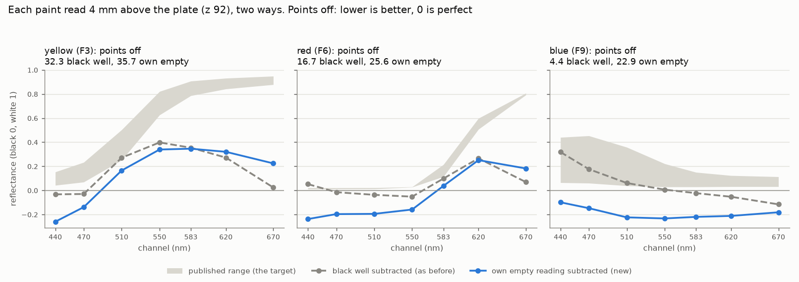
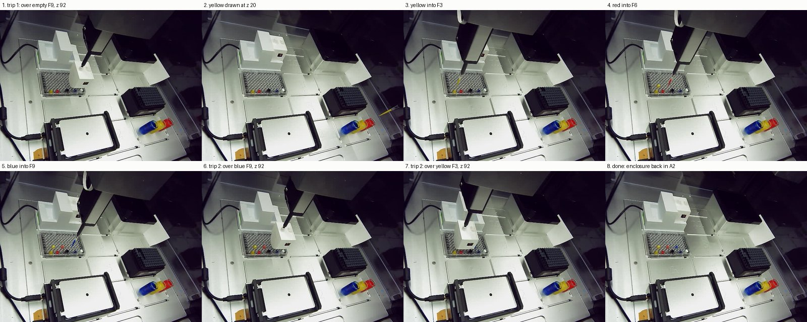

# 2026-10-14 (evening) — wells read empty, painted, read again: subtracting the empty reading makes it worse

**2026-10-14, 15:26–17:23 MDT. Asked on [PR #202](https://github.com/vertical-cloud-lab/byu-vcl/pull/202)
by @sgbaird on 10-10** ("testing with an empty well, dispensing, then measuring again, then
subtracting out the first measurement (the background)", with snapshots), **and by
@timothy-commins today** after putting the plate back: "its fixed, please continue".

The afternoon run ([`results-led-background-2026-10-14.md`](results-led-background-2026-10-14.md))
read the empty wells, then lost the plate before any paint went in. This is the whole test with the
plate back and taped down: one enclosure trip over the empty wells, the paint pipetted in, a second
trip over the same wells. Every reading at nozzle z 92 (the foot ~4 mm above the plate, never
touching it; `--floor 91` made a landing impossible), rail lights on, plate on black paper in slot 7.

## Result

| paint | well | points off, black well subtracted (as before) | points off, own empty reading subtracted |
| --- | --- | --- | --- |
| yellow | F3 | 32.3 | 35.7 |
| red | F6 | 16.7 | 25.6 |
| blue | F9 | 4.4 | 22.9 |
| all three | | **17.8** | **28.1** |

Points off: how far each paint's seven channels (440–670 nm) lie outside the published range of its
pigments, averaged, with black = 0 and white = 100. Lower is better; 0 is perfect
([`analyse_read_height.py`](analyse_read_height.py)).

- **Subtracting each well's own empty reading made every colour worse.** It put 13 of the 21 values below
  zero, darker than black paint (with the black well: 8).
- **Why: the empty reading isn't a background that stays when the paint goes in.** Wherever a pigment
  absorbs, its well read *less* with the paint in than it did empty: blue in every channel (3,510 counts
  against 4,046 empty), red at 440–550 nm, yellow at 440–470 nm. So much of what an empty well sends to
  the sensor is light coming up through the clear plate, and the paint blocks it. Subtracting it takes
  away light that is no longer there. Per channel, the empty reading was 79–135% of the painted one
  (440–670 nm).
- **The light around a well changes a lot from place to place.** On the white/black scale (black paint 0,
  white paint 1), the empty wells read F3 0.03, F6 0.09, F9 0.24 and **F12 0.61**, rising to the right,
  towards the white well H12. An empty well at F12 reads 61% of the way to white. The same empty wells
  read the same as on 10-14 afternoon (F3 3,562 against 3,557; F6 3,707 against 3,713; F9 4,046 against
  4,051), so this is fixed by position and repeats, not noise.
- **Even the usual way scored worse than on 10-06 (17.8 against 12.2 at z 92).** The colours sit two
  rows behind the black and white wells now, in a different light, and the paint is thicker (below).
  Yellow's bright channels read 0.27–0.40 at 550–620 nm and 0.02 at 670, where the pigment is 0.63–0.95.
- **Drift between the trips (1.5 h apart):** the wells that didn't change read lower on trip 2: black H7
  −2.2%, white H12 −1.1%, empty F12 −1.6% (one channel up to 3.6%). Within one visit, 4 readings agreed
  within 0.14%.

## What it means

1. **Per-well empty subtraction doesn't work with a clear plate**, because the well's contents change
   the light that the subtraction assumes is fixed. Keep the black-well method.
2. **The position effect is the bigger error now.** A white and a black reference only correct a paint
   that sits in the same light as they do. Two fixes: an opaque-walled plate (Corning 3915 black or
   3912 white, same 360 µL format; see [`accuracy-sources-2026-10-02.md`](accuracy-sources-2026-10-02.md)),
   which stops light travelling through the plastic; or white and black wells right beside each paint.
3. **Top up and cap the vials.** All three were below z 28: the first yellow draw there came up air,
   and every colour was drawn at z 20 (the vial floors are at z ~3). Evaporation has also thickened the
   paint, so today's colours aren't the same mix as 09-30 or 10-06.

## Snapshots

All 212 step photos in order (trip 1, the transfers, trip 2), as a GIF:
[`background-subtraction-2026-10-14.gif`](background-subtraction-2026-10-14.gif)
(built by [`snapshot_gif.py`](snapshot_gif.py)). The livestream camera points at another room, so the
robot's own camera is the only record.

## How it ran

**Before anything moved (15:20–15:26).** Robot link 0.86–1.2 ms, no run open, rail lights off. Board:
394 counts seated with the lights off; a gain-4 reading echoed `gain 4`. **The plate:** a deck photo
with the rail lights on matched the 10-14 pre-run photo at (0.00, 0.00) px (paint-spot match 0.956,
same method as `plate_shift` in [`analyse_led_background.py`](analyse_led_background.py)); the
afternoon's displaced plate had read (+2.73, +11.27) px. Tape isn't visible at this resolution.

**Trip 1** (maintenance run `6decd1f6`, 15:26–15:41). Standing arguments with `--floor 91`. The z 102
hover photo matched the afternoon's (enclosure −0.05 px). Press to z 89: +0.64 px (afternoon +0.68).
Lift to z 93: −2.09 px; 80 jolts in y and 80 in x at 3 mm/s: −2.07, −2.10 px. Grip check 9.0×. Over each
well: z 92 in one move, `read 4`. Order F9, F6, F3, H7, H12, F12. Released into A2: 470 counts, 463
homed.

**Transfers** (`paint_transfer.py --plate-slot 7 --rack-slot 6`). Each tip: picked up, over its vial at
z 80 (photo compared with 10-06's: tip present), down in ≤ 10 mm steps to z 20, stir 5 × 200 µL at
30 µL/s, draw 200 µL, 3 s wait, out at 3 mm/s, a photo of the full tip at z 110. Then
vial → (vial x, 88) → (262, 88) → (262, 178) → (well x, 178) → over the well at tip-end z 110, down
in 5 mm steps to 2.7 mm above the floor, dispense at 30 µL/s, 3 s, blow-out 1 mm below the rim, trash.
This route never passes over the device at the front of the deck.

| | tip | drawn | dispensed (MDT) |
| --- | --- | --- | --- |
| yellow → F3 | B3 | z 28 came up air (photo of the raised tip), blown out; z 20 | 15:53:26 |
| red → F6 | C3 | z 20, 15:58; **trashed at 16:14** (below) | — |
| red → F6 | D3 | z 20 | 16:59:43 |
| blue → F9 | E3 | z 20 | 17:06:24 |

**The Pi went off the network at 16:00 MDT** (tailnet last seen 22:00:05 UTC), with tip C3 full of red
paint at (367.6, 88, 110). It came back at 16:52 with its uptime unbroken (5 days), so it never stopped
running, only lost its connection. The transfer driver did what its timeout is for: no instruction for
15 min, so at 16:14 it lifted, put the tip in the trash and homed, and the run closed at 16:15. A fresh
driver (run `7b7f6533`) did red and blue. The CI side's own command chain was stopped while the Pi was
away, so nothing stale was sent when it returned. Cause unknown: the other two Pis stayed online, and
this Pi keeps no journal across reboots, though this time it didn't reboot. The same Pi dropped off on
09-24 and needed a power cycle; this time it came back by itself.

**Trip 2** (run `60325c74`, 17:08–17:23). The same arguments and order (F9 blue, F6 red, F3 yellow, H7,
H12, F12). z 102 hover against trip 1: enclosure −0.09 px. Press +0.77 px; lift −2.09 px; after 160
jolts −2.11 and −2.09 px; grip check 9.1×. Released into A2: 468 counts, 460 homed. The plate didn't move
between the trips (homed photos: 0.00, 0.00 px). Paint ages at the read: blue 8 min, red 16 min,
yellow 1 h 23 min.

## Files

| file | what |
| --- | --- |
| [`background-subtraction-2026-10-14.json`](background-subtraction-2026-10-14.json) | all 148 readings of both trips (8 channels, pose, time; `read_cmd` marks the `read 4` ones), every command, the transfers |
| [`analyse_background_subtraction.py`](analyse_background_subtraction.py) | both methods, the scores, the empty wells by position, the drift, the chart |
| [`background-subtraction-analysis-2026-10-14.json`](background-subtraction-analysis-2026-10-14.json) | its output |
| [`background-subtraction-2026-10-14.png`](background-subtraction-2026-10-14.png) | the chart |
| [`background-subtraction-2026-10-14.jpg`](background-subtraction-2026-10-14.jpg), [`.gif`](background-subtraction-2026-10-14.gif) | eight key photos; all 212 step photos |
| [`snapshot_gif.py`](snapshot_gif.py) | builds the GIF from the drivers' step-photo folders |

On the Pi (`RPI_STREAM_CAM_HOSTNAME`), in `~/color-read-1014b/`: `pre/` (deck photos), `enc1/` and
`enc2/` (the trips: photos, `log.txt`, `readings.jsonl`), `paint/` and `paint2/` (the transfers). MQTT
credentials went in over stdin. No services, timers or settings were changed.
