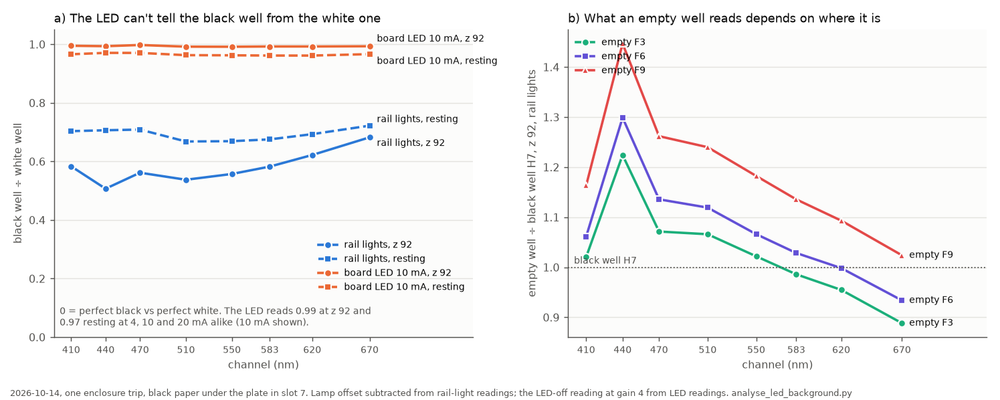
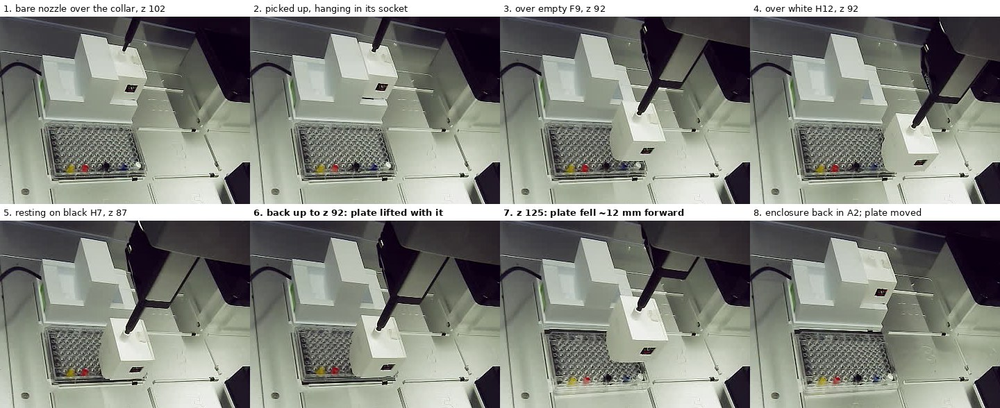

# 2026-10-14 — the board LED can't tell black from white; empty wells read; the plate lifted and moved, so no paint

**2026-10-14, 14:21–14:54 MDT. Asked on [PR #202](https://github.com/vertical-cloud-lab/byu-vcl/pull/202)
by @sgbaird on 10-10** (read wells empty, dispense, read again and subtract; read the black and white
wells with the board's LED on and the rail lights off; snapshots of both, "as long as the rig looks
normal and you can do this safely"), **and by @timothy-commins today:** "please complete sterlings
request above. The ones that your previously could not complete. The enclosure is back in its place".

One enclosure trip read the empty wells and ran the LED test. The paint was never dispensed: lifting
off the black well after resting on it pulled the plate up with the enclosure, and it fell back about
12 mm towards the front, partly out of slot 7. With the plate out of place the rig no longer looked
normal, so the robot was stopped there.

- **The LED test: black ÷ white is 0.99 at z 92 and 0.97 resting on the plate**, at 4, 10 and 20 mA
  alike, in every channel (0.992–0.998 and 0.961–0.971). With the rail lights it is 0.59 at z 92 and
  0.69 resting (lamp subtracted). The 10-10 test said: well below the rail lights' value, try a paint
  run; near 1, upstream's result stands. **It stands**: almost all of the LED's light reaches the sensor
  without touching the paint, the same over the black well as over the white one.
- **The LED does light the paint, under a lot of glare.** In 128x units, white minus black with the
  LED at 4 mA is 1.4× the rail lights' at z 92 and 15× resting. But the part both wells share is 155×
  that difference at z 92 and 27× resting, so a 0.1% change in it moves a colour by 15% or 3% of the
  black-to-white range. Its brightness follows the current (10 mA ÷ 4 mA = 2.46, 20 ÷ 4 = 4.89; bench
  10-10: 2.38–2.51 and 5.09–5.12), and nothing saturated at 4x gain (highest channel 12,960, Clear
  40,780, of 65,535).
- **Empty wells, the first half of the background test:** at z 92 with the rail lights on, F3, F6 and
  F9 read 3,559, 3,711 and 4,052 counts, against 3,572 for the black well H7 and 5,774 for the white
  H12. Channel by channel the empty wells read 0.89–1.45× the black well, highest at 440 nm and in
  F9. On the white/black scale an empty well, which is the same thing in every position, comes out
  anywhere from −0.24 to +0.46. The light around a well changes from well to well by about as much as a
  paint does, which is why each well needs its own empty reading. The painted half wasn't done.
- **The plate moved.** Lowered onto H7 to nozzle z 87, the enclosure rested on the plate. Raised back
  to z 92, it brought the plate up with it: in that photo the paint wells sit higher and tilted, and
  the light stayed at its resting level (3,142 counts; 3,045 resting, 3,572 at z 92 before). On the
  way up to z 125 the plate fell off and landed **~12.1 mm towards the front and ~0.9 mm left** (camera
  model of 2026-09-30, at the plate's top). It stayed there for the rest of the trip.
- **Why it could happen:** the cone on the enclosure's foot is Ø5.2 mm at its tip and ~Ø6.8 mm 1.4 mm
  up, the same as the well's Ø6.86 mm, so a cone resting in a well can wedge there. The plate isn't
  clipped into the slot, it sits on loose paper, and H7 holds black paint that has been drying since
  10-06. No earlier landing is recorded as moving it.
- **Nothing else changed.** The enclosure didn't move on the nozzle (0.00 px at H12, z 125, before and
  after), it went back into A2 and let go normally (475 counts after the release, 466 homed), and the
  sensor answered for the whole 22 minutes off its base. The robot was homed, the rail lights left
  off and the maintenance run closed, as found.

Every step photo, as a GIF: [`led-background-2026-10-14.gif`](led-background-2026-10-14.gif). The robot
camera can't show the LED test itself: each reading takes 0.6 s and the photos are taken with the rail
lights on.

## What next

1. **Put the plate back in slot 7 and tape it down** (two opposite corners, or both long edges), with
   the black paper flat under it, so that nothing the enclosure does can lift it.
2. **Then the background test in one session:** a trip reading F3, F6, F9, H7 and H12 empty at z 92,
   the paint into F3, F6 and F9, and a second trip reading the same wells at z 92. No landings, so
   the enclosure never touches the plate. The empty reads above can't be reused once the plate has
   been moved by hand.
3. **Stop resting the enclosure on the plate** for readings. Resting already scored worst for accuracy
   in every run that compared heights; now it has also lifted the plate.
4. **Leave the board LED off.** The test it had to pass, it failed by a wide margin.

## How it ran

**Before anything moved (14:21–14:23).** Robot link 0.86 ms, no run open, rail lights off, no other
protocols since July. Board: 383 counts seated with the lights off, and a gain-4 reading echoed
`gain 4` (the 10-10 firmware). Deck: enclosure in A2; the plate with the dried paint wells of 10-06 in
slot 7; vials and tip rack as on 10-06. A device in a black frame with a white face and a cable was
at the front of the deck, in slot 1 and into slot 2 (on 10-10 the same frame held a white 96-well
plate). It wasn't touched.
The 10-06 paint route ran along the deck's front edge, over it; the next transfer should go round it
(vial → y 88 → x 262 → y 178 → the well), through empty slots and the gaps between slots.

**The trip** ([`enclosure_height_cal.py`](enclosure_height_cal.py) at `914bd06`, maintenance run
`b78281e6`, the standing arguments with `--target-x 86.38 --target-y 210.24`):
- The z 102 hover photo matched 10-06 evening's (enclosure +0.05 px, base +0.02 px). Pressed 99 → 89 in
  2 mm steps: enclosure +0.68 px at z 89 (10-06 +0.76). Lifted to z 93: −2.12 px (10-06 −2.09). 80 jolts
  in y, 80 in x at 3 mm/s: −2.13, −2.15 px, no slip. Grip check at z 110: 9.1×.
- Carried via z 190. Over each well: z 92 in one move, then `read 4`. Order F9, F6, F3, H7, H12.
- LED at H7 and H12, z 92: `lights off`, then two readings each of `gain=4` (LED off), `led_ma=4`,
  `10` and `20`, all at gain 4. Then H12 lowered in 0.5–1 mm steps; the light's fall per 0.5 mm went
  −256, −224, then −46 at z 87.5, which was taken as resting, and the LED series repeated there. Then
  H7, whose z 92 reading (3,572) showed nothing had moved: −69, −52, −31, −12, −16 per step down to
  z 87, LED series there.
- Back up to z 92 over H7 (3,142), z 125, then H12 at z 92 again: 4,960 against 5,774. Returned via
  z 190 and released into A2 at 14:53.

**Finding when the plate moved** (`plate_shift` in [`analyse_led_background.py`](analyse_led_background.py)).
Only the plate's paint wells are coloured, so the photos' colour saturation tracks the plate without
the well grid's repeat, which fooled a plain image match into reading one row less (~3 px). Matched
against the first photo, the H2 and H4 spots sit at (0, 0) px with a match of 0.96–0.98 in every photo
up to #46 (resting on H7, z 87); at (0, −1) px with 0.84 in #47 (back at z 92: raised and tilted —
1 mm of lift moves H2 0.64 px up the image); and at (+3, +11) px in #48 and every photo after. Across
the whole H row, #02 against #57 gives (+2.73, +11.27) px, a 0.75 match, which the 2026-09-30 camera
model (40 photos of the bare nozzle, 0.40 px rms) turns into −0.9 mm in x and −12.1 mm in y at the
plate's top.

## Files

| file | what |
| --- | --- |
| [`led-background-2026-10-14.json`](led-background-2026-10-14.json) | all 144 readings of the trip (8 channels, settings, Clear/NIR, pose, time) and every command |
| [`analyse_led_background.py`](analyse_led_background.py) | black ÷ white, the LED's linearity and glare, the empty wells, the landings, where the plate went; the chart |
| [`led-background-analysis-2026-10-14.json`](led-background-analysis-2026-10-14.json) | its output (re-runs byte-identical) |
| [`led-background-2026-10-14.png`](led-background-2026-10-14.png) | the chart |
| [`led-background-2026-10-14.jpg`](led-background-2026-10-14.jpg), [`.gif`](led-background-2026-10-14.gif) | eight key photos; all 57 step photos |
| [`photos-2026-10-14/`](photos-2026-10-14/) | the 20 full-size photos the analysis and the montage use |

On the Pi (`RPI_STREAM_CAM_HOSTNAME`), in `~/color-read-1014/`: `pre/` (deck photos before the run),
`enc1/` (the trip: 57 photos, `log.txt`, `readings.jsonl`), and `paint/`, `enc2/`, set up for the
transfer and the second trip and never started. MQTT credentials went in over stdin. No services,
timers or settings were changed.
